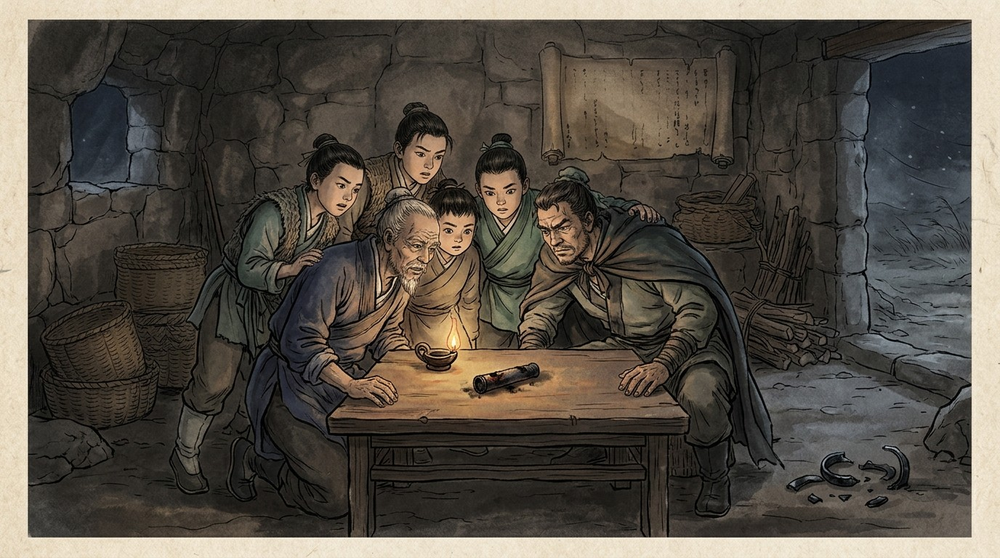

# 第 168 章：遺民的去留抉擇

[← 上一章](ch0167.md) ｜ [本卷目錄](00_intro.md) ｜ [下一章 →](ch0169.md)

*章首插畫：第 168 章 遺民的去留抉擇*

三息微光熄滅的剎那，荒原高坡信標台上三百斤雪亮高純鹽晶儲柱正好完全化作一層薄薄白灰，林鐵生最後一具黑鐵導波環亦隨即崩成兩截燙手廢鐵。

然沒人去看報廢的銅鐵——五個少年連同戚老頭、燕山幾乎全部擠在石棚破燈下，目光一動不動盯著那個從光縫落回來的焦黑細鐵筒！

當沈泥一字一句輕聲念完蘇凝霜親筆寫下的那兩頁輕薄雪繭密紙——「人間已過三年，總號共治推行六縣、雷烈與陸觀瀾均安；萬仞山西麓赤煉暗道已封死，查出三十年前金石內堂簽署『玄木／雲記』清洗令之兩名退隱元老名單暨實印副單……」——

一向寡言穩重的燕隼長長吐出一口緊憋三年之久的濁氣，肩背猛地往牆上一靠；林鐵生抬手用力搓了一把帶著機油與黑灰的臉龐，嘴角咧開一個比鐵砧還硬實的笑容；柳清虛輕閉左眼，唇邊難得露出極淺極真的笑意；顧玄則默默把兩頁密紙連同自己當年帶出來那本《三元本草》空匣收作一處：

故土未垮，故人未負約。他們沒成無根孤魂！

確認人間安好後的第七日，灰燼石堡守夜寨正式召開了有史以來第一場由底層遺民自己拍板的**【灰燼自治邦・去留抉擇議會】**。

窄小的石堂與外頭岩坪擠滿了四百多位剛從百年黑戶變回自由民的老人與青壯。主桌之上端正擺著那方印滿三極文字的《灰燼石堡百年平權自治契書》，議題再簡單不過——**以後萬一真找著通往人間的大門，留，還是走？**

最初確有十幾名年輕鹽夫忍不住激動發問：「前輩們說外界有不會刺傷肺的太陽、有青草流水與不必背著鹽晶喘氣的暖冬……我們就不能跟著諸位少俠一塊去人間看看嗎？」

一旁的醫女蘇青竹神情誠懇卻無比嚴肅地抬手壓下騷動，從顧玄手中拿出一卷三百年生理適應對照表：「我們這幾天挨個診過脈了。但凡在石堡與外環出生長大滿一甲子的人，五臟六腑與筋骨早就長期依附洞天這種兩倍壓強與濃稠原質運行——一旦把你們送回稀薄微壓的凡塵外界，就像是把深海裡慣了大水壓的魚直接撈上旱灘，不出三日便會血脈浮腫、臟腑失壓衰竭而亡！」

全場頓時陷入漫長沉思與低語。

坐在主位一側的獨臂**戚老頭**緩緩站起，先看了看身側替石堡鍛出換芯暖爐與總栓的林鐵生、再望向手捧平權契書的沈泥，忽地展顏敞亮大笑起來：

「去什麼去！老頭子我生在玄武岩縫、吃著鹹苦礦鹽長大，換成凡間那種沒點鹹味的清風軟床反而睡不塌實！既然沈家小掌櫃替我們掙回這方正經當人的《百年平權契書》，又把石堡跟太虛、萬物、戰祖三極等價貨殖大路徹底打通——這座灰燼自治邦，就該由咱們自己留著守出個體體面面的活人模樣來！」

齊老匠師與衡真道人隨即點頭贊同：「不錯！外環二十四站與太虛偏殿正好缺常駐公議席次，我們這些老傢伙守在三極裡替你們盯緊那幫高階老爺別想偷改帳冊，同時幫年輕一代打穩基礎——真等他日諸位徹底破開天羅與深海劫數，再讓身子適應得來的孩子去外頭走動也還不遲！」

議會當場表決一致落地——沈泥鄭重將雲津商盟在此建立之半數物資儲備與《百年平權自治契書》總契公所運行權責正式移交予戚老頭、蘇青竹、齊老匠師與衡真組成的**「灰燼石堡自治議會」**，立下真正自立更生的自治邦根基。

散會之後，唯有一道精瘦高大的身影在岩門口攔住了正準備退回地窖收拾行囊的五人。

獨眼老獵頭**燕山**默默拍了拍腰間那張跟了半輩子的舊角弓，額上焦黑刀疤在燈影下宛如一條沉睡黑蛇：「石堡和戰祖外營的礦奴弟兄如今有了託古照應、有了平權地契，也算是各得其所了。我老漢一把年紀不求什麼成仙問道……只是這副死在黑冰斷谷外頭二十年的老骨頭，總還欠著黑石鋪趙老獵頭半碗老米酒。若真有一天你們找著拔掉洞天血枷、堂堂正正開門回鄉的路——哪怕算我半個替補馱夫，帶老子回家看一眼太陽落山。」

燕隼大步上前雙拳抱緊大伯微涼粗糙的大手，聲音沉穩得像一面岩壁：「誰也不落下。說過的一家人回黑石鋪——一個都不能少。」

---

[← 上一章](ch0167.md) ｜ [本卷目錄](00_intro.md) ｜ [下一章 →](ch0169.md)
