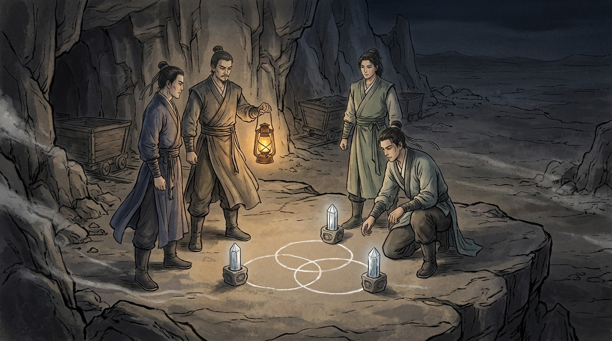

# 第 169 章：五人三元初試 —— 「法力物非不能合，是舊器難載新道」

[← 上一章](ch0168.md) ｜ [本卷目錄](00_intro.md) ｜ [下一章 →](ch0170.md)

*章首插畫：第 169 章 五人三元初試 —— 「法力物非不能合，是舊器難載新道」*

「明日便要動身下到碎石高原最底下，查看天穹裁決核心報出的那條『歸墟總閘門鬆動』座標。」

玄武岩風道背風處的一座寬闊廢棄礦台石盤之上，夜晚的荒原冷風正呼呼吹捲著灰白砂塵。地上畫著一道尺許見方的簡樸三圓交疊粉筆陣圖，三個角落各卡著一枚這半年裡好不容易最後騰出來的備用高純導流儲能晶柱。

「歸墟門縫背後的異界滲壓不是萬物外環的高壓水蒸氣，更不是太虛白玉階那種死板規矩。」**柳清虛**立在石盤西北角，右手雖然仍習慣性地在微風裡輕輕抽動半寸，眼神卻清明鋭利如出鞘銀刃，「一旦下到底層遇到真正無序翻湧的深淵亂流，咱們還是靠五個人各打各的單道微操，恐怕連一息都站不穩！今天不求殺敵，只試一件事——」

他緩緩掃過四位並肩走過生死、身上各自刻滿此界烙痕的同門兄弟：

「不靠凡間五器壓陣、不靠宗門死板心法強逼……**就憑我們五個人如今磨出來的洞天實證本事，能不能真正同頻凝出一縷不互傷炸裂的『純淨混沌三元流』？！**」

這句話若放在三年前雲頂天台之時，無論是太清大能抑或丹鼎掌門恐怕都會搖頭斷言不可能——千古以來法、力、物三道彼此相剋互斥如水火，稍微多碰半絲就會氣機逆衝爆體而亡；就連昔年上古五器，也只是靠機械鎖扣與龐大外來能源硬把三股氣息「壓捆」在同一個鐵盒子裡罷了。

可今日站在玄武岩盤五個方位上的，卻是五個早已摔碎過舊招神話的人——

「先別急著催發氣勁！」**燕隼**忽地皺起眉頭按住自己尚未完全復原、仍隱隱扯痛的左肋筋膜，「我右臂和肋骨舊創沒好透，若按傳統軍陣標準要求齊頭並進，我第三息就會掉拍拖垮整座陣盤。」

「誰叫我們按標準走齊步了？」

**顧玄**抬起那雙掌心烙著永久灰白晶斑的大夫手掌，眼神平靜溫潤如水，「把你們每個人真實的『缺口與滯澀』先報出來，**咱們今天就把『缺陷容差』算進起手式裡！**」

林鐵生聞言哈地一笑，大手一抓黑鐵卡尺「當」地定死在石盤正中央圓點：

「清虛手顫三毫、燕隼三息掉半拍、顧玄掌心經脈傳熱慢兩成——老子打了二十年鐵最懂這道理：**齒輪若真咬得零縫隙反而卡死轉不動！正因留了兩毫鬆動容差，整盤鐵機才有活氣！**」

話音落地，沒有莊嚴冗長的起誓念訣，五個人竟各自踏出半步同時運起這數年在生死場摸透了底細的專屬實證絕學——

一、**顧玄**雙掌輕推不催死力，只將僅餘的溫和《緩衝藥氣》如一圈細薄水膜率先鋪平五人經脈之間的接觸面，替彼此隔開三道相剋鋒芒；

二、**林鐵生**右肩不顧繃帶扯痛、雙手抱定圓心那根『可拆卸黑鐵活榫』猛力向下釘進石盤寸半，把五道隨時會互相排斥彈飛的力量生生轉成繞軸旋轉的實體平衡圓環；

三、**燕隼**乾脆不再硬提一口濁氣，而是把受傷左肋微沈、順著洞天兩倍重力將一身精純『截息長勁』化作貼地緩緩推進的沉穩推力，半點不與他人搶拍子；

四、**柳清虛**左眼青翳微亮，放棄以強橫神識硬壓他人，反而像撥弄琴弦般任憑發顫指尖順著風砂幾何切線微幅撥動三息，把三股截然不同性質的氣場極其溫柔地收束進同一個微小焦點；

五、**沈泥**立於總樞之位不搶半絲主功，只像一名坐在商盟總庫算盤前的老東家般穩穩報出三個節拍：「一息分壓、兩息借重、三息同流——合！！」

「嗡————！！」

沒有驚天動地的爆裂火光，更沒有絲毫氣血反噬的血霧！

只聽空氣中傳來一聲猶如古鐘深水輕鳴般的柔和高振動——玄武岩陣盤正中央那團空氣竟然驟然靜止下來，緊接著在五道人影齊齊微顫卻堅忍不退的對視裡，短短一縷僅有拇指粗細、通體散發著溫潤無瑕的**灰金色微光流絲**，在半空中穩穩凝實了足足**三息時間**！

純淨、沉穩、既包含太虛法理的通透、又有戰祖破陣的厚重與萬物活榫的嚴密——**【純淨混沌三元流】**！

三息甫過，「啪！啪！啪！」

擺在石盤角落的最後三枚備用高純導流儲能晶柱同時被這縷雛流抽盡最後一絲原質，「咔嚓」三聲脆響碎作一地暗淡灰粉。那縷灰金光絲隨之安靜消散於夜風之中，陣盤之上沒有留下一塊破碎石磚。

五個人一時間同時大口吐出濁氣半跪在石盤邊——柳清虛發顫的右手幾乎麻木了半個時辰，林鐵生與顧玄各自承了一口悶熱氣血回衝唇角溢血，燕隼卻忍不住望著方才那縷三息不滅的灰金光絲失聲喃喃道：

「原來如此……太清先祖跟我們師門幾百年來全搞錯了方向。」

「法、力、物從來不是不能合——是凡間與過去的器物心法總想著『誰壓倒誰、誰吞併誰』，容不下半點讓渡與退讓的活榫縫隙。」沈泥擦去嘴角微血，在星塵夜色裡笑得比任何時候都要透亮，「舊器載不動新道……可這回，路子我們五個親手踩出來了。」

---

[← 上一章](ch0168.md) ｜ [本卷目錄](00_intro.md) ｜ [下一章 →](ch0170.md)
