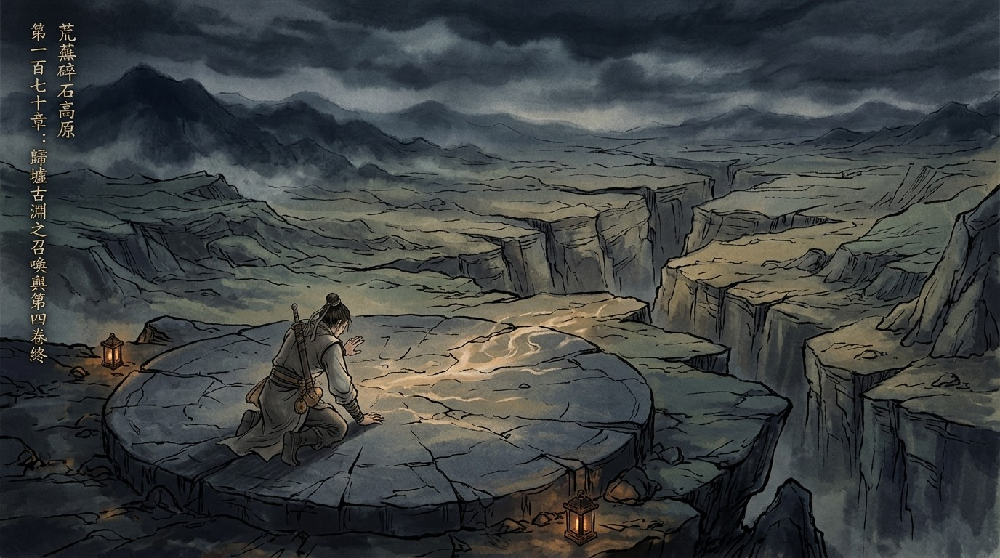

# 第 170 章：歸墟古淵之召喚與第四卷終

[← 上一章](ch0169.md) ｜ [本卷目錄](00_intro.md) ｜ [附錄一：群像人物誌 →](../appendix/characters.md)

*卷首插畫：第 170 章：歸墟古淵之召喚與第四卷終*

幾乎就在那一縷純淨混沌三元雛流於玄武岩盤散成微光的同一剎那——

整座蒼涼廣袤、向來除了風聲之外再無別種聲響的**【荒蕪碎石高原】**萬丈地底深處，忽然極其沉重、低緩而清晰地傳來了一聲彷彿跨越了不知多少萬古歲月的古老石門輕顫！

**「咚——————」**

那記聲響並不刺耳，卻像是一口埋在整方洞天地殼心臟深處的洪鐘被誰在無邊黑暗裡緩緩敲響。正北白玉接天階的星碑底座與正東萬物主機城仲裁長橋的最底層黑曜深碑在同一時間亮起一線微藍長芒，兩道光線穿透厚重雲靄遙遙在碎石高原上空交會，筆直指向當年五子初入洞天時所站立的那處荒涼岩坡正下方——

原本嚴絲合縫萬載的萬丈玄武岩深處裂隙之中，此刻竟然隨著那記沉重石顫幽幽裂開了一線長僅數丈、卻隱約散發著猶如深海太古巨獸吐息般的**幽藍微光門縫**——那是連太虛、萬物、戰祖三大巨構幾百年來都諱莫如深、只敢圍建封鎖卻絕不敢輕易踏足半步的禁忌源頭：**【歸墟古淵】**！

然而這一回，門縫卻僅僅只是亮起了一道微弱座標線，並沒有強行牽引任何人跌進去；彷彿在等待真正有資格破開大鎖、集齊三界拼圖與心魔覺悟的行人親自叩關。

五個早已不在是當年黑石鋪青澀孩童的年輕身影一路返上高原邊緣，停在離那線幽藍深淵裂隙十餘步遠的岩石背坡上，回首朝身後望去——

東方十數里外，那座半嵌進玄武岩溝壑裡的**灰燼石堡**此刻正升起十幾縷安定暖和的淡青炊煙。岩口處，獨臂戚老頭領著蘇青竹、齊老匠師與衡真道人遙遙站在晨微光影之中朝這邊默默拱手相送；身旁則是背好了箭袋與骨矛、靜靜佇立不語的獨眼老獵頭燕山，以及遠遠抬手拍打胸甲告別的託古。

再收回視線看看五個人各自貼身壓著的分量行囊——

沈泥懷裡揣著蘇凝霜趕在微光最後半息逆傳過來的《三十年前金石內堂簽字底單暨萬仞山赤煉暗道線索》與改定三界秩序的《百年平權自治契書》副本；

燕隼背著大伯燕山用五年歲月壓出來的焦黑軍需殘牌；

柳清虛帶著左眼再也抹不掉的淡青雪盲翳痕，口袋裡裝著太虛天道晶塔底部真實衰退紋路拓本；

顧玄雙掌烙著灰白晶灰斑，腰間卻掛著救活四百多口人的《三極排異急救草錄》實測手冊；

林鐵生右臂覆著深重灼疤，手裡拎著齊老匠師親自送行的兩枚最頂級黑鐵退火母榫與烏沉短鍛錘！

「算起來……離開雲津踏入古陣那天算起，人間已經足足滿了三年。」

柳清虛仰望那片依舊沒有二十八宿星辰、卻再也嚇不倒任何一人的灰青天穹，輕聲算出最後一道時間座標：「距離當年傳說中『十歲象』與外海總閘徹底翻帳的大限……人間還剩最後七年。」

沒有人急著高喊什麼救世空言，更沒有誰覺得靠自己一身微薄修為就能一步登天。這五個人太清楚過去三年在每一寸岩壁與鐵軌上付過多少流血的代價——但也正因這雙腿一步一寸踩過凡間泥水、跨過六縣風浪、撬開三座神城的帳簿，此刻面前無論是怎樣深不見底的太古歸墟大門，他們都有底氣把後背完全交給旁邊的人。

「行了。」林鐵生把沉重的烏沉短錘往肩頭一扛，回手重重拍了一下旁邊沈泥與燕隼的肩甲，「大後方的炊煙點著了，人世間的燈也還亮著。走吧——去看看當年那幾隻『造船的老傢伙』究竟在歸墟底下藏了一本什麼樣的糊塗總帳！」

「同去。」

五道沾著玄武岩灰與傷痕印記的身影最後相視頷首一笑，隨即沒有半分遲疑地轉身迎向那道自萬古岩縫底下緩緩透出微光的深淵長階，並肩向下踏出了屬於下一個紀元的第一步。

—— **（第四卷：洞天避難・異界問真篇・全卷完）** ——

---

[← 上一章](ch0169.md) ｜ [本卷目錄](00_intro.md) ｜ [附錄一：群像人物誌 →](../appendix/characters.md)
