# 附錄二：天下輿圖暨實測拓撲圖集

本附錄收錄雙軌輿圖：上篇為依各地地理脈絡繪製之**六幅手繪古風水墨輿圖**，下篇為依真實空間通路生成之**六組精確連線拓撲圖**，供對照人物行旅動線與建築格局。

## 上篇・六大疆域手繪古輿圖

### 圖一：大荒九州總輿圖

*標示黑石鋪、大荒六縣、金石府城、雲津仙集暨北海雪原之宏觀地理格局。*

### 圖二：黑石鋪聚落地形圖

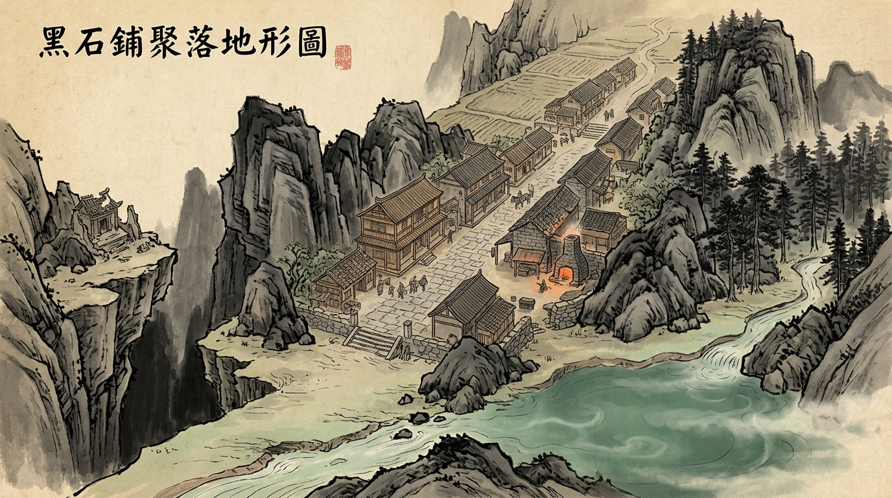

*南谷寒溪、長街鐵鋪茶棚、東側大荒密林與西山破觀絕壁一覽。*

### 圖三：金石府與大荒六縣水陸官道圖

*府城四關接通盤木、重石、青河、鎮風、烈礬、濁水六大次級縣城。*

### 圖四：雲津仙集暨三山四脈輿圖

*萬山泥途總號、問道天台以及太清、丹鼎、八荒、天工群峰分佈。*

### 圖五：北海寒原與戰神遺塚雪圖

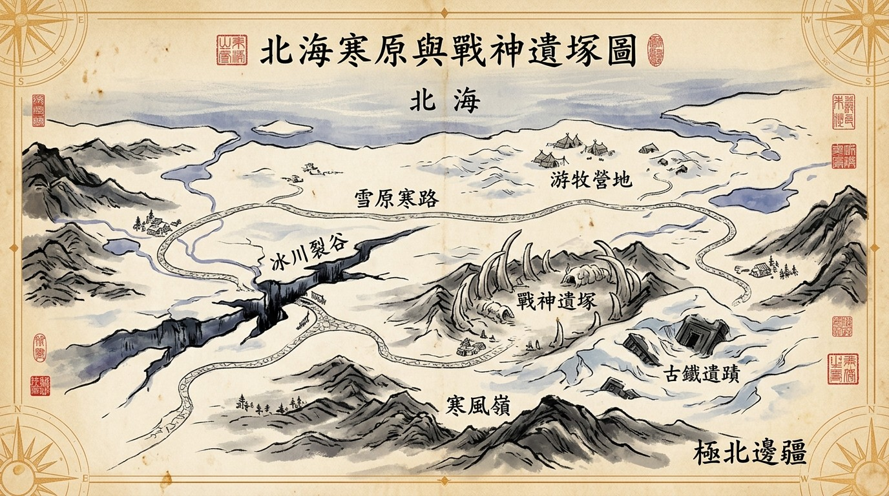

*北境雪道、永凍血原、冰崖裂谷及遠古墜毀方舟冰層遺跡。*

### 圖六：桃花源洞天・三極暨灰燼邊緣圖

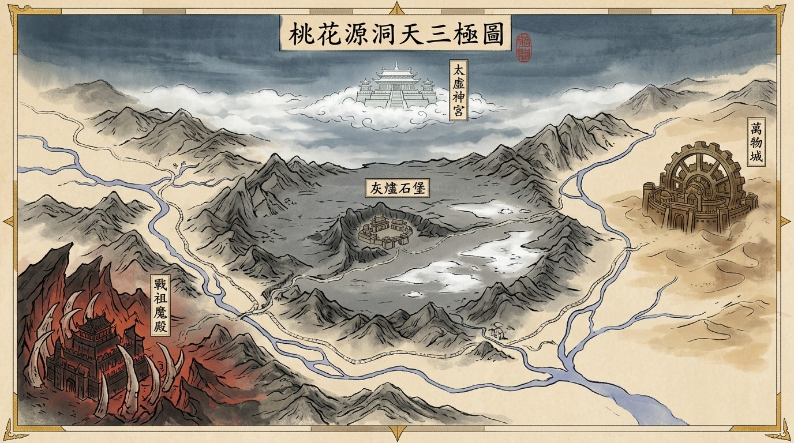

*碎石高原、灰燼石堡聚落、正北太虛神宮、正東萬物主機城與西南戰祖魔殿對峙態勢。*

## 中篇・名勝場域與功能房舍插畫錄

### 黑石鋪南谷・懸崖採藥草廬（初見於第 1 章）

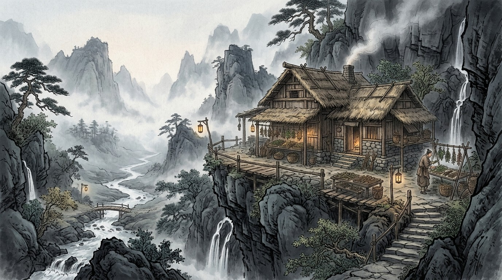

### 黑石鋪東街・老鐵匠鋪打鐵爐房（初見於第 2 章）

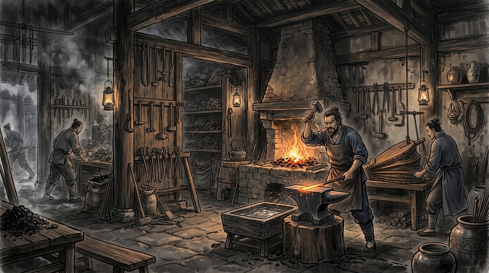

### 西山破落道觀與迎風觀星殘壇（初見於第 4 章）

### 金石府城・巍峨南關城門（初見於第 39 章）

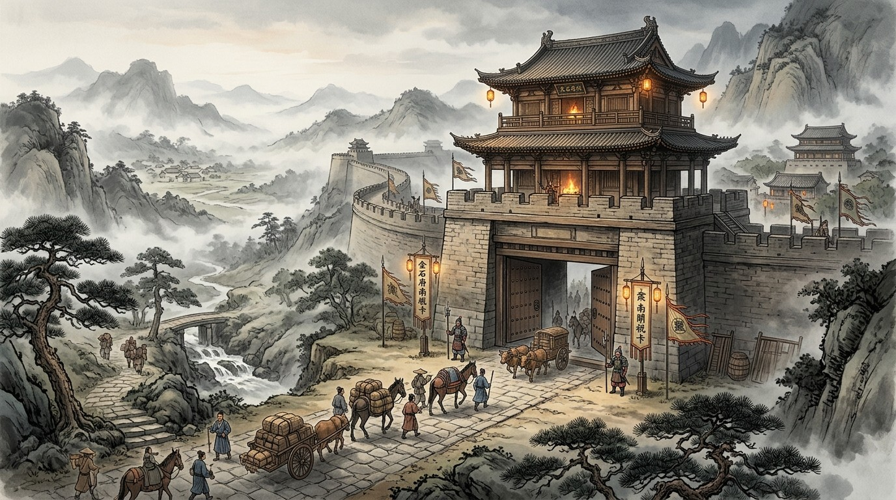

### 金石府城・杏林醫館百草藥堂（初見於第 45 章）

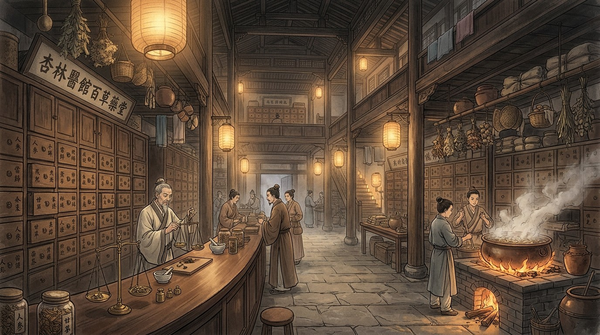

### 金石府城・百工總會千錘地爐坊（初見於第 46 章）

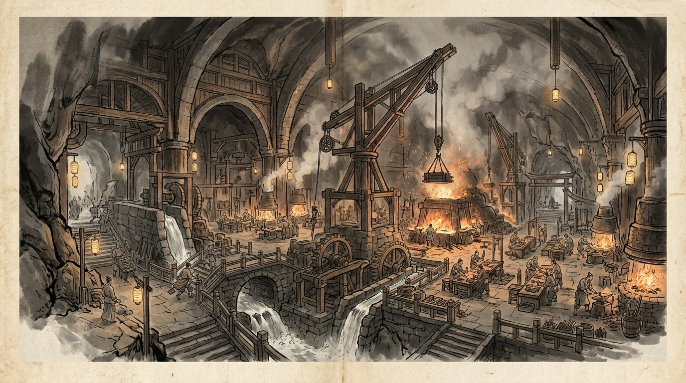

### 金石府城・八方武館黑鐵擂台（初見於第 47 章）

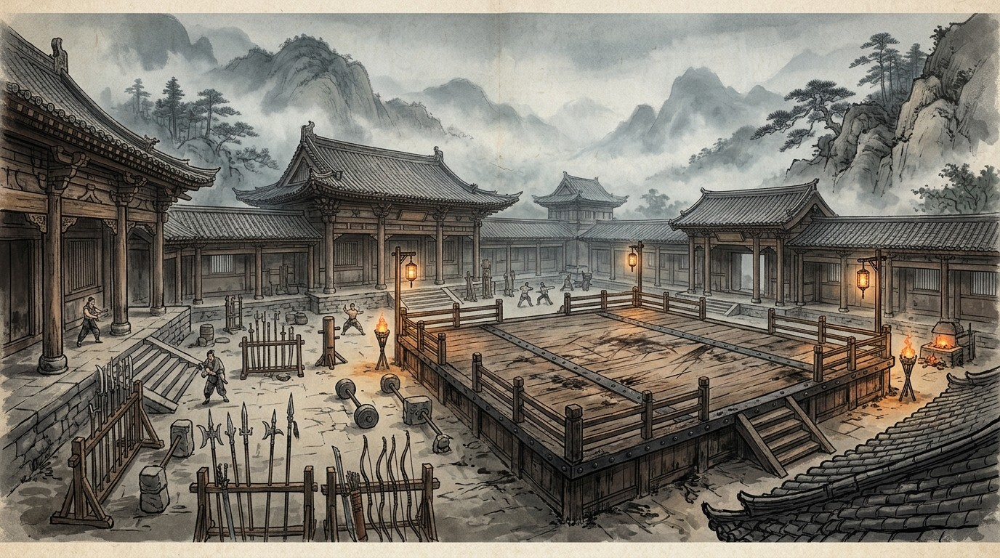

### 金石府城・通寶當鋪高櫃暗帳房（初見於第 48 章）

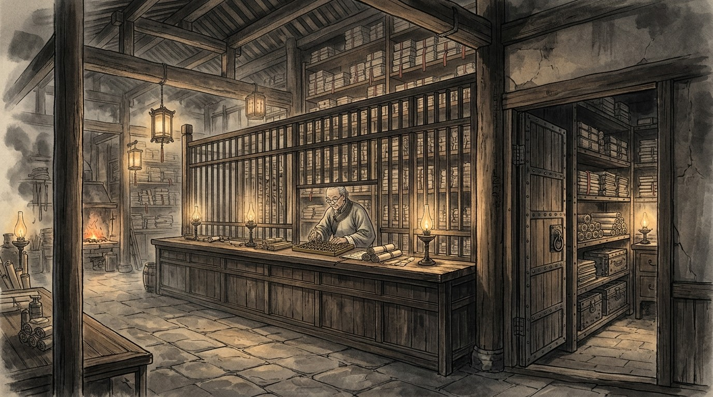

### 雲津仙集・萬山泥途總號茶堂（初見於第 84 章）

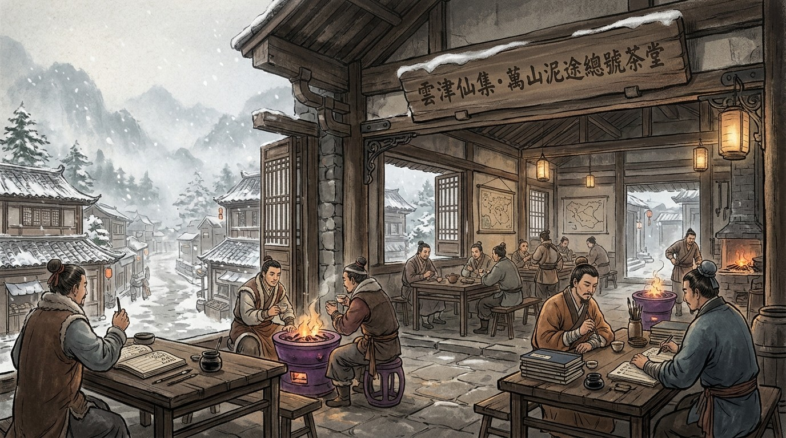

### 太清玄天宮・千丈雲梯與升仙台（初見於第 86 章）

### 丹鼎宗・百草藥谷與地肺丹窟（初見於第 87 章）

### 八荒武宗・黑山鐵峽練武大營（初見於第 88 章）

### 天工閣・萬機地窟神機工坊（初見於第 89 章）

### 雲津高台・問道天台五方聽審席（初見於第 115 章）

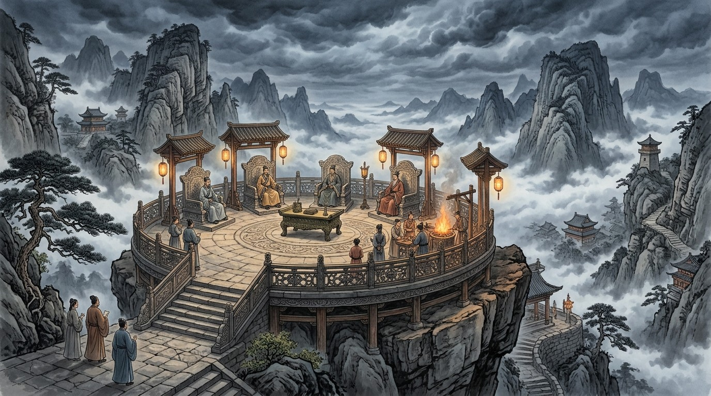

### 桃花源洞天・荒蕪碎石高原（初見於第 126 章）

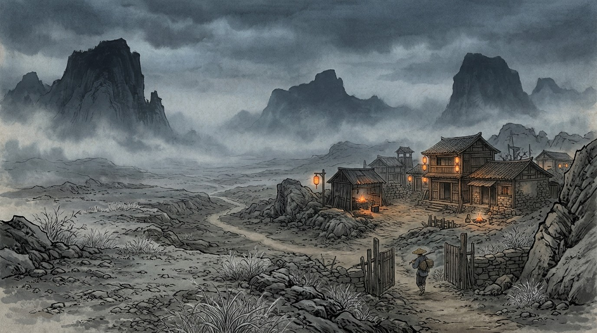

### 灰燼石堡・玄武岩守夜寨（初見於第 127 章）

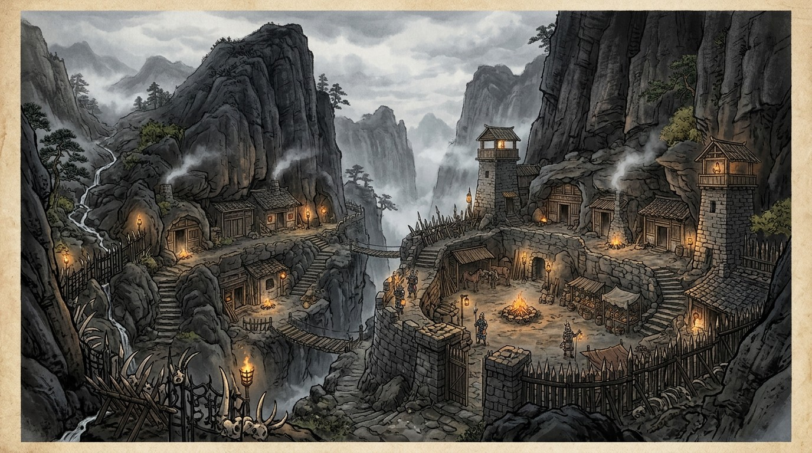

### 邊緣礦棚・排異緩衝醫站（初見於第 130 章）

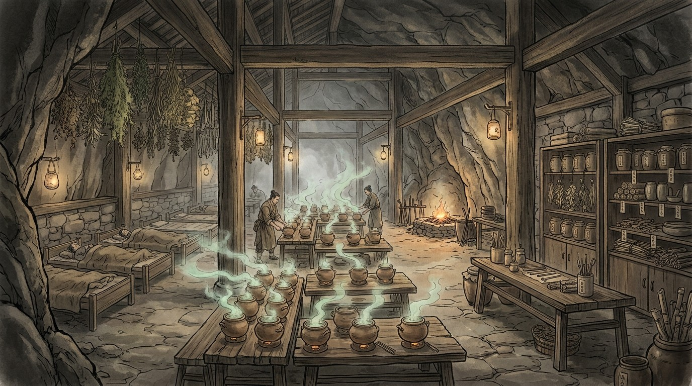

### 太虛神宮・白玉接天階與校準偏殿（初見於第 135 章）

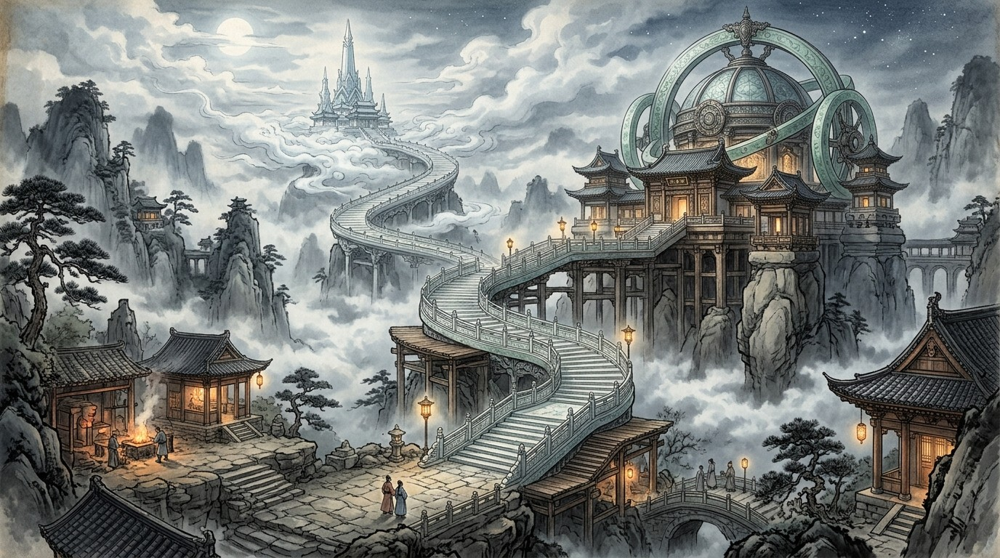

### 萬物主機城・凌空秩序仲裁橋（初見於第 152 章）

### 戰祖裂谷・玄鐵巨骨哨卡（初見於第 159 章）

### 荒原高坡・跨界微光共鳴信標台（初見於第 165 章）

## 下篇・分區精確連線拓撲圖

### 拓撲圖一：黑石鋪聚落節點（22 處）

### 拓撲圖二：金石府城內外坊巷暨暗渠節點（75 處）

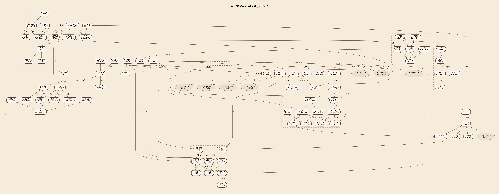

### 拓撲圖三：大荒六縣暨十二條縣際官道水路（113 處）

### 拓撲圖四：雲津仙集暨三宗四脈山門（57 處）

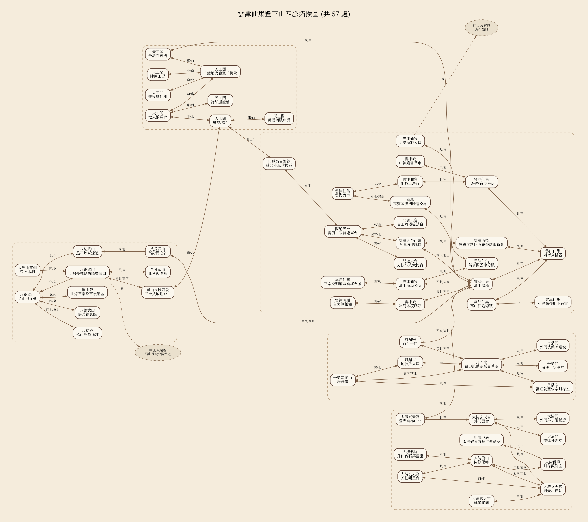

### 拓撲圖五：北海荒原暨戰神遺塚（20 處）

### 拓撲圖六：桃花源洞天三極暨灰燼邊緣（18 處）

