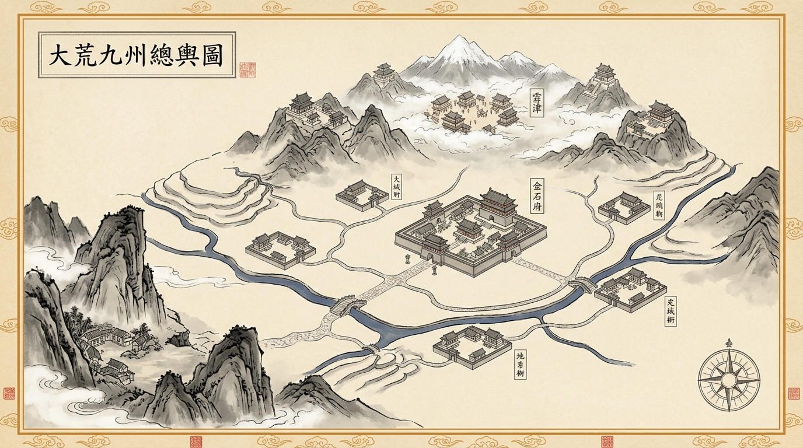
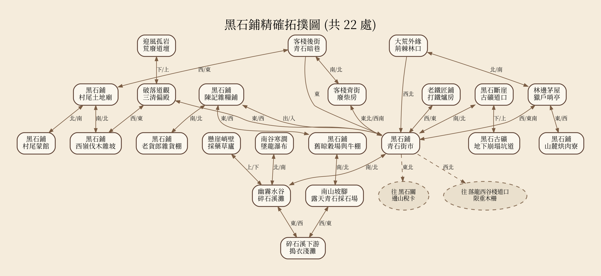
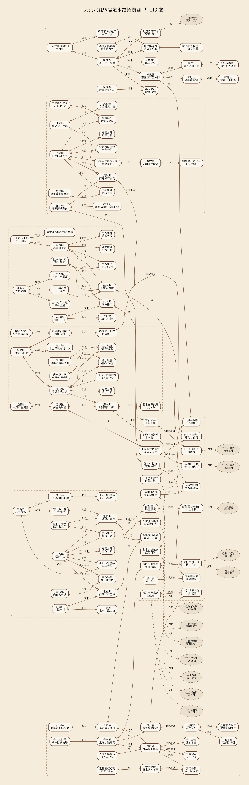
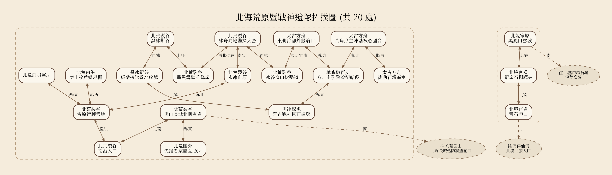
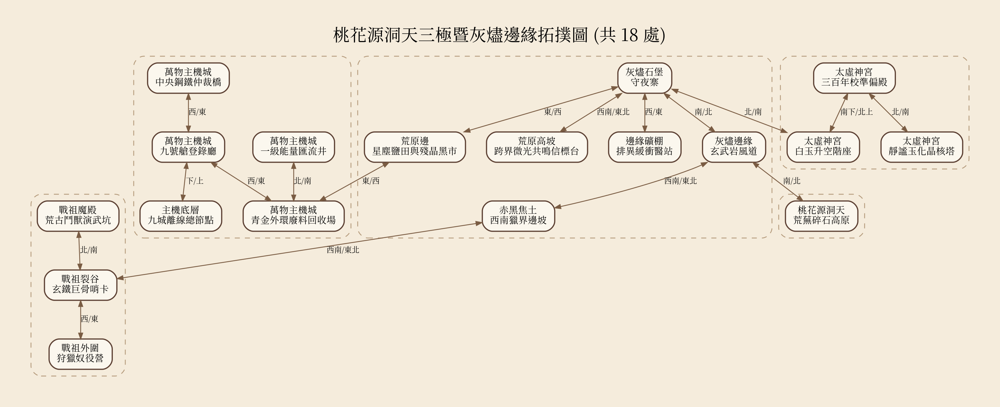

# 附錄二：天下輿圖暨實測拓撲圖集

本附錄收錄雙軌輿圖：上篇為依各地地理脈絡繪製之**六幅手繪古風水墨輿圖**，下篇為依真實空間通路生成之**六組精確連線拓撲圖**，供對照人物行旅動線與建築格局。

## 上篇・六大疆域手繪古輿圖

### 圖一：大荒九州總輿圖

*標示黑石鋪、大荒六縣、金石府城、雲津仙集暨北海雪原之宏觀地理格局。*

### 圖二：黑石鋪聚落地形圖

*南谷寒溪、長街鐵鋪茶棚、東側大荒密林與西山破觀絕壁一覽。*

### 圖三：金石府與大荒六縣水陸官道圖

> *（本幅古輿圖繪製排程中，對應檔名：`assets/maps/map_03_jinshi_six_counties.jpg`）*

*府城四關接通盤木、重石、青河、鎮風、烈礬、濁水六大次級縣城。*

### 圖四：雲津仙集暨三山四脈輿圖

> *（本幅古輿圖繪製排程中，對應檔名：`assets/maps/map_04_yunjin_three_sects.jpg`）*

*萬山泥途總號、問道天台以及太清、丹鼎、八荒、天工群峰分佈。*

### 圖五：北海寒原與戰神遺塚雪圖

> *（本幅古輿圖繪製排程中，對應檔名：`assets/maps/map_05_north_wastes.jpg`）*

*北境雪道、永凍血原、冰崖裂谷及遠古墜毀方舟冰層遺跡。*

### 圖六：桃花源洞天・三極暨灰燼邊緣圖

> *（本幅古輿圖繪製排程中，對應檔名：`assets/maps/map_06_taoyuan_three_poles.jpg`）*

*碎石高原、灰燼石堡聚落、正北太虛神宮、正東萬物主機城與西南戰祖魔殿對峙態勢。*

## 下篇・分區精確連線拓撲圖

### 拓撲圖一：黑石鋪聚落節點（22 處）

### 拓撲圖二：金石府城內外坊巷暨暗渠節點（75 處）

### 拓撲圖三：大荒六縣暨十二條縣際官道水路（113 處）

### 拓撲圖四：雲津仙集暨三宗四脈山門（57 處）

### 拓撲圖五：北海荒原暨戰神遺塚（20 處）

### 拓撲圖六：桃花源洞天三極暨灰燼邊緣（18 處）

