# 附錄一：群像人物誌

本書採「五重視角」並行結構，由黑石鋪出身的五名少年切入世道，其後牽連留守師長、金石六縣官民、雲津三宗宿老及洞天三極遺民。

## 一、五重視角核心主角

### 顧玄（採藥孤兒・丹鼎醫者）

十六年前大洪水中被沖上溪灘石板的棄嬰，由瘋郎中葛半仙撫養於黑石鋪南谷懸崖草廬。習於從草木、水土、病脈與自然痕跡推究因果。初入洞天時為調配【律令排異症】緩衝藥膏，耗盡隨身《三元本草》珍藥並以自身經脈試藥，雙掌正心留下永久不褪的灰白色晶化斑痕。

### 林鐵生（打鐵學徒・天工巨匠）

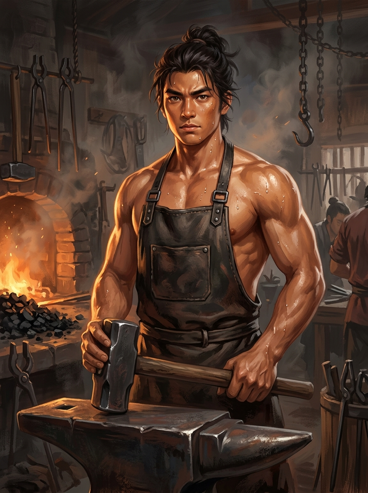

八歲受老鐵匠阿鐵收留於黑石鋪爐房，性格沉穩少言，對材料應力、結構公差與工程極限有著近乎本能的直覺。手握萬度不融太古黑鐵構件與烏沉短鍛錘。於洞天改鑄可拆卸換芯暖爐與三元高壓活榫總栓，大校準夜下潛地底導流井三息帶壓換栓，右肩與小臂留有深可見骨的蒸汽灼痕。

### 燕隼（獵戶之子・八荒神射）

父兄與親大伯燕山早年失陷大荒，由獨目老獵頭趙伯撫養長大。善從蹄印、血色、風向與獸群異動預判危機。手持五石牛筋蛟骨大弓與戰神圖騰骨片，歷經北荒雪原與洞天兩倍半極限重力場淬鍊，悟通「截息卸力」護住巨骨哨卡零死亡守關，並從尋回的大伯燕山手中接過五年赤煉軍需殘牌。

### 柳清虛（破落道童・太清觀星者）

五歲被枯木老道柳乘風收養於西山破落道觀，善以星象典籍、古算與空間法則解構異象。於洞天玄武岩風道悟出低耗「無星向量牽引」，又於太虛校準偏殿打入十二導引銅針將天羅星鎖偏折一度半，救下灰燼石堡全堡性命；唯因強推星束折射與直視晶塔活核，左眼落下永久淡青雪盲翳痕，右手伴隨終身微顫。

### 沈泥（沈雲妮）（流浪孤兒・雲津大掌櫃）

黑石鋪後巷受瘸腿老丐莫三庇護長大的瘦小孤兒，為於底層求生常年蓬頭垢面作男裝打扮。本名沈雲妮，乃三十年前遭清洗之舊商盟「雲記」旁支遺孤。善以市井人情、帳冊勾稽、利益博弈與契約制度重構秩序，終在洞天秩序仲裁橋援引先祖《離艦火種總約》第七條定立《灰燼石堡百年平權自治契書》。

## 二、黑石鋪留守導師

- **瘋郎中・葛半仙**：顧玄養父兼啟蒙恩師，表面瘋癲嗜酒，實則精通地脈藥石與正骨解毒之法，守於黑石鋪南谷草廬。
- **老鐵匠・阿鐵**：林鐵生師父，曾為大荒名噪一時的鍛造宗師，隱居黑石鋪東街鐵匠鋪，贈與順手短鍛錘。
- **老獵頭・趙伯**：燕隼義長輩、燕山換命老友，雙眼灰白卻耳聰如電，傳授重弩追蹤與山林求生戒律。
- **枯木老道・柳乘風**：柳清虛師父，當年自剜雙目躲避道化反噬，棲身西山破觀，告誡弟子「想活命就別信這片天」。
- **瘸腿老丐・莫三**：沈泥庇護者與三十年前舊商盟倖存保管人，守護【天門引】與半塊雲記棗木茶牌三十年。

## 三、金石府城暨六縣群像

### 角色檔案：霸山（八方武館總教頭）

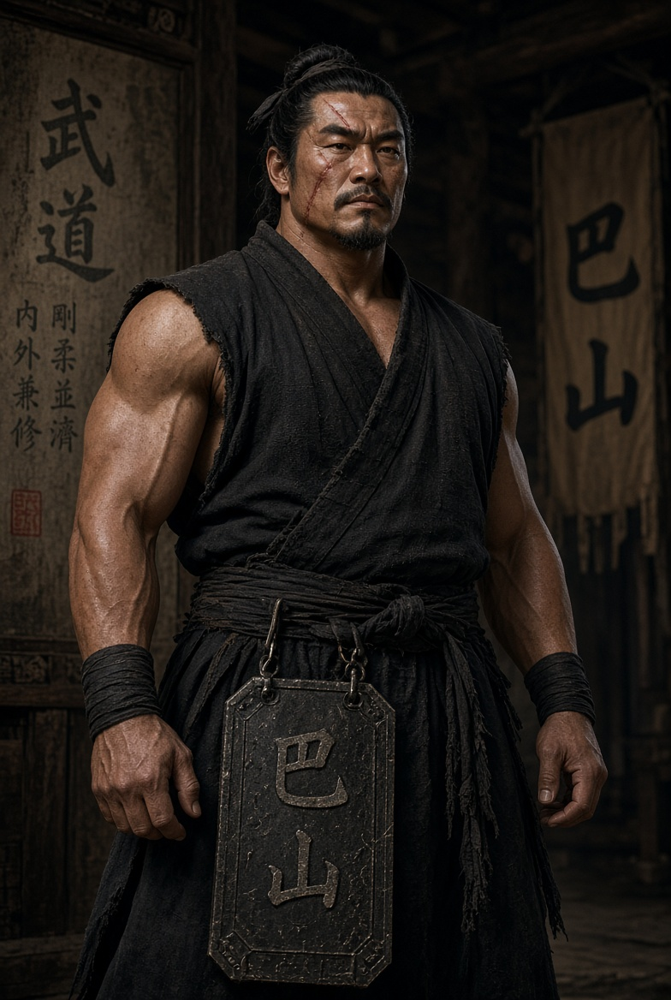

姓名**：霸山

身分**：金石八方武館總教頭、八方鏢局大坐館

年齡**：四十二歲

### 角色檔案：白先生（杏林醫館館主）

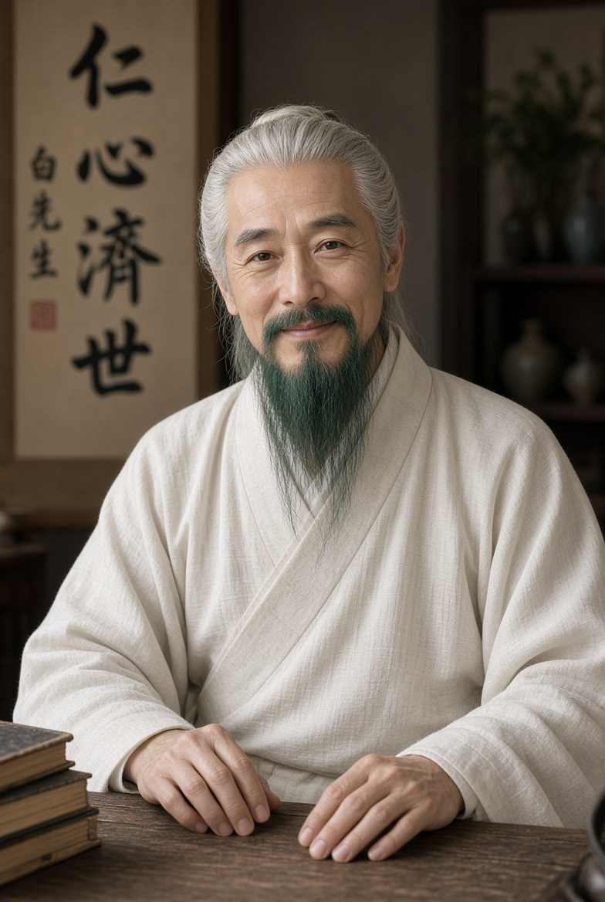

姓名**：白先生

身分**：金石都城杏林醫館館主、府城首席丹醫

年齡**：五十八歲

### 角色檔案：賈朝奉（通寶當鋪大朝奉）

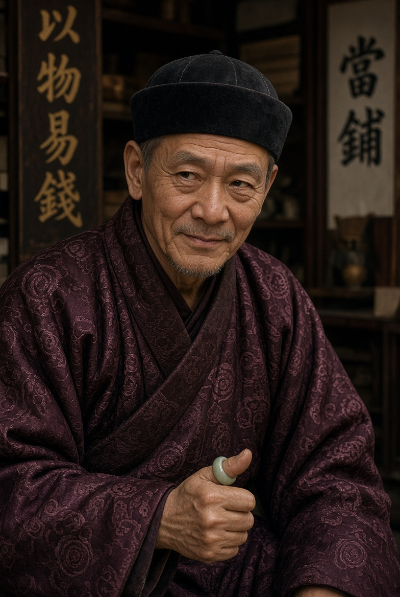

姓名**：賈朝奉（本名：賈富春，行內諢號「賽半仙」）

身分**：金石都城通寶當鋪總號大朝奉、全府六縣地下情報樞紐

年齡**：六十歲

- **角色檔案：老劉（南關車馬小棧棧主）**：姓名**：老劉 身分**：金石南關車馬小棧棧主、底層流民與行商落腳樞紐 年齡**：五十三歲
### 角色檔案：莫錘（鍛造大師 / 千錘地爐坊坊主）

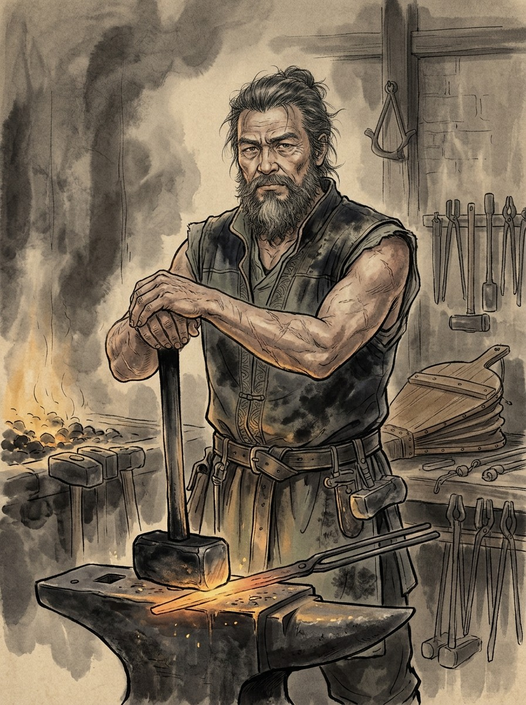

姓名**：莫錘

身分**：金石百工總會千錘地爐坊主管、鍛造宗師

年齡**：四十五歲

### 角色檔案：錢百川（金石商會副會長 / 代會長）

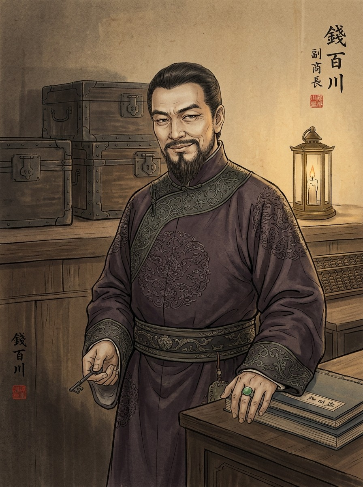

姓名**：錢百川

身分**：金石商會總堂副會長 / 代理實權會長

年齡**：四十八歲

- **角色檔案：宋算子（南關稅吏）**：姓名**：宋算子 身分**：金石南關守城兼度支部徵稅稅吏 年齡**：四十八歲
### 角色檔案：蘇凝霜（商會前會長遺孤）

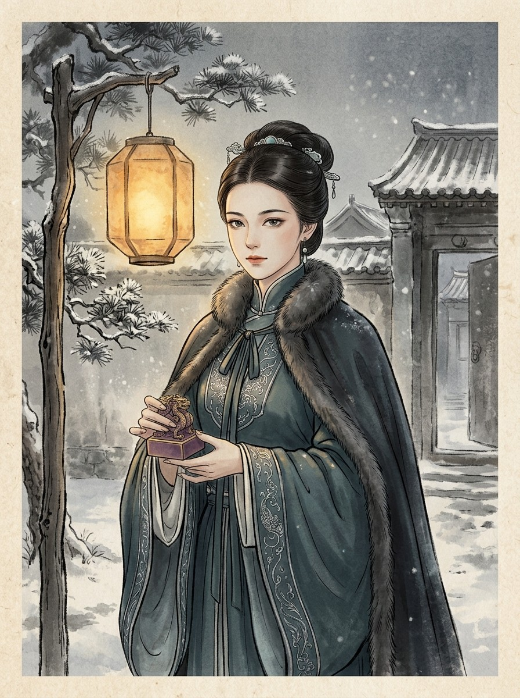

姓名**：蘇凝霜

身分**：金石商會前大掌櫃蘇遠山之女、黑石鋪事件倖存者

年齡**：十八歲

- **角色檔案：文承敬（府衙案牘主簿）**：姓名**：文承敬 身分**：金石府衙案牘庫主簿 年齡**：五十二歲
- **角色檔案：星淵（摘星台觀星師）**：姓名**：星淵 身分**：金石宣道司摘星觀測台主事、觀星師 年齡**：四十二歲
### 角色檔案：玄機真人（宣道司主事宗師）

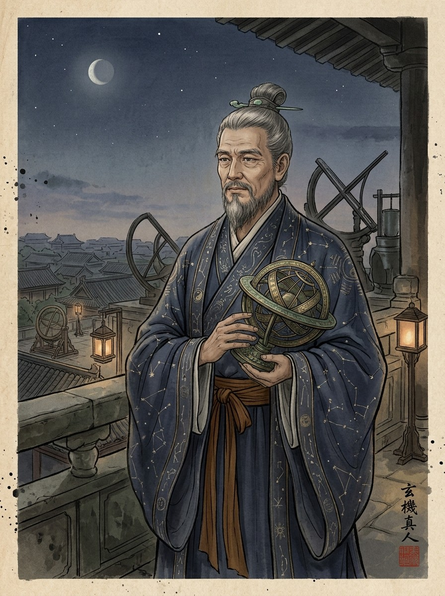

姓名**：玄機真人（法號）

身分**：金石宣道司正堂主事、金石府城首席道官

年齡**：六十餘歲

- **角色檔案：趙德貴（商會前二掌櫃 / 死牢階下囚）**：姓名**：趙德貴 身分**：金石商會前隨隊二掌櫃、毒害蘇遠山之直接執行人、府衙死牢囚犯 年齡**：四十六歲

## 四、雲津暨三宗四脈群像

- **角色檔案：阿滿（北線軍寨炊事與家屬聯絡人）**：姓名／稱謂**：阿滿／北線軍寨炊事與家屬聯絡人 所屬**：八荒武山 活動地點**：
- **角色檔案：杜青禾（傷兵養息院醫官）**：姓名／稱謂**：杜青禾／傷兵養息院醫官 所屬**：八荒武山 活動地點**：
### 角色檔案：雷烈（黑山營獨臂老將／狂刀）

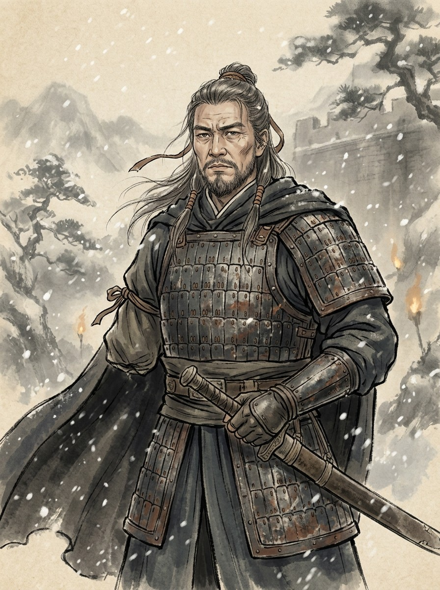

姓名／稱謂**：雷烈／黑山營獨臂老將／狂刀

所屬**：八荒武山

活動地點**：

- **角色檔案：祁無傷（北荒巡哨隊斥候）**：姓名／稱謂**：祁無傷／北荒巡哨隊斥候 所屬**：八荒武山 活動地點**：
- **角色檔案：唐映（破軍重弓塞女校尉）**：姓名／稱謂**：唐映／破軍重弓塞女校尉 所屬**：八荒武山 活動地點**：（二幕後往 broken_army_bow_fort 草案）
- **角色檔案：鐵背山主（八荒武山掌門）**：姓名／稱謂**：鐵背山主／八荒武山掌門 所屬**：八荒武山 活動地點**：
- **角色檔案：王鐵牛（八荒霸戰派猛漢）**：姓名／稱謂**：王鐵牛／八荒霸戰派旁支弟子（虛衝 Lv.89） 所屬**：八荒武山（霸戰派旁支長老門下） 活動地點**：
- **角色檔案：岳停山（煞血霸體營教頭）**：姓名／稱謂**：岳停山／煞血霸體營教頭 所屬**：八荒武山 活動地點**：（二幕後往 blood_body_camp 草案）
- **角色檔案：白鶴年（丹鼎宗外聘醫理師）**：姓名／稱謂**：白鶴年／丹鼎宗外聘醫理師 所屬**：千機百巧門／丹鼎宗 活動地點**：（二幕後兼赴 medical_archive 草案）
- **角色檔案：鶴壽（丹鼎宗長老）**：姓名／稱謂**：鶴壽／丹鼎宗長老 所屬**：千機百巧門／丹鼎宗 活動地點**：（關聯場景 、）
- **角色檔案：李青雲（丹鼎宗鶴壽首徒）**：姓名／稱謂**：李青雲／鶴壽首徒（Lv.84） 所屬**：丹鼎宗內門 活動地點**：
- **角色檔案：孫聞露（醫理院病案掌記）**：姓名／稱謂**：孫聞露／醫理院病案掌記 所屬**：千機百巧門／丹鼎宗 活動地點**：
- **角色檔案：陶生（廢丹崖回收工頭）**：姓名／稱謂**：陶生／廢丹崖回收工頭 所屬**：千機百巧門／丹鼎宗 活動地點**：
- **角色檔案：葉青枝（百草谷靈植管事）**：姓名／稱謂**：葉青枝／百草谷靈植管事 所屬**：千機百巧門／丹鼎宗 活動地點**：
- **角色檔案：周師叔（太清外門中年執事・隔離區病患）**：姓名／稱謂**：周師叔（太清外門中年執事，三十多歲） 所屬**：太清玄天宮外門 活動地點**：
- **角色檔案：韓蒼（太清玄冥首徒）**：姓名／稱謂**：韓蒼／玄冥首徒（二階九十重 Lv.90） 所屬**：太清玄天宮・雷符殿 活動地點**：
- **角色檔案：簡素真人（太清宮苦修派長老）**：姓名／稱謂**：簡素真人／太清宮苦修派長老 所屬**：太清玄天宮 活動地點**：
### 角色檔案：陸觀瀾（柳清虛外門授業師）

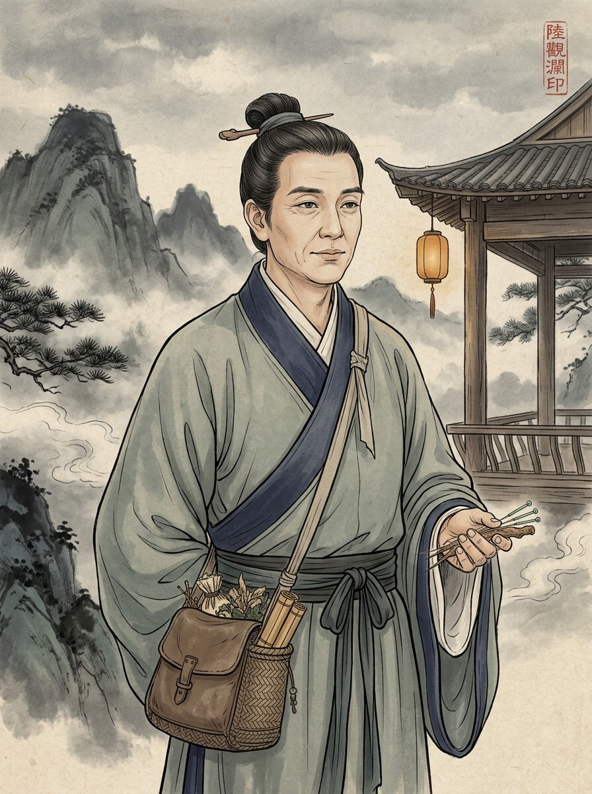

姓名／稱謂**：陸觀瀾／柳清虛外門授業師

所屬**：太清玄天宮

活動地點**：（二幕後兼赴 outer_observatory 草案）

- **角色檔案：沈照塵（周天星律院內門弟子）**：姓名／稱謂**：沈照塵／周天星律院內門（外門試煉同梯）弟子 所屬**：太清玄天宮 活動地點**：
### 角色檔案：宋知微（周天星律院掌院）

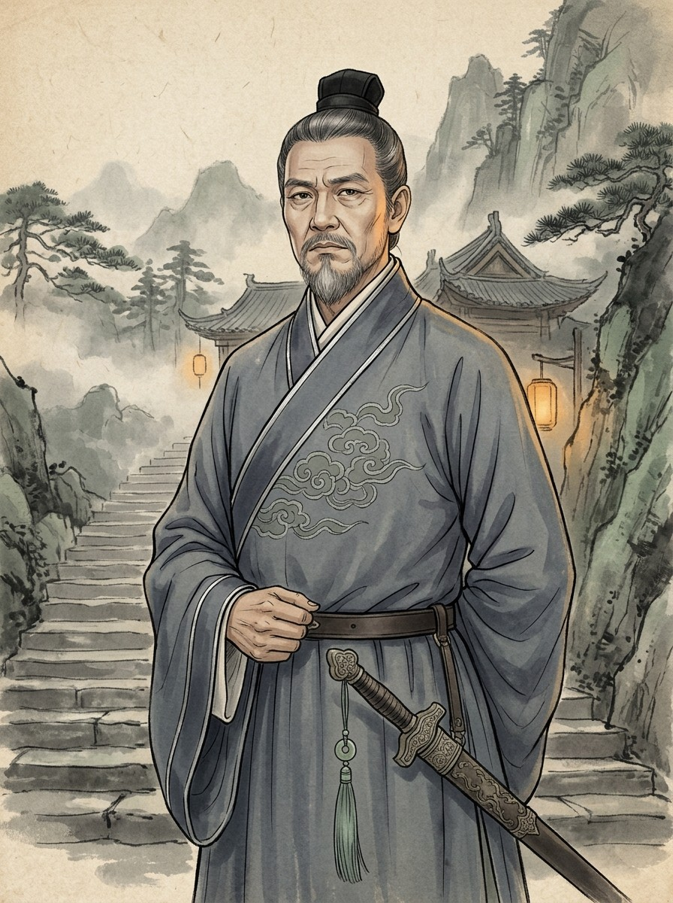

姓名／稱謂**：宋知微／周天星律院掌院

所屬**：太清玄天宮

活動地點**：

- **角色檔案：玄冥真人（太清雷符殿與刑律執法長老）**：姓名／稱謂**：玄冥真人／太清雷符殿暨刑律執法長老 所屬**：太清玄天宮 活動地點**：（二幕兼涉 thunder_talisman_hall）
- **角色檔案：余守拙（藏星秘閣檔案老吏）**：姓名／稱謂**：余守拙／藏星秘閣檔案老吏 所屬**：太清玄天宮 活動地點**：
- **角色檔案：元青（清修偏峰早期晶化老弟子）**：姓名／稱謂**：元青／偏峰閉關老弟子（二階七十三重） 所屬**：太清玄天宮・清修偏峰 活動地點**：
- **角色檔案：紫霄真人（太清玄天宮掌門）**：姓名／稱謂**：紫霄真人／太清玄天宮掌門 所屬**：太清玄天宮 活動地點**：（雲頂三宗論道會武主高台）
- **角色檔案：赤煉（天工閣長老）**：姓名／稱謂**：赤煉／天工閣長老 所屬**：千機百巧門／天工閣 活動地點**：（二幕後兼涉 vault_four.c 與 elder_court 草案）
- **角色檔案：季衡（萬機地窟值守匠師）**：姓名／稱謂**：季衡／萬機地窟值守匠師 所屬**：千機百巧門／天工閣 活動地點**：
- **角色檔案：魯長老（天工閣千機院長老；本名待定）**：姓名／稱謂**：魯長老（本名待定）／天工閣千機院長老 所屬**：千機百巧門／天工閣 活動地點**：
- **角色檔案：聞九（陣圖工房女陣匠）**：姓名／稱謂**：聞九／陣圖工房女陣匠 所屬**：千機百巧門／天工閣 活動地點**：
- **角色檔案：玄樞門主（千機百巧門總門主）**：姓名／稱謂**：玄樞門主／千機百巧門總門主 所屬**：千機百巧門（天工閣／丹鼎宗） 活動地點**：
- **角色檔案：章百鍊（地火鍛兵台總匠）**：姓名／稱謂**：章百鍊／地火鍛兵台總匠 所屬**：千機百巧門／天工閣 活動地點**：（二幕後往 forge_yard 草案）
- **角色檔案：趙烈（天工閣赤煉首徒）**：姓名／稱謂**：趙烈／赤煉首徒（24 歲，Lv.84） 所屬**：天工閣奪天派 活動地點**：
- **角色檔案：白岩（北荒前哨醫師）**：姓名／稱謂**：白岩／北荒前哨醫師 所屬**：北荒裂谷 活動地點**：
- **角色檔案：陳青（纏紗退門藥徒）**：姓名／稱謂**：陳青／纏紗退門藥徒 所屬**：原千機百巧門丹鼎宗百草谷雜役學徒（已逃離／退門） 活動地點**：
- **角色檔案：韓素（失蹤者家屬互助會記錄人）**：姓名／稱謂**：韓素／失蹤者家屬互助會記錄人 所屬**：北荒裂谷（黑山長城北門外三百步草頂木棚） 活動地點**：
- **角色檔案：穆雪（雪原行腳隊領隊）**：姓名／稱謂**：穆雪／雪原行腳隊領隊 所屬**：北境行腳商隊（北荒商線） 活動地點**：
- **角色檔案：祁十六（三宗聯合勘探隊嚮導）**：姓名／稱謂**：祁十六／三宗聯合勘探隊嚮導 所屬**：北荒裂谷 活動地點**：
### 角色檔案：燕山（失蹤走山隊領隊／燕隼大伯）

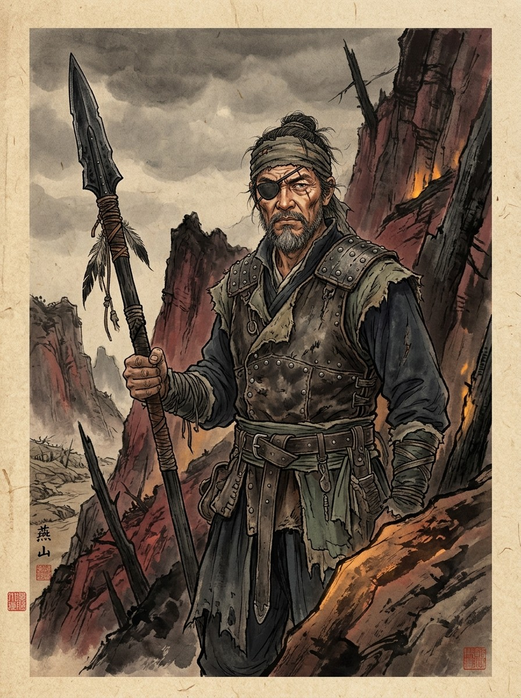

姓名／稱謂**：燕山／失蹤走山隊領隊／燕隼大伯

所屬**：北荒裂谷／下落待查

活動地點**：unknown / evidence-linked only

- **角色檔案：周鐵山（斷臂退門武師）**：姓名／稱謂**：周鐵山／斷臂退門武師 所屬**：原八荒武山外門黑山營備補武卒（已退籍） 活動地點**：（第 83 章；後續留待雲津／金石南關生活線呼應）
- **角色檔案：阿四（泥途商棧年輕夥計）**：姓名／稱謂**：阿四／泥途商棧夥計 所屬**：雲津仙集／泥途商棧 活動地點**：
### 角色檔案：顧蘭舟（雲津靈石票號女掌櫃）

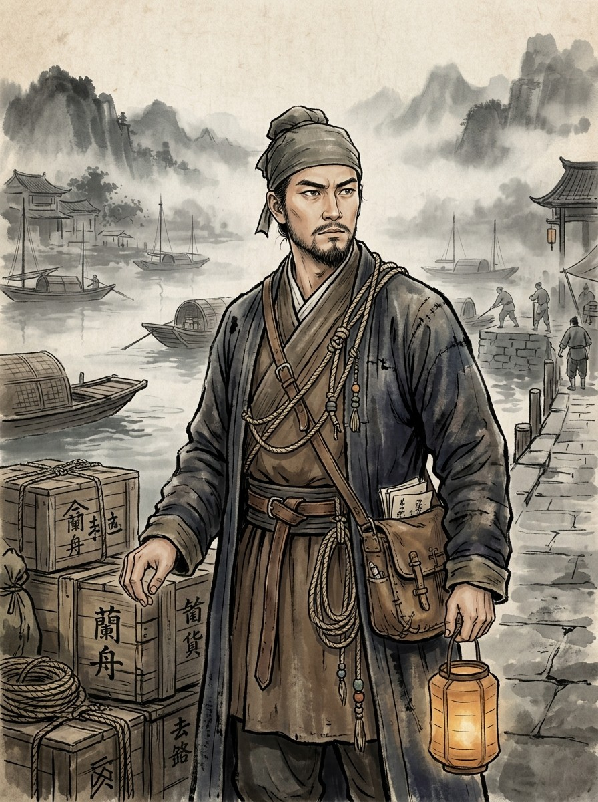

姓名／稱謂**：顧蘭舟／雲津靈石票號女掌櫃

所屬**：雲津仙集／雲海票號

活動地點**：

- **角色檔案：鬼見愁（雲海鬼市牙商）**：姓名／稱謂**：鬼見愁／雲海鬼市牙商 所屬**：雲津仙集／雲海鬼市 活動地點**：
- **角色檔案：何萬金（萬寶閣雲津分號掌櫃）**：姓名／稱謂**：何萬金／萬寶閣雲津分號掌櫃 所屬**：雲津仙集／萬寶閣 活動地點**：
### 角色檔案：羅九秤（萬山商埠公所掌印）

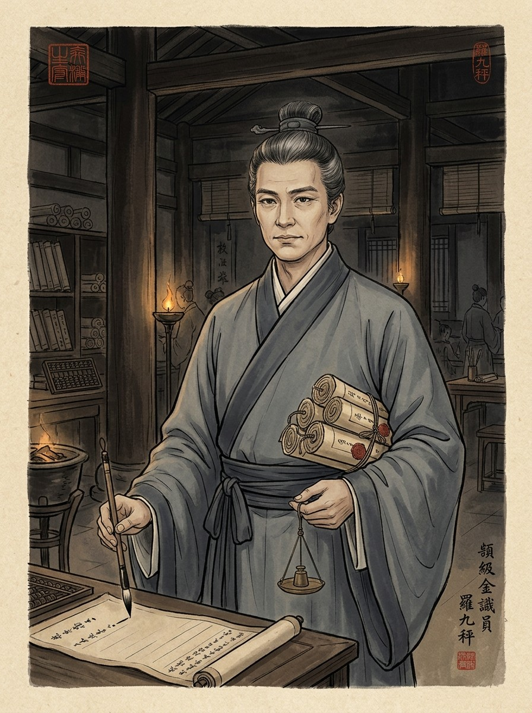

姓名／稱謂**：羅九秤／萬山商埠公所掌印

所屬**：雲津仙集／萬山商埠公所

活動地點**：

### 角色檔案：莫三（泥途商棧外部顧問／舊盟倖存者）

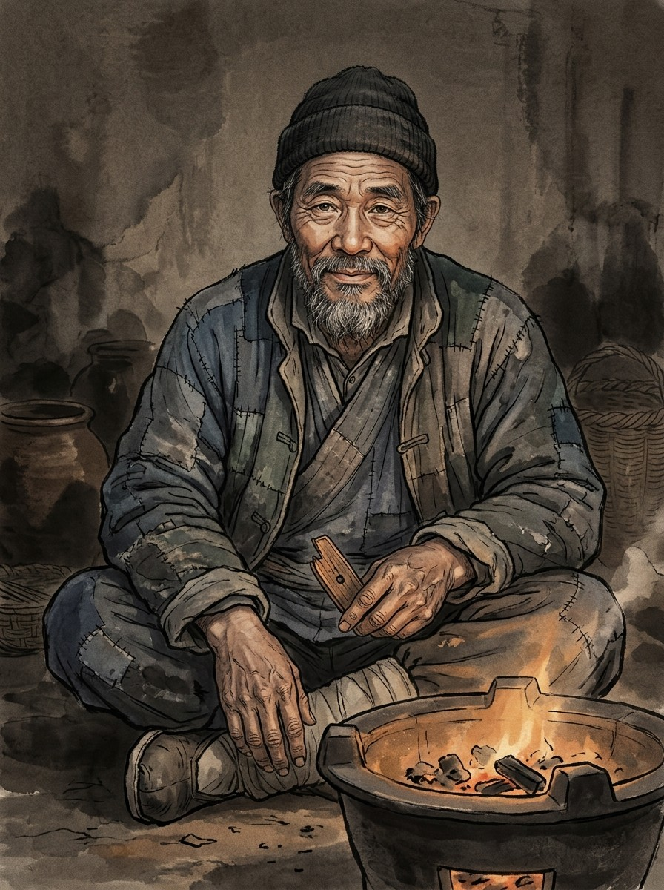

姓名／稱謂**：莫三／泥途商棧外部顧問／舊盟倖存者

所屬**：雲津仙集

活動地點**：（二幕起駐守地窖與後門）

### 角色檔案：邱禾（泥途商棧管事）

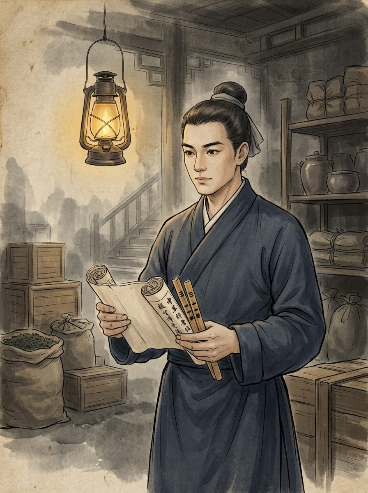

姓名／稱謂**：邱禾／泥途商棧管事（原北境雪橇車隊壓車副手）

所屬**：雲津仙集／泥途商棧

活動地點**：

## 五、桃花源洞天三極群像

### 角色檔案：戚老頭（戚守灰・灰燼石堡守夜長老）

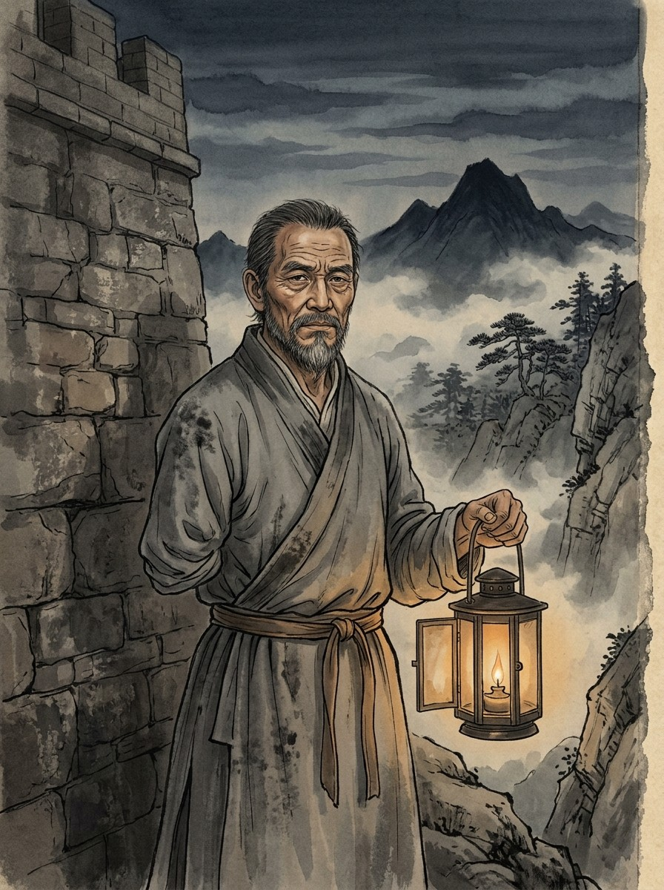

姓名／稱謂**：戚守灰（通稱「戚老頭」）

出身**：二百餘年前首批穿過古陣卻被外環重傷逐出之二階先輩後裔

核心職能**：保管【灰燼石堡熱源配給木牌】，掌握歷代「十七批先輩」多數耗死或淪為耗材的真實口述史。

### 角色檔案：衡真道人（太虛神宮・校星觀測院異見修士）

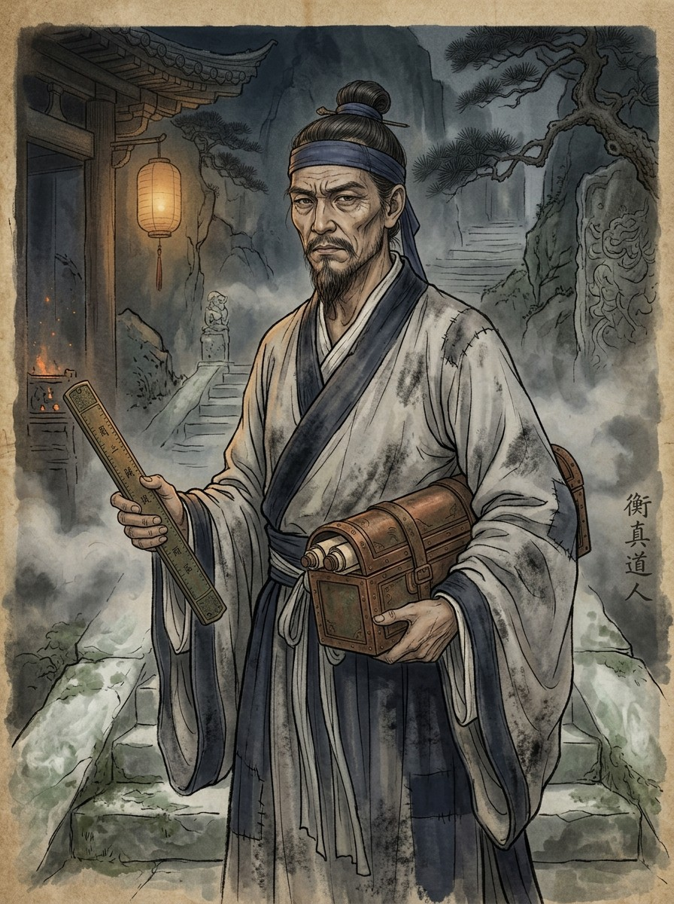

姓名／稱謂**：衡真道人

身分**：太虛神宮外階負責整理三百年校準雜務的實證派老修

核心職能**：向柳清虛揭露「白玉苦役階」玉化晶核制度，以鎖死讀數銅匣與穩壓銅芯債務串起太虛與萬物線，並在 Ch. 157–158 大校準夜配合執行「一度半角位導流叛變」。

### 角色檔案：齊九軸（萬物主機城・外環維修工會總工頭）

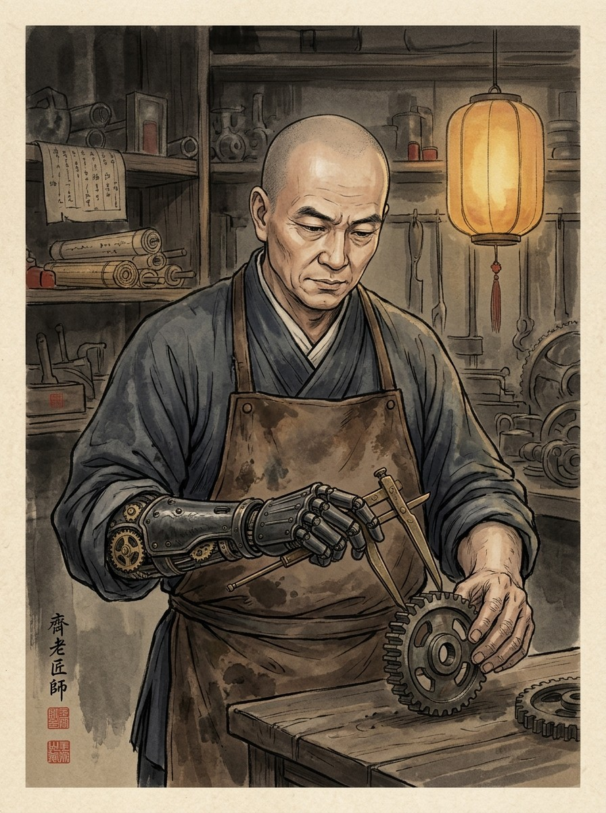

姓名／稱謂**：齊九軸（外環老匠工頭，右臂因早期工傷自製為可拆卸鋼鐵義肢）

核心職能**：掌管三號廢料拆解線公差檢驗，認證林鐵生對太古黑鐵與「九號離艦救生艙」設計規格的解讀；Ch. 147 協同截獲帶「赤火」篆印的走私晶箱；Ch. 155 領二十四站維修工依公差規程發動「大停工」。

對主機中央系統既依賴又憤怒——主機保障基本氣溫與淨水卻把人當成非優先配件；堅定反對林鐵生再走回「神識永久接入機體」的老路。

### 角色檔案：拓跋重（戰祖魔殿・西南骨哨獵隊百夫長）

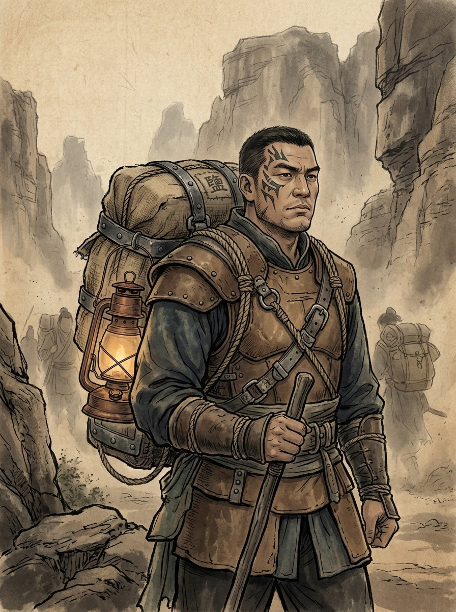

姓名／稱謂**：拓跋重（西南外營狩獵營長）

核心職能**：管理包括大伯【燕山】在內的被強制編入獵奴小隊，嚴核每季九顆混沌獸心核配額；表面冷酷克扣，實則暗中替殘傷隊友少報損耗並保存舊商隊換防帳。

須表現出「弱肉強食秩序下的無奈算計」：若交不出配額，整營俱要填鬥獸坑；絕不無償反水，須待燕隼以實際射殺混沌獸與沈泥穩定供應獸傷止痛膏藥方逐漸換得軍情默契。

