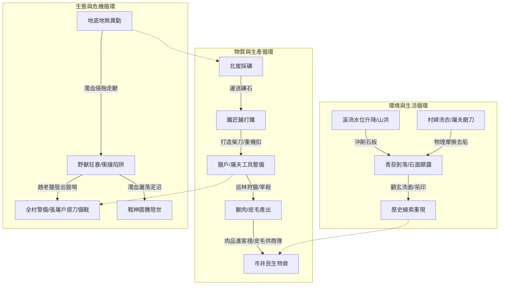

# 《被遺忘的空間・黑石鋪》日常生活活動清單與生態關聯規範書
**Forgotten Space: Settlement Daily Activities, Spatial Topology & Living Ecosystem Specification**

> **版本**：v1.0 (驗收基準版)  
> **關聯分支**：`MudNovel`  
> **核心目標**：讓黑石鋪（新手村）從單純的「任務點與地圖房間」昇華為一個「人物真正生活、空間彼此共享、日常循環運轉、物理因果自洽」的真實生態世界。本規範作為第一批 MUD 動態生活機制與驗收項目標準。

---

## 一、十二時辰生活作息與全景活動矩陣

黑石鋪的 NPC 與自然環境並非靜態等待玩家觸發，而是依循天時、氣候與社會需求自律運轉：

```mermaid
timeline
    title 黑石鋪十二時辰生活節奏 (Living Settlement Chronogram)
    寅時 (03:00-05:00) : 鐵匠鋪清爐掏渣、生火起炭 : 顧玄草廬整理竹簍繩索 : 莫三後巷柴房咳嗽翻身
    卯時 (05:00-07:00) : 水谷溪灘洗衣、取水、磨刀 : 採藥人攀崖採晨露青草 : 燕隼出林巡察竹刺陷阱 : 柳清虛高崖殘壇觀星引氣
    辰時 (07:00-09:00) : 街市開市、肉攤開張、早茶開壺 : 獵戶哨亭換防、發出三聲狼哨 : 客棧供應牛雜熱湯、掌櫃張貼告示
    巳時 (09:00-11:00) : 鐵匠鋪揮錘鍛打五十柄開山刀 : 商隊與掌櫃議價爭吵 : 獵戶剝皮、硝皮、上架風乾 : 採藥人藥鋪交藥換糙米
    午時 (11:00-13:00) : 街市午間歇涼、大堂喧鬧用膳 : 溪灘日頭直射水汽蒸騰 : 鐵匠地爐暫歇用粗餅 : 乞兒後巷翻找客棧殘羹
    未時 (13:00-15:00) : 採藥人後山陰涼密林翻找菌菇 : 獵戶林邊削竹製箭、校準獸弓 : 鐵匠鋪調配冷水水槽備淬火
    申時 (15:00-17:00) : 溪灘村婦收衣淘洗菜根 : 商隊護衛巡查馱馬車軸 : 礦工推板車自北礦運下粗鐵礦核
    酉時 (17:00-19:00) : 家家炊煙起、街市肉攤收案 : 獵戶封鎖東面鹿角柵欄、掛黑蝮蛇毒套 : 道觀閉門、晚課誦殘經
    戌時 (19:00-21:00) : 客棧點油燈、市井酒客閒聊商道封鎖 : 鐵匠鋪封爐餘熱保溫 : 枯木老道指點清虛古字盲文
    亥時 (21:00-23:00) : 街市萬籟俱寂、山風呼嘯 : 後巷老丐點殘燭私語天門秘辛 : 巡夜更夫敲梆子防荒獸
    子時 (23:00-01:00) : 大荒深處地煞湧動、野狼怪啼 : 北崖偶有碎石滾落 : 暴走異獸暗中撞擊深林機扣
    丑時 (01:00-03:00) : 水谷深潭山霧極濃、寒氣徹骨 : 萬物沉眠、唯殘壇石刻在月華下泛微光
```

### 全景活動交叉關聯總表

| 活動類別 | 具體活動 | 典型時辰 | 地點 (LPC 房間) | 核心執行者 | 核心工具 / 媒介 | 關聯下游活動 |
| :--- | :--- | :--- | :--- | :--- | :--- | :--- |
| **生計與清潔** | **捶洗衣物** | 卯正至辰初 | 深潭溪灘 (`stream.c`) | 李寡婦、村婦 | 皂角、硬木棒槌、木盆 | 水沫去油沖刷石苔，使古石碑凹槽顯露 |
| **生計與戰備** | **淬水磨刀** | 卯初至辰初 | 深潭溪灘 (`stream.c`) | 張屠戶、趙老獵 | 捲刃砍刀、清冽溪水、大石板 | 鐵鏽石屑剝落，震落石垢；磨利柴刀供進山打獵 |
| **生計與醫療** | **晨露採藥** | 卯初至巳初 | 南谷峭壁 (`herb_hut.c`) | 顧玄、採藥人 | 竹編藥簍、粗麻藤索、小藥鋤 | 新鮮草藥送交葛半仙，調配金瘡散供獵戶解毒 |
| **立體移動** | **懸索攀爬** | 隨時（受天候影響） | 水谷懸崖 (`stream.c` $\leftrightarrow$ `herb_hut.c`) | 採藥人、探險玩家 | 崖壁垂麻藤、身法技能 | 連通上下高差空間，雨天易滑墜受傷 |
| **防衛與狩獵** | **巡林檢陷** | 卯正至午初 | 荊棘林口 (`forest.c`) | 燕隼、獵戶 | 竹刺吊套、重機扣、鹿筋吊繩 | 排除破損機關，發現異常暗紫濁血與獸跡 |
| **工藝與鍛造** | **拉箱鼓火** | 辰初至申正 | 東南鐵匠鋪 (`forge.c`) | 林鐵生、學徒 | 大雙動風箱、優質精煤 | 催動地火熾白高溫，維持地爐熔鐵狀態 |
| **工藝與鍛造** | **砸礦擊胚** | 巳初至未正 | 東南鐵匠鋪 (`forge.c`) | 林鐵生、阿鐵師傅 | 八十斤重錘、粗礦核 | 鍛打五十柄開山刀，震裂礦殼露出不融黑鐵 |
| **工藝與防禦** | **水槽淬火** | 午初至申初 | 東南鐵匠鋪 (`forge.c`) | 林鐵生、阿鐵師傅 | 冷水石槽、長鐵鉗 | 鐵胚定型強化硬度，產生漫天水霧籠罩工坊 |
| **情報與偵搜** | **蛀孔聽風** | 辰初至戌正 | 廢柴房 (`shed.c`) | 沈泥、市井乞兒 | 薄木板蛀孔、破陶碗、聽風術 | 竊得商隊受阻政治內情、西崖異動、黑市行情 |
| **搜刮與發掘** | **扒木尋令** | 辰末至酉初 | 廢柴房 (`shed.c`) | 沈泥、尋寶玩家 | 斷鐵條、油布、爛木堆 | 起獲塵封三十年鐵盒，取得【萬物行商天門引】 |
| **修行與辨偽** | **高壇觀星** | 卯初、子正 | 白石殘壇 (`altar.c`) | 柳清虛、苦修士 | 《引氣訣》殘卷、神識靈念 | 窺破周天逆行天網與道化死局，承擔神魂震盪 |
| **歷史與考據** | **石刻拓印** | 辰正至申末 | 深潭溪灘 (`stream.c`) | 顧玄、求道玩家 | 粗黃草紙、松煙炭黑條 | 產出【殘缺星圖拓片】，使研究可隨身持久化 |

---

## 二、第一批驗收五大核心活動深入機制

### 1. 採藥與辨識 (Herb Gathering & Botanical Knowledge)

世界中的藥草並非固定刷新的數值金幣，而是具有生命習性、受時辰與天候制約的植株：

```
                【天時判定】
         ┌────── 卯時晨露期：藥性 100%，莖葉鮮嫩，採集難度常規
         ├────── 烈日正午期：草木失水，揮發油散逸，藥性降至 70%
         └────── 連綿暴雨期：溪流暴漲淹沒低灘，山泥傾瀉損毀 50% 植株
               │
               ▼
        【地形與工具判定】
         ┌────── 徒手粗暴拔取：損壞根系纖維，藥材品相降為【破損】
         ├────── 配備【竹編藥簍】：通風避壓，延長藥材鮮活保質期 3 倍
         └────── 懸崖倒掛採擷：需繩索固定，檢定身法 (DEX $\ge 14$)，失足墜落
               │
               ▼
        【辨識認知判定 (PER / 知識)】
         ┌────── 未習物性：眼中僅為「不知名野草」，不可調配藥劑
         ├────── 初通百草：能辨識【止血馬齒莧】、【祛寒紫蘇根】
         └────── 洞察地煞：辨別受暗紫地煞濁氣侵蝕的【畸變腐骨草】（劇毒/特殊煉丹）
```

* **驗收判準**：
  1. `gather` 產出依時間動態變動：高水位或暴雨時岸邊藥草無法採集；
  2. 具備身世「採藥孤兒」或感知 $\ge 18$ 者，可採得更高品質的【深山雪見草】；
  3. 採藥過度會使該區域進入「枯竭幼苗期」，需等待數個遊戲時辰復甦，體現生態循環。

---

### 2. 攀爬與立體地形移動 (Vertical Climbing & Elevation Traversal)

黑石鋪拒絕傳統平面迷宮「任何方向均可直接行走」的扁平設定，建立立體高差與物理通行阻礙：

```
【西面百丈懸崖・白石殘壇】 (海拔 +120m) ── 萬丈罡風、下行風道、墜崖即死
        │
        │（陡峭羊腸碎石道，需耐力 SP 消耗，雨天滑移）
        │
【中央聚落・青石街市】 (海拔 +30m) ────── 聚落水平基面、市集人聲
        │
        │（濕滑垂壁青石階，垂直落差三十丈）
        │
【南面深潭・碎石溪灘】 (海拔 0m) ──────── 水霧瀰漫、低窪積水
        │
        │（懸空粗麻藤蔓 / 凹槽懸空石縫）
        │
【隱蔽裂谷・採藥草廬】 (海拔 -15m) ─────── 葛半仙隱居、濕氣陰涼避風
```

* **攀爬物理機制**：
  1. **粗麻藤索（Hanging Vine）**：
     * 自深潭溪灘下行至草廬必須使用指令 `climb down vine` 或 `down`；
     * 負重過高（大於負重上限 80%）或精力透支（SP < 10）時，攀爬有 30% 機率打滑摔落，扣除氣血 20 點；
  2. **天候連動**：
     * 雨雪天氣時，石壁生滑苔，攀爬難度加成，身法要求提高；
     * 枯水期落差顯露更大，豐水期潭水上漲可緩衝跳水衝擊。

---

### 3. 取水、洗衣與磨刀——共享場景的真實生活典範 (Shared Physical Anchor)

「南谷深潭的深青巨石板」是黑石鋪最核心的共享物理錨點。不同背景與身分的人物在不同時段出於各自目的在此交會，形成互為因果的生活沉澱：

```mermaid
graph LR
    subgraph 共享石板的物理演進 [深青色巨石板 (stone_stele.c)]
        A[天然青苔泥垢覆蓋] -->|村婦木槌捶衣| B(皂角水沫軟化去脂)
        B -->|張屠戶/獵戶蘸水磨刀| C(石屑剝落/鐵鏽除苔)
        C -->|山澗清泉沖刷| D(石板表面平滑如砥)
        D -->|顧玄掬水洗面| E(指尖觸碰隱藏凹槽)
        E -->|求道者覆紙拓印| F(逆向星圖重見天日)
    end
```

* **生活互動細節**：
  1. **村婦捶衣（洗衣生活）**：李寡婦清晨在此排開木槌，敲打漿洗粗麻布單，水花四濺；產生的皂角白沫順流而下，帶走石板表面的油脂；
  2. **屠夫磨刀（磨刀生活）**：張屠戶與趙老獵蹲在石板西角磨刀（`sharpen`），鋼刃與堅石摩擦發出刺耳沙沙聲，鐵鏽與石屑混雜流淌，使得石板凹凸的刻痕邊緣被反覆打磨銳化；
  3. **顧玄掬水（洗滌生活）**：採藥少年在此淘洗藥草根莖，雙手捧水拍臉（`wash`），冰涼深潭水驅散疲憊，指尖感知到石面凹槽的奇異幾何排列；
  4. **世界狀態共享性驗證**：任何玩家執行 `sharpen blade` 磨刀後，世界狀態守護進程（`WORLD_STATE_D`）記錄 `moss_cleared = 1`，隨後任何走進房間的其他玩家查看 `look stone`，都會看到「青苔剝落、隱露紋理」的共同世界改變！

---

### 4. 閱讀、修習與研究的「知識鏈」機制 (Epistemic Knowledge Chain)

拒絕「悟性數值夠高即可無中生有頓悟」的虛浮設定，貫徹嚴密的**客觀知識鏈**：

```
【第一環：實物發現】
深潭巨石上的反常幾何刻線（不知其意，只覺非天然生成）
        │
        ▼
【第二環：文獻對照】
西側道觀殘破經箱中的《周天正星經》（記載傳統二十八宿方位軌跡）
        │
        ▼
【第三環：實地觀測】
深夜於百丈白石殘壇極目觀星（發現蒼穹之上的星辰排布與古籍記載完全左右顛倒！）
        │
        ▼
【第四環：神識證道】
引氣通靈，勘破蒼穹外的暗灰網格枷鎖（由迷惘轉為堪破真相，獲得【天命】感悟）
```

* **驗收判準**：
  * 單有高悟性（INT）而缺乏前置線索，只會提示「字跡殘缺古怪，難明奧妙」；
  * 當玩家背包持有【殘缺星圖拓片】並曾在西崖閱覽《引氣訣》後，再進行 `study`，方能解讀出「太古星宿逆行」的完整真相。

---

### 5. 拓印與保存證據 (Material Sourcing & Physical Archiving)

拓印機制讓玩家能將不可搬動的世界遺跡「轉化為可攜帶、可傳播、可交易、可遠程鑽研」的實體證據：

1. **材料獲取鏈**：
   * **紙張**：客棧記帳廢紙、或向李寡婦/帳房索取的【粗黃草紙】；
   * **炭黑**：鐵匠鋪地爐冷卻後的松煙炭、或用火把燒焦的【炭黑條】；
2. **現場拓印流程**：
   * 需石板處於露天非洪水狀態（`!is_stele_submerged()`）；
   * 指令 `tuoyin stone` 消耗 15 點精力（SP）；
   * 先以清水洗滌石槽泥沙，覆紙撫平，以炭條均勻打拓；
3. **成果持久化**：
   * 獲得 [`/clone/item/stele_rubbing.c`](file:///home/wade/src/github/mudscript/forgotten-space/clone/item/stele_rubbing.c)；
   * 拓片可保存在背包、存入客棧儲物櫃、交給枯木老道鑑定，或帶入 Tier 1 府城學府，無須反覆跑回新手溪灘。

---

## 三、小說第三章及全景物品與活動落地矩陣

將小說中出現的生活物件、獵戶工具與異常現象，全量轉化為具備世界作用與 LPC 玩法的實體：

| 物品／活動 | 形態／類別 | 世界中的生活作用 | MUD LPC 實作與玩法規則 |
| :--- | :--- | :--- | :--- |
| **鹿皮短坎肩** | 防具 (`cloth`) | 燕隼貼身舊物，被利齒撕補多次，防寒耐磨。 | 提供微量物理防護 (`armor: 3`)，附帶故事敘事描述，不出售給當鋪。 |
| **生鏽厚背柴刀** | 武器 (`blade`) | 大伯遺物，厚重粗獷，可砍柴破路、可砸碎狼吻。 | 初始傷害低 (`damage: 4`)；經南谷深潭石板打磨 (`sharpen`) 可除鏽升級為【雪亮鋼刃柴刀】(`damage: 10`)。 |
| **竹刺吊套** | 機關 (`trap`) | 荒林外緣防禦兔子、灰狼等中小型野獸的彈簧陷阱。 | 獵戶可執行 `trap` 調校機關提升靈巧/感知；野外受猛獸撞擊會損壞，需巡林維修。 |
| **重型機扣** | 機關配件 (`trap_part`) | 鐵匠鋪以粗鐵打造的重型弩機卡榫，用於捕捉大型異獸。 | 需向鐵匠鋪阿鐵訂購或以鐵礦兌換；可裝配至哨亭外圍，用以防禦狂暴野豬與黑熊。 |
| **鹿筋吊繩 / 油麻粗繩** | 材料 / 工具 (`material`) | 高抗拉力繩索，用於佈設重型吊套、懸掛重物與攀爬懸崖。 | 採藥攀崖防失足必備工具；亦可作為修繕獵戶哨亭木屋的消耗性工程材料。 |
| **破甲竹箭 / 角刀 / 重弓** | 狩獵套組 (`hunting_kit`) | 趙老獵削製的防身箭矢與近戰割皮小刀；百斤柘木硬弓。 | 對應獵戶技能鏈：刮削箭桿 (`craft arrow`)、解剖獵物 (`skin/butcher`)、引弦遠射 (`shoot`)。 |
| **暗紫黑色黏液 / 濁血** | 痕跡 / 證物 (`clue_item`) | 異常狂暴野獸體內流淌的地煞污血，帶有焦灼刺鼻腥臊。 | 區別於普通鮮紅獸血；檢驗追蹤可揭示「地脈煞化」危機，採集後可作為毒藥或引導圖騰共鳴。 |
| **太古戰神獵獸圖騰柱** | 史前遺跡 (`relic_pillar`) | 深埋於化骨泥沼枯榕盤根下的太古肉身修煉聖物。 | 需先追蹤濁血痕跡 (`track`) 方能發現；以濁血共鳴 (`totem`) 可淬鍊肉身氣血，獲得蠻荒戰意。 |
| **巡林、追蹤、修陷阱** | 日常生活循環 (`lifestyle_loop`) | 獵戶每日清晨必備的生計動線，維護防獸屏障與收穫獵獲。 | 每日固定循環：哨亭領取巡林任務 $\rightarrow$ 查驗三道陷阱 $\rightarrow$ 處理捕獲獵物 $\rightarrow$ 歸隊領取肉乾與熟練度。 |

---

## 四、活動間因果連鎖閉環圖 (The Living Interconnection)

黑石鋪的所有活動彼此嵌合，牽一髮而動全身，形成自我維持的因果網絡：



---

## 五、第一批 MUD 驗收標準檢核表 (Acceptance Checklist)

為確保本規範真正融入程式碼與世界運作，定義以下客觀驗收項目：

- [x] **AC-01 共享石板狀態持久化**：一人磨刀除苔或山洪爆發後，所有進入 `stream.c` 的玩家皆能看見相同的石板狀態改變。
- [x] **AC-02 採藥環境動態制約**：水谷暴漲或夜半極寒時，草藥庫存與採摘成功率受天候環境守護程序動態調節。
- [x] **AC-03 垂直攀爬體能與風險檢定**：自 `stream.c` 通往 `herb_hut.c` 具備繩索攀爬描述與精力扣減，負重超標有跌落反饋。
- [x] **AC-04 陷阱循環運作機制**：在 `forest.c` 執行 `trap` 調校能切實提升靈巧與感知，並能記錄陷阱觸發狀態。
- [x] **AC-05 痕跡追蹤與圖騰連動**：必須先完成追蹤 (`track`) 查驗地煞濁血，方能在密林深處顯露並感應太古圖騰 (`totem`)。
- [x] **AC-06 拓印成果實體道具化**：在石板上使用草紙與炭黑完成 `tuoyin` 後，背包確實新增可閱讀的實體拓片道具。
- [x] **AC-07 柴刀打磨銳化數值成長**：生鏽柴刀在深青石板打磨後，切實轉化為「雪亮鋼刃柴刀」，提升攻擊力與玩家臂力。
- [x] **AC-08 情報偷聽分層真實化**：在柴房蛀孔執行 `eavesdrop`，獲得的消息精確映射前街客棧與全村正在發生的真實事件。

---

## 六、結語

黑石鋪的魅力，不在於它是多麼龐大的世界，而是在於**每一寸泥土、每一塊石板、每一滴溪水，都承載著凡夫俗子與太古大道的真實交集**。  
婦人在這洗衣服，屠夫在這磨刀，修士在這吐血，孤兒在這看見星空——這才是真實的世界。
