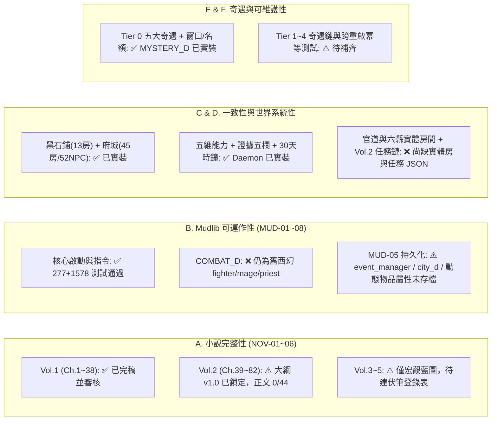

# 《遺忘的世界》需求追溯與交付範圍基線矩陣・實施計畫 (Implementation Plan)

## Goal Description
依據 [completed-spec.md](file:///home/wade/src/github/mudscript/forgotten-space/docs/completed-spec.md) 定義之 6 大驗收領域（共 37 項正式驗收條件）、三層驗收標準（`Level 1 ~ 3`）、六類需求標籤（`CANON` / `RULE` / `DERIVED` / `QUALITY` / `OPTIONAL` / `OPEN`）與五道交付閘門，對現有 `forgotten-space/` 進行**零美化、找反例的真實盤點**，並在你拍板下列 `OPEN` 決策後，正式於專案建立 [traceability_and_scope_baseline.md](file:///home/wade/src/github/mudscript/forgotten-space/docs/traceability_and_scope_baseline.md)，作為後續 `/goal` 或 `/teamwork-preview` 長程自動化開發的權威驗收基線。

---

## User Review Required & Open Questions (`OPEN` 待裁決事項)

> [!IMPORTANT]
> 以下 **5 項 `OPEN` 決策**直接對應 [completed-spec.md](file:///home/wade/src/github/mudscript/forgotten-space/docs/completed-spec.md#L202-L210) 第六節指出的「正式交付範圍推導」與「未決世界／系統邊界」。請在審閱後告訴我你的選擇，我將據此鎖定基線矩陣：

### `OPEN-01`：第一階段「正式可交付版本（Release v1.0）」的範圍切分（解決第六節問題一）
[world_setting.md](file:///home/wade/src/github/mudscript/forgotten-space/world_setting.md) 規劃了 Tier 0 ~ Tier 4（共五卷），但誠如 [completed-spec.md](file:///home/wade/src/github/mudscript/forgotten-space/docs/completed-spec.md#L75-L206) 所言：「不能縮減成只有新手村，也不能把所有想得到的內容都塞進第一版導致永遠停留在建設中」。
我建議將完整交付拆為**三個可獨立驗收的里程碑版本（Milestones）**，請確認是否同意此切分：
- **Milestone 1（`v1.0 凡塵雙卷完整交付版`：Tier 0 黑石鋪 ＋ Tier 1 金石府城與六縣區域網）** — **[建議作為當前首要正式交付範圍]**：
  - **小說範圍**：第一卷【黑石驚蟄】（Ch.1 ~ Ch.38 正文已完稿）＋ 第二卷【金石風雲】（Ch.39 ~ Ch.82 全 44 章完整正文完稿）。
  - **MUD 範圍**：Tier 0 黑石鋪完整閉環（含煞潮與黑石關軍政博弈）＋ Tier 1 金石府城（45 房、52 NPC）與六縣／官道核心節點房間、三道一階轉職、五維能力與三方會審任務鏈、三元戰鬥系統（取代舊西幻 `combat_d.c`）與完整跨重啟存檔持久化。
- **Milestone 2（`v2.0 名山問道擴充版`：Tier 2 名山大川 ＋ 第三卷）**：第三卷大綱與正文 ＋ 三大名山宗門地圖與二階技能／道化機制。
- **Milestone 3（`v3.0 洞天與歸墟終局版`：Tier 3 ~ Tier 4 ＋ 第四、五卷）**：第四、五卷正文 ＋ 桃花源洞天與太古歸墟殘塚終局奇遇（確保 `MYST-05` Tier 4 真正稀有性）。

---

### `OPEN-02`：Tier 1「六大次級縣城與官道驛站」在 MUD 中的空間實作粒度（影響 `WORLD-01`、`WORLD-02`、`CROSS-03`）
目前金石府城有 45 間實體房間（`/d/city/`），黑石鋪有 13 間實體房間（`/d/village/`）；但**官道驛站**與**六大次級縣城（青河・烈礬・盤木・鎮風・濁水・重石）**目前僅存在於 [city_d.c](file:///home/wade/src/github/mudscript/forgotten-space/daemon/city_d.c) 的路網表與 [world_state_d.c](file:///home/wade/src/github/mudscript/forgotten-space/daemon/world_state_d.c) 的 30 天演化數據中，**尚無實體可走動的 `.c` 房間檔案**。
請問對於六縣與官道，你希望採取哪種空間粒度？
1. **(推薦) 方案 A：精煉節點切片（每縣 3~5 間核心功能房 ＋ 官道關鍵驛站／險隘房，約 25~30 間房）**
   - 例如青河縣實作「蘆花渡碼頭、百草坪藥圃、靈植道觀水閘、青河縣集」4 間房；盤木實作「虎跳峽便道、天工木作大棚、青松塢」等。既能讓玩家真實走通 `ROUTE_SEGMENTS`、體驗六縣 30 天自主演進與跨縣任務，又不會陷入數百間空殼房間的維護泥淖。
2. **方案 B：完整城鎮規模（每縣 12~15 間房，六縣合計 70~90 間房）**
   - 比照黑石鋪規模為每個縣城建立完整街區。
3. **方案 C：純車馬行／驛站轉場（僅實作每縣 1 間代表性據點房，其餘透過車馬行移動）**。

---

### `OPEN-03`：新手村目錄路徑與舊西幻殘留區域（`/area/*`）的處置（影響 `WORLD-01`、`CROSS-01`、`MUD-08`）
盤點代碼時發現兩處結構性反例：
1. [tier1_world_operating_model_v0_1.md](file:///home/wade/src/github/mudscript/forgotten-space/docs/tier1_world_operating_model_v0_1.md#L176) 寫「黑石鋪 `/d/blackstone/*` 35 間房」，但實際已實裝且通過測試的黑石鋪位於 **`/d/village/*.c`（共 13 間核心房間）**。
2. `forgotten-space/area/` 目錄下仍留有早期模板的 `area/newbie/room_0_0.c ~ room_7_7.c`（64 間網格房）、`area/cave/`、`area/tower/`、`area/lm/`，且 `/secure/combat_d.c` 仍寫著西幻的 `fighter`（連環快劍）、`mage`（火球術）、`priest`（治療術）。
請問：
1. 黑石鋪正典路徑是否**統一鎖定為現有 `/d/village/`**（並考慮按需擴充北崖三號井、虎跳峽口等 3~5 間房），不再另建 `/d/blackstone/`？
2. 舊西幻殘留的 `/secure/combat_d.c` 是否應**全面重構為三元力量（力道／法道／物道，消耗 `kee/sen/sp`）**，並將無關的 `/area/newbie/` 等舊測試網格與正式世界地圖隔離？

---

### `OPEN-04`：NPC 三態生命週期（`PHASE_D`）在 v1.0 的驗收邊界（影響 `MUD-04`、`WORLD-05`）
[npc_dynamic_lifecycle_spec.md](file:///home/wade/src/github/mudscript/forgotten-space/docs/npc_dynamic_lifecycle_spec.md) 規劃了 `PHASE_D`（讓 NPC 隨十二時辰走動、在礦難/獸潮時瞬移至險境、事件後回歸並改變對話）。目前部分房間透過房間腳本與 `QUEST_ENGINE_D` 判斷狀態，但尚未建立統一的 `/daemon/phase_d.c`。
請問這項機制在 v1.0 應列為：
1. **(推薦) `DERIVED`（v1.0 必備核心機制，針對核心具名 NPC 實裝 `/daemon/phase_d.c` 三態切換）**：確保魯大山、趙老獵、張屠戶、陳鎮山、文承敬、莫三等核心人物符合小說與事件相位。
2. **`QUALITY` / `OPTIONAL`（列為品質強化項，維持現有房間與任務狀態判斷即可）**。

---

### `OPEN-05`：第三至五卷（Tier 2 ~ Tier 4）在 v1.0 階段的規劃深度（影響 `NOV-01`、`NOV-04`、`MYST-05`）
若 `OPEN-01` 採納以 Tier 0 + Tier 1（第一、二卷全文）作為 Milestone 1（v1.0）交付範圍，為了滿足 `NOV-04`（未解伏筆必須是刻意保留而非遺漏）與 `MYST-05`（Tier 4 具備真正稀有性），在 v1.0 驗收時，對於第三至五卷是否只需建立**《跨卷伏筆登錄表與 Tier 2~4 終局設定錨點》**，而無須在 v1.0 撰寫第三至五卷的逐章正文？

---

## 現況真實盤點總覽（對照 `completed-spec.md` 37 項驗收條件）

以下為我直接檢查程式碼與文本後得出的**真實基線狀態**（絕不把勾選清單當成已驗收證據）：



### 6 大領域 37 項指標逐項盤點摘要表

| 領域與 ID | 驗收條件摘要 | 當前真實狀態 | 現有證據（實際檔案／測試） | 推導缺口與標記（`DERIVED` / `QUALITY` / `OPEN`） |
| :--- | :--- | :---: | :--- | :--- |
| **`NOV-01`** | 正式規劃卷章完成無占位符 | **PARTIAL** | Vol.1 `ch0001~0038.md` (38/38 完稿)；Vol.2 `volume2.md` (44 章大綱完稿，正文 `0/44`) | **[`DERIVED`]** 撰寫第二卷 Ch.39~82 全 44 章正文；**[`OPEN-01`]** 確認 v1.0 卷次範圍 |
| **`NOV-02`** | 主要角色線具完整弧線與後果 | **PARTIAL** | `character_profiles.md`、`characters/*.md`、Vol.1 全文、Vol.2 §二五維成長表 | **[`DERIVED`]** 於 Vol.2 正文落實五人分途立籍與破境弧線，建立跨章角色弧線核對表 |
| **`NOV-03`** | 重大事件具前因、觸發與後果 | **PARTIAL** | Vol.1 煞潮與軍政博弈已驗收；Vol.2 四大因果鏈已定義於 `volume2.md` §四 | **[`DERIVED`]** 建立 Vol.1~2 完整事件因果圖（Event DAG）供 Level 2 獨立審查 |
| **`NOV-04`** | 伏筆與真相揭露順序一致 | **PARTIAL** | `shen_ni.md` 六階段、太古五遺物已於大綱標註 | **[`DERIVED`]** 建立《全書伏筆登錄與揭露順序表（Foreshadowing Registry）》 |
| **`NOV-05`** | 人物能力／位置／時間／持有物連續 | **PARTIAL** | `docs/novel_mud_audit.md` (Ch.1~5 100% 通過)、Vol.1 Ch.6~38 整合測試 | **[`DERIVED`]** 建立 Vol.2 Ch.39~82 跨章節連續性檢查表（時間、里數、銀兩、證物保管人） |
| **`NOV-06`** | 正文具文學品質非設定流水帳 | **PARTIAL** | Vol.1 Ch.1~38 具備完整文學描寫與人物情感 | **[`QUALITY`]** Vol.2 逐幕完成後執行獨立敘事審查（Rubric 評核場景、動機、節奏） |
| **`MUD-01`** | 乾淨環境依文件完成建置與啟動 | **PASS** | `Makefile`、`make test` (277/277)、`forgotten-space` 啟動測試 | 維持現有自動化建置與啟動驗證 |
| **`MUD-02`** | 登入、移動、查看、互動、登出 | **PASS** | `std/login.c`、`std/user.c`、`cmds/cmd_*.c`、`tests/test_tier1_city.c` | **[`DERIVED`]** 補齊六縣與官道連通後之端到端跨區移動冒煙測試 |
| **`MUD-03`** | 屬性、`kee/sen/sp`、修煉、戰鬥遵循規則 | **GAP** | `std/living.c`、`secure/skill_d.c` 已支援三元與 `kee/sen/sp`；**但 `/secure/combat_d.c` 仍為西幻 `fighter/mage/priest` 與 `mp/int/wis`** | **[`DERIVED`]** 重構 `/secure/combat_d.c` 與 `/cmds/cmd_perform.c`，全面對接力／法／物三道招式、架勢與 `kee/sen/sp` 消耗 |
| **`MUD-04`** | NPC、物品、地圖、任務無死路 | **PARTIAL** | Tier 0 主線與 Phase 1 煞潮、Tier 1 三道轉職 JSON 已通；缺 Vol.1 階段 3~4 軍政任務 JSON 與 Vol.2 跨縣／會審任務 JSON | **[`DERIVED`]** 補齊 Vol.1 軍政任務與 Vol.2 四線出府／三方會審任務鏈及 `PHASE_D` |
| **`MUD-05`** | 世界狀態與角色進度跨重啟保存恢復 | **GAP** | `user.c` 與 `world_state_d.c` 有 `save_object`，但 **`event_manager.c`、`city_d.c` 無持久化，且 `saved_inventory` 僅存檔名不存動態物品屬性（如火漆封存證物狀態）** | **[`DERIVED`]** 為 `event_manager.c`、`city_d.c` 及關鍵動態物品（證物保管鏈、耐久度）補齊序列化保存與重啟恢復測試 |
| **`MUD-06`** | 任務失敗分支、重複觸發、時限語義明確 | **PARTIAL** | `daemon/quest_engine_d.c`、`tests/test_quest_engine_lost_item.py` | **[`DERIVED`]** 為 Tier 1 兩階段居留（72h 逾期流民懲罰）與六縣限時請假（如莫錘 20 日限期）補齊超時與失敗分支測試 |
| **`MUD-07`** | 新增模組遵循穩定格式與介面 | **PASS** | `std/room.c`、`std/npc.c`、`std/item.c`、`quests/**/*.json` Schema | 維持 `tests/quests/quest_audit.py` 自動化 Schema 驗證 |
| **`MUD-08`** | 無破壞存檔、無限資源或卡死缺陷 | **PARTIAL** | `tests/test_loop_decay_and_hunting_chain.py` 防無限刷資源；但 `/area/newbie/` 舊網格房未隔離 | **[`DERIVED`]** 清理或隔離舊 `/area/*` 測試房，補齊錢莊／當鋪／平糶交易邊界防刷測試 |
| **`CROSS-01`** | 小說與 MUD 共用同一套世界正典 | **PASS** | `world_setting.md`、`tier1_world_operating_model_v0_1.md`、`volume1.md`、`volume2.md` | **[`DERIVED`]** 建立正典條目 ↔ LPC 檔案 ↔ 小說章節雙向追溯表 |
| **`CROSS-02`** | 修行規則、能力限制、資源消耗一致 | **PARTIAL** | `skill_d.c` 五維檢查已建；待 `combat_d.c` 重構與濁氣驅離實裝閉合 | **[`DERIVED`]** 完成 `combat_d.c` 三元化與內城絕靈法網反噬／靜心閣消濁氣實測 |
| **`CROSS-03`** | 地理、路線、旅行時間與事件時序無矛盾 | **PARTIAL** | `city_d.c` 12 條 `ROUTE_SEGMENTS` 與 `volume2.md` 已對齊；缺官道與六縣實體房間 | **[`OPEN-02` / `DERIVED`]** 依拍板粒度建立官道與六縣實體房間並綁定移動耗時 (`sp` 與時辰推進) |
| **`CROSS-04`** | 小說角色能力與知識來源合理無越權 | **PASS** | `volume1.md`、`volume2.md` §二五維能力表與證據五欄模型 | 於 Vol.2 正文寫作時逐章執行 Level 2 審查 |
| **`CROSS-05`** | 主角專屬經歷不強加為所有玩家必經事件 | **PASS** | `world_setting.md` 四層模型、`volume2.md` 多起點規則 (`P0-2`) | **[`DERIVED`]** 實裝六縣分舵初階資格認證接口，驗證玩家不走主角路線亦可晉升一階 |
| **`CROSS-06`** | 跨媒體差異有明確理由無實質衝突 | **PASS** | 如蘇凝霜在小說隨行、在 MUD 由車馬大院蘇忠代理核驗信印 (`tier1_npc_roster.md`) | 納入《跨媒體刻意差異清單》集中管理 |
| **`WORLD-01`** | 地圖與道路形成連通空間網絡 | **PARTIAL** | `/d/village/` (13 房) 與 `/d/city/` (45 房) 內部各自連通；但**兩者之間與六縣尚無實體道路房間連接** | **[`OPEN-02` / `DERIVED`]** 建立東線盤木道、西線重石道與六縣節點房間，打通黑石鋪 ↔ 金石府城 ↔ 六縣全圖連通性 |
| **`WORLD-02`** | 城鎮、村落、道路與資源點具功能與流向 | **PARTIAL** | `world_state_d.c` 六縣物價與 `city_d.c` 四關稅率已定義 | **[`DERIVED`]** 將六縣特產（青河藥、烈礬泥、盤木木、鎮風石、濁水毒囊、重石條石）與府城專材長街／常平倉動態價格實際掛鉤 |
| **`WORLD-03`** | 官府、行會、商會、宣道司權限邊界清楚 | **PASS** | `city_d.c` `JURISDICTION_MODEL`、三印合符與三方會審機制已實裝並通過測試 | 連結至 Ch.75 會審互動任務流程 |
| **`WORLD-04`** | 道途、技能、資格、組織、存取權五維分離 | **PASS** | `skill_d.c` (`check_professional_action`, `check_org_facility_access`) 已實裝並測試 | 將五維檢查掛入千錘地爐、採百草藥爐、摘星台、披甲兵器庫等實體房間動作 |
| **`WORLD-05`** | 世界事件、個人進度與證據保管狀態分離 | **PASS** | `world_state_d.c`、`quest_engine_d.c`、`city_d.c` (`EVIDENCE_MODEL`) | 補齊多玩家並發情境下之證據副本與世界狀態隔離測試 |
| **`WORLD-06`** | 核心遊戲循環無需作者介入可持續運作 | **PARTIAL** | `nature_d.c` 驅動 `world_state_d.c` 時鐘與 30 天六縣循環 (`cycles++`) | **[`DERIVED`]** 撰寫 30 遊戲日無人介入長流程模擬測試（驗證生態復甦、六縣演進循環、物價上下限 `0.5~2.5` 自平衡） |
| **`MYST-01`** | 奇遇具合理發現條件、線索或共鳴機制 | **PASS** | `daemon/mysteryd.c`、`quests/encounter/enc_*.json` | **[`DERIVED`]** 擴充 Tier 1 奇遇（鬼市九城青銅契版共鳴、重石太古石槨氣孔、青河史前石閘） |
| **`MYST-02`** | 重大奇遇具後續影響（改變認知／線索／選擇） | **PARTIAL** | Tier 0 五大奇遇設置 `personal_event/*` 與 `fate_points` | **[`DERIVED`]** 讓 Tier 0 奇遇標記在 Tier 1 宣道司／百工總會／地下密室觸發專屬對話與隱藏分支（對應 Ch.50、54、73、81） |
| **`MYST-03`** | 隱藏歷史由多線索拼合而非單一 NPC 劇透 | **PASS** | `quests/encounter/enc_map_fusion.json`、沈泥身世雙來源鐵律 | 繪製完整《太古大清洗與九城商盟線索依賴圖》 |
| **`MYST-04`** | 一般成長、普通任務與稀有奇遇獲得機制不同 | **PASS** | `world_state_d.c` 獨立奇遇窗口 (`windows`) 與全服名額 (`encounter_slots`) | 量化並記錄奇遇觸發機率與稀有性指標 |
| **`MYST-05`** | Tier 4 內容保持真正稀有性不隨主線自動取得 | **PARTIAL** | `world_setting.md` 已定義原則；待鎖定 Tier 4 解鎖前置門檻規格 | **[`DERIVED`]** 於基線矩陣中明確定義 Tier 4 歸墟古道之複合解鎖門檻（需跨道途遺物共鳴＋隱藏因果鏈，非主線保送） |
| **`MAINT-01`** | 核心系統、規則、格式及啟動方式有文件 | **PASS** | `README.md`、`world_setting.md`、`docs/*.md` | 隨 `combat_d.c` 重構與新房間增補同步更新文件 |
| **`MAINT-02`** | 所有必要需求有來源、實作位置及驗收證據 | **GAP** | 先前分散於各篇審核報告，尚無單一總表 | **[本次任務直接交付]** 建立 `docs/traceability_and_scope_baseline.md` |
| **`MAINT-03`** | 核心規則有自動化測試與回歸測試 | **PASS** | `make test` (277 項) + `forgotten-space/tests/` (1578 項斷言 + Python 測試集) | 隨新功能持續擴充回歸測試 |
| **`MAINT-04`** | 重要創作決策、規則與正典變更有版本紀錄 | **PASS** | Git history 與 `docs/tier1_world_operating_model_v0_1.md`、`volume2.md` §九 | 於基線文件中增設變更決策日誌（ADR 表） |
| **`MAINT-05`** | 中斷可恢復、重試具備冪等性不重複發獎 | **PARTIAL** | `quest_engine_d.c` 防重複完成；但跨重啟恢復與交易／證物冪等性尚缺故障注入測試 | **[`DERIVED`]** 新增存檔中斷恢復與任務／獎勵冪等性自動化測試 (`test_idempotency_and_recovery.c`) |
| **`MAINT-06`** | 未解決問題、待決設定與已知限制有明確清單 | **PASS** | `forgotten_space_first_pass_audit.md`、`completed-spec.md` §六 | **[本次任務直接交付]** 整合至 `docs/traceability_and_scope_baseline.md` 專章 |

---

## Proposed Changes

等你確認上述 `OPEN-01 ~ OPEN-05` 後，本次計畫將執行以下建立工作（**不影響任何既有測試通過率**）：

### 1. 需求追溯與交付範圍基線文件 (`docs/`)

#### [NEW] [traceability_and_scope_baseline.md](file:///home/wade/src/github/mudscript/forgotten-space/docs/traceability_and_scope_baseline.md)
建立《遺忘的世界》完成規格需求追溯與交付範圍基線矩陣（v1.0），完整包含：
1. **分階段交付範圍定義（Milestones M1 / M2 / M3）**：明確劃定 v1.0（Tier 0 + Tier 1 雙卷完整版）的交付邊界，以及 Tier 2 ~ Tier 4 的擴充路線與伏筆保留規範。
2. **37 項驗收條件（`NOV-01~06`、`MUD-01~08`、`CROSS-01~06`、`WORLD-01~06`、`MYST-01~05`、`MAINT-01~06`）完整追溯矩陣**：
   - 每項條件對應之：需求標籤（`CANON` / `RULE` / `DERIVED` / `QUALITY` / `OPTIONAL` / `OPEN`）、驗收層級（`Level 1` 機器驗證 / `Level 2` 獨立審查 / `Level 3` 作者裁決）、現有實作位置（檔案路徑）、現有驗證腳本、以及尚未完成的具體工作包（Work Packages）。
3. **跨媒體刻意差異登錄表（`CROSS-06`）**與**全書伏筆登錄及揭露順序表（`NOV-04`、`MYST-03`）**。
4. **從 v0.1 現況邁向 v1.0 交付閘門（5 Gates）的自動化推進藍圖**：將剩餘的 `DERIVED` 工作拆解為可由 `/goal` 或 `/teamwork-preview` 獨立執行的模組化批次（例如：Batch A 三元戰鬥系統與跨重啟持久化、Batch B 官道與六縣空間節點與跨區任務鏈、Batch C 第二卷五幕正文逐幕撰寫與雙軌驗收）。

---

## Verification Plan

### Automated Tests
完成文件建立後，執行既有自動化測試確認無任何回歸問題：
```bash
make test && MUD_TEST_MODE=1 ./bin/mudscript -mudlib forgotten-space -master master.c --hub none
```

### Manual Verification
請審閱本計畫中的 **`OPEN-01 ~ OPEN-05`** 並提供你的裁決（或直接點擊 Proceed 採納推薦方案），我將立即生成正式的 [traceability_and_scope_baseline.md](file:///home/wade/src/github/mudscript/forgotten-space/docs/traceability_and_scope_baseline.md)。
