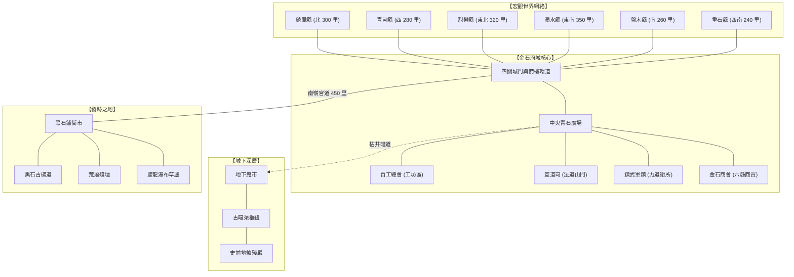

# 《遺忘的世界》全域地圖與空間拓撲總覽 (Maps & Topology)

本目錄匯整了《遺忘的世界》Tier 0（黑石鋪發跡地）與 Tier 1（金石都城及其六縣轄域）的空間拓撲結構、系統地圖輸出與 Mermaid 子圖設計。所有區域均已通過全域 BFS（廣度優先搜尋演算法）100% 可達性與雙向可逆驗證。

---

## 🗺️ 目錄結構

| 檔案 | 內容說明 | 關聯指令 |
| :--- | :--- | :--- |
| [world_map.md](file:///home/wade/src/github/mudscript/forgotten-space/docs/maps/world_map.md) | **宏觀世界網絡圖**：金石府城、六大外縣與黑石鋪地脈關係、貨運路線與里數 | `map world` |
| [city_map.md](file:///home/wade/src/github/mudscript/forgotten-space/docs/maps/city_map.md) | **金石都城九大分區詳細拓撲圖**：四大城門、百工總會、宣道司、鎮武軍鎮、市井核心與商貿區 | `map city` |
| [underground_map.md](file:///home/wade/src/github/mudscript/forgotten-space/docs/maps/underground_map.md) | **城下太古暗渠與舊城廢墟圖**：鬼市暗街、古暗渠樞紐、天字一號密室與史前殘殿 | `map under` |
| [village_map.md](file:///home/wade/src/github/mudscript/forgotten-space/docs/maps/village_map.md) | **黑石鋪新手聚落五方微生態圖**：青石街市、古礦坑、三清偏殿、老鐵匠鋪、墜龍瀑布 | `map village` |

---

## 🎮 遊戲內地圖指令指南

玩家與管理者可在遊戲內隨時呼叫由 [`/cmds/cmd_map.c`](file:///home/wade/src/github/mudscript/forgotten-space/cmds/cmd_map.c) 及 [`/secure/map_d.c`](file:///home/wade/src/github/mudscript/forgotten-space/secure/map_d.c) 提供之地圖服務：

```bash
# 1. 檢視當前所在區域地圖（根據當前所在房間自動切換）
map

# 2. 檢視金石都城九大分區總圖
map city

# 3. 檢視黑石鋪新手村微生態圖
map village

# 4. 檢視地下鬼市與太古暗渠廢墟圖
map under

# 5. 檢視全域六縣一府宏觀網絡圖
map world

# 6. 檢視周遭動態雷達小地圖 (自訂可視半徑 1-5 格)
map 2
```

---

## 🌐 空間拓撲總覽 (Full Topology Overview)



---

## 🛡️ 系統環境規則分佈

各地區依據世界觀設定受到 [`/daemon/city_d.c`](file:///home/wade/src/github/mudscript/forgotten-space/daemon/city_d.c) 的動態環境矩陣管轄：

1. **紅塵濁氣梯度 (Turbidity Gradient)**：
   - 市井商貿核心（中央廣場、六縣專材街、大客棧）：`100%`（紅塵萬丈，靈機晦澀）。
   - 修持道統轄區（宣道司太虛三清殿、百工總會天工殿）：`45%`（有陣法防護與定氣香爐）。
   - 外城農田草野（西郊農田、灌溉水渠）：`15%`（野氣初開）。
   - 城下深層廢墟（地下鬼市、古暗渠、殘殿）：`5%`（紅塵隔絕，但受地脈煞氣影響）。
2. **絕靈法網防衛 (Spirit-Sealing Grid)**：
   - 都城市井行政及核心區域受官府法網全面覆蓋，壓制未經報備的高階法術爆發。
   - 地下暗渠、城外荒郊與亂葬塚則位於法網死角之外，不受官府壓制。
