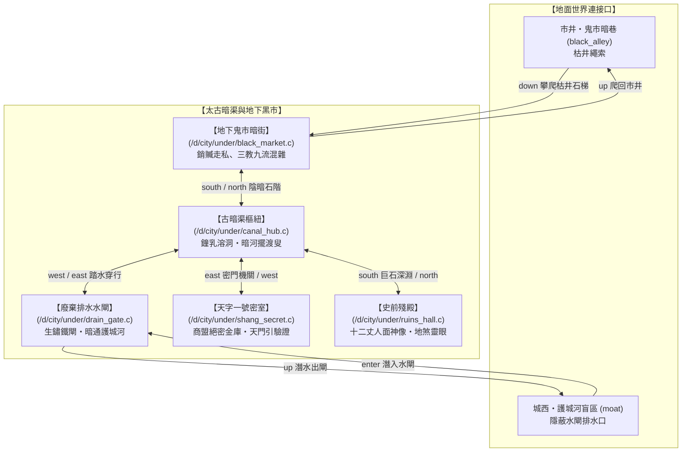

# 城下太古暗渠與舊城廢墟圖 (Underground Map)

金石府城建立於多個大劫前文明的殘垣之上。在青石地面與繁華市井之下，存在著錯綜複雜的太古地下暗渠與舊城廢墟。此處遠離官府絕靈法網的壓制，紅塵濁氣極低，是黑市交易、密謀與尋找失落道統的隱秘去處。

---

## 💻 遊戲內指令輸出 (`map under`)

當玩家在地下區域輸入 `map` 或執行 `map under` 時，顯示如下 ASCII 地圖：

```text
【金石城下・太古暗渠與舊城廢墟地圖】
──────────────────────────────────────────────────────────
                 [地面・鬼市暗巷]
                        │ (down)
                  【地下鬼市】 (銷贓黑市暗街)
                        │
  [廢棄水閘] ──── 【古暗渠樞紐】 ──── 【天字一號密室】
 (護城河盲區)      (溶洞暗河・擺渡叟)      (需天門引信物驗證)
                        │
                  【史前殘殿】 (人面神像・地煞匯聚)
──────────────────────────────────────────────────────────
```

---

## 🗺️ 城下暗渠詳細 Mermaid 拓撲子圖



---

## 🕳️ 地下區域房間與特殊機制清單

| 檔案路徑 | 名稱 | 方位與出口 | 特殊機制 / 核心 NPC |
| :--- | :--- | :--- | :--- |
| [`under/black_market.c`](file:///home/wade/src/github/mudscript/forgotten-space/d/city/under/black_market.c) | 地下鬼市 | `up` $\to$ 地面鬼市暗巷<br>`south` $\to$ 古暗渠樞紐 | 銷贓交易商、黑市情報販子、無名刺客。濁氣 5%，法網死角。 |
| [`under/canal_hub.c`](file:///home/wade/src/github/mudscript/forgotten-space/d/city/under/canal_hub.c) | 古暗渠樞紐 | `north` $\to$ 地下鬼市<br>`west` $\to$ 廢棄水閘<br>`east` $\to$ 天字一號密室<br>`south` $\to$ 史前殘殿 | 暗河擺渡叟（擺渡過河）、溶洞水滴聲。四通八達地下樞紐。 |
| [`under/drain_gate.c`](file:///home/wade/src/github/mudscript/forgotten-space/d/city/under/drain_gate.c) | 廢棄水閘 | `east` $\to$ 古暗渠樞紐<br>`up` $\to$ 護城河盲區 | **城防潛入隱蔽通道**：可繞過金石四關守衛盤查，從護城河潛水直達地下。 |
| [`under/shang_secret.c`](file:///home/wade/src/github/mudscript/forgotten-space/d/city/under/shang_secret.c) | 天字一號密室 | `west` $\to$ 古暗渠樞紐 | **門禁防護**：進入需身懷金石商盟腰牌（天門引 / `caravan_token`）。內設機關鎖與金庫大箱。 |
| [`under/ruins_hall.c`](file:///home/wade/src/github/mudscript/forgotten-space/d/city/under/ruins_hall.c) | 史前殘殿 | `north` $\to$ 古暗渠樞紐 | **地煞靈眼**：聳立殘破十二丈人面神像，地底地煞之氣匯聚，為法道修士淬煉神識與探尋失落紀元的禁地。 |

---

## ⚡ 核心環境特性

1. **濁氣極低 (5%)**：地表百萬凡俗的七情六慾紅塵之氣無法穿透厚重地層，修士在此調息不會引發嚴重的濁氣反噬。
2. **絕靈法網盲區 (Spirit-Sealing Grid = 0)**：官府設於地表的絕靈法陣無法覆蓋深層地宮，在此施展術法、催動符籙皆無官府禁制限制。
3. **戰術偷渡要道**：通往城西護城河（[`moat.c`](file:///home/wade/src/github/mudscript/forgotten-space/d/city/wall/moat.c)）的廢棄水閘，是玩家攜帶管制物品或被通緝時進出都城的絕佳匿蹤路線。
