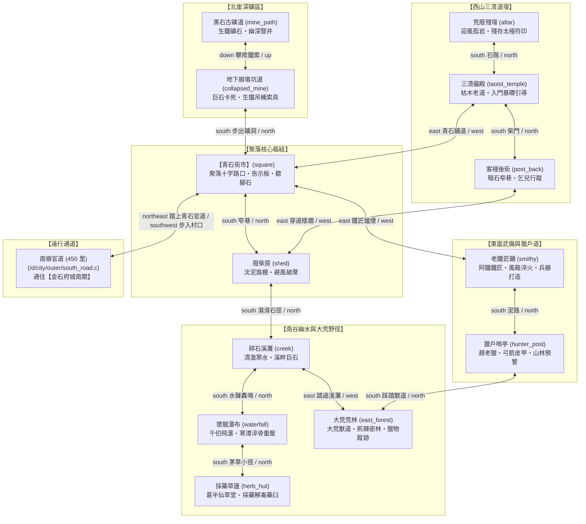

# 黑石鋪聚落五方微生態圖 (Village Map)

黑石鋪為《遺忘的世界》Tier 0 新手發跡之地。坐落於極南莽古山脈深谷，依傍黑石古礦與墜龍寒潭而建，五方分佈著礦道、三清偏殿、鐵匠鋪、荒林與草廬。

---

## 💻 遊戲內指令輸出 (`map village`)

當玩家在黑石鋪聚落輸入 `map` 或執行 `map village` 時，顯示如下 ASCII 微生態地圖：

```text
【黑石鋪・聚落五方微生態地圖 (Tier 0)】
──────────────────────────────────────────────────────────
                             【黑石古礦道】(北崖古礦坑)
                                   │ (up/down)
                             【地下崩塌坑道】(深井生鐵索具)
                                   │
   【荒廢殘壇】                    │                    往 【金石府城】
    (迎風孤岩)                     │                          ▲
        │                         │                          │ (northeast)
   【三清偏殿】 ───────── 【青石街市】 ───────── 【老鐵匠鋪】
    (枯木老道)                 (核心樞紐)                 (阿鐵爐火)
        │                         │                          │
   【客棧後街】 ───────── 【廢柴房】                   【獵戶哨亭】
    (青石暗巷)                 (沈泥窩棚)                 (趙老獵)
                                   │                          │
                             【碎石溪灘】 ───────── 【大荒荒林】
                              (幽霧水谷)                  (東林獸道)
                                   │
                             【墜龍瀑布】
                              (寒潭瀑布淬體)
                                   │
                             【採藥草廬】(葛半仙草堂)
──────────────────────────────────────────────────────────
```

---

## 🗺️ 黑石鋪詳細 Mermaid 拓撲子圖



---

## 🏡 黑石鋪房間與生態功能矩陣 (13 間房間)

| 檔案路徑 | 名稱 | 出口方向 | 核心生態功能 / NPC |
| :--- | :--- | :--- | :--- |
| [`square.c`](file:///home/wade/src/github/mudscript/forgotten-space/d/village/square.c) | 青石街市 | `north` $\to$ 崩塌坑道<br>`south` $\to$ 廢柴房<br>`west` $\to$ 三清偏殿<br>`east` $\to$ 老鐵匠鋪<br>`northeast` $\to$ 南嶺官道 | 聚落政治與交通樞紐、老村長、告示板。可直接踏上東北官道前往金石府城。 |
| [`mine_path.c`](file:///home/wade/src/github/mudscript/forgotten-space/d/village/mine_path.c) | 黑石古礦道 | `down` $\to$ 地下崩塌坑道 | 粗劣生鐵礦石採集點、地下透風暗隙。 |
| [`collapsed_mine.c`](file:///home/wade/src/github/mudscript/forgotten-space/d/village/collapsed_mine.c) | 地下崩塌坑道 | `up` $\to$ 黑石古礦道<br>`south` $\to$ 青石街市 | 採礦工、生鐵絞盤繩索吊桶。 |
| [`taoist_temple.c`](file:///home/wade/src/github/mudscript/forgotten-space/d/village/taoist_temple.c) | 三清偏殿 | `north` $\to$ 荒廢殘壇<br>`south` $\to$ 客棧後街<br>`east` $\to$ 青石街市 | 枯木老道（初期引導、初窺靈氣之道）。 |
| [`altar.c`](file:///home/wade/src/github/mudscript/forgotten-space/d/village/altar.c) | 荒廢殘壇 | `south` $\to$ 三清偏殿 | 孤峰岩頂、風水陣眼、參悟天地微機。 |
| [`post_back.c`](file:///home/wade/src/github/mudscript/forgotten-space/d/village/post_back.c) | 客棧後街 | `north` $\to$ 三清偏殿<br>`east` $\to$ 廢柴房 | 陰冷窄巷、野貓、避世老丐。 |
| [`shed.c`](file:///home/wade/src/github/mudscript/forgotten-space/d/village/shed.c) | 廢柴房 | `north` $\to$ 青石街市<br>`south` $\to$ 碎石溪灘<br>`west` $\to$ 客棧後街 | 貧苦沈泥窩棚、早期避難所。 |
| [`smithy.c`](file:///home/wade/src/github/mudscript/forgotten-space/d/village/smithy.c) | 老鐵匠鋪 | `west` $\to$ 青石街市<br>`south` $\to$ 獵戶哨亭 | 鐵匠阿鐵（生鐵小刀、打製粗鐵器物）。 |
| [`hunter_post.c`](file:///home/wade/src/github/mudscript/forgotten-space/d/village/hunter_post.c) | 獵戶哨亭 | `north` $\to$ 老鐵匠鋪<br>`south` $\to$ 大荒荒林 | 趙老獵（木弓獸夾、荒山獸潮警示）。 |
| [`creek.c`](file:///home/wade/src/github/mudscript/forgotten-space/d/village/creek.c) | 碎石溪灘 | `north` $\to$ 廢柴房<br>`south` $\to$ 墜龍瀑布<br>`east` $\to$ 大荒荒林 | 飲水解渴、洗滌濁氣、捕魚拾螺。 |
| [`waterfall.c`](file:///home/wade/src/github/mudscript/forgotten-space/d/village/waterfall.c) | 墜龍瀑布 | `north` $\to$ 碎石溪灘<br>`south` $\to$ 採藥草廬 | 激流瀑布、水潭、打坐淬鍊肉體骨骼。 |
| [`herb_hut.c`](file:///home/wade/src/github/mudscript/forgotten-space/d/village/herb_hut.c) | 採藥草廬 | `north` $\to$ 墜龍瀑布 | 葛半仙（止血草、解毒散、初級醫藥常識）。 |
| [`east_forest.c`](file:///home/wade/src/github/mudscript/forgotten-space/d/village/east_forest.c) | 大荒荒林 | `north` $\to$ 獵戶哨亭<br>`west` $\to$ 碎石溪灘 | 野兔野鹿、大荒外圍野獸、初生野外探勘。 |
