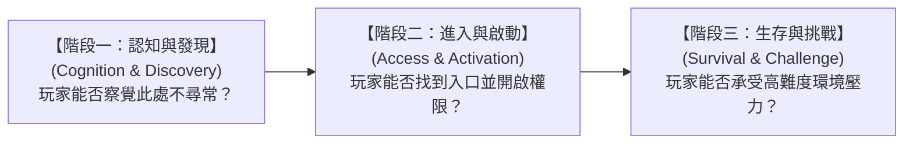
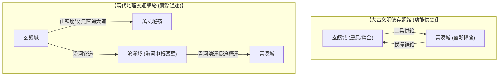
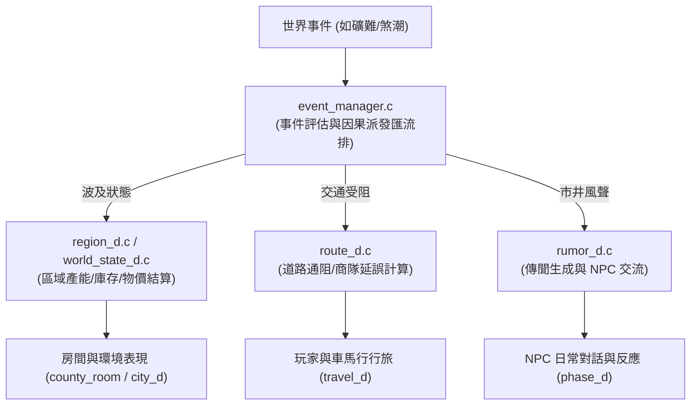
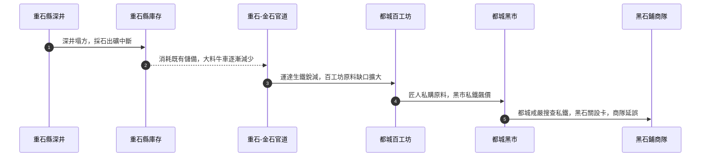
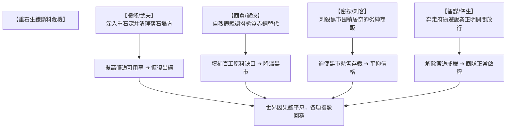
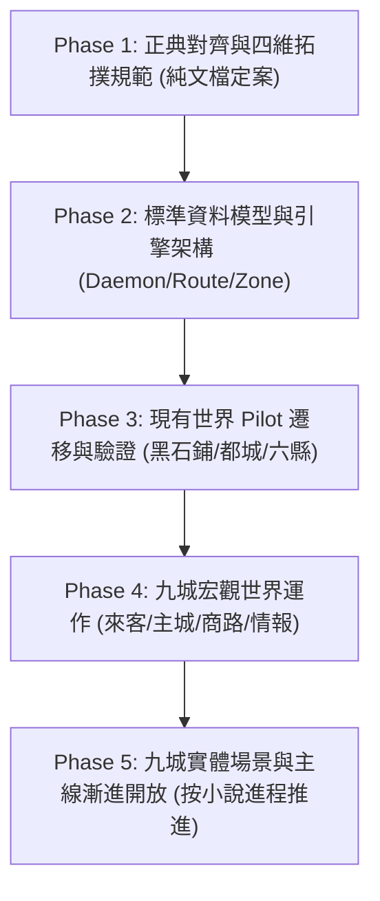

# 《遺忘的世界》(THE FORGOTTEN SPACE)
# Mudlib 宏觀擴建與太古九城系統總體設計方案暨實施手冊 (v3.1)

> **文件狀態**：正式定案稿 (v3.1 Final Specification)  
> **核心戰略方針**：**「先讓現有世界具備標準化的區域模擬能力，再讓九城逐步進入世界，絕不預先鋪設九座空城」**  
> **適用引擎**：MudScript (Go-LPC Engine)  
> **關聯核心**：[GEMINI.md](file:///home/wade/src/github/mudscript/GEMINI.md) ｜ [README.md](file:///home/wade/src/github/mudscript/forgotten-space/README.md) ｜ [world_state_d.c](file:///home/wade/src/github/mudscript/forgotten-space/daemon/world_state_d.c) ｜ [event_manager.c](file:///home/wade/src/github/mudscript/forgotten-space/daemon/event_manager.c)  

---

## 目錄 (Table of Contents)

- [第一篇：世界架構重構核心哲學](#第一篇世界架構重構核心哲學)
  - [1.1 四維正交解耦原則](#11-四維正交解耦原則)
  - [1.2 空間層級模型：Region ➔ Zone ➔ Site](#12-空間層級模型region--zone--site)
  - [1.3 三階段探索模型：認知 ➔ 啟動 ➔ 生存](#13-三階段探索模型認知--啟動--生存)
  - [1.4 世界正典與因果傳播律](#14-世界正典與因果傳播律)
- [第二篇：標準空間與通行模擬規範](#第二篇標準空間與通行模擬規範)
  - [2.1 標準區域模組 (Region Template v1.0)](#21-標準區域模組-region-template-v10)
  - [2.2 場域與遺跡模組 (Zone & Site Template)](#22-場域與遺跡模組-zone--site-template)
  - [2.3 跨區道路與交通模型 (Route Template)](#23-跨區道路與交通模型-route-template)
  - [2.4 多模式交通與特殊空間出入規則](#24-多模式交通與特殊空間出入規則)
- [第三篇：太古九城正典與雙重網絡](#第三篇太古九城正典與雙重網絡)
  - [3.1 九城總綱與文明失落史](#31-九城總綱與文明失落史)
  - [3.2 現代九城存續現狀矩陣](#32-現代九城存續現狀矩陣)
  - [3.3 雙重網絡：現代地理網絡 vs. 太古文明依存網絡](#33-雙重網絡現代地理網絡-vs-太古文明依存網絡)
  - [3.4 金石府城與天樞外圍陣基之正典錨定](#34-金石府城與天樞外圍陣基之正典錨定)
  - [3.5 現代認知 vs. 太古真實功能之正典分層](#35-現代認知-vs-太古真實功能之正典分層)
- [第四篇：底層引擎架構與工程憲章](#第四篇底層引擎架構與工程憲章)
  - [4.1 模組職能邊界與防護分工](#41-模組職能邊界與防護分工)
  - [4.2 靜態定義與動態狀態分離的混合持久化規範](#42-靜態定義與動態狀態分離的混合持久化規範)
  - [4.3 效能與數值雙軌模型：指數阻尼 vs. 狀態轉移](#43-效能與數值雙軌模型指數阻尼-vs-狀態轉移)
  - [4.4 工程憲章：不重寫原則 (No-Rewrite Principle)](#44-工程憲章不重寫原則-no-rewrite-principle)
- [第五篇：動態世界主體系統](#第五篇動態世界主體系統)
  - [5.1 九城來客：需求驅動的 NPC 跨區行旅系統](#51-九城來客需求驅動的-npc-跨區行旅系統)
  - [5.2 玩家主城：生活歸屬、商業據點與回城機制](#52-玩家主城生活歸屬商業據點與回城機制)
- [第六篇：首期試點深度推演：【重石生鐵因果傳播鏈】](#第六篇首期試點深度推演重石生鐵因果傳播鏈)
  - [6.1 測試預期值 vs. 模擬計算值](#61-測試預期值-vs-模擬計算值)
  - [6.2 階梯傳播與中間狀態流動](#62-階梯傳播與中間狀態流動)
  - [6.3 玩家多途徑干預機制](#63-玩家多途徑干預機制)
- [第七篇：分階段實作工程路線圖 (Phase 1–5)](#第七篇分階段實作工程路線圖-phase-15)
- [第八篇：P0 / P1 / P2 架構決策定案總綱](#第八篇p0--p1--p2-架構決策定案總綱)

---

# 第一篇：世界架構重構核心哲學

### 1.1 四維正交解耦原則

傳統在線遊戲常將「地理遠近」與「危險等級」綁定（越遠的區域等級越高），這會導致世界失去地理真實性與層次感。本專案將世界解耦為**四個彼此正交的維度**：

| 維度 | 英文定義 | 核心涵義與遊戲內表現 |
| :--- | :--- | :--- |
| **地理空間拓撲** | Spatial Network | 自然山脈、水系、官道驛道、商業棧道、地下暗河與空間裂隙的實際連接距離與交通成本。 |
| **危險挑戰等級** | Danger Tier (0–4) | 該場域的環境煞氣濃度、生存要素限制、怪物與敵對 NPC 戰鬥難度、法網壓制或天候懲罰。 |
| **文明與技術層次** | Civilization Level | 該區域的生產力型態：蠻荒獵聚落 ➔ 次級衛所縣城 ➔ 百萬人口世俗府治 ➔ 修仙宗門 ➔ 太古自律機械城市。 |
| **全域世界影響力** | World Influence | 該區域的政治決策、物資供應中斷或災難，能沿著地緣網絡波及至其他區域的半徑與幅度。 |

---

### 1.2 空間層級模型：Region ➔ Zone ➔ Site

> **核心憲律**：**Tier 絕非 Region 的單一屬性，而是場域（Zone / Site）的屬性。**

如果整個 Region 只有一個 Tier，則無法解釋金石府城「地面是世俗熱鬧的 Tier 1，地下暗渠是兇險的 Tier 2，深核殘殿卻是古代 Tier 3 陣基」的客觀事實。空間劃分確立為三級巢狀結構：

```mermaid
graph TD
    classDef reg fill:#1a365d,stroke:#2b6cb0,stroke-width:2px,color:#fff;
    classDef zone fill:#234e52,stroke:#319795,stroke-width:2px,color:#fff;
    classDef site fill:#742a2a,stroke:#e53e3e,stroke-width:2px,color:#fff;

    subgraph Region_JSF["【Region: 金石府城】(地理、行政、經濟與生活圈)"]:::reg
        ZONE_SURFACE["【Zone: 地面都城】(Tier 1)<br>官衙、市集、百工坊、坊市住宅"]:::zone
        ZONE_CANAL["【Zone: 太古暗渠與黑市】(Tier 2)<br>廢棄水閘、銷贓鬼市、溶洞暗河"]:::zone
        SITE_TIANSHU["【Site: 天樞南域陣基深殿】(Tier 3)<br>人面神像、陣基靈眼、太古自律中樞"]:::site

        ZONE_SURFACE -->|枯井/護城河水閘| ZONE_CANAL
        ZONE_CANAL -->|陣眼盲區/天門引石門| SITE_TIANSHU
    end
```

#### 空間管理層級權限與邊界規則：
1. **Region（區域）**：地理、行政、人口、經濟與宏觀勢力單位（如金石府城、重石縣、黑石鋪、玄鑄城）。
2. **Zone（分區）**：具體實體活動場域與生活生態（如地面都城、城郊採石場、地下暗渠）。承載基礎環境危險 Tier。
3. **Site（微場域／遺跡設施）**：Zone 內部特定機關、古代設施、陣基核心（如天樞南域陣基、南谷溪畔殘碑）。
4. **靈活性拓撲規則**：
   * 一個 Region 可包含多個 Zone；一個 Zone 可包含多個 Site。
   * **並非所有 Site 都必須隸屬 Zone**（如野外荒山孤立遺跡可由 Region 直轄），亦非所有 Zone 都必須具備 Site。
   * 區域內部允許存在**「尚未被玩家發現的隱藏 Zone / Site」**。
   * **高 Tier Site 可以合理坐落於低 Tier Region 之內**（如 Tier 3 陣基深植於 Tier 1 金石府都城地底）。
   * 此結構通用於太古九城（如百工城地面為 Tier 1~2 探索區，地下中樞為 Tier 3；歸墟城入口為 Tier 2，核心裂隙為 Tier 4）。

---

### 1.3 三階段探索模型：認知 ➔ 啟動 ➔ 生存

原「雙重檢定」正式擴展為**「三階段探索模型」**，將「發現」、「開啟權限」與「攻略生存」嚴格解耦，杜絕將物品、命數與環境抗性混為一談：



| 階段 | 核心回答之問題 | 判定途徑與檢定條件 | 典型反面範例 (避免) |
| :--- | :--- | :--- | :--- |
| **1. 認知與發現**<br>*(Discovery)* | 玩家能否辨識眼前的世俗表象藏有古代玄機？ | **多維途徑**（非單一身世鎖死）：感知靈性、悟性值、古籍殘卷線索、NPC 情報傳聞、特定時辰天象（如破曉旭日斜照）、物理除垢（磨刀石磨去頑苔）。 | ❌ *「天命值不足 3 則完全無法看見此房間」* |
| **2. 進入與啟動**<br>*(Activation)* | 玩家能否解讀陣紋、找到實體機關並獲得通行授權？ | **實體交互**：機關解鎖知識、陣法排列、特殊信物（天門引）、特定身分路引、道統手印。 | ❌ *將「需要天門引道具」塞在發現條件裡* |
| **3. 生存與挑戰**<br>*(Survival)* | 玩家能否在遺跡嚴酷的環境下存活並完成攻略？ | **硬實力檢定**：修為境界、煞氣/濁氣環境抗性、專用防護法器、避毒丹藥、隊伍職業協同。 | ❌ *生硬規定「等級低於 25 級禁止進入」* |

---

### 1.4 世界正典與因果傳播律

1. **不可變世界正典 (Immutable Canon)**：
   * 史前大清洗浩劫、太古九城文明體系、天地絕靈律法，為世界的底層公理。
2. **因果傳播律 (Causal Ripple)**：
   * 玩家行動不直接重寫宏觀歷史，但其產生的衝擊會沿著道路拓撲與經濟網絡擴散。
   * **傳播具備時空延遲**：消息傳播（驛馬/飛鴿）快於實體貨物運輸（牛車/商隊），不搞全服瞬態同步。

---

# 第二篇：標準空間與通行模擬規範

### 2.1 標準區域模組 (Region Template v1.0)

每個 Region 實例以獨立的資料結構管理宏觀社會與生活圈：

```json
{
  "region_id": "zhongshi",
  "name": "重石縣",
  "civ_level": "county",
  "coords": [-240, -180, 50],
  "resources": {
    "primary_product": "raw_iron",
    "secondary_product": "heavy_stone",
    "demand": ["grain", "herbal_medicine"],
    "reserves": { "iron_ore": 12000, "stone_blocks": 45000 },
    "price_index": 100
  },
  "factions": {
    "quarry_guild": { "power": 65, "agenda": "deep_shaft_mining" },
    "official_garrison": { "power": 35, "agenda": "patrol_mountain_pass" }
  },
  "crisis_deck": [
    { "id": "quarry_collapse", "base_weight": 25, "trigger_metric": "mine_instability" },
    { "id": "miner_wage_strike", "base_weight": 15, "trigger_metric": "guild_greed" }
  ],
  "zone_refs": [
    { "zone_id": "zhongshi_town", "type": "settlement" },
    { "zone_id": "zhongshi_quarry", "type": "industrial" }
  ]
}
```

---

### 2.2 場域與遺跡模組 (Zone & Site Template)

Zone 與 Site 承載實際的危險度 Tier、環境規則與三階段探索檢定：

```json
{
  "site_id": "tianshu_southern_core",
  "parent_zone": "jinshi_underground",
  "parent_region": "jinshi_city",
  "tier": 3,
  "environment": {
    "type": "ancient_array_core",
    "pressure": "disha_turbidity_high",
    "fawang_effect": "extreme_spirit_suppression"
  },
  "discovery_rules": {
    "min_perception": 40,
    "astronomy_condition": "shichen_dawn",
    "optional_clues": ["storyteller_hint", "ancient_rubbing_fragment"]
  },
  "access_rules": {
    "required_item": "tianmen_token",
    "mechanism_action": "align_three_runes"
  },
  "survival_rules": {
    "min_turbidity_resistance": 65,
    "required_buff": "disha_ward"
  }
}
```

---

### 2.3 跨區道路與交通模型 (Route Template)

> **核心升級**：Route 是因果傳播的重要載體，但不是所有因果的唯一載體（修仙界飛劍、地脈煞潮可跨地理傳播）。

```json
{
  "route_id": "zhongshi_to_jinshi",
  "from": "zhongshi",
  "to": "jinshi_city",
  "type": "paved_highway",
  "transport": {
    "distance": 240,
    "travel_time_minutes": 180,
    "capacity_freight": 100,
    "toll_copper": 2,
    "risk_tier": 1,
    "conditions": {
      "weather_sensitive": true,
      "requires_permit": false,
      "checkpoint_present": true
    }
  },
  "propagation": {
    "information_delay_minutes": 60,
    "freight_impact_delay_minutes": 180,
    "weight_attenuation": 0.85
  }
}
```
* **雙軌異步性**：消息傳播（60 分鐘）快於大宗貨物抵達（180 分鐘）。市場商人可先因傳聞調整盤價，而實體庫存需等待車隊實際抵達後增減。

---

### 2.4 多模式交通與特殊空間出入規則

| 交通方式 | 移動性質 | 運作規則與限制 |
| :--- | :--- | :--- |
| **步行、單人坐騎** | 個人物理移動 | 依照個人身法、坐騎速力與道路地形難度結算。 |
| **馬車、大宗商隊** | 集體物流行旅 | 需依班次發車，受道路阻滯、塌方、路引關卡與沿途事件攔截影響。 |
| **內河漕運／海運** | 大宗水路轉運 | 依水系水文、季節冰凍（冬季封河）與水閘開閉結算。 |
| **回城捲軸** | 個人緊急折返 | 瞬時返回玩家登記的**主城**；**受特殊空間法則限制**。 |
| **古代傳送陣** | 超遠距空間躍遷 | 需特定古代陣列修復、充沛靈石結晶、授權身分牒文。 |
| **Tier 3 洞天秘境** | 獨立時空進出 | **剛性時空法則**：如桃花源「洞內 90 日 = 人世 3 年」；禁止一般回城捲軸直接突破空間壁壘，必須透過專屬信標或通道進出。 |

---

# 第三篇：太古九城正典與雙重網絡

### 3.1 九城總綱與文明失落史

太古九城是史前單一超凡人道文明構建的**九大文明機能中樞節點**。

1. **九城現代形態界線**：九城名稱指涉的是太古時期的九大文明機能中樞，**絕非意味著現代世界仍存在九座完整的同名古代大城**！現代遺留下來的，是依附於九城古老陣基與地脈之上的**現代遺址、世俗聚落、修仙宗門祖庭、大宗商業港口或荒野地理節點**。
2. **天樞總陣狀態**：大清洗浩劫後，天樞城總陣的跨城協調功能中斷，但**總陣中樞本體仍然存在，只是處於受損、隔離或沉睡狀態**；其散落各地的外圍陣基（如南域金石府地下）則以微弱的殘留機能自主運轉。
3. **大清洗的真相保留**：關於萬年前「史前大清洗」浩劫的起因、幕後力量與終極真相，在當前正典中**嚴格保留為未解之謎**，不在第一階段過早定義，作為小說創作與遊戲長線的核心伏筆。

---

### 3.2 現代九城存續現狀矩陣

| 城名 | 太古核心功能 | 核心道統與專長 | 現代存續形態與地理現況 | 開放階段規劃 |
| :--- | :--- | :--- | :--- | :--- |
| **天樞城** | 文明樞紐 | 總陣調度、大域法網、文明治理 | **中樞本體受損沉睡隔離**，協調中斷。外圍陣基散落南域，金石府城即坐落於其外圍陣基之上。 | 空間跨 Tier 1~4；實體依主線漸進開放 |
| **玄鑄城** | 百兵之源 | 火山地火淬鍊、神兵、精密採礦 | **火山地火工坊遺跡**。古代鍛造設施在地下自主運轉，外圍由霸刀宗門把守。 | 宏觀經濟先行 ➔ Tier 2 宗門後續實裝 |
| **青溟城** | 萬物生養 | 靈脈水土、靈植繁育、生態循環 | **自律古生態區**。太古生態技術與優良物種保存中樞（不代表天下所有靈藥皆源於此，各地域保有獨立生態）。 | 宏觀供需節點 ➔ 跨區商運實裝 |
| **觀星城** | 仰觀天象 | 星辰曆法、命數推演、大劫預警 | **高山星台遺世獨立**。術數學派世守，存有大清洗前古天象異常記錄。 | 時間線情報中樞 ➔ 功法推演實裝 |
| **藏經城** | 萬法歸藏 | 百家學派、功法源流、古代文字 | **地下古卷封存庫遺址**。玉簡殘卷散落天下，核心庫藏由太古符文結界封鎖。 | 典籍收集主線 ➔ 核心庫藏實裝 |
| **滄瀾城** | 萬水交匯 | 大河入海口、跨區漕運、海洋探索 | **繁盛海港商業重鎮**。現代世俗商號雲集，水下深處埋藏著沉沒的太古船塢。 | 港口商業先行 ➔ Tier 3 水下遺跡 |
| **百工城** | 萬器之都 | 機關工程、自律傀儡、動力核心 | **封閉自律機關廢墟城**。城中無活人，古代自律傀儡巡邏修復，生人難入。 | Tier 1~2 外圍探索 ➔ Tier 3 地下機關城 |
| **鎮岳城** | 九城之盾 | 邊關防禦陣列、戰陣、封印大陣 | **荒北邊關絕壁衛所**。古代防禦法陣半殘運轉，當代軍府鎮守於此阻截外域大凶。 | 邊塞防禦先行 ➔ 封印陣列實裝 |
| **歸墟城** | 不可知境 | 空間褶皺、未知文明、虛實通道 | **虛空時空裂隙特異點**。座標漂移不定，古籍有載而世人莫見，大清洗真相核心。 | Tier 2 入口 ➔ Tier 4 終極時空核心 |

---

### 3.3 雙重網絡：現代地理網絡 vs. 太古文明依存網絡

> **核心思想**：文明供需關係與現代道路條件**並不完全對等**，這正是動態世界故事的核心來源！



* **動態連鎖範例**：
  * 太古時代，玄鑄城與青溟城互通有無；
  * 但現代兩城間山嶺崩毀，物資必須經由**滄瀾城水運碼頭**轉運；
  * 一旦滄瀾城因水患封港 ➔ 青溟農具短缺 ➔ 農業產能下降 ➔ 糧價暴漲 ➔ 連帶引發玄鑄城礦工糧荒！

---

### 3.4 金石府城與天樞外圍陣基之正典錨定

金石府城歷史與底層正典徹底閉環：

1. **官府「絕靈法網」**：正典上確立其為**太古天樞總陣殘留的秩序機制**（具體運作頻率參數、作用半徑與物理原理保留為後續深入設定），壓制修士神通私鬥，庇佑凡俗市井生活。
2. **城下太古暗渠**：原為天樞陣基的地下冷卻水系、地脈回流與檢修通道（[underground_map.md](file:///home/wade/src/github/mudscript/forgotten-space/narrative/docs/maps/underground_map.md)）。
3. **十二丈人面神像**：為天樞城派駐南域的巡天監察靈位機關，鎮鎖地煞，感應天地總陣。

---

### 3.5 現代認知 vs. 太古真實功能之正典分層

> **正典嚴格區分**：**現代人如何使用，不代表現代人理解其原始功能。**

| 設施實體 | 現代世俗／官府認知 | 太古正典真實本質 | 探索引導意義 |
| :--- | :--- | :--- | :--- |
| **金石絕靈法網** | 朝廷法度嚴明，官府宣道司以龍氣符印壓制方外修士私鬥。 | 太古天樞總陣殘留的秩序機制（後續設定物理參數）。 | 解開法網之謎是進入陣基深核的必修功課。 |
| **城下太古暗渠** | 舊城排污盲區、三教九流聚集的地下銷贓鬼市暗街。 | 天樞陣基自律冷卻水系、地脈回流管與符文維護通道。 | 順著暗河水道水流方向，方能找到陣基排熱閥門。 |
| **十二丈人面神像** | 史前未知殘殿、凡俗膜拜的避煞石神或邪祀殘像。 | 天樞城南域巡天監察靈位機關，用於監測總陣地脈共鳴。 | 需特定破曉星象斜射，神像眼瞳陣紋方顯露真容。 |

---

# 第四篇：底層引擎架構與工程憲章

### 4.1 模組職能邊界與防護分工



| 模組檔案 | 核心責任 | 禁止越界行為 |
| :--- | :--- | :--- |
| `world_state_d.c` | 世界全域狀態索引、區域註冊、跨系統協調 | 不直接硬編碼各城 NPC 個人行為細節。 |
| `region_d.c` | 單一 Region 內部數值模擬、Lazy Evaluation 差額推進 | 不直接調用其他區域私有變數，統一透過 Route 介面傳播。 |
| `route_d.c` | 管理道路路網、交通時間、關卡路引檢驗、貨流容量 | 不負責決定單一城鎮內部物價。 |
| `event_manager.c` | 純函式事件定義、發布/訂閱事件匯流排、因果派送 | **不直接修改城市物價**；只產生事件 impact，由各領域模組吸收。 |
| `rumor_d.c` | 將動態事件轉化為民間傳聞、說書人段子與 NPC 問答 | 不直接干預底層經濟數值。 |
| `city_d.c` | 金石都城專屬環境（紅塵濁氣梯度、三日通牒倒數） | 不干涉外縣與其他城市內部事務。 |

---

### 4.2 靜態定義與動態狀態分離的混合持久化規範

| 資料類別 | 實體存放路徑 | 管理與加載模式 | 職能特點 |
| :--- | :--- | :--- | :--- |
| **Region / Zone / Site 定義** | `/world/regions/` | 靜態 JSON 檔案，運行時唯讀 | 版本化管理，不佔存檔體積。 |
| **Route 道路定義** | `/world/routes/` | 靜態 JSON 檔案，運行時唯讀 | 定義交通拓撲與傳播權重。 |
| **區域動態狀態** | `/data/regions/{id}.o` | 分區持久化存檔 | 記錄本地庫存、牌價、Agenda 進度。 |
| **全域世界索引** | `/data/world_state.o` | 集中協調管理 | 記錄全服 T-Clock 與大事件整體狀態。 |
| **事務性事件帳本** | `/data/events/` | 獨立狀態紀錄 | 保證事件冪等性，重啟不丟失、不重複。 |
| **NPC 行旅狀態** | `/data/npcs/` | 模組化動態存檔 | 記錄跨城 NPC 所在道路與剩餘時間。 |

---

### 4.3 效能與數值雙軌模型：指數阻尼 vs. 狀態轉移

#### A. 價格與連續數值：指數阻尼自然回歸 (Exponential Damping)
適用於市場物價、浮動供需等具備自然均衡特性的數值：
$$P(t + \Delta t) = 100 + (P(t) - 100) \cdot e^{-k \Delta t}$$
* $k$ 與 $\Delta t$ 嚴格使用一致的遊戲時間單位。偏離 100% 越遠，前期平息速度越快，平滑趨近基準值。
* 物價嚴格鉗制在 **50% 至 300%**。

#### B. 災難與物理結構：離散狀態轉移模型 (State Transition Model)
> **重要原則**：**塌方的礦道與損壞的機關絕不會因時間經過自動復原！**

* 礦道坍方、道路封閉、水閘損壞、陣營控制權轉移等實體危機，必須透過**具體工程行動、玩家干預、官府撥款或勢力修復**，方能觸發狀態轉移（State Transition）恢復常態。

---

### 4.4 工程憲章：不重寫原則 (No-Rewrite Principle)

1. **介面與適配器優先 (Adapter First)**：既有系統只要能透過介面擴充，絕不推倒重寫。
2. **局部重構需有明確依據**：僅在效能瓶頸或設計衝突時進行微創重構。
3. **測試基線守護**：每次改動必須經由測試套件驗證，確保原有 3,500+ 項測試無任何回歸。

---

# 第五篇：動態世界主體系統

### 5.1 九城來客：需求驅動的 NPC 跨區行旅系統

九城來客絕非每隔固定時間生硬刷新 3 名 NPC，而是**由世界供需、地緣政治與大事件動態驅動**：

| 來客類型 | 驅動條件範例 | 對當前區域之世界影響 |
| :--- | :--- | :--- |
| **商業來客** | 玄鑄城糧荒 ➔ 派出商隊赴青溟、滄瀾採購 | 提高當地糧食收購價，帶來外地特產兵甲。 |
| **官方使節** | 金石府絕靈法網異常 ➔ 宣道司派員赴朝廷或宗門質證 | 引發府衙戒嚴、盤查加嚴、公文委託釋出。 |
| **宗門修士** | 天象異常或煞潮前兆 ➔ 觀星城術士、天工坊密探進駐 | 釋出高階收購懸賞、推動特殊勘測主線。 |
| **流民避難** | 邊境大荒煞潮爆發 ➔ 邊境流民南遷湧入關隘 | 壓低底層勞工工資，提高治安惡化與黑市風險。 |

* **效能維護**：所有旅行 NPC 均採 Lazy Evaluation，僅在抵達節點或有玩家接觸時結算位置。

---

### 5.2 玩家主城：生活歸屬、商業據點與回城機制

* **生活歸屬**：玩家完成黑石鋪新手村探索出村後，可自主選擇一座已開放城池（如金石府城）登記為**「主城」**。
* **主要機能**：提供永久倉庫、個人工坊據點、陣營聲望勳階，並作為回城捲軸的錨點。
* **非懲罰性經濟**：在非主城交易不粗暴收取「10% 懲罰稅」，而是主城享有本地專屬補貼、商業行會減免或特定免稅配額。
* **時空剛性限制**：回城捲軸絕對無法穿透 Tier 3 桃花源等特殊封閉空間。

---

# 第六篇：首期試點深度推演：【重石生鐵因果傳播鏈】

### 6.1 測試預期值 vs. 模擬計算值

* **測試預期值**：固定初始單元測試中的確定性驗證斷言。
* **模擬計算值**：運行時受本地原有庫存緩衝、商道運費、黑市哄抬共同計算。

---

### 6.2 階梯傳播與中間狀態流動



---

### 6.3 玩家多途徑干預機制



---

# 第七篇：分階段實作工程路線圖 (Phase 1–5)

> **核心執行憲章**：**Phase 1 不負責把九城全部寫完，而是負責定義九城如何存在於同一個世界。先讓黑石鋪、金石府、六縣具備可持續運作的標準化世界模型，再讓九城逐步進入這個模型。**



### 階段詳細任務表

> **嚴格文件分工憲律 (Strict Document Boundary)**：
> * **`nine_cities_canon.md` (世界正典事實)**：回答九城是什麼、為何存在、歷史上發生過什麼、現代留下什麼。負責「世界事實與正典公理」。
> * **`macro_nine_cities_atlas.md` (空間地理拓撲)**：回答九城在哪裡、彼此如何連接、現代地理網絡與太古文明依存關係如何不同。負責「空間關係與道途拓撲」。
> * **嚴禁事項**：絕不能將兩份文件寫成同一份資料的兩種換皮版本！

| 階段 | 核心目標 | 具體任務內容 | 產出檔案清單 | 驗收與交付標準 |
| :--- | :--- | :--- | :--- | :--- |
| **Phase 1**<br>正典對齊與四維拓撲 | 完成世界觀正典文檔，不碰代碼 | 1. 確立天樞陣基正典（現代認知 vs 太古功能、中樞受損隔離沉睡、大清洗起因保留懸念）。<br>2. 制定 Region/Zone/Site 三層空間矩陣。<br>3. 確立現代地理網 vs. 太古依存網差異。<br>4. 制定跨區交通與洞天出入規則。 | `world/lore/nine_cities_canon.md`<br>(九城正典錄：世界事實)<br><br>`narrative/docs/maps/macro_nine_cities_atlas.md`<br>(宏觀拓撲圖譜：空間關係) | 兩份文件職責清晰分開，經審核無矛盾、拓撲無斷點。 |
| **Phase 2**<br>標準資料模型與引擎架構 | 完成底層資料規格與守護進程分工 | 1. 撰寫 `/include/region.h`。<br>2. 設計 `Route` 交通與傳播雙軌資料結構。<br>3. 實現 `Lazy Evaluation` 時間戳結算函式。<br>4. 明確守護進程分工（`world_state_d` 與 `event_manager` 解耦）。 | `/include/region.h`<br>`world/regions/*.json`<br>`daemon/world_state_d.c` (升級) | 編譯無警告，單元測試通過。 |
| **Phase 3**<br>現有世界 Pilot 遷移與驗證 | **首要核心戰役**：賦予現有世界標準化模擬能力 | 1. 將黑石鋪、金石府城、六縣遷移套用標準 Region/Zone/Site 模板。<br>2. 實裝【重石生鐵因果傳播鏈】。<br>3. 實裝玩家多途徑干預機制與指數阻尼回歸。<br>4. 驗證現有都城功能零退化。 | `tests/test_region_iron_chain.c`<br>更新現有縣城房間介面 | 執行測試全數通過（3,500+ tests），確認無回歸。 |
| **Phase 4**<br>九城宏觀世界運作 | 讓九城以宏觀背景與流動人口進入世界 | 1. 建立九城宏觀供需指數（玄鑄兵甲、青溟靈糧）。<br>2. 實裝「九城來客」NPC 跨區活動與行旅動態。<br>3. 實裝「玩家主城」生活、倉庫與回城機制。<br>4. 連動 `rumor_d.c` 動態生成跨城傳聞與市場牌價。 | `daemon/rumor_d.c`<br>`cmds/std/cmd_city.c`<br>`cmds/std/cmd_market.c` | 玩家能在都城打聽九城流言、查閱天下物價、登記主城。 |
| **Phase 5**<br>九城實體場景漸進實裝 | 配合小說創作逐一開放九城實體 | 1. 第一批：天樞南域陣基深殿（Tier 3 核心機關迷宮）。<br>2. 第二批：藏經城殘卷探尋、觀星城高山星台。<br>3. 第三批：玄鑄城地火工坊、滄瀾城水運港口與水下沉船。<br>4. 第四批：百工城自律機關、鎮岳城邊關絕嶺。<br>5. 第五批：歸墟城終極時空裂隙。 | 各城市實體房間目錄 (`/d/ancient/...`) | 依小說幕次發布，每座城皆具獨立生態與主線閉環。 |

---

# 第八篇：P0 / P1 / P2 架構決策定案總綱

### 🔴 P0 級：核心架構基石（正式採納）
1. **空間層級認同**：正式採納 **Region ➔ Zone ➔ Site**。Tier 嚴格歸屬於 Zone / Site。允許高 Tier Site 位於低 Tier Region，允許隱藏 Zone/Site。
2. **探索三階段模型**：雙重檢定正式升級為 **「認知與發現」➔「進入與啟動」➔「生存與挑戰」**，將發現線索、開門信物與環境抗性徹底解耦。
3. **天樞陣基正典錨定**：正式錨定金石府底層為天樞城南域外圍陣基，並在正典中明確區隔**「現代世俗認知」**與**「太古真實機能」**。
4. **最高工程憲章**：堅守 **No-Rewrite 原則**，現有世界標準化優先，九城宏觀背景逐步顯現，**絕不預先鋪設九座空城**。

### 🟡 P1 級：資料與引擎規範（正式採納，Phase 2 實裝）
1. **Route 雙軌模型**：實體交通（耗時/容量/路費）與因果傳播（情報前導延遲/衰減）分離；道路是主要載體但非唯一載體。
2. **混合式持久化架構**：靜態配置 `/world/` + 動態狀態 `/data/`，集中管理索引、分區持久化狀態、事務性事件帳本。
3. **數值與物理雙軌自癒**：連續市場數值採**指數阻尼回歸**；離散物理災情採**狀態轉移模型**（需具體行動修復）。

### 🟢 P2 級：生活主體系統原則（原則確立，Phase 4 校準）
1. **九城來客動態驅動**：NPC 跨區活動由城市需求、供應、交通與事件動態驅動，非定時定額生硬刷新；採 Lazy Evaluation。
2. **玩家主城生活歸屬**：主城提供生活基地、倉庫與回城錨點，不限制跨城流動，非主城交易不設惡性懲罰稅。

---
*(手冊完。後續工程開發應嚴格依循本手冊所列階段與規範推進。)*
