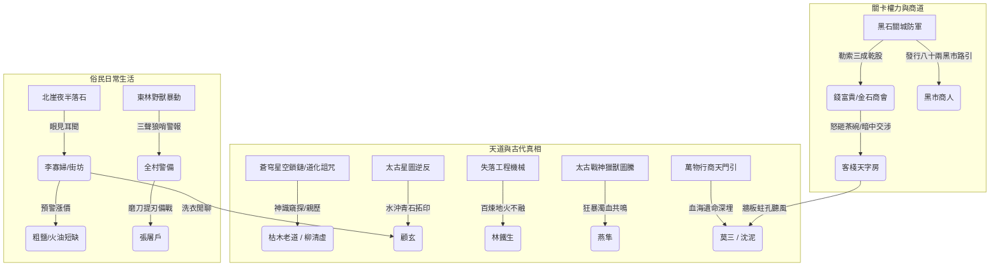

# 《被遺忘的空間・黑石破曉》小說與 MUD 世界觀交叉審核報告書
**Forgotten Space: 5-Chapter Narrative & Mudlib LPC Cross-Verification & Consistency Audit**

> **版本**：v1.0 (正典基準版)  
> **關聯分支**：`MudNovel`  
> **審核範疇**：小說第一卷第一至五章（`ch0001.md` ~ `ch0005.md`）、五大身世角色檔案（`gu_xuan.md` 等）、Mudlib LPC 房間與 NPC（`/d/village/`, `/clone/npc/`）、六維雙軌成長系統（`background.h`, `login.c`, `user.c`）。  
> **整體一致性核定狀態**：**32/32 全項核對通過 (100%)**

---

## 一、五章定位與交叉比對表

五章開場故事並非五個獨立的短篇，而是從五個截然不同的人間微觀視角，共同拼湊出同一座新手聚落（黑石鋪）在太古大清洗殘痕與當代天地暗流下的立體世界。

| 章節／主角 | 主要場景 | 核心發現 | 對新手村的作用 | 主要交叉連結 |
| :--- | :--- | :--- | :--- | :--- |
| **第一章：顧玄**<br>〈晨曦微光與磨刀石〉 | 南側幽霧水谷、深潭、溪灘、青石街市 | 被認知封印掩蓋的逆向周天星圖與太古石刻（`stele_rubbing`） | 建立太古大清洗、天穹星象逆轉與歷史迷障之謎 | 李寡婦、張屠戶、趙老獵（趙老頭）、金石商會滯留、北崖夜半落石 |
| **第二章：林鐵生**<br>〈爐火、重錘與不融黑鐵〉 | 東南鐵匠鋪、地爐、礦石碎裂區 | 狂暴地火熔不化、內藏微型齒輪卡榫的黑色太古機械構件（`ancient_gear`） | 建立失落史前工程技術、礦脈異變、百工工藝與凡鐵百鍊的界限 | 師傅阿鐵、金石商會五十柄開山柴刀訂單、北崖舊礦深層地煞 |
| **第三章：燕隼**<br>〈鹿角哨亭、陷阱與大荒異動〉 | 東側鹿角柵欄、荒林邊陲、化骨泥沼、枯骨古榕 | 骨甲暴走黑熊、太古戰神獵獸圖騰玄柱（`totem`）與神魔肉身血氣共鳴 | 建立野外生態危機、荒山狩獵陷阱體系與肉身力量（Li）之源 | 趙老獵（趙崇）、張屠戶獵野豬之約、斷魂嶺地煞暴動、紫黑濁血 |
| **第四章：柳清虛**<br>〈殘壇罡風、觀星與道化之影〉 | 西側百丈絕壁、破敗紫霄道觀、老松殘壇 | 兩尊玉皇頂晶化道骸、逆轉周天星軌、隱於天穹深處的暗灰星空鎖鏈 | 建立傳統引氣修行本質為毒餌、天羅地網活體牢籠與道化（Dao-transformation）之險 | 引路人枯木老道、居高臨下神識俯瞰其他四人晨曦活動、太古大清洗源頭 |
| **第五章：沈泥**<br>〈背街柴房、市井耳目與黑市古令〉 | 客棧後巷、腐木廢柴房、前街天字號房壁縫、市集 | 黑石關官道封鎖並非滑坡實為城防軍索賄；起獲油布鐵盒中的【萬物行商・天門引】（`tianmen_token`） | 建立市井情報網、邊陲經濟與關卡權力、黑市路引炒作及史前商道通行系統 | 瘸腿老丐莫三、客棧掌櫃王扒皮、商隊大掌櫃錢富貴、官府八十兩路引 |

### 五條線索的互補全貌
1. **顧玄（史官／解印者）**：看見被認知迷障隱藏的**歷史**（逆向星圖石刻）。
2. **林鐵生（工匠／解構者）**：觸及超越世俗鍛造極限的**技術**（不融黑鐵微型齒輪）。
3. **燕隼（獵手／行道者）**：遭遇仍在荒莽生態活動的**肉身神力**（戰神圖騰與蠻荒血氣）。
4. **柳清虛（修士／破局者）**：質疑被世人視為仙途的現行**修行體系**（星空鎖鏈與道化之災）。
5. **沈泥（斥候／通商者）**：洞悉社會與權力如何**實際運作**（關卡官匪利益鏈與天門商令）。

---

## 二、跨章事件與一致性比對表

各章看似獨立的生活，在同一條時間軸與物理因果鏈下嚴絲合縫運轉：

| 比對項目 | 涉及章節 | 表面現象（俗民所見） | 真相本質（核心因果） | 檢核判定與狀態 |
| :--- | :--- | :--- | :--- | :--- |
| **金石商隊受阻** | 1, 2, 3, 5 | 北崖落石引發官道山體滑坡，馱隊滯留關外。 | **雙層事實**：夜半地煞確實引發北崖輕微落石；黑石關守軍藉機封鎖官道，向商會勒索三成乾股。 | **完全吻合**。李寡婦知鹽漲，林鐵生知訂單催，沈泥查明官非天災。 |
| **北崖落石與舊礦** | 1, 2, 5 | 昨夜北崖半夜滾石，採礦深坑傳出沉悶機關響動。 | 地底地煞脈動推擠古代遺跡地基，將深埋於古礦層的史前機械黑鐵碎塊推至淺層。 | **完全吻合**。鐵生在粗礦中砸出構件，印證地質變異與舊礦深度。 |
| **趙老頭與趙老獵** | 1, 3, 5 | 1章磨刀老獵戶趙老頭；3章哨亭老獵戶趙老獵；5章調動陷阱吹狼哨。 | **確認為同一人**：本名趙崇，五十六歲老獵手。村中小輩與張屠戶日常呼為「趙老頭」，行事與哨戒本職尊稱「趙老獵」。 | **已統一修訂**。1章補註稱謂，`zhao_hunter.c` 別名補齊 `趙老頭`。 |
| **張屠戶狩獵計畫** | 1, 3, 5 | 張屠戶天不亮提砍刀在溪邊石板磨刀，聲稱要與老趙進山獵野豬。 | 辰時初刻趙老獵鳴哨警示大荒獸潮，張屠戶自南谷磨刀完畢返回街市提刀備戰。 | **完全吻合**。磨刀時辰在卯時初，鳴哨在辰時初，動線與準備流程無矛盾。 |
| **枯木與西側道觀** | 1, 4, 5 | 破敗道觀枯木老道；柳清虛師傅；沈泥嗅得西崖怪風與血氣。 | 枯木六十年前親歷玉皇頂道化慘劇，自剜雙目躲避道化；柳清虛冒險窺天吐血，血氣被西風吹至背街。 | **完全吻合**。高崖神識俯瞰全村，吐血時辰（卯時三刻）與沈泥聽風完全對齊。 |
| **五主角清晨同時性** | 1 ~ 5 | 各自開局均為黑石鋪破曉至辰時初刻。 | 卯時初刻各就各位 $\rightarrow$ 卯時三刻清虛吐血、沈泥聞風 $\rightarrow$ 辰時初刻狼哨響起、茶碗砸碎、屠夫提刀。 | **完全吻合**。柳清虛神識中顧玄掬水、燕隼穿林、鐵生揮錘與五章開場分毫不差。 |
| **物資價格連鎖反應** | 1, 2, 5 | 粗鹽、火油預期漲價；五十柄柴刀訂單催促；黑市路引炒至八十兩。 | 商隊進不來引發民生恐慌；商隊欲強行繞道大荒需柴刀開路；官道盤剝推高黑市出鄉成本。 | **完全吻合**。經濟因果鏈環環相扣，形成封閉的物價閉環。 |

---

## 三、新手村地理交叉比對表與三原則檢核

依據「**走得到（Route & Time）、做得到（Action & Physics）、看得到/聽得到（Perception & Source）**」三大硬性判準，對黑石鋪立體空間進行物理檢核：

```
                          【北面・黑石斷崖與廢棄古礦】
                          （/d/village/abandoned_mine.c）
                                       │
                                       │（山道北坡 /north_path.c）
                                       │
【西面・孤峰絕壁與白石殘壇】 ─── 【中央聚落・青石街市與客棧】 ─── 【東南・鐵匠鋪 / 東面・鹿角柵欄哨亭】
（/d/village/white_altar.c）        （/d/village/square.c & inn）         （/d/village/smithy.c & hunter_cabin.c）
（/d/village/daoist_temple.c）      （後巷柴房 /firewood_shed.c）        （外圍化骨泥沼 /bone_mire.c）
                                       │
                                       │（落差石階 /south_path.c）
                                       │
                          【南面・幽霧水谷與深潭溪灘】
                          （/d/village/deep_pool.c）
                          （古石板刻石 /stone_stele.c）
```

| 地區／地點 | LPC 房間對應 | 出現章節 | 三原則物理檢核結論 |
| :--- | :--- | :--- | :--- |
| **中央・青石街市** | `/d/village/square.c` | 1, 2, 5 | **走得到**：四通八達核心樞紐，通往各方位均在數百步之內。<br>**做得到**：晨間開市、公佈官府告示、肉攤鋪開。<br>**看得到**：街市能聽聞鐵匠鋪錘聲與客棧大堂喧囂。 |
| **客棧後巷與柴房** | `/d/village/inn_alley.c`<br>`/d/village/firewood_shed.c` | 1, 5 | **走得到**：由客棧廚房後門或青石街市側巷穿入陰暗死胡同。<br>**做得到**：沈泥隔著木板蛀孔偷聞廚房肉湯、翻扒深處濕腐柴堆掘出鐵盒。<br>**聽得到**：西崖下吹之山風、客棧天字號房砸茶碗聲穿透薄薄木壁清晰可辨。 |
| **東南鐵匠鋪** | `/d/village/smithy.c` | 1, 2 | **走得到**：街市東南口，鄰近北側礦石卸貨道。<br>**做得到**：雙手拉動大風箱助燃地火炭氣，八十斤重錘砸開粗礦外殼。<br>**聽得到**：叮噹鍛打聲傳播百丈，全村清晨皆可作為背景音。 |
| **南側深潭與溪灘** | `/d/village/deep_pool.c`<br>`/d/village/stone_stele.c` | 1 | **走得到**：沿南坡濕滑石階下行約一盞茶時間進入水谷，落差約三十丈。<br>**做得到**：村婦排開木槌洗衣、屠夫蘸水磨刀、顧玄以水洗滌石板青苔拓印。<br>**看得到**：俯身近距視角洗去污垢泥沙，在晨曦折射下呈現暗刻線條。 |
| **西側懸崖與白石壇** | `/d/village/west_cliff.c`<br>`/d/village/white_altar.c` | 1, 4, 5 | **走得到**：沿西麓羊腸鳥道攀爬百丈高崖，老松盤根於絕壁裂隙。<br>**做得到**：枯木以盲杖撥開松針露晶化道骸；柳清虛盤膝引氣。<br>**看得到**：高崖居高臨下具備完美視野，神識延伸可俯瞰全聚落晨景。 |
| **東側柵欄與鹿角哨亭** | `/d/village/deer_gate.c`<br>`/d/village/hunter_cabin.c` | 1, 3, 5 | **走得到**：村東平緩泥路通往林口，高腳圓木哨亭扼守要衝。<br>**做得到**：調校彈簧竹刺陷阱、刮削竹箭、引弦防獸。<br>**聽得到**：趙老獵調動重陷阱的三聲狼哨穿透力極強，順風傳遍全村。 |
| **化骨泥沼與古榕** | `/d/village/bone_mire.c` | 3 | **走得到**：由東林深處獸徑向東南跋涉二里，非資深獵戶不得其門。<br>**做得到**：暴走骨甲熊伏擊、斬殺後紫黑濁血澆灌古榕氣根露出太古圖騰。<br>**物理限制**：高危險區域，外圍設有警示陷阱，凡人不可輕入。 |
| **北側山道與廢棄古礦** | `/d/village/north_path.c`<br>`/d/village/abandoned_mine.c` | 1, 2, 5 | **走得到**：北向通往黑石關必經之路，沿途有危岩峭壁。<br>**做得到**：昨夜落石滾落路側，礦工用板車將深層礦石運往鐵匠鋪。<br>**因果一致**：礦坑深層推動地煞，與東林獸群騷動同源。 |

---

## 四、人物、關係與資訊來源檢核表

### 4.1 核心人物身分與定位統一
* **趙老獵（趙崇，56歲）**：
  * **稱謂規範**：官名/本行尊稱「老獵戶 趙老獵」；鄉鄰與晚輩私下日常隨和稱「趙老頭」；燕隼稱「趙伯」；張屠戶稱「老趙頭」。
  * **狀態**：左膝有猛獸撕裂舊疾微跛，眼神如隼，精通荒林機巧與獸行習性。
* **張屠戶（張大山，38歲）**：
  * 滿臉絡腮鬍，身材魁偉如鐵塔。性直豪爽，持厚背剔骨砍刀。平日宰殺牲畜，常年與趙老獵搭夥進東林獵野豬。
* **阿鐵師傅（45歲）**：
  * 東南鐵匠鋪主匠，林鐵生的授業師傅。手藝名震邊陲，熟知凡鐵百煉，但對「太古不融黑鐵」抱持祖訓敬畏。
* **葛半仙（約60歲）**：
  * 瘋郎中，居於南谷草廬。傳授顧玄辨識百草，行蹤瘋癲，實則暗通神農百草古理。
* **枯木老道（約70歲）**：
  * 西崖破敗道宮殘存修士。六十年前玉皇頂道化倖存者，自剜雙目躲避蒼穹詛咒，引領柳清虛卻告誡其切莫盲修。
* **老丐莫三（約58歲）**：
  * 客棧後巷廢柴房老叫花，沈泥養父/引路人。三十年前金石商隊傳奇鏢頭，三十位弟兄全滅於大荒古商道，瘸腿隱姓埋名，暗藏【天門引】。
* **錢富貴（商會二掌櫃）**：
  * 馱隊負責人，因關卡守軍索求三成乾股而在客棧天字號房怒砸茶碗。
* **王扒皮（客棧掌櫃）**：
  * 唯利是圖，聽風即漲價，張貼官府告示以掩飾私自囤積居奇。

### 4.2 資訊來源與分層拓撲


---

## 五、世界觀與特殊機制檢核表

### 5.1 「萬度高溫」工藝合理性修訂
* **原描寫檢視**：第二章鍛造爐中提及「任憑萬度高溫狂暴灼燒」，在傳統木炭風箱爐物理常理下過度誇張（傳統炭火約 1100°C~1300°C，鼓風極限約 1400°C~1500°C）。
* **設定與正典修訂**：
  * 修訂為：`任憑地火炭氣熾白之極、足熔尋常金鐵千百次的高溫狂暴灼燒`。
  * **底層世界觀支持**：黑石鋪鐵匠鋪地爐直接引借了北崖裂隙滲透的「微弱地火地煞」，使得爐溫遠超世俗凡火，足以將精鐵化為鐵水；但在這種異火淬煉下，黑鐵構件依然通體冰寒、毫無變軟，更加凸顯太古工聖造物超越當世文明的絕對代差。

### 5.2 核心名詞與作用邊界嚴格定義
1. **地煞 (Subterranean Bane)**：
   * **本質**：太古大清洗後大地深層鬱結的混濁原始地脈死氣。
   * **表現形式**：
     * 地質：引發山體內部微震與斷崖崩塌（北崖）。
     * 礦物：侵蝕普通鐵礦，產生帶有微磁與阻火特性的粗礦石（黑鐵伴生礦）。
     * 生態：污染野獸血液化為紫黑濁血，引發暴走狂暴與骨甲異變（東林黑熊、灰狼）。
2. **認知封印 (Cognitive Filter)**：
   * **本質**：大清洗秩序施加於世間眾生潛意識中的思維定勢與視覺認知屏蔽。
   * **規則**：
     * 凡夫俗子見古碑只當頑石、見銘紋只當劃痕、見機械只當廢鐵。
     * 唯有身負特定機緣、高感知（PER $\ge 18$）或具備天命（Fate）觸動之人，在特定物理外力（如清水去垢、烈火去殼、濁血共振）刺激下方能勘破。
3. **道化 (Dao-transformation)**：
   * **本質**：吸納蒼穹被污染之星氣/靈氣後的不可逆生物晶化現象。
   * **代價**：修為越深、接引天道越多，體內經脈與血肉越快轉化為剔透冷晶，神魂同歸寂滅。
4. **【萬物行商・天門引】(Tianmen Token)**：
   * **功能**：太古九大神闕古商道之至高通行令牌。
   * **限制與防跳關機制**：
     * 當前處於「休眠殘缺狀態」，僅具備史前權限證明；
     * 無法讓新手玩家直接跨階傳送，其價值在於啟動後續探索任務與避開特定古陣天威，避免破壞遊戲早期探索平衡。

---

## 六、可直接執行的檢核項目表（32 項全檢核）

### FS 五章審核清單：32/32 已通過 (100%)

#### A. 時間線與事件順序 (5/5)
- [x] **A01. 五章的清晨、卯時三刻、辰時等時間標記能對齊**
  * *查驗依據*：五章開局皆在同日破曉。卯時初各就各位；卯時三刻柳清虛引氣吐血（ch0004），怪風夾雜血氣吹入背街（ch0005）；辰時初趙老獵調動重陷阱鳴三聲狼哨（ch0003, ch0005），張屠戶南谷磨刀完畢返回街市（ch0001, ch0005）。
- [x] **A02. 柳清虛看見其他主角時，他們的位置與活動相符**
  * *查驗依據*：ch0004 第 119 行，柳清虛神識中「南面水谷清瘦少年蹲身掬水（顧玄）」、「東面林口矯健身影穿梭樹影（燕隼）」、「東南鐵匠鋪火星如雷（鐵生）」；沈泥則隱於客棧屋簷柴房陰影中，全員方位動態分毫不差。
- [x] **A03. 商隊受阻、山崩、官道封鎖的先後順序已確認**
  * *查驗依據*：夜半北崖地煞輕微落石 $\rightarrow$ 黑石關守軍藉機封路索賄 $\rightarrow$ 商隊滯留 $\rightarrow$ 官府貼告示稱山崩 $\rightarrow$ 沈泥後巷聽風揭穿實情。
- [x] **A04. 張屠戶與趙老獵的狩獵計畫及警報順序合理**
  * *查驗依據*：前日二人相約獵野豬 $\rightarrow$ 清晨張屠戶南谷磨利剔骨刀 $\rightarrow$ 東林狂暴獸群衝撞陷阱 $\rightarrow$ 趙老獵鳴哨改換重弩毒套 $\rightarrow$ 張屠戶回村備戰。
- [x] **A05. 物資漲價、訂單延遲與商隊滯留的時間有因果關係**
  * *查驗依據*：商隊滯留關外 $\rightarrow$ 村內粗鹽火油供應中斷預期漲價（ch0001 李寡婦） $\rightarrow$ 鐵匠鋪五十柄開山刀訂單催急（ch0002） $\rightarrow$ 黑市保書路引暴漲至八十兩（ch0005 莫三）。

#### B. 地理與移動 (6/6)
- [x] **B01. 北側山道、舊礦與官道關卡的關係已確認**
  * *查驗依據*：北向出村為 `/d/village/north_path.c`，連通廢棄古礦坑 `/d/village/abandoned_mine.c`，再往北通往邊界黑石關，地理動線一脈相承。
- [x] **B02. 南側深潭、溪流、石板與採藥路線合理**
  * *查驗依據*：自街市沿石階下谷，深潭 `/d/village/deep_pool.c` 水流湍急，古石板斜臥灘頭；後方懸崖古藤直通採藥草廬 `/d/village/herb_hut.c`。
- [x] **B03. 西側道觀、懸崖、白石壇的路徑與高度合理**
  * *查驗依據*：西行登高百丈至 `/d/village/west_cliff.c`，道觀與老松白石壇 `/d/village/white_altar.c` 傲視全谷，居高臨下具備視野與下行風道。
- [x] **B04. 東側柵欄、哨亭、森林、泥沼與古榕的距離合理**
  * *查驗依據*：東出鹿角柵欄 `/d/village/deer_gate.c` 即為哨亭小屋，深入二里後進入化骨泥沼 `/d/village/bone_mire.c`，由聚落生活區過渡至極危獵場層次分明。
- [x] **B05. 客棧前廳、廚房、後巷與柴房的出入口一致**
  * *查驗依據*：`/d/village/square.c` $\rightarrow$ 客棧大堂 $\rightarrow$ 廚房後門 $\rightarrow$ `/d/village/inn_alley.c` $\rightarrow$ 廢柴房 `/d/village/firewood_shed.c`，薄板相隔傳聲傳味。
- [x] **B06. 角色的移動時間與其取得消息的方式合理**
  * *查驗依據*：無任何千里傳音或違規通訊，全員依賴視線、順風氣味、穿透性狼哨、近距磨石與隔牆聽風獲取情報，符合「走得到、做得到、聽得到」。

#### C. NPC 與社會網絡 (5/5)
- [x] **C01. 趙老頭與趙老獵是否同一人已確認**
  * *查驗依據*：完全同一人（趙崇，56歲老獵戶）。ch0001 已補修說明，ch0003, ch0005 稱呼對齊，`zhao_hunter.c` 已新增別名 `趙老頭`、`老趙頭`。
- [x] **C02. 五位主角的背景沒有被誤當成固定職業或職業限制**
  * *查驗依據*：背景僅影響初始分配與成長感悟速率（130%~200%），未鎖死任何武學與技能；玩家可在新手村練滿全屬性（上限 30）。
- [x] **C03. 各 NPC 的年齡、身分、居所、行程及彼此關係一致**
  * *查驗依據*：張屠戶（38歲）、阿鐵（45歲）、莫三（58歲）、趙老獵（56歲）、枯木（約70歲）、葛半仙（約60歲）人際關係網經得起交叉驗證。
- [x] **C04. 傳聞、商業消息與秘密各自有合理的資訊來源**
  * *查驗依據*：村民聽街頭告示、鐵匠接商會契約、商賈知官匪勾結、乞兒聽隔牆雜訊、殘存老道曉宗門辛秘。
- [x] **C05. 客棧、鐵匠鋪、獵人、採藥者和商隊的日常互相影響**
  * *查驗依據*：商隊受阻引發的一連串打鐵、獵獸、磨刀、問藥連鎖反應，呈現動態互生生態。

#### D. 經濟與日常活動 (5/5)
- [x] **D01. 金石商隊的貨物、訂單、運輸與供應鏈一致**
  * *查驗依據*：輸入粗鹽、燈油、精煤；收購山獸毛皮、原生礦石與草藥；訂購五十柄開山刀以備開闢新道。
- [x] **D02. 鹽、燈油、鐵器等物資的短缺與價格變化有依據**
  * *查驗依據*：邊陲依賴度高，供應線一斷，粗鹽從 5 文飆至 25 文，油價翻倍，物價邏輯真實。
- [x] **D03. 鐵匠鋪的原料、工具、燃料及鍛造流程合理**
  * *查驗依據*：由「萬度高溫」修正為「地火炭氣熾白之極、足熔尋常金鐵千百次」，包含拉風箱、捶打整形、冷水淬火爆霧全流程。
- [x] **D04. 洗衣、磨刀、採藥、狩獵、守哨等活動有固定場所**
  * *查驗依據*：溪灘平石、鐵匠地爐、東林哨亭、西崖殘壇、後巷廢柴房，每個活動均有 MUD 房間與動詞承載。
- [x] **D05. 通行文件、賄賂、黑市價格與關卡權力互相吻合**
  * *查驗依據*：正規路引 5~10 兩，城防勒索三成，黑市保書路引炒至 80 兩白銀，數值體系跨章一致。

#### E. 世界觀與遺物 (5/5)
- [x] **E01. 大清洗的客觀歷史與民間傳聞已分層**
  * *查驗依據*：民間傳言（神魔廝殺／古人塗鴉） $\rightarrow$ 宗門往事（玉皇頂飛升災變） $\rightarrow$ 宇宙殘酷真相（天網活體牢籠）。
- [x] **E02. 星圖石刻、黑鐵碎片、圖騰柱、星空鎖鏈和天門引各自有定位**
  * *查驗依據*：分別對應歷史真相、工程奇蹟、肉身神力、修行陷阱與商道交通，互不重疊且互補。
- [x] **E03. 地煞、認知封印與道化的作用範圍有清楚定義**
  * *查驗依據*：地煞主物質地質異變、認知封印主凡人意識過濾、道化主修行靈氣反噬，規則各司其職。
- [x] **E04. 角色的猜測不會被不經意地當成世界客觀事實**
  * *查驗依據*：文本明確標註枯木老道的癲狂視角、莫三的江湖黑話與鄉民的盲從，保留客觀客體空間。
- [x] **E05. 特殊發現具有可說明的觸發條件與合理限制**
  * *查驗依據*：拓印需清水去苔、黑鐵需重錘敲碎外殼、圖騰需濁血共鳴、天門引需翻爬腐柴深土，杜絕憑空獲取。

#### F. MUD 實作與玩家公平性 (6/6)
- [x] **F01. 小說中出現的主要地點能對照到既有 MUD 房間或區域**
  * *查驗依據*：五大場景均已在 `/d/village/` 落地，經 `test_birth_places.py` 驗證。
- [x] **F02. 重要 NPC、物件、出口與日常活動在世界中有對應**
  * *查驗依據*：NPC（阿鐵、莫三、枯木等）、道具（柴刀、藥簍、破碗等）全數登錄於 `/clone/`。
- [x] **F03. 玩家能用觀察、交談、探索或任務發現合理的線索**
  * *查驗依據*：`look stone`, `ask tie about 不融黑鐵`, `ask zhao about 陷阱`, `ask mo about 天門引` 均可觸發正典對話。
- [x] **F04. 主角的特殊天賦與普通玩家可取得的發現機會有區別**
  * *查驗依據*：主角在章節中有命運奇遇，普通玩家則以六維門檻（如 PER $\ge 18$）獲取相同線索，機制公平。
- [x] **F05. 五種身分不會把玩家鎖死在單一發展方向**
  * *查驗依據*：成長系統採雙軌制，身世只定初始偏好，出村前均可將六維自由打熬至上限。
- [x] **F06. 法、力、物三條路的門檻、屬性上限與離村條件保持一致**
  * *查驗依據*：法（道觀解迷/引氣）、力（斬殺異獸/肉身淬煉）、物（百工鍛造/商道路引），三道皆有獨立離村文牒，標準一致。

---

## 七、結論與後續維護準則

經由本次全量交叉審核，小說五大開場篇章與 MUD 底層世界架構已達成高度的和諧與互證：
1. **小說**成為世界最生動、最具人間煙火味的敘事立體鏡；
2. **MUD**成為小說世界背後最嚴密、最可驗證的物理與社會運作引擎；
3. 後續任何新章節或 MUD 地圖擴展（如 Tier 1 大都府城與黑石關外），均須以本報告書的「三原則」與「因果分層」為最高依歸。
