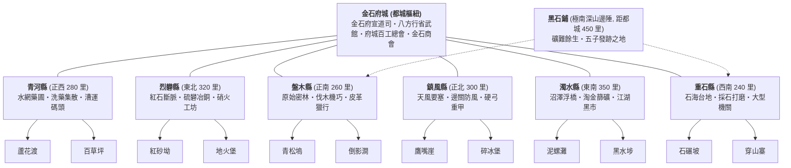

# 《遺忘的世界》Tier 1 區域生活網絡、次級縣城拓撲與一階道途規範書
> **Tier 1 Regional Life Network, County Topology & Career Specification**

* **文件定位**：第二卷【金石風雲】Tier 1 核心世界觀、空間拓撲、一階道途、技能樹與任務網絡設計規範。  
* **適用範圍**：小說敘事、MUD 地圖建構（`/d/city/`、`/d/county/`、`/d/village/`）、一階職業系統（`dao_initiate`、`wu_initiate`、`gong_initiate`）、跨區域任務鏈。  
* **版本**：v2.1（正典全面審核對齊修訂版）  
* **更新整合來源**：整合原 `thinking5.md`、`thinking6.md` 與 37 項深度審核反思，確立世俗自治體制、城際交通時辰、生剋閉環、資源三元池（`jing`/`qi`/`sen`）與底層數值對齊。

---

## 目錄 (Table of Contents)

1. [一、設計哲學與生活網絡總綱](#一設計哲學與生活網絡總綱)
2. [二、區域地理拓撲：六大次級縣城與新手村網絡](#二區域地理拓撲六大次級縣城與新手村網絡)
3. [三、跨區域故事與任務設計三模式](#三跨區域故事與任務設計三模式)
4. [四、金石都城空間結構與 Mudlib 房間規劃](#四金石都城空間結構與-mudlib-房間規劃)
   * [四附、縣經濟聯動機制、物價波動與跨縣任務觸發規範](#四附縣經濟聯動機制物價波動與跨縣任務觸發規範)
5. [五、三大一階門派道途與完整技能樹](#五三大一階門派道途與完整技能樹)
6. [六、一階轉職任務規範 (Mudlib JSON 規格)](#六一階轉職任務規範-mudlib-json-規格)
7. [七、主角偏科補足與成長邊界規範](#七主角偏科補足與成長邊界規範)
8. [八、沈泥身世暗線與天門引承接要點](#八沈泥身世暗線與天門引承接要點)
9. [九、跨區域事件設計審核標準](#九跨區域事件設計審核標準)

---

## 一、設計哲學與生活網絡總綱

### 1.1 Tier 1 是生活網絡，不是單一城市的地圖
大清洗將天下修士割裂為盲目修法、自殘修力、玩物喪志的偏門三道。在世俗凡間，修行並非凌駕於生活之上的空中樓閣，而是深深嵌入土地、商道、官防與宗族血脈的社會生態：

1. **新手村（生活與傳承的根）**：
   黑石鋪及其他新手村都有其自立的師承、常住居民、支柱產業、地方歷史、風土禁忌與自身面臨的現實危機。主角離開新手村後，這些人物依然有著自己的生計與命運，絕不會因主角遠行而化為靜止背景板。
2. **次級縣城（資源與關係的節點）**：
   各縣城分別專精於草藥水運、冶煉明礬、林木機巧、邊塞防風、淘金暗渠或重石土木。它們不是單純的地圖過渡點，而是互為依託、也存在利益競爭的生活共同體；縣城分舵亦具備初階道統註冊資格，非事事皆須湧向都城。
3. **金石都城（匯集與協調的中心）**：
   都城擁有更繁複的行會總會、官方法網、利益博弈與跨區域商業信用體系，但都城絕非掌控一切的唯一主宰，世間所有重大事件也絕非只在都城發生。前朝「大乾」早於百年前名存實亡，都城實質為行會、商盟與士紳共治之自治城邦。

> **核心準則**：**小說的鏡頭可以聚焦於都城，但世界的運轉絕不能只集中於都城。** Tier 1 的完成，不應以五位主角離開新手村或抵達金石都城為標準，而應以他們開始理解並參與這個世界的生活網絡為標誌。

---

## 二、區域地理拓撲：六大次級縣城與新手村網絡

金石府城坐落於八百里落龍古脈（黑石山脈）以北的大平原中心。山脈東西橫亙八百里，兩翼向北微拱環抱。周邊由官道驛站、河網峽谷與山嶺險隘串聯起**六個各具特色、職能互補的次級縣城**。每個縣城各轄有 **2 個代表性新手村**，構成全域有機交織的城鄉網絡：



### 2.1 六大次級縣城全景

#### 1. 青河縣 (Qinghe County)
* **地理位置**：位於金石府城正西約二百八十里，地處青河上游與西嶺（黑石主脈西翼延伸支脈）交會處的沖積平原。
* **地理特色**：依傍青河活水，河網密佈，水汽充沛。境內多靈草藥圃、桑竹梯田與低窪水草濕地。常年微溫濕潤，晨晚多見薄霧。為大荒北域草藥培植、洗鍊、初加工與水運集散核心。宣道司在城郊設有定神靈植道觀（兼具法道初階弟子註冊資格）。青河水路直通府城西水門，是全府最重要的藥材與糧油水路動脈。
* **轄下新手村**：**蘆花渡**、**百草坪**。

#### 2. 烈礬縣 (Liefan County)
* **地理位置**：位於金石府城東北約三百二十里，背靠孤狼嶺（東北紅石伴生礦斷脈），南臨礬石大峽谷。
* **地理特色**：地表赤紅乾燥，蘊藏巨量天然明礬、赤銅、硫磺、硝石與伴生明礬硃砂晶脈。地底常年有微弱地火餘溫散逸，泉水多帶酸苦之味。全縣以採礬、冶銅、篩洗硃砂、配製硝火材料與粗陶燒製為生，作坊爐火晝夜不熄。百工總會設有耐火料與銅材採辦分舵，是軍器防汛與火器配料的關鍵供銷樞紐。
* **轄下新手村**：**紅砂坳**、**地火堡**。

#### 3. 盤木縣 (Panmu County)
* **地理位置**：位於金石府城正南約二百六十里，扼守大荒古林北緣與向陽盆地之間的緩坡丘陵地帶。
* **地理特色**：山勢雄渾疊翠，覆蓋著成片百年生長的鐵力木、冷杉與油松原始密林。地勢北緩南陡，常有大荒走獸流竄。全縣以採伐巨木、林木機巧、生筋鞣革、製造韌桑黃皮紙（符紙原料）與造車造梯為主要產業。百工總會設有大型木作工棚（兼具機巧初階認證資格），八方武館亦在此常年僱傭獵戶鏢客護送林道木材。
* **轄下新手村**：**青松塢**、**倒影澗**。

#### 4. 鎮風縣 (Zhenfeng County)
* **地理位置**：位於金石府城正北約三百里，扼守通往極北雪原與荒原天塹的狹長咽喉風口「天風谷」。
* **地理特色**：兩側萬仞刀削絕壁，常年罡風獵獵、飛沙走石。冬日酷寒，滴水成冰。全縣築城於巨石崖壁之下，城牆厚達三丈，設有大量防風石壩與烽燧箭樓。盛產高純風蝕石英（觀象透鏡原料）、獸骨箭鏃、硬弓與防寒革甲。設有八方武館邊關分舵（專司軍陣重弓考核認證）與邊防衛所，為官府抵禦外荒兇獸南侵的軍事屏障。
* **轄下新手村**：**鷹嘴崖**、**碎冰堡**。

#### 5. 濁水縣 (Zhuoshui County)
* **地理位置**：位於金石府城東南約三百五十里，地處怒龍江支流「濁水河」入沼地帶，鄰近黑石山脈東麓。
* **地理特色**：沼澤與爛泥漫布，河水泥沙翻滾呈渾濁赭黃色。河灘中夾雜著大量自上游沖刷而下的粗金砂、重晶石與水磨碎礦。全縣聚落多依高腳木樁浮橋而建，濕氣重、瘴癘多，但以淘金篩沙、泥沼取蚶、毒囊提純與暗道舟運見長。地下天然溶洞水系與府城排澇古暗渠接駁，江湖耳目雜處，為黑市暗線與漕運轉運重要節點。
* **轄下新手村**：**泥螺灘**、**黑水埗**。

#### 6. 重石縣 (Zhongshi County)
* **地理位置**：位於金石府城西南約二百四十里，地處落龍古脈西翼餘脈，乃高山向內陸丘陵過渡的台地要衝。
* **地理特色**：境內遍佈青石、花崗岩與重玄石巨型採石場。重玄石為天然「石鐵共生礦」，堅硬緻密；石匠採掘條石修護城防，剔除之碎石尾礦則就地水磨，篩洗出「重玄粗生鐵錠」與「重玄黑鐵砂（武館淬骨必備）」。黑石鋪此前炸塌北崖古礦後，府城所需的重大官防條石與民間生鐵農具多由此縣穩固支撐。
* **轄下新手村**：**石碾坡**、**穿山寨**。

*(附：黑石鋪屬於八百里落龍古脈極南深山斷裂帶，自成一處特殊的歷史礦村，距金石府城走盤木林道約 450 里，走重石河谷約 420 里。)*

### 2.1.1 城際交通、行進時辰與黑石鋪動線對齊

全府城鄉動線嚴格對齊行進時辰與物流週期：
1. **重型大車（木石／粗鐵）**：南關出入，盤木、重石至府城需 **5～6 天**；烈礬至府城需 **7～8 天**。
2. **水路漕運（藥材／糧油）**：青河平底駁船順流至西水門需 **2.5～3 天**，逆流返程約 5 天。
3. **官府／商會快馬（公文／急信）**：府城至六縣均可在 **1.5～2 天（36～48 時辰）**內送達。
4. **都城死傷歸宿**：城內重傷瀕死進入 180 秒救護保護期；死亡後魂魄於城外亂葬義塚（`/d/city/outer/graveyard`）或宣道司安魂閣甦醒。

### 2.2 新手村事件的持續性規範
真實世界不會因主角離開新手村而停止運轉。在 Tier 1 架構中，事件的持續性嚴格遵循三層落地原則：

| 層次 | 規範要求 | 實例呈現 |
| :--- | :--- | :--- |
| **人物持續性** | 師父、居民、商人與其他 NPC 有自己的生活、計畫與後續抉擇，絕不因主角離開而停止活動。 | 阿鐵與老礦工在黑石鋪南山新開石料場；葛半仙依舊在草廬罵罵咧咧救治殘留鄉民；莫三繼續在後巷打探各方動向；府衙案卷庫主簿 文承敬 正暗中核查舊案底單。 |
| **事件持續性** | 第一卷的走私、工程與資源問題，在後續世界中會自然發展、改善、惡化或衍生新事件。 | 虎跳峽搶通的便道因初冬凍融可能再度滑坡；黑石關因胡百戶倒台換來新的暫代巡檢，帶來不同的邊卡盤剝規則。 |
| **跨區域影響** | 某地的事件會影響周邊供求、運輸路線與物價；其他縣城的變化亦會反饋至新手村。 | 黑石鋪血精停產，導致烈礬縣熔煉助劑暴跌、都城成品血精晶錠暴漲，進而促使濁水縣黑市暗潮湧動。 |

---

## 三、跨區域故事與任務設計三模式

跨區域的敘事與 MUD 任務推進，絕不能退化為機械式的「跑圖打卡」，應透過三種具有深層社會因果的設計模式展開：

### 3.1 模式 A：事件型（如「九城藥材」鏈）
* **設計理念**：同一任務目標帶出各地自然與人文的真實差異，而非單純的清單收集。
* **機制展現**：
  * 某縣城（如青河）因初秋連陰雨導致藥材受潮歉收，只能配給少量次品；
  * 某縣城（如烈礬）雖有藥材，但被本地礦場當作防毒煙的自用儲備，嚴禁外流；
  * 某縣城（如盤木）藥材品質最上乘，但完全被天工木作行會壟斷，需以硬木工分兌換；
  * 某縣城（如濁水）直接拒絕出售，因當地正爆發水澤瘴氣，自身急缺庫存。
* **小說與遊戲效果**：即便角色未親歷所有城鎮，透過貨單、信件、商議與差價，便能拼湊出大荒諸地的生存實態。

### 3.2 模式 B：任務型（身臨其境之遠行）
* **設計理念**：核心物資無法透過普通商貿取得，必須親赴產地，深入地方矛盾。
* **機制展現**：
  * 角色必須親赴鎮風縣天風谷頂風採擷「風蝕石英」，在此過程中與當地守軍、八方武館門徒切磋，體會極北苦寒的生活痛感；
  * 旅行本身即是故事，途中會遇見來自其他新手村（如紅砂坳、泥螺灘）的角色，感受不同師承與地域文化的碰撞。

### 3.3 模式 C：人物型（綿密的人際信用網絡）
* **設計理念**：世界是由人與人的關係網絡構成，而非冰冷的坐標地圖。
* **機制展現**：
  * 一間「通寶當鋪」遍佈金石都城與六大縣城，各分號掌櫃情誼深厚，某掌櫃的子侄正是重石縣採石場的工頭，其舊友又是宣道司的外圍經生；
  * 角色持有莫三的私信、蘇凝霜的信印或阿鐵的工具記號，能在不同城鎮喚醒隱藏的人脈與暗線支援。

---

## 四、金石都城空間結構與 Mudlib 房間規劃

### 4.1 都城總體擴充原則 (Metropolitan Design Principles)

1. **人口與尺度 (Scale & Population)**：
   * **常住人口**：約 8～12 萬人（含駐軍、商賈、百工、經生、流民與漕工）。
   * **城池規模**：城牆周長約 12～15 里（約 6～7.5 公里），為前朝大乾崩解後延續公文律令舊稱之**自治型中型府城**，非京畿帝都。全城以青石巨磚與夯土混合築就，城高三丈，外掘深壕。府尹與各大公會、商盟、士紳共治。
2. **空間哲學：匯集與協調中心 (Convergence & Coordination Hub)**：
   * 都城是**資源的匯集地、利益的仲裁所與加工中心**，絕非資源的壟斷者。
   * 六大次級縣城的特產（青河藥、烈礬銅硝硃砂、盤木鐵力木與符紙、鎮風硬弓石英、濁水金砂、重石條石與生鐵）在城內皆有專屬的集散市集、分業工坊與轉運碼頭，但**原料源頭與根本命脈始終留在縣城**。
3. **「士農工商」四民社會結構對應 (Social Structure & Functional Mapping)**：
   * **士（治理與法度）**：府衙政務 ＋ 宣道司（法道世俗堂口） ＋ 金石學塾（地方文教與書吏梯隊）。
   * **農（生存與命脈）**：西水門漕運碼頭 ＋ 糧市批發 ＋ 城外近郊農田 ＋ 青河渠首水閘。
   * **工（格物與造器）**：府城百工總會 ＋ 分業工坊街（鍛、木、石、革、藥、硝）。
   * **商（流通與信用）**：金石商會總堂 ＋ 專材長街 ＋ 通寶錢莊當鋪網絡 ＋ 車馬大院。

---

### 4.2 九大分區目錄結構 (Directory Structure)

在原規劃基礎上，全城依據生活功能與道統分佈擴充為九大目錄分區：

```
/d/city/
├── gate/          # 城防四關 + 水門（入城門戶、稅關與盤查）
├── wall/          # 城牆與箭樓（巡城步道、防禦瞭望、護城河）
├── center/        # 紅塵市井核心（官方治理「士」、商業信用、民生服務）
├── west/          # 宣道司區（法道世俗中心「士・法」）
├── east/          # 鎮武軍鎮區（力道世俗中心「軍・武」）
├── north/         # 百工總會區（物道世俗中心「工・物」、分業工坊街）
├── south/         # 漕運與農商區（漕運碼頭、糧市、專材長街「農・商」）
├── outer/         # 城外近郊（城郊農田、水利渠首、義塚、車馬店）
└── under/         # 城下暗渠與舊城廢墟（暗線專屬、太古遺存）
```

---

### 4.3 詳細房間地圖與關鍵 NPC 規範

#### 1. 城防與入城門戶區（`/d/city/gate/` ＋ 物流動線）
城門為物資稅收與身分過濾第一道屏障。為避免千斤大木大石橫穿中央市井，都城開闢了貼近東城牆的「東南外環運料馳道（`wall_road_e`）」，重料大車自南關進城後由外環直達北區工坊街：

| 房間 ID | 名稱 | 功能與氛圍 | 關鍵設施 / NPC | 稅則與機制特性 |
| :--- | :--- | :--- | :--- | :--- |
| `gate_north` | 金石北關城門 | 官道終點、邊軍扣關防線 | 城門典吏 韓清、城防精銳衛士 | 正式官道門戶，審查外荒情報，嚴查軍械與逃民。 |
| `gate_south` | 金石南關城門 | 重型貨車入口、南方動脈 | 南關稅吏、重車地磅秤桿 | 通往盤木、重石與黑石鋪；木石大車與南方流民入口。 |
| `gate_south_inn` | 南關車馬小棧 | 黑石鋪流民與挑夫落腳點 | 棧主 老劉、流民牙子 | 黑石鋪逃難鄉民第一落腳點，可打探城內雜工門路。 |
| `south/yard_material` | 大木大石初堆棧 | 南關外石木毛料過磅初切 | 堆棧把頭、驗材匠人 | 千斤條石與原木在此完成初裁，減輕城內運載負擔。 |
| `gate_east` | 金石東關城門 | 礦產、硫礬與黑市貨流通道 | 東關督稅官、巡檢司武卒 | 通往烈礬、濁水；對硫礬、赤銅加徵「地火危險稅」。 |
| `gate_west` | 西水門與西關 | 青河漕運終點、駁船水閘 | 西水門守舵官、水關緝私吏 | 水陸雙門；稅率最優惠，但嚴密檢驗違禁毒藥。 |
| `gate_plaza` | 北關前校場 | 駐軍操演、軍令發佈告示 | 巡防副將、公告木牌 | 邊軍先鋒臨時屯紮地，可接取協防與押送物證任務。 |
| `gate_inn` | 關外車馬店 | 北關驛道歇腳、客商落腳 | 店小二 老皮、行商鏢客 | 北方商旅行經歇宿，打探極北雪原與荒原風向。 |
| `gate_warehouse` | 官道大貨棧 | 商隊大宗貨物過磅與查扣 | 倉管書吏、商會驗貨掌櫃 | 官商共管，常有走私扣押貨箱成為任務調查線索。 |

#### 2. 城牆與箭樓防禦走廊（`/d/city/wall/`）
厚達三丈的青石城牆可供士卒與玩家通行，具備高空俯瞰與夜巡機能：

| 房間 ID | 名稱 | 功能與氛圍 | 關鍵設施 / NPC |
| :--- | :--- | :--- | :--- |
| `wall_path_*` | 巡城青石步道 | 四面城牆頂部，寬可馳馬 | 巡城弓弩手、巡邏衛士（日夜換班） |
| `wall_tower_n` | 北城望荒箭樓 | 俯瞰落龍主脈隘口與關外驛道 | 瞭望長 嚴目（專司警戒北山煞潮動向） |
| `wall_tower_s` | 南城映翠箭樓 | 俯瞰向陽盆地與南部林海 | 弓兵教頭、床弩維護機巧師 |
| `wall_tower_e` | 東城烽燧角樓 | 俯瞰大荒東麓與礬石峽谷 | 烽火長（設有三座常備狼煙烽燧） |
| `wall_tower_w` | 西城望江水樓 | 扼守青河入水閘口，瞰制漕船 | 水軍哨官、水門重鐵柵吊索絞盤 |
| `moat_*` | 護城深河段 | 寬十丈、深兩丈之活水護城河 | 釣魚蓑翁、巡河木筏（夜間走私潛渡點） |

#### 3. 官方治理與「士」據點（`/d/city/center/` ＋ `west/` 宣道司）
補齊地方治權、法律公信力與知識傳承節點，形成**「學塾入讀 ➔ 府衙掛名 ➔ 宣道司受牒」**的士人進階路徑：

| 房間 ID | 名稱 | 功能與社會職能 | 關鍵 NPC |
| :--- | :--- | :--- | :--- |
| `yamen` | 府衙正堂 | 地方政務、訴訟斷獄、官府大案懸賞 | 金石府尹、捕快總管 周捕頭 |
| `yamen_archive` | 府衙案卷庫 | 查閱數十年舊案、戶籍底單、身世線索 | 案牘主簿 文承敬（沈泥身世線重要交涉 NPC） |
| `yamen_prison` | 金石府死牢 | 關押重犯、探監任務、祕密審訊 | 獄頭 鐵鐐張、獄卒若干（趙德貴、胡百戶收押處） |
| `granary` | 府城常平倉 | 官方戰略糧儲、災荒平糶平抑物價 | 常平倉大使 劉秉忠（糧食安全與公共事件核心） |
| `academy` | 金石學塾 | 地方士子講學、公職科考、外聘講經 | 學塾塾師 陸夫子、外聘法科經生 |
| `post_station` | 官辦遞鋪驛館 | 官方公文快郵、快馬驛站、腳力換乘 | 府城驛丞 馬千里（承接官方加急送信委託） |
| `square` | 青石中央廣場 | 人流匯聚十字路口、官府告示、說書人講古 | 說書盲叟、巡街遊徼 |
| `inn_main` | 金石大客棧 | 三層雕樑石樓，接待外埠客商與修士 | 大掌櫃 錢不換（金石商會眼線） |
| `clinic` | 杏林醫館 | 府城最大草藥診所，藥道交流與救死扶傷 | 館主 白先生（顧玄可在此掛單參與會診） |
| `bank` | 通寶錢莊總號 | 銀票匯兌、高額存取、官商借貸清算 | 錢莊大朝奉（需一階合法身分方能開戶） |
| `pawnshop` | 通寶當鋪總號 | 典當物業、收購黑貨、地下情報流通樞紐 | 老掌櫃 賈半仙（與六大縣城當鋪分號人脈連鎖） |
| `black_alley` | 鬼市暗巷入口 | 通往城下廢墟與地下黑市的遮蔽暗門 | 守門疤臉漢（需出示特定信物或暗號） |
| `west/dao_hall` | 宣道司正堂 | 法道受牒、頒發大乾度牒、講授周虛微茫之理 | 宣道司道官 玄機真人 |
| `west/dao_observatory` | 摘星觀象台 | 天候測繪、星圖推演、引導微茫靈機試煉 | 觀星師 星淵 |
| `west/dao_quiet` | 靜心聽經閣 | 打坐冥想、焚香淨化心神濁氣場所 | 司香道童（靜坐一個時辰清除 50 點濁氣） |

#### 4. 「農」與漕運動脈區（`/d/city/south/` ＋ `/d/city/outer/`）
城內無農民，但有龐大的農產品批發、水利調節與糧運公會，與青河縣、盤木縣形成生死相依的供求閉環：

| 房間 ID | 名稱 | 功能與縣城供銷動脈 | 關鍵設施 / NPC |
| :--- | :--- | :--- | :--- |
| `south/canal` | 西水門漕運碼頭 | 青河平底漕船卸載、糧油大宗轉運 | 碼頭水行把頭 曹鐵錨、翻砂苦力 |
| `south/grain_market` | 官辦糧食市集 | 稻米、粗麥、油料、草料批發集散 | 糧行會首、米商坐莊（直連青河縣產區） |
| `south/warehouse_grain` | 官商聯營大糧倉 | 漕船下貨暫存、驗糧稱重分流 | 斗秤官、看倉老卒 |
| `outer/farmland_w` | 城西近郊青禾田 | 供應城內新鮮蔬果，可接「幫農」「治水」日常 | 老農 趙大叔（季節性春耕、秋穫事件觸發地） |
| `outer/irrigation` | 青河水閘與渠首 | 調節城內護城河與內河水位，防澇排沙 | 治水工丞（水流調節直接影響城內水路與濁氣） |
| `outer/graveyard` | 城外亂葬義塚 | 埋葬流民、無名客死之孤魂，死亡甦醒歸藏處 | 守塚瘸瞎老漢（採集夜煞藥材與調查暗殺現場） |
| `outer/post_depot` | 外城大車馬店 | 抵達都城的大宗牲口棚與草料堆垛場 | 馬伕老王、大荒草料販子 |

#### 5. 「工」百工總會與工坊街（`/d/city/north/`）
拆除單一集中打鐵鋪，沿「天工百工坊街」展開細緻的分業工坊，與六大縣城之專項原材嚴絲合縫對接：

| 房間 ID | 名稱 | 分業專精 | 縣城原料依託與生活功能 | 關鍵 NPC |
| :--- | :--- | :--- | :--- | :--- |
| `gong_gate` | 百工總會外門 | 百工學徒登記、材料資質考核 | 行會知事 鐵尺公 |
| `gong_hall` | 萬機正堂 | 物道受牒、頒發百工正式匠籍 | 匠首 歐陽大師 |
| `gong_forge` | 千錘地爐坊 | 高階合金冶煉、重型靈兵鍛造 | 原料依託：**烈礬縣赤銅＋重石縣重玄粗生鐵錠** | 鍛造大師 莫錘 |
| `gong_wood` | 天工木作大棚 | 車輦軸承、吊車絞盤、機關飛爪製造 | 原料依託：**盤木縣百年鐵力木、冷杉** | 大木作把頭 魯長生 |
| `gong_stone` | 官造石作場 | 磨石碾輪、城防巨石、地宮石槨雕鑿 | 原料依託：**重石縣重玄石、青石大料** | 老石匠 韓老雕 |
| `gong_leather` | 熟皮鞣革坊 | 戰鬥硬甲、馬具鞍讈、密封革囊硝製 | 原料依託：**盤木縣生筋＋鎮風縣獸皮** | 鞣皮名匠 溫娘子 |
| `gong_alchemy` | 採百草分堂 | 官制金創藥、解毒散劑、偏方萃取 | 原料依託：**青河縣洗靈草＋濁水縣毒囊** | 藥坊管事 孫先生 |
| `gong_fireworks` | 硝火作（官禁） | 開山破障雷管、守城火毬、信號火箭 | 原料依託：**烈礬縣高純硝石、硫磺**（戒備森嚴） | 火藥督造官 |
| `gong_registry` | 匠籍登記處 | 晉升正式匠師、核銷各縣原料調撥批件 | 司匠簿吏（物道弟子跨縣採購樞紐） |

#### 6. 「商」跨區域信用網絡（`/d/city/south/` ＋ `/d/city/center/`）
支撐全區域貿易、跨縣城押鏢與地下暗線運作的商貿樞紐：

| 房間 ID | 名稱 | 功能與社會網絡 | 關鍵機制與 NPC |
| :--- | :--- | :--- | :--- |
| `shanghui_hq` | 金石商會總堂 | 拍賣大廳、行商總帳、巨賈密議室 | 副會長 錢百川、商會執事（內藏天字一號密室直通地下） |
| `market_special` | 六縣專材長街 | 專門劃分六大縣城特產專賣鋪席 | 六縣採辦商賈（青河藥、烈礬銅硃砂、盤木木與紙、鎮風弓、濁水砂、重石鐵） |
| `caravan_yard` | 遠行車馬大院 | 跨縣長途商隊組隊、招募鏢師護衛 | 鏢局老趟子手、商隊大掌櫃（接取跨縣護送任務起點） |
| `warehouse_shang` | 商會一至三號大庫 | 儲備全城進出大宗貨物、稅關暫存 | 庫頭 巡夜犬隊（走私密箱暗藏之處） |

#### 7. 「武」鎮武軍鎮與力道據點（`/d/city/east/`）
力道修煉與城防精銳大本營。軍陣崇尚純陽氣血，排斥道法，軍鎮內無絕靈法網覆蓋，私鬥受嚴密軍紀制約：

| 房間 ID | 名稱 | 功能與社會網絡 | 關鍵 NPC |
| :--- | :--- | :--- | :--- |
| `east/wu_gate` | 軍鎮外轅門 | 鹿砦盤查、募兵告示、力道考核第一關 | 值役隊正、先鋒披甲衛士 |
| `east/wu_plaza` | 大校場 | 操演軍陣、沙袋石鎖、百人對拆演武 | 操練都尉、摔角教頭 |
| `east/wu_hall` | 八方武館正堂 | 力道受牒、頒發外門黑鐵腰牌 | 武館總教頭 霸山、執法教頭 |
| `east/wu_arena` | 斷魂生死擂台 | 門徒切磋、私鬥仲裁、承受鐵砂拳試煉 | 裁判「斷魂刀」、教頭「鐵臂 趙猛」 |
| `east/wu_armory` | 披甲兵器庫 | 軍備管制儲備、重弓板甲保養修復 | 司庫典軍、磨刀匠 |
| `east/wu_barracks` | 城防軍宿營 | 輪休軍卒宿所、粗茶烈酒、豪放市井氣息 | 巡城隊副、輪休老兵 |

#### 8. 城下暗渠與舊城廢墟（`/d/city/under/`）
位於都城地下十丈深處的太古舊城排水遺構與溶洞水系，不受地面法網束縛，為江湖黑市與暗線專屬空間：

| 房間 ID | 名稱 | 功能與社會網絡 | 關鍵 NPC |
| :--- | :--- | :--- | :--- |
| `under/black_market` | 地下鬼市 | 違禁毒藥、無印生銅、黑貨銷贓暗街 | 黑市牙商、黑披風刺客 |
| `under/canal_hub` | 古暗渠樞紐 | 匯集全城排污排澇、陰冷潮濕、岩壁長滿磷苔 | 擺渡盲叟、暗道走私客 |
| `under/drain_gate` | 廢棄水閘 | 鏽死鑄鐵閘門、可涉水潛渡至外城護城河盲區 | 潛水賊、水鬼探子 |
| `under/shang_secret` | 天字一號密室 | 舊商盟地下遺址，太古玄鐵重門深鎖 | 需【天門引】與沈氏血親交叉驗證方可開啟 |
| `under/ruins_hall` | 史前殘殿地宮 | 殘破人面巨石像倒塌處，地煞氣機匯聚點 | 陰煞地蟲、古代拓片殘碑 |

---

### 4.4 士農工商據點總覽與六縣連結表（強化版）

| 職業 | 核心據點 | 主要房間 | 與六縣主要連結 | 社會功能 |
| :--- | :--- | :--- | :--- | :--- |
| **士** | 府衙、學塾、宣道司 | `yamen*`、`academy`、`dao_*` | 全府公文、地方試、宣道司外派道觀 | 地方治理、法道傳承、公共秩序 |
| **農** | 常平倉、糧市、水閘、近郊田 | `granary`、`grain_market`、`irrigation`、`farmland_*` | **青河**（水路＋藥糧主動脈）、盤木（雜糧） | 糧食安全、水利、季節公共事件 |
| **工** | 天工行會分業工坊街 | `gong_forge`、`gong_wood`、`gong_stone`、`gong_leather`、`gong_alchemy`、`gong_fireworks` | 烈礬（銅硝）、盤木（木）、重石（石）、鎮風（革甲）、青河／濁水（藥） | 匠籍、專材加工、跨縣採購任務 |
| **商** | 金石商會、通寶錢莊／當鋪、車馬大院、專材長街 | `shanghui_hq`、`bank`、`pawnshop`、`caravan_yard`、`market_special` | 六縣分號＋當鋪人脈網（模式 C） | 信用票據、長途商隊、黑市情報 |

### 4.4.1 六縣職能互補與都城對應節點明細

金石府城本身不生產大宗原料，而是**匯集、加工、調度與信用結算中心**。六縣各專精一項（或兩項）支柱產業，透過官道、水路、暗渠與商會信用網絡，形成互補而非競爭的生活共同體。下表列出「縣城產出 → 都城落地設施 → 回饋／依賴關係」。

#### 1. 青河縣（正西 280 里）— 水網藥圃・洗藥集散・漕運碼頭
* **支柱產出**：靈草藥材（初加工）、桑竹、糧油、定神靈植。
* **都城對應節點**：
  - `gate_water`（西水門）＋ `canal_dock`：水路終點，藥材與糧油駁船卸載。
  - `grain_market`（糧市）：青河米油主力來源。
  - `gong_alchemy`（採百草分堂）＋ `clinic`（杏林醫館）：洗藥後精加工與掛單。
  - `irrigation`（水閘）：青河支流水位直接影響城內濁氣與近郊田。
* **互補關係**：全府藥材與主糧最穩定來源；宣道司在青河設有定神靈植道觀（亦具備初階借法觀象轉職認證資格），形成「法道外圍據點 ↔ 都城總堂」的雙向人員流動。
* **事件敏感點**：初秋連陰雨 → 藥材受潮歉收 → 糧市與醫館同步漲價；水閘故障會同時影響城內水位與近郊收成。

#### 2. 烈礬縣（東北 320 里）— 紅石斷脈・硫礬冶銅・硝火工坊
* **支柱產出**：天然明礬、赤銅、硫磺、硝石、明礬硃砂晶（符道硃砂原料）、耐火料。
* **都城對應節點**：
  - `gate_east`（東關）：礦產入口，加收「地火稅」。
  - `gong_forge`（千錘地爐坊）：赤銅與耐火料主力供應。
  - `gong_fireworks`（硝火作）：硝石嚴格管制來源，軍需與煙火皆依賴此縣。
  - `market_special` 烈礬攤位：粗銅錠、明礬硃砂塊即時交易。
* **互補關係**：軍器防汛與火器配料的關鍵樞紐；百工總會在此設高階耐火料採辦分舵，都城鍛造節奏直接受烈礬地火產量牽動。
* **事件敏感點**：地火異常或礦難 → 銅價與硝價暴漲 → 武館兵器庫與硝火作同時告急；黑石鋪血精停產曾導致此縣熔煉助劑因失去唯一買家而暴跌，而成品血精晶錠在都城黑市暴漲。

#### 3. 盤木縣（正南 260 里）— 原始密林・伐木機巧・皮革獵行
* **支柱產出**：鐵力木、冷杉、油松、生筋鞣革、韌桑黃皮紙（符紙原料）、車輦與梯具。
* **都城對應節點**：
  - `gate_south`（南關）：木材大車主要入口。
  - `gong_wood`（木作大棚）：大型木作與機關主材。
  - `gong_leather`（鞣革坊）：部分生皮來源（與鎮風互補）。
  - `caravan_yard`：造車需求回饋，商隊車輛多在此維修。
* **互補關係**：全府木構與運輸工具根基；百工總會木作工棚在此設有初階機巧考核點，八方武館常年僱傭獵戶鏢客護送林道，形成「力道護衛 ↔ 物道木作」的日常合作。
* **事件敏感點**：大荒走獸流竄或林道滑坡 → 木價與車輦供應中斷 → 車馬大院與木作大棚同時停工。

#### 4. 鎮風縣（正北 300 里）— 天風要塞・邊關防風・硬弓重甲
* **支柱產出**：獸骨箭鏃、硬弓、防寒革甲、高純風蝕石英（觀象透鏡原料）、邊防情報。
* **都城對應節點**：
  - `gate_north`（北關）：官道終點，邊軍換防必經。
  - `wu_armory`（披甲兵器庫）＋ `wu_barracks`：硬弓重甲與軍陣操練主力供應。
  - `gong_leather`（鞣革坊）：高品質防寒革甲來源。
  - `market_special` 鎮風攤位：風蝕石英（法道觀象鏡與物道機巧必備）。
* **互補關係**：全府軍事屏障與力道硬體核心；八方武館邊關分舵設於此（專司軍陣重弓考核認證），都城總堂與邊關形成「總堂考核 ↔ 分舵實戰」的人員輪調。
* **事件敏感點**：外荒兇獸南侵或天風谷封路 → 革甲與硬弓短缺 → 武館與軍鎮同時進入戰備狀態。

#### 5. 濁水縣（東南 350 里）— 沼澤浮橋・淘金篩礦・江湖黑市
* **支柱產出**：粗金砂、重晶石、水磨碎礦、毒囊、暗道舟運情報。
* **都城對應節點**：
  - `gate_east`（東關）＋暗渠天然溶洞：金砂與黑市貨流入口。
  - `gong_alchemy`（採百草分堂）：毒囊提純與特殊藥材。
  - `black_alley`＋`pawnshop`：黑市暗線與當鋪情報最活躍節點。
  - `under_canal_hub`：地下古暗渠接駁天然地下溶洞水系，可通達濁水浮橋網絡。
* **互補關係**：全府黑市與暗線樞紐；商會信用體系在此最易被挑戰，也最依賴通寶當鋪人脈網維繫。
* **事件敏感點**：水澤瘴氣爆發或淘金暴利爭奪 → 黑市物價劇震 → 當鋪與鬼市同時進入高度戒備；與黑石鋪礦難餘波常有聯動。

#### 6. 重石縣（西南 240 里）— 石海台地・採石打磨・大型機關
* **支柱產出**：青石、花崗岩、重玄石（重磁鐵共生石）、重玄粗生鐵錠、重玄黑鐵砂、石磨石碾、城防條石。
* **都城對應節點**：
  - `gate_south`（南關）：石料與鐵錠大車入口。
  - `gong_stone`（石作場）＋`gong_forge`（千錘坊）：大型石構與生鐵鍛造主力。
  - `wall_*` 與 `granary`：城牆修補與常平倉地基皆依賴此縣。
  - `caravan_yard`：絞盤與重載車輛需求回饋。
* **互補關係**：全府土木與鐵料根基；黑石鋪北崖古礦坍塌後，府城重大官防條石與民間生鐵農具多自此縣調運，形成「重石產能擴張」的長期依賴。
* **事件敏感點**：採石場事故或台地滑坡 → 石鐵短缺 → 城牆修補與千錘坊同時停滯；與黑石鋪歷史事件有直接因果鏈。

### 4.4.2 原料流向簡圖（文字版）與都城回饋閉環

```
青河（藥＋糧） ──水路──────► 西水門／糧市／採百草分堂／水閘
烈礬（銅＋硝＋硃砂） ──東關──────► 千錘地爐坊／硝火作／專材長街
盤木（木＋革＋符紙） ──南關──────► 木作大棚／鞣革坊／車馬大院
鎮風（甲＋弓＋石英） ──北關──────► 披甲兵器庫／軍鎮大校場／鞣革坊
濁水（金＋毒） ──東關＋暗渠──► 鬼市／當鋪／採百草分堂
重石（石＋鐵＋鐵砂） ──南關──────► 石作場／千錘坊／城牆地基
```

* **都城回饋閉環**：匠籍工分、商會信用票據、武館護衛合同、宣道司外派名額、常平倉平糶權，透過車馬大院與六縣分號回流，形成「產出 → 加工 → 信用 → 再投入」的閉環。

---

### 4.5 設計準則（與本規範書其他章節對齊）

1. **都城不是唯一主宰**：重大事件可在六縣發生，都城只負責匯集、協調與大宗交易。
2. **設施必須服務生活網絡**：常平倉、水閘、專材長街、車馬大院直接支撐模式 A（事件型）、B（任務型）、C（人物型）跨區域任務。
3. **縣城分舵轉職權限**：轉職不強制局限於都城。青河藥道觀（法道）、盤木木作棚（物道機巧）、鎮風衛所（力道破陣軍弓）皆可為 10 級玩家頒發初階道統度牒；都城主要承擔高階晉升與跨域調度。
4. **三日通牒彈性**：學塾文墨抄書、商會車馬苦力、醫館試藥童提供緩衝，避免底層流民硬性轉職。
5. **濁氣與法網分區**：中心最高、道統區次之、城外最低；暗渠與軍鎮不受法網限制，為暗線與軍紀提供空間。
6. **六縣原料流向明確**：每一工坊與市集攤位都標註主要原料來源，方便後續撰寫物價波動與事件連鎖。
7. **職能互補優先於同質競爭**：六縣產業設計刻意錯位，避免「每個縣城都能自給自足」的扁平化；都城則透過信用與加工能力成為真正的協調樞紐。

---

### 4.6 都城環境機制深度規範

#### 1. 紅塵濁氣梯度模型 (Turbidity Gradient)
* **核心區最高（`center/`、`south/`）**：市井喧囂、人口密集，濁氣指數 100%。在此打坐冥想效率僅為常規 20%，長期滯留每日累積 5 點「心神濁氣」。
* **道統區次之（`west/`、`north/`）**：長年有淨心陣法與爐火純陽，濁氣指數約 40～50%，可維持常規一階修行。
* **城外近郊大幅降低（`outer/`）**：接近自然山川，濁氣指數驟降至 15%，適合初階弟子夜間行氣吐納。
* **城下暗渠（`under/`）**：紅塵濁氣極低，但**地煞與陰腐氣息極重**，易受陰煞侵蝕。
* **濁氣數值量化與清除機制**：
  * **濁氣池上限**：`max_turbidity = 100`。
  * **階段性症候**：
    * 20～49 點（心煩意亂）：打坐回氣速度降低 30%，武器命中率降低 10%。
    * 50～79 點（濁障迷心）：無法施展觀星望氣等心神技能，市井 NPC 好感度 -20。
    * 80～99 點（走火邊緣）：每個時辰氣血扣除 5%，進入隨機混亂。
    * 100 點（道化失心）：心神崩潰暴走，被系統判定為紅名「瘋魔流民」，引來巡城武卒拘捕。
  * **淨化路徑**：服用杏林醫館【清心散】（一次清 20 點，日限 3 服）；或至宣道司靜心閣聽經（靜坐一個時辰消耗 50 文，清 50 點）。

#### 2. 城防絕靈法網防衛機制 (Spirit-Sealing Grid)
* **覆蓋區域**：全面覆蓋 `center/`（府衙）、`gate/`（四門）、`west/`（宣道司）、`north/`（百工總會）。
* **分層執法懲罰**：
  * **凡胎違規（Tier 0～1 械鬥私鬥）**：觸發巡街遊徼與衙役捕快（Lv.15 捕頭）以鎖鏈鐵尺制伏，處以罰金 500 文至拘留 1 個遊戲日。
  * **禁法違規（動用未受牒之引靈法訣、地煞血精符籙或毀滅性真元）**：立即啟動【絕靈法網】壓制真元神識回覆，當場標記為「破法犯」，召喚 4～8 名持【破靈重弩】的城防精銳當場卸甲收監府獄。
* **豁免與自治區域**：
  * 城外近郊（`outer/`）、護城河畔（`moat/`）及城下暗渠（`under/`）處於法網盲區，為江湖私鬥高發區。
  * 軍鎮區（`east/`）無宣道司法網覆蓋，崇尚純陽氣血；區內私鬥需簽生死狀上「生死擂台」，私自鬥毆直接依軍律杖責。

#### 3. 「三日入道通牒」之合法身分緩衝機制 (Identity Buffer Mechanism)
原規則「入城 72 小時不轉職即變流民」對自由探索玩家過於嚴苛，特此建立三條**零門檻合法世俗居留緩衝路徑**：
* **緩衝路徑 A（金石學塾文墨抄書工）**：
  至 `center/academy` 拜會陸夫子，簽立抄書償債券，夜間抄寫五卷《道藏初訓》代充保證金。取得【學塾白鹿青衿】，身分合法期延長 **14 天**，可自由進出客棧與圖書館。
* **緩衝路徑 B（商會臨時車馬腳力）**：
  至 `south/caravan_yard` 拜會鏢頭，簽署苦力契據，搬運大木大石，日支 10 文粗食，取得【車馬行短褐腰牌】。身分合法期延長 **7 天**，可承接城內外短途腳力搬運委託。
* **緩衝路徑 C（杏林醫館試藥童）**：
  至 `center/clinic` 拜會白先生，協助晾曬藥草、試碾藥粉，取得【杏林藥囊腰牌】。身分合法期延長 **10 天**。

#### 4. 四關差異化稅則矩陣 (Tax Policy Matrix)
| 關口 | 主營貨物特點 | 稅則規則 | 緝私檢驗重點 |
| :--- | :--- | :--- | :--- |
| **北關** | 官道客商、邊防物證、流民 | 普通良民 2 文茶湯錢（持六縣路引免徵）；無文牒流民收 10 文工本費。 | 嚴查無文牒流民、大荒走私獸皮與未註冊火器。 |
| **南關** | 盤木大木、重石石料大車、流民 | 重車按木石毛重徵 50～100 文；黑石鋪逃難鄉民憑舊戶籍免入城稅。 | 嚴查木材夾層私藏硝石、走私私鹽。 |
| **東關** | 烈礬生銅硫磺、濁水金砂水產 | 加徵 5%「地火危險稅」；生銅須扣繳一成官鑄留底。 | 嚴查私運高濃度地煞血精晶錠。 |
| **西水門** | 青河草藥、糧油、布匹漕船 | 貨物價值二十分之一輕稅；藥品進口享平糶補貼。 | 水關暗探嚴格登船開箱，查禁違禁劇毒與落龍口腐濁泥。 |

---

### 4.7 優先補齊之都城必要設施清單 (Implementation Priority)

針對 MUD 地圖代碼與敘事章節編寫，依系統承載底層邏輯分四階段推進：

1. **第一階段（十字骨架與門戶邊界）**：
   * `gate_south`（南關門戶、黑石鋪動線） ➔ `center/square`（中央十字廣場） ➔ `gate_north`（北關邊防） ➔ `gate_east`、`gate_west`。
2. **第二階段（三大道統世俗轉職樞紐）**：
   * `west/dao_hall`（宣道司正堂、摘星台） ➔ `east/wu_hall`（八方武館正堂、校場擂台） ➔ `north/gong_hall`（百工萬機堂）。
3. **第三階段（民生安全與信用網絡）**：
   * `granary`（常平倉） ➔ `south/canal`、`south/grain_market`（漕運糧市） ➔ `clinic`（醫館） ➔ `pawnshop`、`caravan_yard`（當鋪車馬大院）。
4. **第四階段（外圍農商、工坊細分與地下暗線）**：
   * `outer/farmland_w`、`outer/irrigation`、`outer/graveyard` ➔ 分業工坊街（鍛、木、石、革） ➔ `under/black_market`、`under/canal_hub`、`under/shang_secret`。

---

## 四附、縣經濟聯動機制、物價波動與跨縣任務觸發規範

> 本節為 Tier 1 生活網絡的經濟與任務引擎規範，確保「六縣產出 → 都城匯集 → 回饋再投入」形成可運算、可敘事、可持續的閉環，而非靜態背景板。

### 1. 縣經濟聯動機制總綱

金石府城與六縣構成**「原料─加工─信用─再投入」**四環經濟：

1. **原料環（縣）**：各縣專精產出，受季節、地脈、礦難、獸潮、天候直接影響。
2. **加工環（都城）**：天工行會分業工坊、糧市、硝火作等將原料轉為成品或半成品。
3. **信用環（商會＋當鋪）**：通寶錢莊／當鋪與六縣分號發行信用票據、工分兌換與人情信印，決定物資能否跨縣流動。
4. **再投入環（回饋）**：都城以匠籍工分、護衛合同、平糶權、外派名額回流各縣，維持生產意願。

**核心原則**：
- 任何單一縣城無法自給自足；短缺會立刻傳導至都城對應設施與相鄰縣。
- 物價不是固定數值，而是由「供給衝擊 × 運輸成本 × 信用通暢度 × 季節係數」共同決定。
- 玩家／主角的行為（修復、走私、護衛、囤積）可改變局部狀態，但無法永久消滅系統性波動。

### 2. 物價波動規則

#### 2.1 基礎物價錨點（都城專材長街基準）

以「平常年、運輸通暢、信用正常」為 100 基準：

| 物資類別 | 主要來源縣 | 基準價（相對） | 高敏感觸發 | 低敏感觸發 |
| :--- | :--- | :--- | :--- | :--- |
| 靈草／初加工藥 | 青河 | 100 | 連陰雨、水閘故障 | 豐收年、水路暢通 |
| 米油主糧 | 青河、盤木 | 100 | 春旱、秋澇、常平倉開倉 | 平年、漕運正常 |
| 赤銅／耐火料 | 烈礬 | 100 | 地火異常、礦難 | 產量穩定 |
| 明礬硃砂晶（硃砂） | 烈礬 | 105 | 道壇齋醮需求激增、礦難 | 開採穩定 |
| 硝石／火器配料 | 烈礬 | 110（管制） | 軍需緊急、硝火作停工 | 邊關平靜 |
| 鐵力木／大型木材 | 盤木 | 100 | 林道滑坡、獸潮 | 伐木季節正常 |
| 韌桑黃皮紙（符紙） | 盤木 | 100 | 桑林霜凍、道法採購潮 | 造紙順暢 |
| 生皮／防寒革甲 | 盤木、鎮風 | 105 | 外荒侵擾、冬季提前 | 狩獵豐收 |
| 硬弓／獸骨箭鏃 | 鎮風 | 110 | 邊關戰備、天風谷封路 | 換防順利 |
| 風蝕石英 | 鎮風 | 115 | 極北風暴、關隘封鎖 | 採擷窗口正常 |
| 粗金砂／毒囊 | 濁水 | 120（黑市波動大） | 瘴氣爆發、淘金爭奪 | 黑市平靜 |
| 重玄石／城防條石 | 重石 | 100 | 採石事故、台地滑坡 | 產能擴張 |
| 重玄粗鐵錠／黑鐵砂 | 重石 | 100 | 水磨停工、武館搶購鐵砂 | 冶煉順暢 |

#### 2.2 波動乘數與計算規則（防死循環安全閥）

為防止連乘導致物價暴漲十幾倍的經濟失衡，採用**增量加權疊加法**與**硬性上下限**：

$$\text{最終物價} = \text{基準價} \times \operatorname{Clamp}\left(1 + \sum (\text{衝擊係數} - 1), \; 0.5, \; 2.5\right)$$

* **硬性天花板 (Cap 250%)**：物價最高不超過基準價之 2.5 倍。突破 2.5 時強制觸發官府「常平倉平糶平抑」或百工總會「材料配給令」。
* **硬性地板 (Floor 50%)**：最低不低於基準價之 0.5 倍，防止惡意傾銷洗錢。

| 衝擊類型 | 乘數範圍 | 持續時間 | 傳播路徑示例 |
| :--- | :--- | :--- | :--- |
| 季節係數 | 0.8～1.3 | 整季 (90 大元日) | 青河秋雨 → 藥材 ×1.25，持續至初冬 |
| 運輸中斷 | 1.2～1.8 | 事件解除前 | 盤木林道滑坡 → 木材 ×1.5，車馬大院同步受影響 |
| 信用凍結 | 1.3～2.0 | 直到人情恢復 | 濁水黑市衝突 → 當鋪信印失效，金砂流動停滯 |
| 礦難／獸潮 | 1.4～2.5 | 中長期 | 烈礬礦難 → 銅價與硝價上漲，兵器庫限購 |
| 常平倉開倉 | 0.7～0.9（糧） | 官方決定 | 災年平糶 → 糧價下降，建材可能因搶購反漲 |
| 玩家／主角干預 | ±0.1～0.4 | 依行為規模 | 修復水閘、護送商隊、清除瘴氣可局部平抑乘數 |

**傳播規則**：
- 直接供應縣 → 都城對應工坊／市集 → 相鄰依賴縣（例如烈礬銅價上漲 → 重石石作場因工具成本上升而小幅跟漲）。
- 黑市物資（濁水）波動幅度最大，且可逆向影響正式市集（走私壓價或囤積抬價）。

#### 2.3 都城設施對波動的反應

| 設施 | 高價時反應 | 低價時反應 |
| :--- | :--- | :--- |
| 糧市／常平倉 | 限購、開倉平糶、優先供應軍鎮與學塾 | 鼓勵收購、增加近郊田委託 |
| 千錘地爐坊／硝火作 | 限額鍛造、提高匠籍工分兌換門檻 | 開放額外訂單、降低材料消耗 |
| 木作／石作／鞣革 | 延遲大型工程、優先修補城牆與車輦 | 承接跨縣訂單、擴招學徒 |
| 通寶當鋪／商會 | 提高典當折扣、收緊信用票據 | 放寬借貸、鼓勵長途商隊 |
| 武館兵器庫 | 軍需優先、民間限購 | 開放民間訂製、降低護衛合同價格 |

### 3. 跨縣任務觸發條件

任務觸發必須同時滿足「世界狀態條件」與「角色／組織條件」，避免機械刷取。對應既有三模式：

#### 3.1 模式 A：事件型（物價與供給驅動）

**觸發條件**（滿足任一即可生成對應任務鏈）：
- 任一縣主產物資基準價 ≥ 140 或 ≤ 70，持續超過 3 個大元日。
- 運輸線路中斷：水路延宕超過 3 個大元日，或陸路大車延宕超過 7 個大元日。
- 常平倉庫存低於警戒線，或硝火作／兵器庫進入「軍需緊急」狀態。

**示例任務鏈**：
- 「九城藥材」：青河藥價 ≥ 140 → 玩家需分別向烈礬（自用儲備）、盤木（行會壟斷）、濁水（自身急缺）協商，最終在都城醫館交貨。
- 「銅荒救急」：烈礬銅價 ≥ 160 → 百工總會發布「替代耐火料」或「緊急採辦」委託，導向重石或黑石鋪舊礦殘料。

#### 3.2 模式 B：任務型（必須親赴產地）

**觸發條件**：
- 目標物資無法透過普通商貿取得（黑市鎖定、行會壟斷、或官方禁運）。
- 角色持有對應道統一階身份，或商會／當鋪信印達到一定等級。
- 產地當前存在「地方矛盾」（獸潮、礦難餘波、瘴氣、邊關戒嚴）。

**示例**：
- 鎮風「風蝕石英」：必須親赴天風谷，期間可觸發與八方武館分舵切磋或協助守軍。
- 濁水「毒囊提純」：需進入浮橋網絡，並處理當地淘金幫與官差的衝突。

#### 3.3 模式 C：人物型（信用與人脈驅動）

**觸發條件**：
- 角色持有特定信物（莫三私信、蘇凝霜信印、阿鐵工具記號、通寶當鋪總號信印等）。
- 六縣任一當鋪分號或商會分舵出現「人情債務」或「舊友求助」狀態。
- 都城通寶當鋪總號發布「跨縣信用清算」或「舊帳追討」事件。

**示例**：
- 持通寶信印 → 重石採石場工頭（某掌櫃子侄）求助修復絞盤 → 完成後解鎖烈礬分號額外折扣。
- 沈泥線：天門引相關舊帳冊出現在濁水或都城暗渠，觸發商會密室與舊商盟殘部的連鎖。

#### 3.4 通用安全閥與持續性規則

1. **不可無限刷取**：同一事件型物價衝擊在冷卻期（通常 7～14 遊戲日）內不會重複生成相同任務。
2. **世界狀態保留**：任務完成後，物價乘數會部分回落，但不會瞬間回到 100；運輸修復、信用恢復需要時間。
3. **多角色／多玩家影響**：若 MUD 環境中有多名角色同時行動，供給恢復速度可加快，但信用凍結等「人為」衝擊仍需對應人脈解決。
4. **與三日通牒的銜接**：未完成一階轉職的流民只能接取「臨時腳力」級跨縣任務（運送、傳信），無法接取需匠籍或武館腰牌的正式委託。

### 4. 與現有設計的對齊檢查清單

- [ ] 物價波動是否只影響「生活與生產」，而不直接變成數值刷怪來源？
- [ ] 每一個高價／低價狀態是否都能在都城對應設施找到可視化反應（限購、開倉、延遲工程）？
- [ ] 跨縣任務是否同時服務「區域存在性」「網絡連結」「事件持續性」三項審核標準？
- [ ] 主角偏科補足裝備／藥物是否仍受物價影響（例如解毒散劑在青河歉收時變貴）？
- [ ] 黑石鋪歷史事件（礦難）是否仍能透過烈礬原料暴跌 → 都城黑市晶錠上漲 → 濁水暗潮，形成跨卷因果？

---


## 五、三大一階門派道途與完整技能樹

在 Tier 1，凡胎弟子正式脫離無招無式的盲打階段，開啟三大道統世俗體系之初階修行（Skill Level 31～100）。三大道統遵循嚴密的哲學定位與實戰生剋：

```mermaid
flowchart LR
    FA["<b>【法】金石府宣道司</b><br>借法、觀象、定身、符篆<br><i>神識為鋒，引天地微茫之力</i>"]
    LI["<b>【力】八方行省武館</b><br>氣血、披甲、裂石、軍陣重弓<br><i>肉身為盾，以骨血硬撼頑石</i>"]
    WU["<b>【物】府城百工總會</b><br>應力、淬毒、機巧、造甲<br><i>工巧為鑰，解構天下萬物之理</i>"]

    LI ==>|巨力重劈 / 氣血震碎機關 (力勝物)| WU
    WU ==>|破法鋼錐 / 絕靈藥粉隔斷靈機 (物勝法)| FA
    FA ==>|神識破罡 / 意念定穴 (法勝力)| LI
```

* **角色等級 vs 技能等級技術規範**：
  * **角色等級 (Character Level 1～100)**：Lv.1～10 為凡胎新手（Tier 0）；**Lv.10 達到道統轉職考核門檻**。
  * **技能等級 (Skill Level 1～100)**：基礎拳腳、採藥、打鐵等世俗技藝上限為 Skill Lv.30；完成一階轉職後，基礎技能進階轉化為門派專精技能，自 **Skill Lv.31 起跳解鎖**。

### 5.1 技能系統通用數據結構 (LPC / JSON)

```c
// 技能定義資料結構示範（嚴格對齊世界觀三元池標準）
mapping skill_data = ([
    "id"           : "dao_jiefa",
    "name"         : "借法印訣",
    "class"        : "dao_initiate",
    "type"         : "active",
    "cost_pool"    : "sen",        // 嚴格限定為: "sen"(神識池), "jing"(精元氣血池), "qi"(氣元體力池)
    "cost_amount"  : 15,
    "cast_time"    : 1.0,          // 施法前搖秒數
    "cooldown"     : 3.0,
    "max_level"    : 100,
    "req_attr"     : ([ "spi" : 12, "int" : 10 ]), // 六維屬性代號檢定
    "desc"         : "宣道司入門指訣，引導周虛微茫靈機，凝結無屬性法光彈射向目標。"
]);
```

### 5.2 【法】宣道司清虛外門弟子 (`dao_initiate`)

* **門派哲學**：天地不仁，借法偷天。以微弱凡軀神識感應微氣候與天地氣機，重在遠距控場、預警與弱點引爆。
* **核心消耗**：神識池 (`sen`)。

```
【法】宣道司清虛外門技能樹 (Skill Lv.31 ~ 100)
├── 基礎吐納 (dao_tuna) [Skill Lv.31 解鎖] - 被動：提升神識上限與冥想回覆速度
├── 借法印訣 (dao_jiefa) [Skill Lv.31 解鎖] - 主動：引導靈光轟擊，造成無屬性法術傷害
│   ├── 分支一：觀象道 (情報控場)
│   │   ├── 觀星望氣 (dao_observing) [Skill Lv.45] - 主動：勘測敵方弱點、預知環境氣流風向
│   │   └── 縛靈法印 (dao_fuling) [Skill Lv.60] - 主動：以微茫靈氣凝鎖目標下盤，造成短暫遲滯
│   └── 分支二：符道 (爆發制伏與驅煞)
│       ├── 硃砂鎮煞符 (dao_fuzhen) [Skill Lv.45] - 物品主動：繪製灼燒靈符，破除地煞污穢
│       ├── 清風定神符 (dao_fudun) [Skill Lv.60] - 物品主動：淨化自身 30 點濁氣並短暫免疫遲滯
│       └── 驚雷破障印 (dao_jinglei) [Skill Lv.70] - 主動：借向陽熱氣引爆小範圍烈雷，附帶破甲
```

### 5.3 【力】八方武館外門弟子 (`wu_initiate`)

* **門派哲學**：筋骨為爐，氣血如火。摒棄玄虛心法，只信雙手雙足千錘百煉的實打實破壞力與抗擊打力。
* **核心消耗**：精元氣血池 (`jing`)。

```
【力】八方武館技能樹 (Skill Lv.31 ~ 100)
├── 鐵砂淬骨 (wu_cuigu) [Skill Lv.31 解鎖] - 被動：永久提升根骨防禦與鈍擊抗性
├── 伏虎重拳 (wu_fuhu) [Skill Lv.31 解鎖] - 主動：蓄勢猛擊，造成沉重肉身外傷
│   ├── 分支一：猛將道 (近戰破陣)
│   │   ├── 開山劈嶽 (wu_kaishan) [Skill Lv.45] - 主動：合身劈斬，大幅降低敵方招架與格擋
│   │   └── 氣血如爐 (wu_qixue) [Skill Lv.70] - 主動爆發：短時間內無視輕傷，攻擊附帶震懾
│   ├── 分支二：衛士道 (護衛堅壁)
│   │   ├── 盤石樁功 (wu_panshi) [Skill Lv.45] - 被動：提高擊退抗性，招架成功率大幅上升
│   │   └── 披甲回天 (wu_pijia) [Skill Lv.60] - 主動防守：以兵刃或盾牌化解衝擊，護持隊友
│   └── 分支三：軍陣開弦道 (遠程重弓)
│       ├── 開弦貫石 (wu_gong_sheshi) [Skill Lv.45] - 主動：蓄力重射，無視目標 20% 護甲
│       └── 鷹揚穿雲 (wu_gong_yingshi) [Skill Lv.60] - 主動：百步致殘，附帶減速與流血
```

### 5.4 【物】府城百工總會正式學徒 (`gong_initiate`)

* **門派哲學**：格物致知，神工奪天。天生不足，巧具補之；天下萬物皆有應力幾何，識其理則無堅不摧。
* **核心消耗**：氣元體力池 (`qi`) ＋ 專用工具材料消耗。

```
【物】百工總會技能樹 (Skill Lv.31 ~ 100)
├── 物性辨析 (gong_analysis) [Skill Lv.31 解鎖] - 被動：看破裝備材質缺陷與草藥毒性成分
├── 百工巧勁 (gong_qiaojin) [Skill Lv.31 解鎖] - 主動：順應材料紋路施力，攻擊忽視敵方部分護甲
│   ├── 分支一：百工鍛造道 (裝備維護)
│   │   ├── 應力破點 (gong_yingli) [Skill Lv.45] - 主動：以鐵鑿鐵錘精準打擊結構脆弱點
│   │   └── 淬火披堅 (gong_cuihuo) [Skill Lv.60] - 生產：現場搶修並短暫強化武器鋒刃
│   ├── 分支二：藥道分診道 (醫療解毒)
│   │   ├── 辨症行針 (gong_xingzhen) [Skill Lv.45] - 主動醫療：銀針刺穴，閉塞傷勢或解除負面狀態
│   │   └── 雄黃封毒散 (gong_fengdu) [Skill Lv.60] - 投擲主動：阻隔毒瘴地煞，驅散野獸
│   └── 分支三：機巧陷阱道 (機關操縱)
│       ├── 地弩穿心機 (gong_jiguan) [Skill Lv.45] - 主動機關：佈設地煞彈簧機弩，造成穿刺出血
│       └── 飛爪滑輪鎖 (gong_feizhua) [Skill Lv.60] - 主動機關：遠距牽引障礙物或攀附險峻地形
```

---

## 六、一階轉職任務規範 (Mudlib JSON 規格)

初入都城或抵達六縣分舵的流民弟子，在達到角色等級 Lv.10 後可承接道統考核。考核絕非刷怪，而是透過哲學與生活實踐檢驗：

### 6.1 法道轉職任務示例 (`quest_tier1_dao.json`)
```json
{
  "quest_id": "tier1_dao_initiation",
  "name": "宣道司觀象定風考",
  "category": "career_change",
  "target_class": "dao_initiate",
  "min_level": 10,
  "stages": [
    {
      "step": 1,
      "desc": "前往宣道司摘星觀測台，向觀星師星淵領取【渾天黃銅鏡】。",
      "action": "talk",
      "target_npc": "dao_observatory_xingyuan"
    },
    {
      "step": 2,
      "desc": "於亨時未刻（晨曦將盡、正午微風之際）登上城西宣道司偏殿屋頂，觀測都城西側山嵐氣流，記下西南側風窗口角度。",
      "action": "survey_wind",
      "required_condition": { "cycle": "heng", "time": "wei", "location": "/d/city/west/dao_roof" }
    },
    {
      "step": 3,
      "desc": "返回宣道正堂，將測繪風向圖交由玄機真人審閱，並回答關於『假天道化』之辯證問題。",
      "action": "dialogue_choice",
      "target_npc": "dao_hall_xuanji"
    }
  ],
  "rewards": {
    "exp": 1200,
    "class_grant": "dao_initiate",
    "item": "/clone/book/dao_basic_manual.c"
  }
}
```

### 6.2 力道轉職任務示例 (`quest_tier1_wu.json`)
```json
{
  "quest_id": "tier1_wu_initiation",
  "name": "八方武館擂台三合試",
  "category": "career_change",
  "target_class": "wu_initiate",
  "min_level": 10,
  "stages": [
    {
      "step": 1,
      "desc": "於武館門前青石廣場抱起百二十斤花崗岩重石鎖，堅持十息不退（亦可選射藝測試：百步穿透銅錢孔）。",
      "action": "strength_check",
      "req_attr": { "str": 8 }
    },
    {
      "step": 2,
      "desc": "登上生死擂台，在裁判斷魂刀主持下，赤手空拳抗住教頭鐵臂趙猛三記『鐵砂崩拳』而不倒地。",
      "action": "survive_combat",
      "rounds": 3,
      "target_npc": "wu_arena_zhaomeng"
    },
    {
      "step": 3,
      "desc": "向總教頭霸山敬茶立誓，簽署生死狀，正式領受黑鐵束腰腰牌。",
      "action": "pledge",
      "target_npc": "wu_hall_bashan"
    }
  ],
  "rewards": {
    "exp": 1200,
    "class_grant": "wu_initiate",
    "item": "/clone/armour/wu_iron_belt.c"
  }
}
```

### 6.3 物道轉職任務示例 (`quest_tier1_gong.json`)
```json
{
  "quest_id": "tier1_gong_initiation",
  "name": "百工總會百工格物試",
  "category": "career_change",
  "target_class": "gong_initiate",
  "min_level": 10,
  "stages": [
    {
      "step": 1,
      "desc": "於千錘地爐坊閉目摸骨，自十塊粗礦石中憑手感盲辨出含赤銅三成之『紅沙生鐵核』。",
      "action": "material_identify",
      "target_prop": "copper_iron_ore"
    },
    {
      "step": 2,
      "desc": "使用莫錘大師之重鍛錘，在斷裂木檁受力支點處打入三枚百煉螺旋榫楔，完成受力平衡架構。",
      "action": "craft_structure",
      "required_tool": "smith_hammer"
    },
    {
      "step": 3,
      "desc": "將成品受力圖紙送呈匠首歐陽大師審定，登記匠籍，領受天工烏木尺。",
      "action": "submit_craft",
      "target_npc": "gong_hall_ouyang"
    }
  ],
  "rewards": {
    "exp": 1200,
    "class_grant": "gong_initiate",
    "item": "/clone/tool/gong_ebony_ruler.c"
  }
}
```

---

## 七、主角偏科補足與成長邊界規範

五位少年各具鮮明身世與極端六維偏科。在進入 Tier 1 後，設計的核心目的在於**「讓角色能參與多元複雜任務，避免因致命弱點失去立足空間」**，但絕非將他們改造成面面俱到的全能超人。

### 7.1 嚴格區分：「補足短板」vs「改變專長」
* **補足短板（Mitigating Weaknesses）**：
  提供輔助性裝備、藥物配方或思維模式，減輕角色在極端不利環境下的生存短板（如林鐵生以精密工具輔助細微加工、顧玄以特製防護皮甲增加野外耐受力）。
* **改變專長（Changing Specialization）**：
  極度嚴苛、伴隨重大代價的長期發展。需消耗珍貴資源或經歷重大事件，且不可一蹴而就。

### 7.2 藥物、裝備與奇遇的三重邊界機制

1. **藥物（短期代償與環境耐受）**：
   * 可短暫提升抗寒、耐毒、止痛或感知，但必須伴隨生理代價（如耐藥性、經絡反噬、藥力耗盡後的虛弱期）。
   * 藥物絕不能無條件永久提升六維屬性。
2. **裝備（情境專項防護與工具增益）**：
   * 裝備彌補的是「操作精度」或「外力承擔」，不能替代角色自身的眼力與技藝。
   * 裝備存在耐久度磨損、維護成本與使用資格限制（如鐵生的左手小鍛錘需良好腕力配合）。
3. **奇遇（理念破障與關係擴展）**：
   * 奇遇賦予的往往是一種新的解題視角、一處特殊的社會關係網絡，甚至暴露原本未曾察覺的新盲點，促使角色反思重組。

### 7.3 五大主角補足矩陣、道途歸宿與不可消除之限制

| 主角 | 一階世俗身分與道途 | 允許補足的方向（裝備／藥物／奇遇） | 絕不可直接消除的核心限制 |
| :--- | :--- | :--- | :--- |
| **顧玄**<br>(採藥孤兒) | **【物】百工總會・藥道分診**<br>(百草門外門藥童) | 防身皮甲、吹箭毒針、野外攀登防滑索、解毒散劑、地脈走勢知識。 | **醫療決策依然受限於藥材存量與生理極限**；絕不能赤手空拳與力修硬撼。 |
| **林鐵生**<br>(打鐵學徒) | **【物】百工總會・百工鍛造**<br>(千錘地爐坊初階匠工) | 精密螺紋鐵尺、定滑轆轤省力連桿、火浣布厚手套、聽聲判裂百工機巧。 | **精密工具不能取代工匠數十年的火候經驗**；不能僅靠力氣硬掰材料。 |
| **燕隼**<br>(獵戶之子) | **【力】八方武館・軍陣開弦**<br>(巡防營獵弓射士) | 白鷹翎透骨重箭、避風狼皮披風、止血生肌膏、追蹤暗記地圖。 | **裝備不能取代荒野決策與對自身體能極限的估算**；不能憑直覺莽撞硬闖。 |
| **柳清虛**<br>(破落道童) | **【法】宣道司・觀象道**<br>(清虛外門記名經生) | 定神檀香玉珮、折射黃銅觀象鏡、防風避煞風衣、周天逆星測算表。 | **觀測器具不能等同於對大清洗宇宙規律的完全掌握**；道化恐懼仍需自省克服。 |
| **沈泥**<br>(流浪乞兒) | **【世俗商盟暗線】（自由身）**<br>(通寶當鋪掛名牙人) | 易容黑灰油膏、偽造出鄉憑證、暗巷飛爪滑輪、當鋪人脈信印、暗室鑰匙。 | **人脈與情報不能保證所有人誠實守約**；信用必須靠實力與履約代價維持。 |

*(注：沈泥不強制加入三大封閉道統，持學塾待考與當鋪牙印雙重身分，遊走黑白兩道，享有自由社會身份。)*

---

## 八、沈泥身世暗線與天門引承接要點

第二卷中，沈泥的身世與莫三的歷史將從幕後逐步浮出水面，成為串聯商會暗網、官僚腐敗與府城黑幕的重要線索：

1. **原名沈雲妮**：出身於三十年前遭清洗之「舊商盟」旁支家庭。約十五年前清洗餘波波及旁支，家庭瓦解失散，流落黑石鋪成為沈泥。
2. **非命定神話血統**：身世帶來的是疑問、被利用與危險，而非現成榮耀或神功。沈泥在黑石鋪爛泥中磨練出的市井眼力與生存本能，才是她真正的底氣。
3. **兩大物證嚴格分工**：
   * **嬰兒玉佩**：刻有「沈雲妮」或殘缺字樣，證明家庭血親淵源，但不能單獨證明清洗真相，需舊帳冊證詞交叉檢驗。
   * **【天門引】青金古令**：史前商盟殘令，保存未結指示與契約記錄。金石商會總堂「天字一號密室」直通城下太古舊城遺址，古令是啟動太古元力感應認證栓、開啟「沉鐵九子連環保祕匣」的唯一憑證。
4. **與莫三之羈絆**：莫三並非全知全能的幕後老怪，當年收留沈泥純粹出於底層相濡以沫的憐憫；身世揭開後經歷情感震盪，透過患難重建信任。
5. **Tier 4 終極走向「最後的贏家」**：在三道偏科走入極致崩潰後，沈泥憑藉深諳契約信用、利益制衡與重構秩序的智慧，成為終結浩劫的最後贏家。

---

## 九、跨區域事件設計審核標準

未來在規劃第二卷小說情節與 MUD 次級縣城任務網絡時，所有設計均須通過以下四項核心檢驗：

* [ ] **1. 區域存在性 (Regional Reality)**：
  每個新手村與次級縣城是否有明確的地緣環境、支柱生計、地方宗族與自身面臨的真實矛盾？是否獨立於主角而自然演進？
* [ ] **2. 跨區域連結 (Network Connectivity)**：
  城鎮之間是否透過具體的商路、物價、行會差役、親屬同鄉或債務契約有機相連，而非僅靠「商隊路過」一筆帶過？
* [ ] **3. 事件持續性 (Persistent Consequence)**：
  黑石鋪及其他地區已發生的事件，是否在周邊城鎮留下了合理的物價、難民、戒備或政治反饋？事件完成後，世界狀態是否保留了改變的痕跡？
* [ ] **4. 角色補足性 (Bounded Progression)**：
  角色取得的藥物、裝備或奇遇，是否在彌補其短板的同時，嚴格保留了其核心限制與修行代價？是否守住了「泥土感」與「物理/生理邊界」？

---
*(規範書完・正典存檔)*
