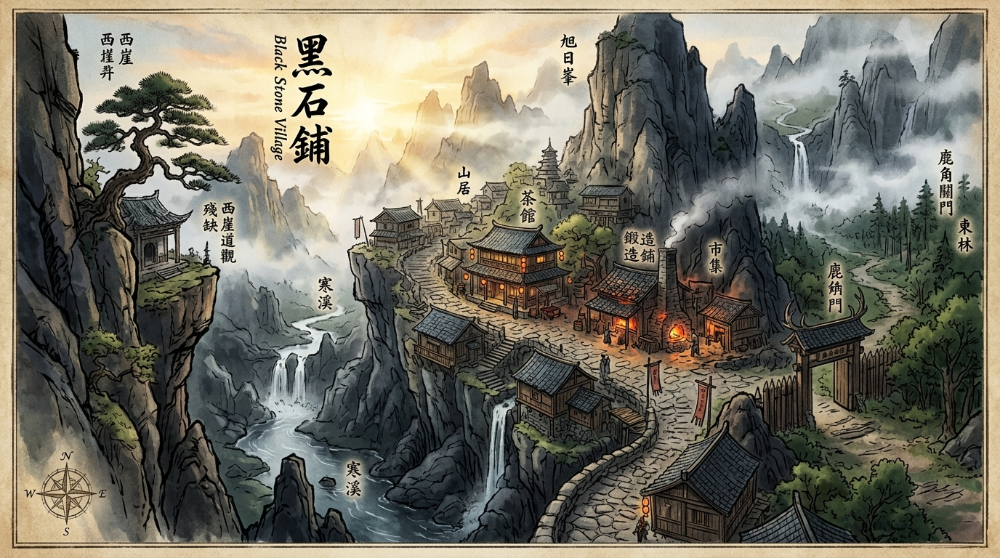

# 敘事內容：小說章節綱要 (Novel Chapters)

此目錄存放《遺忘的世界》(THE FORGOTTEN SPACE) 的各卷章節詳細綱要與章節正文。

---

## 第一卷：黑石破曉 / 凡胎驚蟄

*黑石鋪聚落全景地圖：北依黑石斷崖古礦坑，西立老松殘觀，東設鹿角木柵大荒林口，南臨幽霧寒溪與浣衣磨刀石灘。*

本卷以黑石鋪同一天清晨（破曉時分）為統一時間錨點，從五位不同身世底層少年的生活切入，層層揭開被大清洗掩蓋的太古真相：

* [**第 1 章：晨曦微光與磨刀石**](file:///home/wade/src/github/mudscript/forgotten-space/narrative/chapters/ch0001.md)
  * **視角人物**：[顧玄（採藥孤兒）](file:///home/wade/src/github/mudscript/forgotten-space/narrative/characters/gu_xuan.md)
  * **主場景**：南谷碎石溪灘 (`/d/village/stream.c`)
  * **失落秘密**：洗衣石板深處被水流洗出的【逆行蒼龍七宿星圖】與太古大清洗殘篆。
* [**第 2 章：爐火、重錘與不融黑鐵**](file:///home/wade/src/github/mudscript/forgotten-space/narrative/chapters/ch0002.md)
  * **視角人物**：[林鐵生（打鐵學徒）](file:///home/wade/src/github/mudscript/forgotten-space/narrative/characters/lin_tiesheng.md)
  * **主場景**：老鐵匠鋪・打鐵爐房 (`/d/village/forge.c`)
  * **失落秘密**：地爐萬度熔火不化的【太古不融黑鐵齒輪構件】，上古工聖失落的微型機械造物。
* [**第 3 章：鹿角哨亭、陷阱與大荒異動**](file:///home/wade/src/github/mudscript/forgotten-space/narrative/chapters/ch0003.md)
  * **視角人物**：[燕隼（獵戶之子）](file:///home/wade/src/github/mudscript/forgotten-space/narrative/characters/yan_sun.md)
  * **主場景**：林邊茅屋・獵戶哨亭 (`/d/village/hunter_cabin.c`) 與 荊棘林口 (`/d/village/forest.c`)
  * **失落秘密**：化骨泥沼巨榕根下的【太古戰神獵獸圖騰玄柱】，肉身力修之道荒古血脈共鳴。
* [**第 4 章：殘壇罡風、觀星與道化之影**](file:///home/wade/src/github/mudscript/forgotten-space/narrative/chapters/ch0004.md)
  * **視角人物**：[柳清虛（破落道童）](file:///home/wade/src/github/mudscript/forgotten-space/narrative/characters/liu_qingxu.md)
  * **主場景**：迎風孤岩・荒廢道壇 (`/d/village/altar.c`)
  * **失落秘密**：孤松下玉化晶石長老揭開的「道化詛咒」，以及蒼穹星空背後的灰暗天羅牢籠。
* [**第 5 章：背街柴房、市井耳目與黑市古令**](file:///home/wade/src/github/mudscript/forgotten-space/narrative/chapters/ch0005.md)
  * **視角人物**：[沈泥（流浪乞兒）](file:///home/wade/src/github/mudscript/forgotten-space/narrative/characters/shen_ni.md)
  * **主場景**：客棧背街・廢柴房 (`/d/village/shed.c`)
  * **失落秘密**：客棧後巷爛泥深處發掘的【萬物行商・天門引】青金古令，史前商盟通往九大神城的通關信物。
* [**第 6 章：晨集初開・五方交匯**](file:///home/wade/src/github/mudscript/forgotten-space/narrative/chapters/ch0006.md) - 青石街市晨集開市，五位底層少年首次目光交錯。
* [**第 7 章：百工之環・生計互生**](file:///home/wade/src/github/mudscript/forgotten-space/narrative/chapters/ch0007.md) - 鐵匠、藥師、獵戶的底層生活閉環與物道相互依存。
* [**第 8 章：荒澗伏擊・氣血如爐**](file:///home/wade/src/github/mudscript/forgotten-space/narrative/chapters/ch0008.md) - 南谷荒澗遭城防軍暗樁伏擊，燕隼戰神圖騰氣血初顯反殺。
* [**第 9 章：逆星殘卷・知見道爭**](file:///home/wade/src/github/mudscript/forgotten-space/narrative/chapters/ch0009.md) - 暗巷石碑拓片與道門青銅殘圖合契，拼合出太古逆星全圖。
* [**第 10 章：暗巷驚鴻・少年心氣**](file:///home/wade/src/github/mudscript/forgotten-space/narrative/chapters/ch0010.md) - 暴雨夜五子聯手營救金石商隊大小姐蘇凝霜，揭開屠村陰謀。
* [**第 11 章：瘋醫與盲道・老輩殘影**](file:///home/wade/src/github/mudscript/forgotten-space/narrative/chapters/ch0011.md) - 伏擊六名黑甲弩衛，五位底層殘老導師暗中拔刀撐天。
* [**第 12 章：凡骨微瀾・修為初進**](file:///home/wade/src/github/mudscript/forgotten-space/narrative/chapters/ch0012.md) - 柴房溫情與修為精進，突發北崖大塌方，老礦工被埋地底。
* [**第 13 章：地煞崩鳴・山崩礦塌**](file:///home/wade/src/github/mudscript/forgotten-space/narrative/chapters/ch0013.md) - 趙德貴封山滅口，蘇凝霜以紫金雙龍印血書簽署甲級特等救援委託。
* [**第 14 章：逆流而上・人心如鑑**](file:///home/wade/src/github/mudscript/forgotten-space/narrative/chapters/ch0014.md) - 全鎮百工傾力相助，五子立生死狀踏入地下三百米死寂深淵。
* [**第 15 章：鑿巖破穴・鐵骨生生**](file:///home/wade/src/github/mudscript/forgotten-space/narrative/chapters/ch0015.md) - 鐵生重錘撼石眼右腕骨裂，沈泥銜藥冒險爬過兩尺排沙暗穴建救命索。
* [**第 16 章：死線拔河・命懸一線**](file:///home/wade/src/github/mudscript/forgotten-space/narrative/chapters/ch0016.md) - 針藥搶救，燕隼雙殺盲眼岩蜥，鐵生黑鐵卡榫撐開通道，二十三礦工全數救出。
* [**第 17 章：生還之後・暗流如沸**](file:///home/wade/src/github/mudscript/forgotten-space/narrative/chapters/ch0017.md) - 礦坪家屬拜謝，胡百戶率鐵騎逼宮，老輩亮獠牙，魯大山拋軍用引信揭真相。
* [**第 18 章：分歧之夜・少年道擇**](file:///home/wade/src/github/mudscript/forgotten-space/narrative/chapters/ch0018.md) - 廢柴房五子哲學理念激烈交鋒，求真、現實、責任、天命、生存撞擊立下三日出鄉誓約。
* [**第 19 章：生息暗湧・晨市米貴**](file:///home/wade/src/github/mudscript/forgotten-space/narrative/chapters/ch0019.md) - 封關與百里虎跳營軍情校準，糧價暴漲與商隊算計，鐵生斷煤左錘悟應力、顧玄三包止痛散殘酷分診與寒針截脈，東林矛盾獸跡與無外傷暴斃黃羊現蹤。
* [**第 20 章：暴斃黃羊・雙重實證**](file:///home/wade/src/github/mudscript/forgotten-space/narrative/chapters/ch0020.md) - 顧玄結合礦工石肺經驗剖檢黃羊驗出地煞硫塵急性窒息，清虛與斥候比對北獸南逃糞便蹄印層次，雙重實證確立「逃荒遷徙假說」，拼合古圖驚見二十五里落龍深澗直通虎跳峽官道。
* [**第 21 章：市井暗火・人心如鑑**](file:///home/wade/src/github/mudscript/forgotten-space/narrative/chapters/ch0021.md) - 雜糧鋪搶糧見血、商隊外聘護衛譁變奪馬被彈壓遣散，沈泥與鐵生識破富戶王周二家暗藏封爐耐火泥之「地煞精煉坩堝」欲攜贓私逃，趙老獵當頭棒喝點破強堵必垮與轉嫁官道之道德重擔。
* [**第 22 章：火塘夜議・落龍借勢**](file:///home/wade/src/github/mudscript/forgotten-space/narrative/chapters/ch0022.md) - 深夜柴房密會，釐清谷底重氣沉降與向陽坡西南側逆風之雙層氣流，確立「清東減阻、斜石導西」及窄巷暗渠備案，直面二十五里裂谷分波衝擊官道之因果代價，洞悉大乾軍制三方制衡槓桿。
* [**第 23 章：落龍天塹・風眼隘口**](file:///home/wade/src/github/mudscript/forgotten-space/narrative/chapters/ch0023.md) - 清晨實地踏勘落龍口，目睹幼鹿因東路亂石折返西路，鐵生識破危岩冰裂紋與千層酥頁岩結構，清虛以三處瓦盆實測鎖定辰末至巳初僅一個時辰的「西南側逆風窗口」與巳正亂流倒灌紅線。
* [**第 24 章：百工逆行・萬斤落石**](file:///home/wade/src/github/mudscript/forgotten-space/narrative/chapters/ch0024.md) - 三十一人逆行施工，鐵生嚴守右腕夾板限制以炭筆判讀應力指揮絞盤，二號危岩因轉向石柱崩塌卡在半坡，魯大山傳授井下「斜向卸力疊石法」，築成前低後高、側翼留有洩壓缺口的三十度品字形碎石導向障。
* [**第 25 章：逆風草煙・惡臭之陣**](file:///home/wade/src/github/mudscript/forgotten-space/narrative/chapters/ch0025.md) - 沈泥以乾饃動員後巷乞兒寡婦搜集狼糞辣蓼，顧玄嚴減三分之二硫磺渣並立下上風位、兩刻鐘換班與沙袋滅煙三條鐵律；小岔道實測證實側風草煙與鳴鏑能誘導黃羊岩鹿改道，卻攔不住受激硬衝的狂躁大野豬。
* [**第 26 章：私逃血鑑・連鎖破局**](file:///home/wade/src/github/mudscript/forgotten-space/narrative/chapters/ch0026.md) - 富戶王周二家雇雷五等十名刀客趕四輛重車強走南谷小道，遭先頭野豬與狼群伏擊車毀人亡堵死南路，徹底粉碎全鎮私逃幻想並迫使街坊投入窄巷防禦；沈泥彈壓爭搶建立戰時配給，破碎鐵箱滾出刻有「金石內造・丙字柒號」之除渣精煉坩堝。

