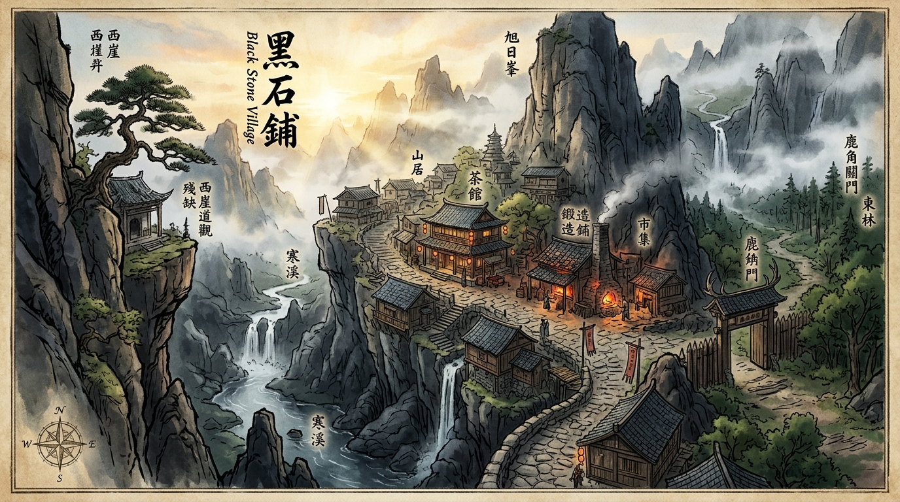

# 敘事內容：小說章節綱要 (Novel Chapters)

此目錄存放《遺忘的世界》(THE FORGOTTEN SPACE) 的各卷章節詳細綱要與章節正文。

---

## 第一卷：黑石破曉 / 凡胎驚蟄

*黑石鋪聚落全景地圖：北依黑石斷崖古礦坑，西立老松殘觀，東設鹿角木柵大荒林口，南臨幽霧寒溪與浣衣磨刀石灘。*

本卷以黑石鋪同一天清晨（破曉時分）為統一時間錨點，從五位不同身世底層少年的生活切入，層層揭開被大清洗掩蓋的太古真相：

* [**第 1 章：晨曦微光與磨刀石**](file:///home/wade/src/github/mudscript/forgotten-space/narrative/chapters/ch0001.md)
  * **視角人物**：[顧玄（採藥孤兒）](file:///home/wade/src/github/mudscript/forgotten-space/narrative/characters/gu_xuan.md)
  * **主場景**：南谷碎石溪灘 (`/d/village/stream.c`)
  * **失落秘密**：洗衣石板深處被水流洗出的【逆行蒼龍七宿星圖】與太古大清洗殘篆。
* [**第 2 章：爐火、重錘與不融黑鐵**](file:///home/wade/src/github/mudscript/forgotten-space/narrative/chapters/ch0002.md)
  * **視角人物**：[林鐵生（打鐵學徒）](file:///home/wade/src/github/mudscript/forgotten-space/narrative/characters/lin_tiesheng.md)
  * **主場景**：老鐵匠鋪・打鐵爐房 (`/d/village/forge.c`)
  * **失落秘密**：地爐萬度熔火不化的【太古不融黑鐵齒輪構件】，上古工聖失落的微型機械造物。
* [**第 3 章：鹿角哨亭、陷阱與大荒異動**](file:///home/wade/src/github/mudscript/forgotten-space/narrative/chapters/ch0003.md)
  * **視角人物**：[燕隼（獵戶之子）](file:///home/wade/src/github/mudscript/forgotten-space/narrative/characters/yan_sun.md)
  * **主場景**：林邊茅屋・獵戶哨亭 (`/d/village/hunter_cabin.c`) 與 荊棘林口 (`/d/village/forest.c`)
  * **失落秘密**：化骨泥沼巨榕根下的【太古戰神獵獸圖騰玄柱】，肉身力修之道荒古血脈共鳴。
* [**第 4 章：殘壇罡風、觀星與道化之影**](file:///home/wade/src/github/mudscript/forgotten-space/narrative/chapters/ch0004.md)
  * **視角人物**：[柳清虛（破落道童）](file:///home/wade/src/github/mudscript/forgotten-space/narrative/characters/liu_qingxu.md)
  * **主場景**：迎風孤岩・荒廢道壇 (`/d/village/altar.c`)
  * **失落秘密**：孤松下玉化晶石長老揭開的「道化詛咒」，以及蒼穹星空背後的灰暗天羅牢籠。
* [**第 5 章：背街柴房、市井耳目與黑市古令**](file:///home/wade/src/github/mudscript/forgotten-space/narrative/chapters/ch0005.md)
  * **視角人物**：[沈泥（流浪乞兒）](file:///home/wade/src/github/mudscript/forgotten-space/narrative/characters/shen_ni.md)
  * **主場景**：客棧背街・廢柴房 (`/d/village/shed.c`)
  * **失落秘密**：客棧後巷爛泥深處發掘的【萬物行商・天門引】青金古令，史前商盟通往九大神城的通關信物。
* [**第 6 章：晨集初開・五方交匯**](file:///home/wade/src/github/mudscript/forgotten-space/narrative/chapters/ch0006.md) - 青石街市晨集開市，五位底層少年首次目光交錯。
* [**第 7 章：百工之環・生計互生**](file:///home/wade/src/github/mudscript/forgotten-space/narrative/chapters/ch0007.md) - 鐵匠、藥師、獵戶的底層生活閉環與物道相互依存。
* [**第 8 章：荒澗伏擊・氣血如爐**](file:///home/wade/src/github/mudscript/forgotten-space/narrative/chapters/ch0008.md) - 南谷荒澗遭城防軍暗樁伏擊，燕隼戰神圖騰氣血初顯反殺。
* [**第 9 章：逆星殘卷・知見道爭**](file:///home/wade/src/github/mudscript/forgotten-space/narrative/chapters/ch0009.md) - 暗巷石碑拓片與道門青銅殘圖合契，拼合出太古逆星全圖。
* [**第 10 章：暗巷驚鴻・少年心氣**](file:///home/wade/src/github/mudscript/forgotten-space/narrative/chapters/ch0010.md) - 暴雨夜五子聯手營救金石商隊大小姐蘇凝霜，揭開屠村陰謀。
* [**第 11 章：瘋醫與盲道・老輩殘影**](file:///home/wade/src/github/mudscript/forgotten-space/narrative/chapters/ch0011.md) - 伏擊六名黑甲弩衛，五位底層殘老導師暗中拔刀撐天。
* [**第 12 章：凡骨微瀾・修為初進**](file:///home/wade/src/github/mudscript/forgotten-space/narrative/chapters/ch0012.md) - 柴房溫情與修為精進，突發北崖大塌方，老礦工被埋地底。
* [**第 13 章：地煞崩鳴・山崩礦塌**](file:///home/wade/src/github/mudscript/forgotten-space/narrative/chapters/ch0013.md) - 趙德貴封山滅口，蘇凝霜以紫金雙龍印血書簽署甲級特等救援委託。
* [**第 14 章：逆流而上・人心如鑑**](file:///home/wade/src/github/mudscript/forgotten-space/narrative/chapters/ch0014.md) - 全鎮百工傾力相助，五子立生死狀踏入地下三百米死寂深淵。
* [**第 15 章：鑿巖破穴・鐵骨生生**](file:///home/wade/src/github/mudscript/forgotten-space/narrative/chapters/ch0015.md) - 鐵生重錘撼石眼右腕骨裂，沈泥銜藥冒險爬過兩尺排沙暗穴建救命索。
* [**第 16 章：死線拔河・命懸一線**](file:///home/wade/src/github/mudscript/forgotten-space/narrative/chapters/ch0016.md) - 針藥搶救，燕隼雙殺盲眼岩蜥，鐵生黑鐵卡榫撐開通道，二十三礦工全數救出。
* [**第 17 章：生還之後・暗流如沸**](file:///home/wade/src/github/mudscript/forgotten-space/narrative/chapters/ch0017.md) - 礦坪家屬拜謝，胡百戶率鐵騎逼宮，老輩亮獠牙，魯大山拋軍用引信揭真相。
* [**第 18 章：分歧之夜・少年道擇**](file:///home/wade/src/github/mudscript/forgotten-space/narrative/chapters/ch0018.md) - 廢柴房五子哲學理念激烈交鋒；蘇凝霜傳遞城防司三千大軍駐紮虎跳營軍報，胡百戶封死黑石關，五子立下破境衝關誓約。
* [**第 19 章：生息暗湧・晨市米貴**](file:///home/wade/src/github/mudscript/forgotten-space/narrative/chapters/ch0019.md) - 晨市粗糧暴漲與沈泥安撫乞兒，鐵生斷煤左手小錘悟結構應力，草廬顧玄殘酷分診；老礦工老李頭主動推拒吊命藥、從容辭世，以命護佑柱子與大牛。
* [**第 20 章：暴斃黃羊・雙重實證**](file:///home/wade/src/github/mudscript/forgotten-space/narrative/chapters/ch0020.md) - 燕隼與清虛查東林南逃足跡帶回暴斃黃羊，顧玄剖檢驗出地煞硫塵窒息，雙重實證確立「逃荒遷徙假說」，拼合古圖驚見二十五里落龍深澗直通虎跳峽官道。
* [**第 21 章：市井暗火・人心如鑑**](file:///home/wade/src/github/mudscript/forgotten-space/narrative/chapters/ch0021.md) - 雜糧鋪搶糧見血，商隊外聘護衛譁變被遣散（雷五受阻於山口狼群困守南門），沈泥與鐵生識破富戶車藏耐火泥與除渣坩堝欲私逃，趙伯點破硬堵必垮與轉嫁官道之道德重擔。
* [**第 22 章：火塘夜議・落龍借勢**](file:///home/wade/src/github/mudscript/forgotten-space/narrative/chapters/ch0022.md) - 深夜柴房密會，確立「清東減阻、斜石導西」及窄巷暗渠備案，直面二十五里裂谷衝擊官道之因果代價，洞悉大乾軍制三方制衡槓桿。
* [**第 23 章：落龍天塹・風眼隘口**](file:///home/wade/src/github/mudscript/forgotten-space/narrative/chapters/ch0023.md) - 清晨眾人分頭拼合落龍口情報（獸性習慣、千層酥岩床、人力極限與冰裂紋），清虛將辰末至巳初逆風定為有條件估計；三十一名各懷真實生計考量的參與者集結，結尾發現二號危岩轉向石柱底座暗裂卻因時間緊迫被迫冒險一試。
* [**第 24 章：百工逆行・萬斤落石**](file:///home/wade/src/github/mudscript/forgotten-space/narrative/chapters/ch0024.md) - 鐵生嚴守右腕夾板限制以炭筆判讀指揮，拉二號危岩時轉向石柱崩塌導致王老四負傷退下、導輪損毀；魯大山改用「分段落石與魚鱗式碎石坎」降低單點失敗風險並預留三丈洩壓缺口，耗盡白晝體力築成半截導向坎。
* [**第 25 章：逆風草煙・惡臭之陣**](file:///home/wade/src/github/mudscript/forgotten-space/narrative/chapters/ch0025.md) - 沈泥依安全邊界動員九歲狗蛋與乞兒寡婦、封窗換取孫老頭狼糞；顧玄減除三分之二硫磺渣並赴北面岔道實測，記錄下黃羊主動繞行、岩鹿受亂煙遮眼原地打轉擁擠、野豬受激硬衝破陣三種反應，確立複合防禦策略。
* [**第 26 章：私逃血鑑・連鎖破局**](file:///home/wade/src/github/mudscript/forgotten-space/narrative/chapters/ch0026.md) - 王周二家出重金買下雷五等十名刀客強趕四車私逃，撞毀拒馬、動搖街坊，旋即於南谷窄道遭野豬狼群伏擊翻車堵死南路，迫使全鎮回頭配合守城；翻車夾層起出「金石內造・丙字柒號」紫銅除渣坩堝，確立戰時最低合作秩序。
* [**第 27 章：驚蟄前夜・簷下風聲**](file:///home/wade/src/github/mudscript/forgotten-space/narrative/chapters/ch0027.md) - 第三天寅時破曉前夕，客棧地窖避難爭執由阿鐵與葛半仙強力彈壓，確立孫大牛右膝下截脈寒針拔除後之石膽苔外敷底線；五子與趙伯、魯大山於落龍口高崖就位，嚴密監測北山震動與風向窗口。
* [**第 28 章：奔雷偏折・怒轉深澗**](file:///home/wade/src/github/mudscript/forgotten-space/narrative/chapters/ch0028.md) - 辰末兩千五百頭獸潮抵近落龍口，清虛鎖定西南側風窗口下令點火、燕隼鳴鏑火矢驚擾頭鹿、鐵生心神感應不融黑鐵應力指揮魯大山鬆銷落石鎖死三十度魚鱗碎石障，成功將八成獸潮導入落龍深澗；尾部三百餘頭狂躁野豬與傷狼順洩壓缺口衝向黑石鋪。
* [**第 29 章：巷尾餘燼・守望相助**](file:///home/wade/src/github/mudscript/forgotten-space/narrative/chapters/ch0029.md) - 三百漏網狂獸撞破外柵，眾人依託車陣迷宮與絆獸鐵索分段削弱動量；木匠老陳以身頂檁硬撼六百斤野豬王壯烈殉職，阿鐵重錘轟殺豬王，燕隼百斤蛟骨弓連珠箭射穿卡橋巨豬解炭棚之危，殘獸終被驅出南口。
* [**第 30 章：晨曦灰燼・劫後微光**](file:///home/wade/src/github/mudscript/forgotten-space/narrative/chapters/ch0030.md) - 第四天清晨水井坪祭奠老李頭與木匠老陳兩位長者，凝聚全鎮骨血；沈泥以工分榜平息爭端，醫棚內二十二名礦工傷情穩定但全鎮外傷草藥徹底見底，靜候燕隼帶回虎跳峽實況。
* [**第 31 章：錯位天平・狼狽關防**](file:///home/wade/src/github/mudscript/forgotten-space/narrative/chapters/ch0031.md) - 燕隼與石頭叔帶回虎跳峽戰況：先鋒參將陳鎮山領八百輕兵已過北岸，隨後輜重營遭獸潮衝擊，六十丈懸崖木棧道崩塌，十八車糧食重弩墜江；胡百戶斷糧龜縮黑石關，先鋒軍斷糧翻山，形成三層戰略轉機。
* [**第 32 章：迷局反客・籌碼在手**](file:///home/wade/src/github/mudscript/forgotten-space/narrative/chapters/ch0032.md) - 五子直面轉嫁災難之因果重擔，沈泥亮出天門引鐵牌合契商會總堂密室；眾人依大乾軍制「三方互監」分置籌碼（雷管批號拓片、暗賬與丙字坩堝拓片、斷道實圖與礦工家書），敲定借道太古排沙暗渠外延支洞連夜分投先鋒大營。
* [**第 33 章：迷霧扣關・三軍陣前**](file:///home/wade/src/github/mudscript/forgotten-space/narrative/chapters/ch0033.md) - 八百先鋒輕兵列陣扣關，胡百戶誣告謀反；陳鎮山洞察三大矛盾，推遲強攻限令次日午時交出實據。
* [**第 34 章：暗賬分牒・多點投書**](file:///home/wade/src/github/mudscript/forgotten-space/narrative/chapters/ch0034.md) - 沈泥莫三穿行地下排沙暗渠支洞，燕隼鳴鏑掩護，多點投書精準掣肘軍械監軍、主帥陳鎮山與督糧官。
* [**第 35 章：軍心如鑑・天威難欺**](file:///home/wade/src/github/mudscript/forgotten-space/narrative/chapters/ch0035.md) - 校場公開勘驗，軍用雷管鋼印鎖死胡百戶罪名，老礦工與家書動搖軍心，陳鎮山順勢拿下胡德海，改強攻為封存會審。
* [**第 36 章：商會殘骨・利益之毒**](file:///home/wade/src/github/mudscript/forgotten-space/narrative/chapters/ch0036.md) - 提審趙德貴揭穿副會長錢百川走私謀殺大掌櫃黑幕，天字一號密室與天門引暗線浮現，確立五子護送證物赴府城之決心。
* [**第 37 章：回首黑石・凡胎圓滿**](file:///home/wade/src/github/mudscript/forgotten-space/narrative/chapters/ch0037.md) - 聚落展開真實重建重開爐火，五子歷經劫難迎來心性與技藝質變，水到渠成晉升 Lv.10 凡胎圓滿，獲頒官府出鄉路引。
* [**第 38 章：大荒官道・天門驚蟄**](file:///home/wade/src/github/mudscript/forgotten-space/narrative/chapters/ch0038.md) - 虎跳峽便道搶通，五子向五位留守師長深沉道別，護衛商隊踏上大荒官道邁向金石府城，第一卷圓滿落幕。

---

## 第二卷：金石風雲 / 入城立籍篇

本卷主舞台移至金石府城（九大分區、45 間正典房間）與周邊六縣區域網。五位少年護送死囚與走私重證，沿東線盤木林道踏入自治城邦，直面世俗體制、五方共治博弈、兩階段居留鐵律與分途立籍考驗：

* [**第 39 章：殘雪驛道・證物同行**](file:///home/wade/src/github/mudscript/forgotten-space/narrative/chapters/ch0039.md)
  * **視角人物**：[沈泥（流浪乞兒）](file:///home/wade/src/github/mudscript/forgotten-space/narrative/characters/shen_ni.md)
  * **路段場景**：盤木林道東線 (`seg_blackstone_panmu` 190 里) ｜ 青澗驛
  * **核心事件**：重車難渡西線吊橋，全隊隨陳鎮山押解隊走盤木林道；蘇凝霜與陳鎮山逐項建立證物「保管鏈 (`chain_of_custody`)」；沈泥與顧玄勘破隨隊「犒軍鹹肉」蘊藏透骨草麻痺味覺之致命伏筆；驛站嚴苛計價，五子切身體會 Tier 0 新手保護之撤除。
* [**第 40 章：墜崖之家**](file:///home/wade/src/github/mudscript/forgotten-space/narrative/chapters/ch0040.md)
  * **視角人物**：[燕隼（獵戶之子）](file:///home/wade/src/github/mudscript/forgotten-space/narrative/characters/yan_sun.md)
  * **路段場景**：盤木林道 40 里 ｜ 峽下驛（虎跳峽下游斷道收容營）
  * **核心事件**：直面虎跳峽棧道崩塌墜江死傷兵丁與腳夫家屬；燕隼額角受創不退反進，五子肅然長跪不推諉避責；通宵搶救傷肢、修補車棚樑木、劈柴生火、撫慰孤寡；柳清虛逐名造冊血書畫押立下終生欠償之諾；確立「救村功績不能抵消下游傷亡代價」的硬骨人間道。
* [**第 41 章：夜半鐵檻**](file:///home/wade/src/github/mudscript/forgotten-space/narrative/chapters/ch0041.md)
  * **視角人物**：[顧玄（採藥孤兒）](file:///home/wade/src/github/mudscript/forgotten-space/narrative/characters/gu_xuan.md)
  * **路段場景**：盤木林道 150 里 ｜ 松崖驛（盤木縣前哨）
  * **核心事件**：重囚趙德貴夜半七竅滲黑血暴發「地陰腐骨散」劇毒；顧玄行針鎖心脈、草木灰水催吐、九節菖蒲散吊命，險奪活口卻致其咽喉灼爛神智殘缺；驗明毒源出自高鹽透骨草犒軍鹹肉；嚴守五欄證據邊界將樣本定為 `lead_only`（調查線索），不作無據指控；陳鎮山雷霆隔離死守、內鬼留白。
* [**第 42 章：盤木林道・木價之痕**](file:///home/wade/src/github/mudscript/forgotten-space/narrative/chapters/ch0042.md)
  * **視角人物**：[林鐵生（打鐵學徒）](file:///home/wade/src/github/mudscript/forgotten-space/narrative/characters/lin_tiesheng.md)
  * **路段場景**：盤木縣城集材大坪 ｜ 盤木→金石南關林道起點 (`seg_city_panmu` 260 里)
  * **核心事件**：對接盤木縣 30 天自主演進（獸潮引發林道滑坡、巨木暴漲、天工木作越界毀青松塢陷阱爆發宗族對峙）；萬斤古冷杉卡死斜坡絞盤瀕臨崩塌，林鐵生右臂吊夾板、左手小鍛錘憑「百工析理與應力判讀」一錘定軸化解滅頂危機；獲贈盤木木作特級工牌（連繫城北總把頭魯長生）；車隊踏上最後 260 里進城征途。
* [**第 43 章：南關入城・濁氣初嚐**](file:///home/wade/src/github/mudscript/forgotten-space/narrative/chapters/ch0043.md)
  * **視角人物**：[柳清虛（破落道童）](file:///home/wade/src/github/mudscript/forgotten-space/narrative/characters/liu_qingxu.md)
  * **路段場景**：金石府城南關 (`/d/city/gate/gate_south`) ｜ 南關車馬小棧 (`/d/city/south/inn_south`)
  * **核心事件**：東線 450 里十日跋涉終抵府城南關；稅吏宋算子藉南關稅則（木材 10%、重礦 20%）欲撬箱破壞保管鏈，陳鎮山怒拔斬馬刀霸道震懾通關；流民牙子刁小七兜售黑工契現流民慘狀；柳清虛親嚐「紅塵濁氣梯度（+2/時辰）」與宣道司「絕靈法網」壓制；同鄉老掌櫃老劉警示居留鐵律，第一階段「72 小時臨時擔保通牒 (`initial_registration_72h`)」正式倒數。
* [**第 44 章：證物入庫・兩面主簿**](file:///home/wade/src/github/mudscript/forgotten-space/narrative/chapters/ch0044.md)
  * **視角人物**：[沈泥（流浪乞兒）](file:///home/wade/src/github/mudscript/forgotten-space/narrative/characters/shen_ni.md)
  * **路段場景**：金石府衙正堂 (`/d/city/center/yamen`) ｜ 案卷庫 (`yamen_archive`)
  * **核心事件**：陳鎮山與蘇凝霜登堂交割人犯與證物，府尹秦正明威儀深不可測、未定三方會審日期；趙德貴移交死牢鐵鐐張嚴加死守；案牘主簿文承敬於案卷庫登記保管鏈時，盤查沈泥出身底細，沈泥裝怯瞞過卻窺見其案頭壓著十五年前舊商盟「雲記」查抄名冊；七十二小時大限僅餘四十八時辰。
* [**第 45 章：總堂吊唁・金蓮微笑**](file:///home/wade/src/github/mudscript/forgotten-space/narrative/chapters/ch0045.md)
  * **視角人物**：[沈泥（流浪乞兒）](file:///home/wade/src/github/mudscript/forgotten-space/narrative/characters/shen_ni.md)
  * **路段場景**：車馬大院 (`/d/city/south/caravan_yard`) ｜ 商會總堂靈堂 (`/d/city/south/shanghui_hq`)
  * **核心事件**：蘇氏舊部大掌櫃蘇忠接應預警；靈堂上副會長錢百川滿面悲戚、當眾擲五百兩白銀與「特級商會附庸籍」欲行收買；沈泥洞察附庸籍為剝奪獨立訴訟權之生鐵絞索，五子冷硬回絕；錢算子宣讀內堂令架空蘇凝霜管轄權；雙方不見血撕破臉，居留大限倒數僅剩最後 48 時辰。
* [**第 46 章：三日通牒・分途之約**](file:///home/wade/src/github/mudscript/forgotten-space/narrative/chapters/ch0046.md)
  * **視角人物**：五人群像（沈泥、顧玄、林鐵生、燕隼、柳清虛）
  * **路段場景**：南關車馬小棧 ｜ 城中蒙學塾、杏林醫館、車馬大院
  * **核心事件**：巡防營子時夜搜前夕，五人精確啟用「三條零門檻緩衝路徑」完成第一階段居留擔保（清虛與沈泥赴學塾領青衿生員牌獲 14 天寬限期、顧玄赴醫館應募試藥童獲 10 天寬限期、燕隼與鐵生赴車馬大院簽苦力短契獲 7 天寬限期）；五手相疊立下「分途不分道」之約（旬會核帳、分散藏證、三道互證）；第二卷第一幕（Ch.39 ~ 46）圓滿落幕。
* [**第 47 章：學徒登記・阿鐵的記號**](file:///home/wade/src/github/mudscript/forgotten-space/narrative/chapters/ch0047.md)
  * **視角人物**：[林鐵生（打鐵學徒）](file:///home/wade/src/github/mudscript/forgotten-space/narrative/characters/lin_tiesheng.md)
  * **路段場景**：百工總會外門 (`/d/city/north/gong_gate`) ｜ 千錘地爐坊 (`north/gong_forge`)
  * **核心事件**：鐵生持盤木特級工牌報考匠籍，因右臂骨裂遭司匠薄吏方矩冷嘲拒收；首席鍛造大師莫錘現身，自鐵生左手小錘錘底認出二十年前替罪離城師兄「阿鐵」之本命私印，悲慟震撼；嚴守「五維能力分離」鐵律不給特例，設下「十丈聽聲辨甲、左手校準五百根生鐵銷（誤差不超半絲）」之地獄考核；鐵生慨然應戰踏入地爐。
* [**第 48 章：杏林藥囊・城裡的病**](file:///home/wade/src/github/mudscript/forgotten-space/narrative/chapters/ch0048.md)
  * **視角人物**：[顧玄（採藥孤兒）](file:///home/wade/src/github/mudscript/forgotten-space/narrative/characters/gu_xuan.md)
  * **路段場景**：杏林醫館 (`/d/city/center/clinic`) ｜ 四海驛站 (`center/post_office`)
  * **核心事件**：顧玄盲眼精確辨認三十味大荒藥性、更當場識破生砒地煞染毒「暗毒引」，深得館主白先生激賞，破格獲頒【杏林藥囊腰牌（`clinic_token`）】取得 10 天合法居留；接診揭開平民普遍罹患「金石礦肺」與「濁氣焦燥症」之黑幕（私爐除渣不全與法網靈毒反噬）；赴四海驛站找驛丞馬千里寄出首批急需藥單與回村家信，正式對接黑石鋪 30 天自主演進（Stage 2）。
* [**第 49 章：大校場・百斤石鎖**](file:///home/wade/src/github/mudscript/forgotten-space/narrative/chapters/ch0049.md)
  * **視角人物**：[燕隼（獵戶之子）](file:///home/wade/src/github/mudscript/forgotten-space/narrative/characters/yan_sun.md)
  * **路段場景**：八方武館大門 (`/d/city/east/wuguan_gate`) ｜ 大校場 (`east/wuguan_ground`)
  * **核心事件**：燕隼持車馬大院苦力牌報考黑鐵武籍，遭門房牛大力與執法教頭雷剛刁難；校場徒手平舉兩尊二百斤生鐵石鎖（整整四百斤死重）直臂行走一百步震撼全場，引出軍鎮最高統帥霸山將軍親臨；獲頒【八方黑鐵腰牌（`wuguan_iron_token`）】；嚴守「五維能力分離」邊界（非軍官、無權調閱兵器庫），受命從基層「巡道武卒」做起收斂骨煞。
* [**第 50 章：宣道司五殿・借鏡觀象**](file:///home/wade/src/github/mudscript/forgotten-space/narrative/chapters/ch0050.md)
  * **視角人物**：[柳清虛（破落道童）](file:///home/wade/src/github/mudscript/forgotten-space/narrative/characters/liu_qingxu.md)
  * **路段場景**：宣道司山門 (`/d/city/west/dao_gate`) ｜ 摘星觀象台 (`dao_observatory`) ｜ 靜心閣與三清正殿
  * **核心事件**：柳清虛持學塾青衿赴宣道司，執律道人明鏡道人嚴誡「無牒私引法者列破法死犯」之絕靈法網鐵律；於摘星觀象台以盲算精準推演蒼龍心宿三星仰角折服觀星道人星淵，獲准大考；靜心閣目睹「五十文一炷香清滌濁氣」之修行銅臭真相；三清殿玄機真人講道點破「天羅牢籠」真相，清虛貼身深藏逆星拓片暗伏道爭。
* [**第 51 章：舊帳微塵・雲妮之名**](file:///home/wade/src/github/mudscript/forgotten-space/narrative/chapters/ch0051.md)
  * **視角人物**：[沈泥（流浪乞兒）](file:///home/wade/src/github/mudscript/forgotten-space/narrative/characters/shen_ni.md)
  * **路段場景**：通寶當鋪總號 (`/d/city/center/pawnshop`) ｜ 蒙學塾 (`center/academy`)
  * **核心事件**：沈泥上午學塾抄書維繫保書、午後入通寶當鋪隨老掌櫃賈富春（賈朝奉）分揀十五年前死當爛帳；於天興十四年發霉當票中驚見「行商沈氏、質長命鎖、隨行幼女乳名雲妮」之泣血記錄，指尖觸及胸前玉佩；嚴守身世二階邊界，將單一來源定為 `lead_only`（調查線索）等待交叉驗證；以精妙算力獲頒【通寶掛名牙人信印（`lic_broker`）】立足商道。
* [**第 52 章：擂台再試・磐石與軍陣**](file:///home/wade/src/github/mudscript/forgotten-space/narrative/chapters/ch0052.md)
  * **視角人物**：[燕隼（獵戶之子）](file:///home/wade/src/github/mudscript/forgotten-space/narrative/characters/yan_sun.md)
  * **路段場景**：大校場 (`/d/city/east/wu_plaza`) ｜ 生死擂台 (`east/wu_arena`) ｜ 八方武館正堂
  * **核心事件**：燕隼隨岳千軍苦修「力修・磐石樁功」、聽輪休老兵石老兵剖析「軍陣弓手等號令」之戰略心性；二度登擂硬接外門教頭趙猛三記「鐵砂崩拳」寸步未退、三石鐵胎硬弓百步穿楊連珠貫穿三隻旋轉飛銅鐘震動全軍；獲霸山將軍親授【八方黑鐵護衛武籍（`lic_escort_guard`）】並解鎖出入【披甲兵器庫（`east/wu_armory`）】校準軍械特權。
* [**第 53 章：屋頂觀風・假天道辯證**](file:///home/wade/src/github/mudscript/forgotten-space/narrative/chapters/ch0053.md)
  * **視角人物**：[柳清虛（破落道童）](file:///home/wade/src/github/mudscript/forgotten-space/narrative/characters/liu_qingxu.md)
  * **路段場景**：屋頂觀風平台 (`/d/city/west/dao_roof`) ｜ 摘星觀象台 (`west/dao_observatory`)
  * **核心事件**：柳清虛當值夜班觀風，凌空俯瞰驚見西北常平倉與古暗渠上空紅塵濁氣呈「渦旋逆吸」，與黑石鋪地煞外洩氣息完全暗合，鎖定城內地底大規模私煉黑洞；道官玄機真人夜巡平台以「天心唯公、人欲無厭」叩問天人大道；清虛以老松殘觀質樸無為嚴謹對答避過殺機，玄機冷厲點破「宣道司要的是長明燈，不是野火」予以森寒警告。
* [**第 54 章：地火殘渣・丙字第七**](file:///home/wade/src/github/mudscript/forgotten-space/narrative/chapters/ch0054.md)
  * **視角人物**：[林鐵生（打鐵學徒）](file:///home/wade/src/github/mudscript/forgotten-space/narrative/characters/lin_tiesheng.md)
  * **路段場景**：千錘地爐第三坊 (`/d/city/north/gong_forge`) ｜ 司匠局值房 ｜ 地下暗渠入口
  * **核心事件**：林鐵生通過「五百生鐵銷校準」地獄考驗，獲莫錘大師親授【初級司匠文牒（`lic_artisan`）】；清掏地爐排渣暗溝時以百工析理檢出「地煞血精滲碳」高溫熔渣，並拓獲殘缺翻砂模具捲雲暗紋，與黑石鋪【金石內造・丙字柒號】坩堝物理咬合完全吻合；嚴守證據模型將坩堝工藝出處自線索升級為 `corroborating`（間接佐證），鎖定官造工藝出處。
* [**第 55 章：辨症行針・毒囊與洗靈草**](file:///home/wade/src/github/mudscript/forgotten-space/narrative/chapters/ch0055.md)
  * **視角人物**：[顧玄（採藥孤兒）](file:///home/wade/src/github/mudscript/forgotten-space/narrative/characters/gu_xuan.md)
  * **路段場景**：採百草分堂 (`/d/city/north/gong_alchemy`) ｜ 格物化生殿
  * **核心事件**：白先生保薦顧玄赴採百草分堂受試；顧玄盲測十二味受染靈藥，於第九味「洗靈草」微小結晶中以礬水析出「地陰腐骨散」母液特徵，與松崖驛趙德貴嘔吐殘留交叉比對證實同源——皆出自「濁水縣黑水埗水澤劇毒囊二次提純工藝」；經孫先生、白先生雙重公證，物證 `relay_poison_sample` 升級為 `corroborating`（間接佐證）；顧玄獲頒【杏林行醫與百草藥師雙重資質（`lic_apothecary`）】。
* [**第 56 章：西水門閘・三道合力**](file:///home/wade/src/github/mudscript/forgotten-space/narrative/chapters/ch0056.md)
  * **視角人物**：五人群像（沈泥、顧玄、林鐵生、燕隼、柳清虛）
  * **路段場景**：西水門漕運水關 (`/d/city/gate/gate_west`) ｜ 城外排灌水網 (`outer/irrigation`)
  * **核心事件**：連陰暴雨西水門古石閘卡死，閘官刁監水欲擅自炸閘洩洪淹沒下游三十村；五子各憑新獲正式專業資格（匠籍、藥師、黑鐵護衛、觀象道牌、牙人信印）首度在府城公眾危機中三道合力破局：清虛借鏡精算水脈退峰時差、顧玄調配高熱化冰散、燕隼負重索下水磐石樁定位、鐵生攜魯長生以左手小錘複合榫楔定軸啟閘、沈泥調集沙船避險；成功排洪保全下游與內城。
* [**第 57 章：暗紋有主・六項缺口**](file:///home/wade/src/github/mudscript/forgotten-space/narrative/chapters/ch0057.md)
  * **視角人物**：全員群像（五子 ＋ 蘇凝霜）
  * **路段場景**：南關車馬小棧 ｜ 千錘地爐坊 ｜ 披甲兵器庫
  * **核心事件**：莫錘證實商會內堂曾以特造名義下單丙字柒號坩堝但簽領簿遭調檔；燕隼入兵器庫勘破雷管批號存在「雙聯火印錯位」偷樑換柱；夜會南關依「證據五欄模型」盤點會審勝算，沈泥斷言現存間接佐證不足以扳倒老謀深算之錢百川；確立「六項證據缺口清單」（濁水毒囊出貨單、烈礬耐火泥存根、鎮風走山令舊檔、重石條石暗帳、一號密室正底單、趙德貴親筆口供）；全員兵分四路展開六縣出巡跨區域調查；第二卷第二幕（Ch.47 ~ 57）圓滿完結！

### 📜 第三幕：六縣連環・證據成鏈（第 58 ～ 67 章）

* [**第 58 章：分頭啟程・路引、假條與信印**](file:///home/wade/src/github/mudscript/forgotten-space/narrative/chapters/ch0058.md)
  * **視角人物**：沈泥
  * **路段場景**：通寶當鋪總號 (`/d/city/center/pawnshop`) ｜ 車馬大院 (`south/caravan_yard`) ｜ 東關城門 (`gate/gate_east`)
  * **核心事件**：五人向所屬機構請假銷假，直面體制附隨之組織隸屬成本（`affiliation`）：莫錘限鐵生二十日內回坊否則扣光匠籍工分；白先生命顧玄必須帶回三簍道地洗靈草；宣道司與八方武館編清虛、燕隼為北關風候巡防協查使；蘇凝霜遭錢百川以守孝名義軟禁總堂；東關督稅官褚嚴向鐵生出示生銅暴減私硝激增扣繳底冊；賈朝奉為沈泥開立通寶核驗信印並派老牙人帶路赴濁水，各懷算盤；五人誓約分頭出府展開跨縣調查。
* [**第 59 章：青河水霧・爭水與歉收之價**](file:///home/wade/src/github/mudscript/forgotten-space/narrative/chapters/ch0059.md)
  * **視角人物**：顧玄
  * **路段場景**：青河縣城 ｜ 蘆花渡口 ｜ 百草集市 ｜ 水道 (`seg_city_qinghe_water` 300 里)
  * **核心事件**：顧玄乘漕船經三百里水路抵青河縣，親歷青河 30 天自主演進 Stage 2~3 危機：上游道觀截水濾沙保貢品靈藥，商會重船霸佔閘口拒不放水，引發百草坪藥農流血械鬥；集市藥價暴漲至 140 基準，商會以高利貸預購折價契逼迫歉收藥農賣田抵債；顧玄亮出【杏林初階醫籍】當場揭穿商會以陳草假冒新草、人為製造歉收斷水以牟取暴利之黑幕。
* [**第 60 章：九城藥材・四線書信與各有各的難**](file:///home/wade/src/github/mudscript/forgotten-space/narrative/chapters/ch0060.md)
  * **視角人物**：五人跨縣群像剪輯（顧玄、林鐵生、沈泥、柳清虛、燕隼）
  * **路段場景**：青河官驛 ｜ 烈礬紅砂坳 ｜ 濁水黑水埗 ｜ 鎮風邊塞天風谷 ｜ 青河靈植道觀
  * **核心事件**：四海驛站快郵匯總四線書信，揭開六縣 30 天自主演進各自深陷的制度困境：烈礬深井火毒截留甘草、盤木只認工分、濁水水銀污染爛瘡蔓延、鎮風軍管封鎖川芎；顧玄打破「一次性低價買齊」幻想，以「次級苦參替代方＋盤木赤松茯苓」破局，並憑孫先生公函說服靈植道觀開閘放水三個時辰兼平價放藥，成功將十二大箱救命藥草發往黑石鋪；同時從四線情報中驚覺商會正大宗掃蕩解毒藥與濁水毒囊。
* [**第 61 章：天風谷口・頂風採石**](file:///home/wade/src/github/mudscript/forgotten-space/narrative/chapters/ch0061.md)
  * **視角人物**：柳清虛
  * **路段場景**：鎮風縣城 ｜ 天風谷 ｜ 鷹嘴崖 ｜ 邊防衛所 ｜ 塞道 (`seg_city_zhenfeng` 300 里)
  * **核心事件**：柳清虛與燕隼馳抵北塞鎮風縣，直面邊軍欠餉兩月引發衛所強徵石英、採石散人營門對峙之 Stage 2 危機；恪守法修器具邊界，清虛以水銀渾天鏡精算三息風眼窗口，燕隼以磐石沉錨與神箭引索，二人完美配合於萬刃絕壁採得八枚極品風蝕石英核；以四枚石英折抵邊軍冬糧、二枚撫恤陣亡散人，平息流血兵變，贏得衛所雷百戶生死信任。
* [**第 62 章：走山令・衛所舊檔與殘牌**](file:///home/wade/src/github/mudscript/forgotten-space/narrative/chapters/ch0062.md)
  * **視角人物**：燕隼
  * **路段場景**：鎮風邊防衛所 ｜ 北塞烽燧箭樓 ｜ 衛所地下案卷室
  * **核心事件**：雪狼群夜襲軍屯糧站，燕隼以重箭射殺狼王、清虛打出符火火障，二人協防死守保全糧站；獲准調閱塵封五年之衛所出關底檔，查明五年前金石商會出資三萬兩組建勘探隊並聘燕隼大伯燕山持特批【走山令】出關探測北崖礦脈，換走水文圖；現場起獲刻有大伯箭記的半枚玄鐵走山令殘牌；燕隼強忍悲慟恪守「五欄物證鐵律」，定為 `corroborative` 級別，雷震將軍親自用印作保。
* [**第 63 章：地火堡・耐火泥與減爐之痛**](file:///home/wade/src/github/mudscript/forgotten-space/narrative/chapters/ch0063.md)
  * **視角人物**：林鐵生
  * **路段場景**：烈礬地火堡 ｜ 紅砂坳 ｜ 銅駝嶺三號深井 ｜ 百工耐火分舵
  * **核心事件**：林鐵生抵烈礬縣直面減爐之痛與 Stage 2~3 礦難危機：黑石鋪血精停產引發烈礬赤礬暴跌、中小作坊熄火礦工失業；三號井地火引燃氣脈塌方，商會欲封井滅口，鐵生憑百工應力與通風結構計算率眾鑿穿側風道，救出一百二十二名礦工；憑阿鐵短錘記號獲老爐頭韓老調生死託付，取得三個月前商會內堂專用「金蓮環刀印」提領三萬斤特級耐火白泥之原始出貨底單（`liefan_clay_batch`），升級為 `corroborative` 強物證。
* [**第 64 章：浮橋濁水・金砂、廢水與毒囊**](file:///home/wade/src/github/mudscript/forgotten-space/narrative/chapters/ch0064.md)
  * **視角人物**：沈泥
  * **路段場景**：濁水縣泥螺灘 ｜ 黑水埗高腳浮橋 ｜ 排石暗渠與水樓
  * **核心事件**：沈泥踩踏泥沼浮橋道入濁水縣，直面淘金水銀劇毒外洩、亡命火併之 Stage 2~3 危機；老牙人方平斗勾結商會伏兵設伏，沈泥恪守「看出矛盾不等於知道真話、理解動機不等於認同」市井鐵律，金蟬脫殼避過連弩伏擊潛入毒囊提純地下作坊；於密櫃廢帳中截獲金石商會總堂後勤房提領六十斤高純度地陰腐骨散專供黑石關犒軍乾肉之原始出貨底單（`relay_poison_sample` 核心補強件）；四方互鎖逼近 `conclusive`（關鍵定罪鐵證）。
* [**第 65 章：舊盟殘部・「雲記」名冊與雙來源核實**](file:///home/wade/src/github/mudscript/forgotten-space/narrative/chapters/ch0065.md)
  * **視角人物**：沈泥
  * **路段場景**：濁水縣黑水埗廢棄暗渠舊址 ｜ 柯九算度支石室
  * **核心事件**：沈泥於暗渠深處尋獲前朝舊商盟老帳房柯九算，取出貼身玉佩與《舊商盟十三行原籍掌理手抄名冊》對照，交叉比對第 44 章刑部舊卷、第 51 章通寶死當陳帳，三方獨立互鎖正式達成【身世六階段・階段三：關係證實】：十五年前黑石嶺覆滅之沈氏旁支商號定名「雲記」，沈泥確為雲記少東之女「沈雲妮」；老帳房揭露幕後黑手深植商會內堂，嚴守「不知真容、不能直接指認」之邊界；獲取手抄底單（`yunji_roster`）。
* [**第 66 章：重石台地・崩斷的絞盤與虎跳峽條石**](file:///home/wade/src/github/mudscript/forgotten-space/narrative/chapters/ch0066.md)
  * **視角人物**：林鐵生
  * **路段場景**：重石縣石碾坡 ｜ 穿山寨二號採石場 ｜ 西南馳道 (`seg_city_zhongshi` 240 里)
  * **核心事件**：林鐵生馳赴西南重石縣直面城防配額轉嫁、巨型絞盤主軸崩斷民夫封錘罷工之 Stage 2~4 危機；憑沈泥【通寶牙人信印】與左手短錘【阿鐵工記】雙重信物觸發深層人脈；以百工應力析理聯手魯小木重造「雙齒棘輪複合防逆轉巨型絞盤」，化解血腥罷工；少工頭杜小山解鎖跨縣材料特惠並發車修復虎跳峽斷道；揭露商會內堂於礦難前兩個月強令抽減北崖古礦三成沉陰鐵木支護之致命證言；深溝炸穿太古石槨氣孔伏筆。
* [**第 67 章：歸途匯流・證據成鏈與凍結反擊**](file:///home/wade/src/github/mudscript/forgotten-space/narrative/chapters/ch0067.md)
  * **視角人物**：全員群像（五子 ＋ 蘇凝霜）
  * **路段場景**：南關車馬小棧 (`/d/city/south/inn_south`) ｜ 南關大街 ｜ 商會總堂外圍
  * **核心事件**：早春四線回抵南關匯流，六項缺口已補齊四項（濁水毒源交割單、烈礬耐火泥出貨單、鎮風走山令與北崖抽減支護證言、舊商盟雲記名冊），僅差密室正底單與雷管火印存根；沈泥坦白「雲記沈雲妮」身世與天字一號密室子母玄鐵門開啟機括，全員生死同盟；同日傍晚錢百川雷霆反擊，以押銀遭劫為由全面凍結六縣通寶飛錢與遠期帳期，張榜停職查辦蘇凝霜引發金融恐慌；第二卷第三幕（Ch. 58 ～ 67）圓滿完結！

