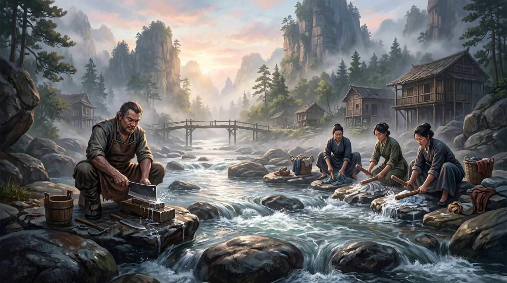

# 第一卷：黑石凡胎・驚蟄篇

## 第一章 晨曦微光與磨刀石（採藥孤兒・顧玄）

*黑石鋪聚落全景簡圖：依附於黑石峭壁上的邊陲粗獷聚落，南臨寒溪深潭，東傍大荒密林，西峙破廟絕壁。*

### 一

天色是冷鐵一般的青灰色。

卯時未過，濃稠的寒霧自黑石斷崖下的深潭中翻湧而起，像一層浸透了冰水的白練，貼著嶙峋犬牙般的怪石蜿蜒遊走，將整座黑石鋪吞得只剩幾處高懸的黑褐稜角。

這是一座依附在陡峭岩台上的邊陲聚落。幾十年間，往來於大荒邊陲的金石商隊、採藥人、逃役流民與老礦工，用踩碎的獸骨與石渣，生生在大山裂隙間夯出了一條長街。此刻天光將破未破，遠處市井街頭的老茶棚尚未生火，唯有東側老鐵匠鋪的爐膛深處，隱隱透出一抹暗紅的炭火反光，以及牛皮風箱如老牛喘息般的沉悶呼哧聲。

冰涼的水氣穿透單薄的粗麻短褐，十六歲的顧玄打了個寒顫，下意識地收緊了肩頭磨得發毛的麻繩背帶。

「嘶……」

少年赤足踏在一塊被夜霜封凍的青黑鵝卵石上，冰冷刺骨的寒意瞬間順著腳底板直衝天靈蓋，凍得他腳趾關節發僵，幾處昨日在懸崖上擦破的細小血口子被冰水一殺，泛起一陣鑽心的抽痛。

顧玄沒有縮腳，反而狠狠將腳掌踩進冰涼的淺灘泥沙裡，借著碎石摩擦的鈍痛驅散睡意。

常年在刀削般的百丈峭壁上攀援採藥，讓這名少年生就了一副勻稱精悍的筋骨。他的雙手結滿老繭，指節修長而穩固，右手手腕上拿麻繩懸著一把磨得只剩半指寬的小鐵藥鋤——那是老鐵匠鋪的阿鐵師傅用碎鐵渣隨手替他敲出來的，刃口滿是崩口，卻是他在這座大山裡討生活的唯一依仗。

*少年顧玄：背負舊竹編藥簍，攀援於碎石溪灘與峭壁間採藥，目光冷靜而沉毅。*

顧玄蹲下身，解下背後磨得包了漿的舊竹編藥簍，小心翼翼地掀開覆在最上層的濕芭蕉葉。

芭蕉葉下，靜靜臥著三株通體翠綠、葉肉薄如蟬翼的細草。草葉狹長，葉尖端端正正凝著一顆渾圓欲滴的晨露，在熹微的青灰晨光中，泛著一股極淡的幽藍微光。

那是【帶露晨露草】。

整株草連泥帶葉不過半兩重（約二十克），卻是黑石鋪最金貴的止血定驚藥引。

「三株……葉尖的露水還沒散。」

顧玄低聲呢喃了一句，清秀的臉龐在寒霧中透著幾分不合年齡的冷靜與疲憊。

為了這三株草，他昨夜四更天便懸在南谷百丈懸崖外的葛藤上，在呼嘯的山風中凍了整整一個時辰。採這草有極嚴苛的規矩：必須在日頭翻過東崖、第一縷陽光化去露珠之前，連泥帶露送回草廬；若露珠乾涸，藥性散了大半，草廬裡那位瘋郎中葛半仙，會毫不留情地把整簍草藥倒進火塘，再罰他去斷崖風口倒吊兩個時辰。

想起葛半仙，顧玄的背脊不由自主地泛起一陣寒意。

草廬的主人是把他從這條寒溪邊撿回來的怪醫，滿頭蓬亂白髮，身上常年混雜著烈酒、硫磺與爛草藥的刺鼻怪味。黑石鋪的人都罵葛老頭是個酒瘋子，但顧玄心裡清楚，若非那老頭那些稀奇古怪的偏方與近乎殘酷的淬體操練，他一個無父無母的病弱孤兒，早不知在哪個暴雪嚴冬凍死在老客棧後巷的野狗堆裡了。

顧玄將濕苔重新裹好草根，捧起清冽的溪水擦了把臉，正準備背起藥簍攀上石階，耳邊忽然傳來一陣沉重嘈雜的腳步聲。

---

### 二

「喲，小玄子！今兒個又是你起得最早！」

粗豪如雷的嗓門瞬間撕破了水谷清晨的寂靜。

只見滿臉絡腮鬍、腰間紮著油膩硬牛皮圍裙的張屠戶提著兩柄沉重厚實的剔骨砍刀，大大咧咧地踏碎泥濘，踩進淺灘；身後還跟著村東李寡婦等幾名端著大木盆、裝滿伙房油漬油布與粗麻被單的村婦。

「張叔，起得早，趁著露水採了幾株草。」顧玄直起腰，退後半步，溫和知禮地垂下眼簾。

「採草能掙幾個錙銖？整天跟著那瘋老頭搗弄爛樹皮！」張屠戶嘿嘿咧嘴一笑，露出滿嘴黃牙，大步走到溪水邊一處最為平整寬闊的深青色巨石旁，隨手將手裡那把足有三斤四兩重的厚背砍刀「鏘」地一聲甩在石面上。

這是一塊斜臥在深潭溪灘上的深青色石板。石板長達丈許，大半截沉在湍急冰冷的流水中，露出水面的部分平滑如砥，邊緣已被幾十年間的流水與鄉民踏得圓潤微陷。

它是黑石鋪底層生計不可或缺的所在。

平日裡，村婦們便在這石板上排開木槌，敲打漿洗那些浸滿油污泥沙的粗麻衣裳；採藥人出山在此歇腳淘洗根莖；而張屠戶與老獵戶趙老獵，則最喜歡蹲在石板西角，蘸著清冽溪水，將捲刃生鏽的砍刀在青石上來回磨礪。

*晨曦溪灘：張屠戶於青石巨板旁蘸水磨礪厚背砍刀，村婦李寡婦等人在湍急清流中捶打漿洗粗布衣裳。*

「沙——沙——沙——」

粗糙刺耳的金鐵磨礪聲伴著濺起的渾濁泥水，在溪谷間刺耳迴盪。石屑、鐵鏽與殘留的暗褐豬血順著石板凹陷的溝槽混雜流淌，被急流一衝，瞬間散入深潭，化作一縷極淡的腥氣。

李寡婦也熟練地將沉重的槐木大盆往石板中央一頓，掄起硬梨木棒槌，「砰！砰！砰！」地用力捶打著濕布，水珠四濺。一邊捶，她一邊抹了抹額前的散髮，抱怨道：

「這鬼天候！昨夜半夜北崖又滾了幾塊大石下來，轟隆隆震得床板晃，嚇得人心驚肉跳。聽客棧掌櫃說，金石商會的馱隊在山口被滑坡阻了道，要是三日內進不來，咱們黑石鋪的粗鹽與火油可又得漲價了！」

「怕個鳥！塌方滾石哪個月不來兩回？」張屠戶吐了口唾沫，大拇指在泛著寒光的刀刃上狠狠一刮，刮出一道刺耳的微鳴：

「等老子磨利了這柄厚背刀，跟趙老獵去東林獵兩頭肥山豬，少吃兩口鹹鹽也餓不死人！」

婦人們的抱怨聲、棒槌的捶打聲與刺耳的磨刀聲交織在一起。一刻鐘後，衣裳洗畢，砍刀磨利，眾人說笑著端起木盆、拎著滴水的生鐵刀，踏著泥濘向街市走去。

原本嘈雜的溪灘，再次歸於冰冷的寂靜。

深潭水氣浩渺，遠處瀑布如白練傾瀉而下，撞擊在岩壁上發出沉悶如雷的低吼。

顧玄蹲下身，雙手探入冰寒徹骨的溪水中。

刺骨的冰涼順著皮肉扎入骨髓，令他精神陡然一振。他洗去指縫裡的黑泥，捧起一捧清水拍在臉上。晶瑩的水珠順著他清瘦的下頜滴落，砸在方才村婦捶打衣物、屠夫磨刀的那塊青石板上。

然而，就在水花順著石面青苔散開的剎那，顧玄按在石板邊緣的中指指尖，猛地傳來一陣微弱而奇異的刺痛！

---

### 三

那是一種極其奇異、卻直刺神魂深處的微弱悸動。

就像是一根極細的冰針，冷不防自他按在石面上的右手中指指尖扎入，順著手臂經脈直竄心口！

顧玄渾身汗毛倒豎，身形如受驚的山鹿般猛地向後彈開半步，右手小鐵藥鋤橫在胸前，目光如電般警惕地掃視四周。

晨霧翻滾，荒林寂寂，唯有溪流嘩嘩。四周並無猛獸，也無毒蟲。

「奇怪……」

顧玄眉頭微蹙，低頭望向自己那隻隱隱泛麻的右手食指。指尖皮膚完好無損，唯有一點冰涼刺骨的麻木感在經脈間游離。

那是體內那卷殘缺呼吸法產生的細微感應。

顧玄深吸了一口氣，放緩呼吸，強行壓下狂跳的心臟。他重新走到石板旁，俯下身子，目光凝聚在剛才手掌按著的那片石面。

昨夜上游山洪暴漲，狂暴的激流裹挾著砂石沖刷了一整夜，將石板靠近水線處覆蓋了不知多少歲月的厚重綠苔生生掀去了一大片；加上剛才張屠戶用生鏽砍刀來回刮磨、李寡婦以沉重木槌狠命捶打，竟將青石表面一層半指厚的滑膩石垢與沉積物震碎脫落。

露出的，並非普通青石斑駁粗糙的石胎，而是一片質地堅硬如墨玉般的太古深黑異石。

然而，若是換作任何一個平常時日，哪怕有人特意將石板洗淨，也絕不可能發現任何端倪——千萬年來無休無止的江河砂礫沖刷，加上一代代村民不知多少萬次的棒槌捶打、生鐵磨礪，早將石面磨蝕得平滑如鏡。石面上的太古深刻早已被時光徹底抹平，凹凸起伏甚至不足數十微米。在正午烈日當空或是陰雨漫射的天光下，肉眼平視過去只是一汪光滑反光的深黑頑石，任誰來了，都只當是幾道被屠戶砍刀磨花的細碎雜痕。

但偏偏，就在此時，就在此地，這方被神魔遺忘的天地，巧合地迎來了一場數百年難逢的交匯！

正值深秋入冬的枯水期，深潭水線退至全年最低，整塊石板破天荒地徹底裸露在水灘之上；昨夜一場急雨山洪恰到好處地剝去了百年生長的石垢綠苔；而今晨雲開霧霽，天青如洗，深谷中積聚的冰冷幽霧，恰在此刻被清晨的第一縷長風吹散開來，無絲毫雜光散射！

更驚人的是時辰——

辰時初刻，一輪赤金色的朝陽，剛好翻過黑石鋪東側那道刀削斧劈般的千丈絕壁缺口！

那一束極致純粹的金紅晨曦，以幾乎貼近溪灘、不到十五度的極限低角度（掠射角），筆直地橫切而過，掃在剛被清澈泉水洗滌、薄薄水膜尚未乾涸的黑石石板上！

正如在浩瀚星空的另一端，火星塞多尼亞平原上那座歷經億萬年風沙侵蝕的普通丘陵，唯有在特定太陽照射角下，山脊坑窪的背光陰影才能在人類視界中勾勒出一張威嚴如神的「火星人面像」；
世間某些被浩瀚時光沖刷到近乎虛無的痕跡，也唯有在極限低角度的光與影中，才會短暫地借光顯形！

在極限側光的照耀下，那些深不及髮絲毫釐、撫之平滑如鏡的微弱凹槽邊緣，其背光側驟然投下了千萬道針尖般細微而深沉的投影！

微弱的水膜折射與清晨強烈的側光陰影精巧咬合——
原本光滑無物、任人踐踏的青黑石板上，那些由極致微弱的灰階陰影交織而成的線條，宛如一道沉睡萬古的機關被晨光猝然點亮，在石面上立體凸顯而出！

顧玄的心跳不由自主地驟停了。他整個人趴伏在冰涼的石板上，以特定的側向角度望去，眼前露出的景象讓他狠狠倒吸了一口涼氣——

那絕不是磨刀留下的雜亂劃痕，也不是村婦洗衣砸出的凹坑。

那是一幅圖！

一幅龐大、精密，卻被人以某種難以想像的恐怖偉力削去了大半邊緣的殘缺星圖！

石面上密密麻麻地分佈著數十個針尖大小的凹陷微孔，微孔之間由細如髮絲的陰影槽線相連，縱橫交錯，構成了一幅宛如蒼穹星宿運轉的玄奧陣圖。而在石圖中央，有七個稍大一圈的圓形凹坑，其排列的形態，顧玄在西崖破廟枯木老道案几上那本缺頁殘破的《周天星緯》中見過無數次——

角、亢、氐、房、心、尾、箕。

那是東方蒼龍七宿。

但是……方向錯了！

顧玄的瞳孔劇烈收縮，後背瞬間滲出了一層冷汗，連呼嘯的山風吹在身上都失去了知覺。

他記得清清楚楚，老道殘經上畫得明明白白：蒼龍首角亢，尾指天市，自東向南隨天樞而旋。然而石板上這七顆古星的連線與拱衛星宿的微痕，竟然完全顛倒了過來！

角宿居幽西，箕宿踏正東！

所有的星軌流轉弧度，都在以一種違背常理的姿態，逆時針狂暴反震！

「星軌……是反的？」

顧玄喃喃出聲，腦海中彷彿有一道驚雷霍然炸響！

這不是匠人雕錯了。任何一個能把堅逾精鋼的太古異石雕琢得如髮絲般精密的造物者，絕不可能犯下星宿方位顛倒的低級謬誤。

這意味著……在不知道多麼久遠的史前歲月之前，蒼穹上的星辰，根本不是按照如今世人所仰望的軌跡運行的！

或者說——如今這座籠罩在天地萬靈頭頂、凡夫修士習以為常的日月星空，是被某種恐怖的力量，硬生生逆轉、甚至替換過的天地？！

---

### 四

這個荒謬而駭人的念頭剛在腦海中浮現，顧玄便感到眉心泥丸宮傳來一陣針扎般的劇烈刺痛！

那是源自天地秩序深處的冥冥排斥。

就好像世間冥冥之中存在著某種思維的「鋼印」——凡夫俗子看見這石板，大腦便會自動將其忽略，看作是磨刀磨損的麻點、衣槌敲碎的石痕；哪怕是修行有成的修士路過，目光掠過這頑石，也會本能地將其視為荒古蠻民無意義的拙劣塗鴉。

若非今日這場「深秋枯水、山洪去垢、晨曦初露、低角側光」的萬古巧合，若非顧玄自幼身負某種連他自己都不甚明瞭的「天命異數」，他一樣會像那張屠戶、李寡婦一樣，踩在這塊石板上洗衣踏步，終其一生對這萬古隱秘視而不見！

顧玄屏住呼吸，手指顫抖著撫過石板的最邊緣。

在半浸於深潭濁流下的折斷裂口處，水波盪漾間，幾行如蟻足般古拙、卻蘊含著無盡森寒意韻的微小符印，在晨曦與深潭的交界處隱隱浮現。

那是太古大清洗之前失落的古篆文。黑石鋪沒有一個人識得，但顧玄這幾年在西崖為盲眼老道抄經，曾對照殘卷硬生生啃下了幾十個散碎古字。

他艱難地辨識著流水中的石刻：

『太古天曆……逆行九宿……』

『星軌反震……大清洗紀元始……』

『天傾之劫……道化為墟……留此逆緯……以待……』

後面的字跡，在一道平整如神兵削切般的恐怖斷口處戛然而止。

整座斷碑的後半截，不知沉落在深潭的千丈泥沙之下，還是早在萬古之前的那場浩劫中被轟成了齏粉。

「大清洗……」

顧玄低聲重複著這三個字。

在黑石鋪老人口口相傳的荒誕神話裡，在老道酒醉後的瘋言癲語中，常常能聽到這個詞彙。

據說在那極其遙遠、不可考證的史前歲月，天地間曾有一場無差別抹去一切文明、道統與強大存在的浩劫。神魔寂滅，山海移位，仙凡隔絕。大清洗過後，天地間的完整通天大道徹底崩碎，法力物三道彼此割裂防範，天下修士各走偏門，世間生靈皆在遺忘中苟延殘喘。

世人都當那是遠古先民面對山崩海嘯時編造的荒誕寓言。

然而，此刻在極限晨光陰影中重現人間的石刻，卻像是一具自萬丈地底探出蒼白手臂的古屍，帶著血淋淋的真實感，狠狠擊碎了這凡間市井的寧靜。

這塊每天被村婦墊在腳下洗衣服、被屠夫當磨刀石踩踏的頑石……

竟是一座記錄了天地浩劫與諸天星軌逆轉真相的史前神碑！

---

### 五

「咚——咚——咚——」

遠處市井街頭的老客棧方向，傳來了敲響的三聲破銅鑼響。

那是宣告晨集早市開市的信號。

炊煙開始在聚落上方裊裊升起，狗吠聲、商旅的吆喝聲、馱獸毛驢的鐵蹄聲漸次交織，邊陲小鎮的喧囂再次如潮水般湧動起來。

北崖方向隱隱傳來老礦工魯大山等人的咳嗽聲；東面鐵匠鋪阿鐵師傅呼哧拉動風箱的熱浪隨風飄來；後巷廢柴房裡，似乎能看見一個瘦小如幼狼般的乞兒身影鑽出柴堆……

整個黑石鋪，正在同一口冰冷的晨霧中醒來。

而此時此刻，東崖絕壁處的晨光已然又升高了寸許。

顧玄敏銳地察覺到，隨著太陽入射角度的微小改變，石板凹槽投射出的陰影正在以肉眼可見的速度縮短、變淡！那些由光影勾勒出的星宿軌跡，正逐漸被重新充斥的白晝強光抹平！

只要日頭再高半竿，或者清晨長風將石面薄薄的水膜吹乾，這幅驚世駭俗的萬古星圖，就會在天地間徹底隱去，不留半點痕跡！

這是百萬年歲月與天地光影聯手演繹的一場「大奇遇」——錯過了這轉瞬即逝的數十息，哪怕是移山倒海的大能親臨，也休想在光天化日之下窺見半分奧秘！

顧玄眼神沉靜如淵，動作快如閃電。

他迅速從懷中摸出一張用來包草藥的粗黃草紙，又從藥簍夾層中取出一塊平日用來記藥名的半乾炭黑條。

他將粗紙緊緊貼在石板露出水面的逆星圖中央，就著殘存的微濕水氣與尚未完全散去的光影輪廓，手腕穩定如鐵，用炭黑快速而精準地在紙面上沿著陰影脈絡拓印起來。

少年的指節極其穩定，每一次落墨，都精確地鎖住了星宿即將消逝的微孔與流線。

「唰、唰、唰……」

僅僅半柱香功夫，當最後一顆箕宿的逆轉弧線被炭黑烙在紙上的一瞬間，東山絕壁上的旭日徹底升起，刺目的金色陽光普照大地！

強光之下，石面上的陰影頃刻退盡。

原本驚心動魄的蒼龍逆星圖，如同一場盛大幻象般憑空蒸發，整塊深青石板重新變回了那塊光潔如鏡、凡夫俗子隨意踐踏的尋常洗衣石！

少年額頭沁出細密的冷汗，長長吐出了一口白氣。

一張帶著淡淡青苔苦味與炭香的【殘缺星圖拓片】，已被他小心地折成四方小塊，貼身藏入了胸口最貼肉的衣襟之內。

冰涼的紙張貼在胸膛上，隨著少年微弱的呼吸起伏，竟隱隱傳來一絲溫熱。

做完這一切，顧玄抓起一把溪底的細沙與黑泥，重新均勻地抹在那片露出的石刻之上。清冽的溪水嘩嘩淌過，淤泥沉澱，徹底封死了最後一絲光影折射的可能。

他背起竹藥簍，提起那桶清涼的潭水，轉身踏上了通往懸崖草廬的陡峭石階。

晨光徹底普照大地。

一縷金紅色的陽光破開層層寒霧，筆直地照在黑石鋪的青石街市上，將少年的影子在斑駁古道上拉得極長。

這是一個依舊為了生計、草藥與三餐奔波的早晨。

但自這一刻起，在這個被神魔與歲月遺忘的邊陲黑石深處，少年胸膛裡那顆跳動的凡胎心臟，已然悄然扣響了通往萬古真相的第一記道音。
