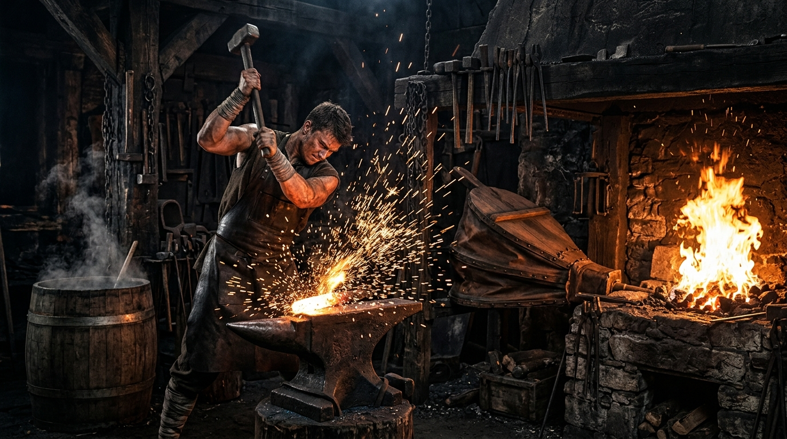

# 第一卷：黑石凡胎・驚蟄篇

## 第二章 爐火、重錘與不融黑鐵（打鐵學徒・林鐵生）

*打鐵學徒林鐵生：精壯沉穩的十七歲少年，身著深色皮圍裙，手執厚重舊鐵錘，目光凝視於烈火與鐵砧之間。*

### 一

火星在昏暗潮濕的工坊裡狂暴迸濺，宛如夜幕中炸散的赤金流螢。

「呼哧——呼哧——」

屋角一人高的巨大牛皮風箱伴隨著拉動，發出老牛喘息般沉悶而有力的喘息。每一道風箱推到底，地爐深處的赤褐木炭便陡然亮起刺目的白光，狂暴的熱浪撲面而來，將粗大的巨木樑柱熏得愈發烏黑，屋頂瓦縫間漏下的青灰晨光都被扭曲得微微晃動。

十七歲的林鐵生赤裸著精壯的上身，腰間紮著一條被鐵屑燙出無數焦黑窟窿的硬牛皮圍裙。

古銅色的肌膚上掛滿了豆大的油汗，汗水混著嗆鼻的黑炭粉，順著堅實如岩石的脊背溝壑滑落，滴在滾燙焦黑的泥地上，「滋」地一聲蒸發成一縷白氣。

他雙腳微張，如老松生根般死死釘在被炭渣鋪黑的地面上。

左手一尺長、生著斑駁銹跡的精鋼長鐵鉗死死夾著一塊燒得通紅微軟的粗鐵胚料；

右手則高高掄起那柄足有七斤重（約三千五百克）的八角舊鐵錘！

胸膛微伏，沉腰落胯，隨後——

「當——！！」

一聲高亢、清脆而沉渾的金鐵交鳴，霍然撕裂了黑石鋪清晨的寂靜！

*老鐵匠鋪晨曦鍛打：重錘砸落，金紅火星迸射四濺，牛皮風箱與地爐熾焰將工坊染上一層金赤光芒。*

粗鐵胚料在他沉重的錘擊下劇烈塌陷變形，火星如暴雨般砸在厚重的牛皮圍裙與他結實的胸膛上，燙出一點點刺痛的紅斑。但林鐵生連眼皮都沒有眨一下。

他的呼吸深沉而綿長，沒有半聲多餘的呼喝。每一錘落下的間隔、角度與反震卸力的弧度，都維持著一種令人心悸的精準節奏：

腳跟借力，腰胯擰轉，氣血自脊椎如大龍般直貫右臂，最後將千鈞巨力毫無保留地送進錘尖！

那是自八歲起被老鐵匠阿鐵從街頭鐵匠鋪旁的廢鐵堆裡揀回來後，整整九年間、揮動了幾十萬次鐵錘生生磨進骨髓裡的肌肉本能。

普通學徒掄這七斤重錘，不出三十下便會手腕脫臼、虎口崩裂；而林鐵生右臂的肌肉早已比左臂粗了一整圈，手掌的厚繭硬得能直接捏熄飛濺的火星。在他掌中，舊鐵錘那截棗木短柄已被手油浸透得如黑玉般溫潤，八角錘面平整得能倒映出爐火赤紅的影子。

在黑石鋪，所有人都知道老鐵匠鋪有個沉默寡言、卻耐得住千錘百鍊的鐵匠學徒，叫林鐵生。

---

### 二

「落錘手腕要鬆！說了多少回了，死扣著錘柄，反震的暗勁遲早震碎你的腕骨！」

粗獷沙啞如沙石摩擦的聲音自爐火旁響起。

一位鐵塔般粗壯的中年漢子大步走上前來。老鐵匠阿鐵古銅色的膀子上，縱橫交錯著早年被滾燙鐵水灼傷的暗褐色老疤，宛如一條條猙獰的蜈蚣。阿鐵用一條搭在肩頭的黑布巾抹了把脖子上的熱汗，隨手抄起石槽邊的一瓢冰涼井水，仰頭「咕咚咕咚」灌了個精光，長長地吐出一口痛快的白氣。

「阿鐵師傅。」

林鐵生停下鐵錘，用長鐵鉗夾著打成雛形的開山柴刀胚料，放回炭火邊溫著。

「金石商會訂的這三十把開山柴刀，大掌櫃錢富貴三日前就派人來催過。大荒山道兇險，商隊走一趟就要耗損十幾把刀，若不是咱們鋪子打的刀刃厚、淬火吃得進，他們才不會大老遠從府城送鐵料來。」

阿鐵師傅望著爐火，眉頭卻微微皺起，銅鈴大眼中透著幾分隱憂：

「只是昨夜北崖古礦道塌方得厲害，聽送粗鐵下來的老礦工魯老頭說，洞穴深處傳來了像是地龍翻身般的怪異悶響。今早送下來的這批粗礦雜質極多，硫燥之氣甚重，一燒就脆……鐵生，這幾日開採的礦脈不對勁，洞裡的地煞，怕是要壓不住了。」

「地煞？」林鐵生擦了擦額頭的黑汗，望向工坊北面的小排煙窗。

從老鐵匠鋪的後窗往北望去，便是那座寸草不生的黑石斷崖。黝黑嶙峋的怪石如巨獸的犬牙交錯，森然立在天地間。常年有幾十名老礦工在那裡鑿石挖礦，把一簍簍沉重堅硬的粗鐵礦核送往鐵匠鋪，敲碎、熔鍊、鍛造成聚落賴以生存的鐵鎬、柴刀與箭鏃。

「凡人皆以為天地唯有草木神靈可敬，殊不知手造之物才是安身立命的根本。」

阿鐵師傅伸出滿是老繭的粗糙大手，重重敲了敲身旁那尊巨大的百斤鐵砧，聲音低沉得像是自地底升起：

「這世間道統割裂，修法的人自視清高，動輒妄言天道；修氣力的人凶神惡煞，只知恃力橫行。但不管是仙家飛劍、還是萬斤巨鎖，哪一樣不是出自百工之手？只是大清洗之後，上古工聖的造物之理盡數失傳，如今的世人，連一爐好鐵都難以鍛透了……」

阿鐵的話語在悶熱的工坊裡迴盪。

這時，客棧方向傳來了隱約的爭吵聲。阿鐵把粗布巾往肩上一搭，交代道：

「商隊的大掌櫃在客棧跟商行核對路引文牒，為師去前街探探虛實。你且把魯老頭清晨送來的那堆粗礦胚子砸碎選料，把硫石剔乾淨！」

「是，師傅。」

---

### 三

晨光漸漸透過排煙天窗灑落，阿鐵師傅沉重的腳步聲遠去，工坊裡只剩下林鐵生一人。

爐火在晨風中微微搖曳，空氣中混雜著炭煙、鐵鏽與水槽冷水的鐵腥氣。

林鐵生蹲下身，按照師傅的吩咐，來到工坊角落那一堆由老礦工從百丈古礦道裡抬下來的深黑粗礦前。

這些礦石每塊足有五六斤重（約三千克），表面凝結著厚厚一層油滑的深黑泥漿與劣質褐石渣，隱隱散發著一股自地心深處帶上來的刺鼻硫磺氣味。林鐵生抓起一把平頭短柄鋼鑿，手握八角鐵錘，熟練地在礦石的外殼上輕輕敲擊敲尋「石眼」。

「啪！啪！噹！噹！」

幾聲清脆的裂響，普通的碎岩外殼崩裂脫落，露出了內部泛著暗青色金屬光澤的鐵核。

林鐵生神色無比專注，一絲不苟地將送來的整整八塊大粗礦悉數砸碎選料，剔除硫雜，隨後將燒得微紅的鐵核夾上鐵砧，以沉雄有力的重錘一錘接一錘地將其鍛打成規整的開山柴刀粗胚，整整齊齊地堆在石槽旁。

當最後一塊粗鐵胚料成型歸位，師傅交代的一整簍常規正料，已被他徹底敲打完畢、消耗一空。

然而，此時此刻，地爐裡的火勢正被風箱鼓動得最為純淨熾烈，赤白色的烈焰如火龍翻捲。林鐵生赤裸的古銅色肌膚被熱汗完全浸透，體內那股在九年間千錘百鍊打熬出的氣血，正像奔騰江河般在脊椎大龍間瘋狂翻湧——

打完了所有的常規正料，他的手是熱的，心是滾燙的。那種大開大合、氣力直貫錘尖的剛猛節奏，竟讓他生出一種意猶未盡的強烈渴求。他還想找些零星小料，練習一下微調筋骨發力的小物件。

他環顧空蕩蕩的工坊，目光落在了西北角落那一堆經年累月堆積下來的「廢料坑」。

那裡堆滿了老鐵匠鋪十幾年來敲碎挑剩下的劣質石皮、死煤結焦與畸形碎渣。而在廢料堆的最底層、厚厚一層冰冷黑炭灰與生鏽鐵屑之下，隱約露出了半塊拳頭大小、凹凸畸形、表面結滿了焦黑石瘤的古怪頑石。

那是阿鐵師傅早年隨手丟棄的死料。老鐵匠眼裡看的是打農具的大料，嫌這塊料「太小太畸形打不了刀刃，皮殼死硬難熔又白費炭火」，順腳踢到了廢料坑的最底下墊腳。經年累月被煤灰泥漿覆蓋，連阿鐵自己都早已忘記了這塊頑石的存在。

林鐵生蹲下身，伸出粗糙的大手撥開浮灰，將那塊深埋在最底層的焦黑頑石摳了出來。

就在指掌握住頑石的一瞬間——

**福至心靈！**

這世間有一種古老而殘酷的行當，喚作「賭石」——天地造化的奇珍美玉，往往深藏在數寸厚、滿是泥沙石癬的粗糲風化皮殼之下。在未剖開之前，任誰看去都只是一塊毫無價值的黑烏砂磚頭廢料，唯有浸淫數十年的相玉宗師，方能隔著頑劣石皮，隱約感應到內裡的絕世靈韻。

而在金鐵與百工的世界裡，少年林鐵生體內沉睡的太古工聖血脈，亦在此刻被這塊壓底頑石猛然喚醒！

尋常礦渣入手輕浮發脆，可這塊拳頭大小、長滿焦黑石瘤的畸形頑石一落入掌心，其比重竟然沉墜得令人心悸，遠超凡鐵十倍！

林鐵生心頭狂跳，屈起食指，在粗糙冰冷的黑石皮上輕輕一彈——

「嗡……」

一聲極其微弱、常人肉耳根本無法捕捉的空靈長鳴，宛如自萬丈地底的太古神鐘深處傳來，悄然在少年敏銳的指骨神經間泛起一陣奇異的共鳴！

這絕不是凡鐵廢渣！

這是一塊被億萬年風化焦殼死死包裹的神物盲料！

林鐵生眼中爆發出駭人的精芒，整個人沉腰落胯，如淵渟嶽峙。他沒有絲毫猶豫，長嘴鐵鉗死死夾住這塊壓底頑石，一把將其按在了重達數百斤的烏黑鐵砧正中央！

右臂肌肉暴凸，氣血如龍直貫錘尖，那柄七斤重的八角舊鐵錘被他掄成了一道狂暴的弧光，全力砸下！

「當——嗡——！！」

一聲宛如太古神龍引頸長吟般的尖銳嘯音，驟然在狹窄的爐房裡霍然炸開！

那絕不是岩石碎裂的悶響，而是某種純度極致、硬度超越凡俗想像的恐怖金屬碰撞！

林鐵生只覺一股沛莫能禦的反震巨力順著八角舊鐵錘瘋狂倒灌而回！

「唔！」

少年悶哼一聲，整條右臂的骨骼發出不堪重負的劈啪脆響，虎口當場被撕裂開一道血口，鮮血狂湧而出，染紅了木柄；整柄七斤重的鐵錘險些脫手倒砸在自己的胸膛上！

林鐵生踉蹌著後退了三步，後背重重撞在冰涼粗大的巨木樑柱上，整座工坊的瓦片都在這聲刺耳的龍吟中簌簌發抖。

「這……這是什麼？！」

林鐵生死死捂著劇烈抽痛、酸麻發顫的右腕，眼中爆發出駭然的光芒。

他快步搶上前去，丟開手裡的鐵錘，不顧掌心的血漬，一把扒開鐵砧周圍崩碎的焦黑石屑。

正如神工剖開了頑劣石皮——
那層風化了不知多少萬年的焦黑石瘤寸寸崩碎脫落，在碎石核心最深處，沒有凡鐵粗糙的青黑紋理，赫然卡著一截通體深沉、漆黑如墨的金屬構件！

構件僅有兩指長短、拇指寬厚，重量卻沉墜得像是一塊實心生鐵（約兩百克）。表面沒有絲毫光澤，甚至當清晨金紅色的晨光照在其上時，光線彷彿被其生生吞噬，連一絲反光都折射不出來！

更詭異的是，林鐵生方才那傾盡全身氣力的一記重錘，在七斤純鐵的反震撕裂下，這截黑色金屬的表面……

竟然連一道白痕都沒有留下！

---

### 四

林鐵生的心臟在胸膛裡瘋狂擂動。

自八歲學打鐵以來，他經手過凡鐵、熟鐵、精鋼、白銅、乃至商隊從大荒深處帶來的地火隕鐵，但世間絕無任何一種金鐵，能硬到無視八角重錘全力一擊的程度！

「師傅說過……金鐵有靈，遇烈火則現原形。」

林鐵生喃喃低語，強烈的探求欲壓過了右手的劇痛。

他抓起一柄兩尺長的長嘴精鋼水鉗，死死夾住那截冰冷的黑色金屬，咬牙將其猛然送入了地爐炭火最為熾烈的心臟位置！

隨後，他撲到屋角的巨大牛皮風箱前，用尚在淌血的雙手抓住拉桿，如瘋魔般瘋狂推拉起來！

「呼哧！呼哧！呼哧！」

狂暴的疾風化作旋風灌入地底炭層，地爐內的炭火從暗紅瞬間暴漲為赤金，隨後轉為熾亮耀眼的純白！

那是連精鋼鐵胚放進去都會在半柱香內熔化成赤紅汁液的萬度高溫！整個爐房內的空氣被炙烤得扭曲變形，梁木上的松脂被烤得劈啪燃燒，滾滾熱浪甚至將林鐵生前額的頭髮烤得焦黃卷曲。

然而，地爐中央。

那截黑色金屬靜靜臥在熾白的木炭之間。任憑地火如何狂暴舔舐，任憑高溫足熔凡鐵千百次，它的通體……

依舊呈現出那種令人心悸的、深不見底的冰冷漆黑！

連一絲變軟、融化、甚至燒得泛紅的跡象都沒有！

「燒不紅……熔不化？！」

林鐵生感到背脊升起一股徹骨的寒意。這完全擊碎了阿鐵師傅教給他的一切鍛造常理！

他按捺不住發狂的心跳，用精鋼水鉗將那截黑色金屬從熾白烈火中猛然夾出，轉身「噗通」一聲，狠狠探入了石槽盛滿的井水之中！

「轟——！！」

整槽原本冰涼的淬火水，在黑色金屬浸入的剎那間，竟發出一聲宛如旱天雷鳴般的劇烈轟鳴！

整槽水瞬間徹底暴沸！濃白滾燙的蒸汽如火山噴發般轟然炸裂，化作滾滾濃霧將整間鍛造工坊死死淹沒，水霧甚至衝開了屋頂的排煙木板，驚得後巷老客棧大廚房的黑狗瘋狂狂吠！

良久，蒸汽漸漸在穿堂的晨風中散去。

林鐵生用一塊厚麻布裹著手掌，小心翼翼地從石槽底部的碎渣裡，將那塊金屬拾了起來。

入手的一瞬間，少年渾身劇烈一顫！

沒有高溫！

剛從萬度熔火中取出的金屬，在冷水裡僅僅激盪了一息，表面竟沒有絲毫餘溫，反而散發著一股如大荒寒冬玄冰般的刺骨清冷！

而更讓林鐵生雙手劇烈顫抖、瞳孔收縮如針尖的——是原本覆蓋在金屬表面的那一層萬年石垢被冷熱激碎後，露出的真正本體！

那根本不是天然生成的礦核！

那是一截殘缺的、斷裂邊緣平整如鏡的金屬構件！

在它僅有兩指長短的表面上，赫然雕刻著數圈細如游絲、彼此嚴密咬合的螺旋齒紋！齒輪之間的凹凸間隙，甚至連一根頭髮絲都插不進去，精密度遠遠超越了黑石鋪最巧手的老工匠用放大水晶所能雕琢的極限！

而在這截齒輪構件的最核心處，以一種不可思議的精巧榫卯，銜接著一圈極其微小的活動卡榫——

那是某種超乎世人想像的太古龐大神造機關的……微型核心樞紐！

「這……這是人手雕出來的？！」

林鐵生喃喃失聲，大腦一片空白。

黑石鋪的鐵匠，能用泥模澆築出一尊方正的鐵砧、能把一把開山刀打得刃口均勻，便已經能名震十里八鄉；可眼前這枚構件，其公差、精密度與內部齒輪的咬合邏輯，根本不是人力所能為之！

『大清洗之前……曾有上古工聖以萬物為機關，改換天地日月……』

阿鐵師傅方才沙啞的低語，如同一道驚雷在少年的腦海深處瘋狂轟鳴！

這截深埋在地底百丈、混在粗礦之中的漆黑金屬……

難道是萬古之前，由失落的太古工聖神殿鍛造出的至高神械殘片？！

---

### 五

「踏、踏、踏。」

工坊門外的泥濘小道上，傳來了阿鐵師傅粗重的腳步聲與罵罵咧咧的咆哮：

「王扒皮這狗掌櫃！官軍封了黑石關，他反倒趁機在街市大茶棚前支攤壓價，一把好柴刀硬要扣三成火耗銀！」

阿鐵的身影轉過街角，即將跨進工坊大門。

林鐵生在這一瞬間展現出了一種極其沉靜的果決。

他沒有絲毫遲疑，迅速將那截漆黑冰涼的齒輪構件揣入了腰間硬牛皮圍裙最內側的貼肉暗袋。冰冷的金屬貼在胸腹上，隨後，他抓起鐵鎬，三兩下將地上崩碎的普通礦石殘渣掃入爐膛底灰之中。

當阿鐵師傅掀開草簾跨進鍛造房時，看見的只有滿頭大汗、正握著鐵鉗將一塊燒軟粗鐵夾上鐵砧的憨厚徒弟。

「鐵生！手腳麻利點！」

阿鐵抹了把臉上的唾沫星子，粗聲吩咐道：

「商隊催得急，又加了十柄重型開山獵叉的訂單，多給三百個大錢！這幾日鋪子裡的爐火不能熄，得日夜兼程掄錘！」

「好嘞，師傅！爐子旺著呢！」

林鐵生抬起頭，抹了一把被煙火熏黑的臉龐，露出了平日裡那副樸實厚道的笑容。

他重新握緊了手中的八角舊鐵錘。

手腕微鬆，勁力自腳跟而起，走腰胯，送進錘尖！

「當——！當——！當——！」

節奏分明、沉雄有力的打鐵聲，再次在黑石鋪的晨曦寒霧中昂揚炸響！

火星漫天翻飛，如同一場盛大而悲壯的金色暴雨。

但在少年那雙被煙火熏染得黝黑明亮的眸子深處，一簇比萬度地爐更為熾烈的火焰，已然無聲點燃。

他感受著胸膛內側那截冰冷黑鐵的堅硬稜角——

世間的仙家或許能御劍乘風、焚山煮海，但他們身上穿的寶甲、手裡握的神兵、乃至這片天地運轉的樞機關竅，終究是由百工手中這把溫熱焦黑的重錘，一錘一錘鍛打出來的！

太古工聖失落的至理，終有一日，將由凡人焦黑的手掌……重鑄人間！
