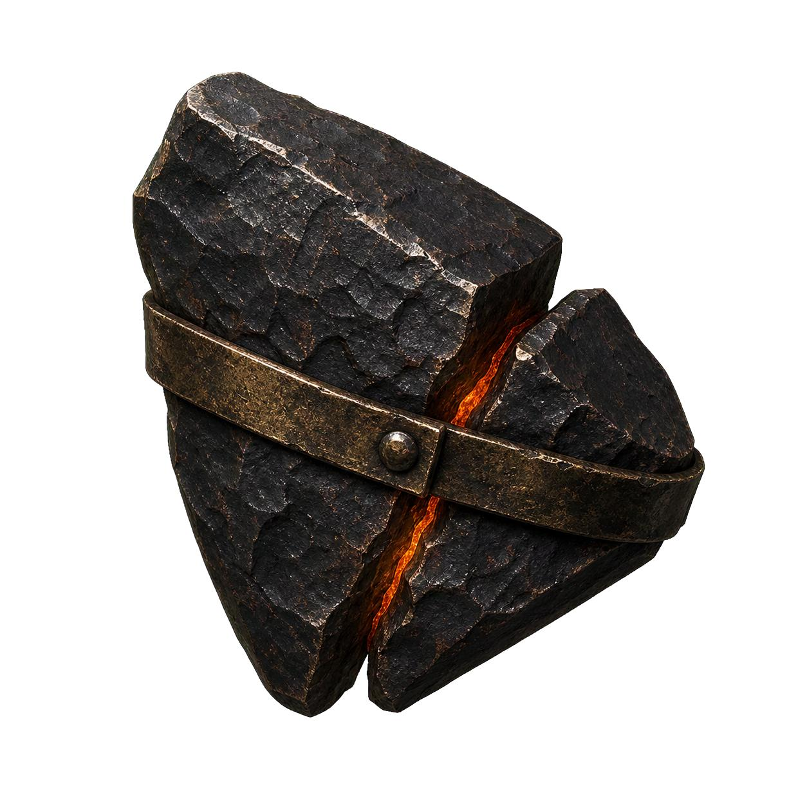

# 第一卷：黑石凡胎・驚蟄篇

## 第二章 爐火、重錘與不融黑鐵（打鐵學徒・林鐵生）

*打鐵學徒林鐵生：精壯沉穩的十七歲少年，身著深色皮圍裙，手執厚重舊鐵錘，目光凝視於烈火與鐵砧之間。*

### 一

火星在昏暗潮濕的工坊裡狂暴迸濺，宛如夜幕中炸散的赤金流螢。

「呼哧——呼哧——」

屋角一人高的巨大牛皮風箱伴隨著拉動，發出老牛喘息般沉悶而有力的喘息。每一道風箱推到底，地爐深處的赤褐木炭便陡然亮起刺目的白光，狂暴的熱浪撲面而來，將粗大的巨木樑柱熏得愈發烏黑，屋頂瓦縫間漏下的青灰晨光都被扭曲得微微晃動。

十七歲的林鐵生赤裸著精壯的上身，腰間紮著一條被鐵屑燙出無數焦黑窟窿的硬牛皮圍裙。

古銅色的肌膚上掛滿了豆大的油汗，汗水混著嗆鼻的黑炭粉，順著堅實如岩石的脊背溝壑滑落，滴在滾燙焦黑的泥地上，「滋」地一聲蒸發成一縷白氣。

他雙腳微張，如老松生根般死死釘在被炭渣鋪黑的地面上。

左手一尺長、生著斑駁銹跡的精鋼長鐵鉗死死夾著一塊燒得通紅微軟的粗鐵胚料；

右手則高高掄起那柄足有七斤重（約三千五百克）的八角舊鐵錘！

胸膛微伏，沉腰落胯，隨後——

「當——！！」

一聲高亢、清脆而沉渾的金鐵交鳴，霍然撕裂了黑石鋪清晨的寂靜！

*老鐵匠鋪晨曦鍛打：重錘砸落，金紅火星迸射四濺，牛皮風箱與地爐熾焰將工坊染上一層金赤光芒。*

粗鐵胚料在他沉重的錘擊下劇烈塌陷變形，火星如暴雨般砸在厚重的牛皮圍裙與他結實的胸膛上，燙出一點點刺痛的紅斑。但林鐵生連眼皮都沒有眨一下。

他的呼吸深沉而綿長，沒有半聲多餘的呼喝。每一錘落下的間隔、角度與反震卸力的弧度，都維持著一種令人心悸的精準節奏：

腳跟借力，腰胯擰轉，氣血自脊椎如大龍般直貫右臂，最後將千鈞巨力毫無保留地送進錘尖！

那是自八歲起被老鐵匠阿鐵從街頭鐵匠鋪旁的廢鐵堆裡揀回來後，整整九年間、揮動了幾十萬次鐵錘生生磨進骨髓裡的肌肉本能。

普通學徒掄這七斤重錘，不出三十下便會手腕脫臼、虎口崩裂；而林鐵生右臂的肌肉早已比左臂粗了一整圈，手掌的厚繭硬得能直接捏熄飛濺的火星。在他掌中，舊鐵錘那截棗木短柄已被手油浸透得如黑玉般溫潤，八角錘面平整得能倒映出爐火赤紅的影子。

在黑石鋪，所有人都知道老鐵匠鋪有個沉默寡言、卻耐得住千錘百鍊的鐵匠學徒，叫林鐵生。

---

### 二

「落錘手腕要鬆！說了多少回了，死扣著錘柄，反震的暗勁遲早震碎你的腕骨！」

粗獷沙啞如沙石摩擦的聲音自爐火旁響起。

一位鐵塔般粗壯的中年漢子大步走上前來。老鐵匠阿鐵古銅色的膀子上，縱橫交錯著早年被滾燙鐵水灼傷的暗褐色老疤，宛如一條條猙獰的蜈蚣。阿鐵用一條搭在肩頭的黑布巾抹了把脖子上的熱汗，隨手抄起石槽邊的一瓢冰涼井水，仰頭「咕咚咕咚」灌了個精光，長長地吐出一口痛快的白氣。

「阿鐵師傅。」

林鐵生停下鐵錘，用長鐵鉗夾著打成雛形的開山柴刀胚料，放回炭火邊溫著。

「金石商會訂的這三十把開山柴刀，大掌櫃蘇遠山三日前進山時就派人來催過，只是昨天二掌櫃趙德貴的管事又來壓價。大荒山道兇險，商隊走一趟就要耗損十幾把刀，若不是咱們鋪子打的刀刃厚、淬火吃得進，他們才不會大老遠從府城送鐵料來。」

阿鐵師傅望著爐火，眉頭卻微微皺起，銅鈴大眼中透著幾分隱憂：

「只是昨夜北崖古礦道塌方得厲害，聽送粗鐵下來的老礦工魯老頭說，洞穴深處傳來了像是地龍翻身般的怪異悶響。今早送下來的這批粗礦雜質極多，硫燥之氣甚重，一燒就脆……鐵生，這幾日開採的礦脈不對勁，洞裡的地煞，怕是要壓不住了。」

「地煞？」林鐵生擦了擦額頭的黑汗，望向工坊北面的小排煙窗。

從老鐵匠鋪的後窗往北望去，便是那座寸草不生的黑石斷崖。黝黑嶙峋的怪石如巨獸的犬牙交錯，森然立在天地間。常年有幾十名老礦工在那裡鑿石挖礦，把一簍簍沉重堅硬的粗鐵礦核送往鐵匠鋪，敲碎、熔鍊、鍛造成聚落賴以生存的鐵鎬、柴刀與箭鏃。

「凡人皆以為天地唯有草木神靈可敬，殊不知手造之物才是安身立命的根本。」

阿鐵師傅伸出滿是老繭的粗糙大手，重重敲了敲身旁那尊巨大的百斤鐵砧，聲音低沉得像是自地底升起：

「這世間道統割裂，修法的人自視清高，動輒妄言天道；修氣力的人凶神惡煞，只知恃力橫行。但不管是仙家飛劍、還是萬斤巨鎖，哪一樣不是出自百工之手？只是大清洗之後，上古工聖的造物之理盡數失傳，如今的世人，連一爐好鐵都難以鍛透了……」

阿鐵的話語在悶熱的工坊裡迴盪。

這時，客棧方向傳來了隱約的爭吵聲。阿鐵把粗布巾往肩上一搭，交代道：

「商隊的二掌櫃在客棧跟鎮上貨行核對路引文牒，為師去前街探探虛實。你且把魯老頭清晨送來的那堆粗礦胚子砸碎選料，把硫石剔乾淨！」

「是，師傅。」

---

### 三

晨光漸漸透過排煙天窗灑落，阿鐵師傅沉重的腳步聲遠去，工坊裡只剩下林鐵生一人。

爐火在晨風中微微搖曳，空氣中混雜著炭煙、鐵鏽與水槽冷水的鐵腥氣。

林鐵生蹲下身，按照師傅的吩咐，來到工坊角落那一堆由老礦工從百丈古礦道裡抬下來的深黑粗礦前。

這些礦石每塊足有五六斤重，表面凝結著厚厚一層油滑的深黑泥漿與劣質褐石渣，隱隱散發著一股自地心深處帶上來的刺鼻硫磺氣味。林鐵生抓起一把平頭短柄鋼鑿，手握八角鐵錘，熟練地在礦石的外殼上輕輕敲尋「石眼」。

「啪！啪！噹！噹！」

幾聲清脆的裂響，普通的碎岩外殼崩裂脫落，露出了內部泛著暗青色金屬光澤的鐵核。

林鐵生神色無比專注，一絲不苟地將送來的整整八塊大粗礦悉數砸碎選料，剔除硫雜，隨後將燒得微紅的鐵核夾上鐵砧，以沉雄有力的重錘一錘接一錘地將其鍛打成規整的開山柴刀粗胚，整整齊齊地堆在石槽旁。

當最後一塊粗鐵胚料成型歸位，師傅交代的一整簍常規正料，已被他徹底敲打完畢、消耗一空。

然而，此時此刻，地爐裡的火勢正被風箱鼓動得最為純淨熾烈，赤白色的烈焰如火龍翻捲。林鐵生赤裸的古銅色肌膚被熱汗完全浸透，體內那股在九年間千錘百鍊打熬出的氣血，正像奔騰江河般在脊椎大龍間翻湧。

他環顧空蕩蕩的工坊，目光落在了西北角落的獨輪木板車旁。

那裡扔著一塊足有二十多斤重、長滿焦黑石瘤的烏黑母礦鐵坨——那是昨天魯大山從北崖三號深坑最底層刨出來的怪石。清晨阿鐵師傅曾把這塊二十多斤的怪石塞進地爐燒了半個時辰，又掄起七斤重的八角重錘一口氣砸了整整七十二下，結果連一絲鐵屑都沒能熔化，反倒把阿鐵師傅震得右臂舊傷隱隱作痛，罵了一句「燒不化的死鐵疙瘩」，吩咐鐵生待會兒推板車去早市時，順道把這塊二十多斤的廢鐵坨拉去東林換鹿筋墊樁子用。

林鐵生蹲下身，伸出粗糙的大手，撫摸著那塊二十多斤重的烏黑母礦鐵殼。

就在指掌按在鐵殼側面一道被阿鐵師傅砸了七十二錘才勉強震出的細微冷裂紋上時——

林鐵生心頭猛地一跳！

他屈起食指，順著那道冷裂紋輕輕一彈。

「嗡……」

一聲極其微弱、常人肉耳根本無法捕捉的空靈清音，竟從這塊二十多斤的死鐵坨正中心傳了出來！那聲音不像是一塊實心頑石，倒像是厚重的烏黑鐵殼中心，還包裹著某件獨立的器物！

林鐵生眼中精芒暴漲，整個人沉腰落胯。他費力地將這塊二十多斤的烏黑母礦鐵坨抱上百斤鐵砧，沒有像師傅那樣蠻砸鐵殼正面，而是將平頭鋼鑿精準無比地抵在鐵殼側面的冷裂紋死穴上，右臂肌肉暴凸，七斤重的八角鐵錘全力一擊！

「噹——嗡——！！」

一聲金鐵交鳴的尖銳嘯音，驟然在狹窄的爐房裡炸開！

林鐵生只覺一股沛莫能禦的反震巨力順著鐵錘倒灌而回，虎口當場被震裂一道血口，整個人踉蹌著後退了兩步！

而鐵砧之上，那塊被阿鐵師傅砸了七十二錘都未曾開裂的二十多斤烏黑母礦鐵殼，順著側面的石眼應力線「咔嚓」裂開了一道三寸寬的口子！

一截原本被緊緊封在母礦最核心處、通體深沉如墨的金屬構件，順著裂口滾落在了鐵砧上！

那截核心構件僅有兩指長短、拇指寬厚，入手卻沉墜得足有六兩重。表面沒有絲毫光澤，甚至當清晨金紅色的晨光照在其上時，光線彷彿被其生生吞噬，連一絲反光都折射不出來！

更不可思議的是，剛才鋼鑿正中它的邊緣，這截兩指長的黑色金屬表面，竟然連一道白痕都沒有留下！

---

### 四

林鐵生的心臟在胸膛裡劇烈擂動。

自八歲學打鐵以來，他經手過凡鐵、熟鐵、精鋼、白銅、乃至商隊從大荒深處帶來的地火隕鐵，但世間絕無任何一種金鐵，能硬到無視鋼鑿正面劈擊的程度！

「師傅說過……金鐵有靈，遇烈火則現原形。」

林鐵生強忍著虎口的刺痛，抓起一柄兩尺長的長嘴精鋼水鉗，夾住那截兩指長的黑色核心構件，將其送入了地爐炭火最熾烈的心臟位置，隨即撲到牛皮風箱前奮力推拉起來！

「呼哧！呼哧！呼哧！」

疾風灌入炭層，地爐內的炭火從暗紅暴漲為熾白！然而，那截兩指長的黑色金屬靜靜臥在熾白木炭之間，任憑地火如何舔舐，依舊呈現出深不見底的冰冷漆黑，連一絲變軟泛紅的跡象都沒有！

林鐵生用精鋼水鉗將那截黑色金屬從烈火中夾出，轉身「噗通」一聲探入石槽的井水之中！

「轟——！！」

冷熱激盪之下，濃白滾燙的蒸汽轟然炸裂，原本粘連在這截兩指長金屬表面最後一層薄如蟬翼的礦垢應聲崩落！

林鐵生用厚麻布裹著手掌，將那枚構件從水槽底部拾了起來。

入手的一瞬間，少年渾身劇震——剛從熔火中取出的金屬，浸水一息後竟沒有絲毫餘溫，反而透著一股刺骨的清冷！

而褪去礦垢後的本體，更讓林鐵生瞳孔驟縮：

那根本不是天然生成的礦核，而是一截斷裂邊緣平整如鏡的機關構件！

在它僅有兩指長短的表面上，赫然雕刻著數圈細如游絲、彼此嚴密咬合的螺旋齒紋！齒輪之間的凹凸間隙，連一根頭髮絲都插不進去；而在齒輪構件的最核心處，以精巧絕倫的榫卯銜接著一圈微小的活動卡榫——

*烈火淬水後顯露的太古機關殘件：漆黑深沉的金屬構件表面雕刻著嚴密咬合的螺旋微型齒紋與精密卡榫。*

「這……這是人手造出來的？！」

林鐵生喃喃失聲。黑石鋪的鐵匠能用泥模澆築出一尊方正的鐵砧、能把一把開山刀打得刃口均勻，便已能名震十里八鄉；可眼前這枚兩指長的構件，其分寸之嚴密、齒紋咬合之精巧，根本不是凡俗工匠所能企及！

『大清洗之前……曾有上古工聖以萬物為機關，改換天地日月……』

阿鐵師傅方才沙啞的低語，在少年的腦海深處轟然迴響！

---

### 五

「踏、踏、踏。」

工坊門外的泥濘小道上，傳來了阿鐵師傅粗重的腳步聲與罵罵咧咧的咆哮：

「王扒皮這狗掌櫃！官軍封了黑石關，他反倒趁機在街市大茶棚前支攤壓價，一把好柴刀硬要扣三成火耗銀！」

阿鐵的身影轉過街角，即將跨進工坊大門。

林鐵生沒有絲毫遲疑，迅速將那枚僅有兩指長、六兩重的【太古不融黑鐵齒輪構件】揣入了腰間硬牛皮圍裙最內側的貼肉暗袋；隨後，他一把抱起鐵砧上那塊被剖開了一道口子、依然重達二十多斤的烏黑母礦鐵殼，用爛麻布重新裹好，放回了牆角的獨輪木板車最底層。

當阿鐵師傅掀開草簾跨進鍛造房時，看見的只有滿頭大汗、正握著鐵鉗整理柴刀的憨厚徒弟。

「鐵生！手腳麻利點！」

阿鐵抹了把臉上的唾沫星子，粗聲吩咐道：

「商隊催得急，又加了十柄重型開山獵叉的訂單，多給三百個大錢！這幾日鋪子裡的爐火不能熄，得日夜兼程掄錘！」

「好嘞，師傅！爐子旺著呢！」

林鐵生抬起頭，抹了一把被煙火熏黑的臉龐，露出了平日裡那副樸實厚道的笑容。

他重新握緊了手中的八角舊鐵錘。

手腕微鬆，勁力自腳跟而起，走腰胯，送進錘尖！

「當——！當——！當——！」

節奏分明、沉雄有力的打鐵聲，再次在黑石鋪的晨曦寒霧中昂揚炸響！

火星漫天翻飛，如同一場盛大而悲壯的金色暴雨。

但在少年那雙被煙火熏染得黝黑明亮的眸子深處，一簇比萬度地爐更為熾烈的火焰，已然無聲點燃。

他感受著胸膛內側那截冰冷黑鐵的堅硬稜角——

世間的仙家或許能御劍乘風、焚山煮海，但他們身上穿的寶甲、手裡握的神兵、乃至這片天地運轉的樞機關竅，終究是由百工手中這把溫熱焦黑的重錘，一錘一錘鍛打出來的！

太古工聖失落的至理，終有一日，將由凡人焦黑的手掌……重鑄人間！
