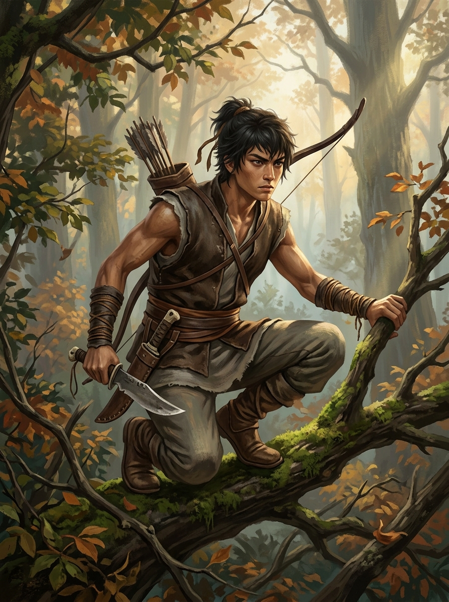
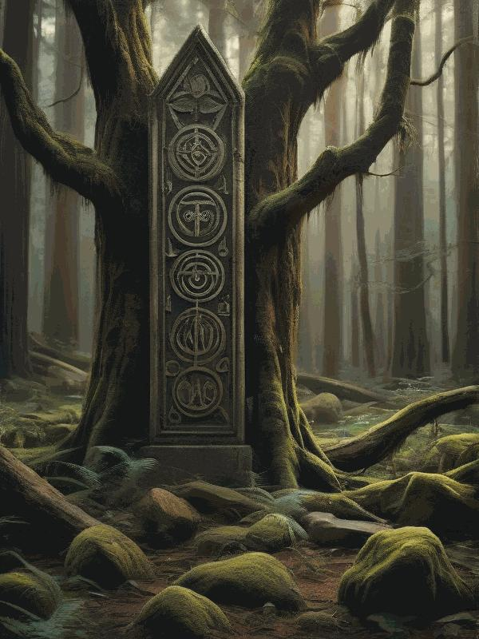

# 第一卷：黑石凡胎・驚蟄篇

## 第三章 鹿角哨亭、陷阱與大荒異動（獵戶之子・燕隼）

*獵戶之子燕隼：身著破舊鹿皮短坎肩，腰佩厚背柴刀，背負獵弓，如獵鷹般警覺地潛伏於大荒林冠。*

### 一

腐葉的潮霉氣混雜著老松脂與陳年野獸騷腥，在昏暗黏稠的密林底層沉沉不散。

「啪嗒。」

一滴冰涼的林露自高懸的鐵線葛藤尖端墜落，精準地砸在一隻半陷在黑泥中的破舊深灰草鞋鞋面上。

十六歲的燕隼整個人如同一張拉滿的硬弓，無聲地蜷縮在一株五人合抱的古櫟樹橫枝上。他的呼吸極其悠長微弱，胸膛起伏的幅度微不可察，整個人彷彿與呼嘯掠過樹梢的凜冽林風徹底融為了一體。

深蜜色的皮膚在斑駁林隙的青灰晨光下，像是一截風乾堅韌的枯木。他身上穿著一件被野獸利爪撕破、又用粗麻線粗糙縫補過十幾次的陳舊鹿皮短坎肩，乾硬的皮革散發著濃烈的野獸油脂與熏肉防腐煙氣。

他的雙眼亮得駭人，瞳孔如黑夜中高懸的隼鷹般微微收縮，死死釘在下方三丈外的荊棘灌木叢間。

在他背後，斜背著一張六十斤拉力的鐵脊硬拓木弓；而在他腰間，則插著一把刃口生著斑駁暗紅鏽斑的厚背開山柴刀——那是他親大伯燕山五年前隻身深入大荒斷魂嶺、再也沒能回來前留給他唯一的遺物，家裡如今只剩下患有風濕腿疾的大伯母與他相依為命。刀背足有兩斤重，既能在劈荊斬棘時破開如生鐵般的老藤，亦能在猛獸飛撲而至的毫釐之間，精準砸碎其咽喉脆弱的軟骨。

晨風自西北面吹來，遠處黑石鋪東南面的鹿角木柵上方，升起了幾縷驅趕毒蟲的苦艾草青煙；而更遠處的街市方向，隱隱飄來老鐵匠鋪打鐵的叮噹脆鳴與南谷溪流的轟響。

燕隼腳踝微一發力，身形如同一片枯黃的落葉般無聲自三丈橫枝滑落，腳尖穩穩點在覆滿潮濕落葉的鬆軟地面上，甚至連一根乾枯的細枝都未曾踩斷。

---

### 二

「回來了？」

林邊哨亭高腳圓木搭建的粗糙門檻上，坐著一位臉頰被大荒風霜吹得如同乾裂老樹皮的精瘦老者。

老獵戶趙老獵——村裡人習慣叫他「趙伯」或「趙老拐」，是當年與燕隼父親、親大伯燕山一塊兒在山裡換過命的獵隊老把頭。此時他正拿著一柄磨得極薄的小角刀，一雙如蒼鷹般銳利的灰白眸子專注地盯著手中的青竹箭桿。在他身後漏風的小木屋橫樑上，懸掛著幾條風乾硬邦邦的野豬肉乾、三張浸透了防腐油脂的厚實灰狼皮，以及那張只有他全力才能拉開的祖傳百斤牛筋蛟骨大弓。

每削下一道薄如蟬翼的竹皮，老獵戶便抓起案上一隻陶罐，用羽毛蘸取少許散發著腥臭與微苦氣味的黑褐色藥膏，均勻抹在箭鏃的倒刺凹槽之上。

那是能在一炷香內麻痺野獸心脈的【黑蝮蛇毒】。

「趙伯，林口第三道鹿筋竹刺吊套……被人暴力撞斷了。」

燕隼快步跨進哨亭，順手扯下木架上的生水皮囊，仰頭狠狠灌了兩大口冰涼的井水，用手背抹去嘴角的泥沙：

「不是山雉，也不是野兔。整根嬰兒手臂粗的彈簧青竹被生生扭成麻花，地上的足印被腐泥落葉掩蓋，但留了一道深陷泥地半寸、拖拽重物的可怖深痕。」

趙老獵手中刮削竹箭的角刀，猛地停在了半空。

老獵戶渾濁深陷的眼眸深處，驟然掠過一抹森寒至極的厲芒。

「這幾日……大荒深處的畜生，全發了瘋了。」

趙老獵緩緩站起身，推開哨亭面朝東方的破木窗，望向那片望不到邊際、黑壓壓如暴怒汪洋般的浩瀚原始林海。

山巒層疊，雲霧低垂。在林海極深處，隱隱傳來幾聲穿透雲層的淒厲狼嚎。但那嚎叫聲中沒有獵食者的狂傲與殘忍，反而透著一股如同大禍臨頭般、瀕死絕望的尖銳驚恐！

「昨夜三更，老子在哨亭頂上聽得真真切切——整整一個黑背山狼群，連帶產崽的母狼，全發了瘋似地往外圍瘋狂逃竄！有三頭甚至像是被無形鬼魅追趕一般，眼睜睜撞在咱們鹿角木柵三寸長的倒刺竹尖上，生生把肚皮扎穿剖開！」

趙老獵咬著牙，粗糙的手指死死按住自己那條跛了十幾年的左膝蓋。那裡有三道早年被大荒兇獸撕裂的可怖深疤，每逢地煞震動，傷口便如火燒般劇痛：

「這不是天災！這是斷魂嶺深處沉睡的什麼大東西……翻了個身！快，去把林口所有的繩套全部換成連環重機扣，彈簧竹籤全部浸透黑蝮蛇毒！只要商隊還卡在山口沒進村，咱們黑石鋪這扇東南大門，就全靠咱們這幾雙招子死死盯著！」

---

### 三

「好。」

燕隼沒有半句廢話。

他轉身自木架上取下一捆浸透了防腐生桐油的粗麻繩，抓起一把削磨鋒利、泛著幽綠毒光的倒刺竹籤，反手握緊腰間生鏽的厚背柴刀，再次如一抹灰影般鑽進了遮天蔽日的荊棘林口。

身為獵戶之子，他從小在飢餓、嚴寒與猛獸獠牙的夾縫中苟延殘喘。對尋常村夫而言，這片原始荒林是步步殺機的絕地；但對燕隼來說，一截折斷的草莖、一滴風乾的黏液、一絲微不可察的草木倒伏，都是這座大山在用無聲的語言向他發出生死預警。

他穿過層層鐵線荊棘，來到林口深處一處地勢低窪的避風獸道前。

眼前的景象讓少年目光驟然一凝。

原本隱蔽在厚重落葉下、以堅韌鹿筋絞成的小型捕獸機關已被徹底粉碎。堅韌如鐵的鹿筋繩齊整地斷裂開來，斷口處泛著令人作嘔的焦黑腐蝕痕跡，周圍丈許內的灌木枯葉更是呈現出一種詭異枯萎的暗褐色。

燕隼蹲下身，伸出食指，輕輕沾了一點泥土中殘留的黏稠液體。

黏液尚未乾涸，黏稠拉絲，不是普通野獸鮮血的赤紅，而是一種深邃詭異、泛著油光的暗紫黑色！一股刺鼻難聞的硫磺焦味與狂暴的地煞腥臭撲面而來，激得燕隼胃部一陣翻江倒海。

「這不是尋常野獸的血……」

然而，這個念頭剛剛在腦海中閃過——

少年脊椎深處的汗毛，毫無預兆地瘋狂倒豎而起！

那是一種無數次在鬼門關前將他拉回來的死亡直覺！

頭頂上方濃密的枯藤樹冠間，沒有風吹草動，沒有落葉飄零，唯有一股滾燙熾熱、混雜著硫磺死屍焦臭的腥風，如沉重的裹屍布般兜頭罩下！

「吼————！！」

一聲撕裂耳膜的狂暴凶咆自樹冠頂部悍然炸響！

一道龐大如黑色巨丘的恐怖陰影裹挾著萬鈞腥風，如山崩般自半空中當頭狂暴拍落！

獵物……根本沒有逃跑！

它借著地煞死血的掩護，反向伏擊了獵人！

燕隼的大腦在這一瞬間一片空白，全憑九歲起在狼嘴裡奪食練就的野獸本能，身形如被踩中尾巴的靈狐般貼地狠命一滾！

「轟隆！！」

一隻覆滿黑紫石痂與爛肉的巨掌狠狠拍在少年方才蹲伏的泥地上！方圓數丈內的泥土腐葉被掀飛半尺高，碗口粗的灌木被餘波掃斷了數根，碎木四濺！

燕隼在泥濘中連滾三圈卸力，後背狠狠撞在一塊長滿青苔的巨石上，喉頭一甜，嘴角溢出一縷鮮血。

他猛地抬頭，瞳孔驟然收縮成了針尖大小——

那是一頭人立起來足有一丈高、背部隆起厚重灰黑石痂的恐怖老黑熊！它的雙眼因為長期受地煞毒瘴侵蝕而充血赤紅，半邊頭顱皮毛潰爛露出顱骨，胸口赫然插著半截折斷的生鐵獵叉，正汩汩噴湧著令人作嘔的紫黑濁血！

大荒深處被地煞毒瘴徹底狂化的「染煞披甲黑熊」！

---

### 四

面對這頭在毒瘴侵蝕下幾乎失去痛覺的狂暴兇獸，任何常規的游走身法都是徒勞！

「吼！」

染煞黑熊一擊落空，狂暴更甚。它那八百多斤的沉重軀體帶著腥風再度橫衝直撞而來，所過之處，鐵線老藤如枯草般寸寸崩斷！

燕隼身形疾退，反手自背後扯下六十斤鐵脊硬弓，搭上一支淬了黑蝮蛇毒的破甲重箭，弓弦如雷鳴般嗡然震響！

「崩——嗖！」

破甲箭化作一道烏光，精準狠辣地洞穿了兇獸完好的左眼眶！

「嗷吼——！」

黑蝮蛇毒與劇痛讓染煞黑熊陷入了毀滅般的瘋狂。它根本不顧眼眶中狂噴的黑血，另一隻覆滿石痂的巨掌帶著刺耳的撕風厲嘯，狠狠橫掃而至！

速度太快了！避無可避！

燕隼只來得及將生鏽的厚背柴刀橫在胸前——

「砰！」

一聲沉悶巨響！柴刀被巨力拍得死死貼在胸膛獸皮護心鏡上，少年胸口如遭重錘轟擊，肋骨裂痛、左肩脫臼，整個人倒飛而出，口中噴出一口鮮血，重重跌在整座荒林最險絕的禁忌死地——「化骨泥沼」邊緣的千年巨榕根下！

下方是一處深達數丈的泥沼地陷死穴，死穴中央倒插著無數被毒瘴侵蝕的枯木巨石；半空中，重傷瀕死的狂暴染煞黑熊踏著崩塌的泥坎，張開噴著焦臭毒氣的血盆大口，合身飛撲而下！

必死之局！

然而，就在意識即將陷入無盡黑暗的千分之一瞬，獵戶少年骨子裡那股大荒先民最蠻橫、最酷烈、寧死也要撕下敵人一塊肉的狼崽子野性，被徹底逼到了極致！

「給老子……死！！」

燕隼雙目赤紅如血，沒有後退，沒有求饒！他竟借著倒飛之勢在半空中強行扭轉身軀，用唯一完好的右手死死握住生鏽柴刀，在黑熊血盆大口咬向自己頭顱的剎那，合身反撲，如同一枚倒射的利矛，連刀帶手臂，順著黑熊被洞穿的眼眶死死鑿進了它的腦髓最深處！

「噗嗤——！」

一人一獸在空中慘烈撕咬糾纏，伴隨著骨肉撕裂的悶響，雙雙失控翻滾，轟然砸穿了死沼邊緣脆弱的腐泥斷層，直直墜入了那座被萬年枯藤封印的百丈毒沼死穴深處！

「轟隆隆隆————！！」

天崩地裂般的劇烈撞擊在泥沼最底層炸開！

一人一獸翻滾下墜的恐怖衝勢，狂暴地砸穿了覆蓋在坑底厚達三尺的枯枝爛泥與萬年石衣，最後狠狠撞在一截斜斜倒插於地心死穴中央的冰冷玄石古柱之上！

黑熊的頸骨在狂暴的撞擊下徹底粉碎，龐大的身軀抽搐了兩下，徹底氣絕。

而燕隼全身骨骼劇痛欲碎，五臟六腑如同被生生絞碎了一般，生命之火如同狂風中的殘燭，迅速黯淡下去。

少年整個人趴伏在冰冷如萬年玄鐵的古老柱身之上，胸膛劇烈起伏，口鼻間大口大口地湧出滾燙濃稠的鮮血。

那是瀕死絕境下，心臟瘋狂搏動逆湧而出的——**心頭精血**！

滾燙純陽的人族精血，混合著少年狂暴不屈的玉石俱焚戰意，如同一道決堤的烈焰，淋漓盡致地狂潑在那截被砸碎石衣的古老玄柱之上！

鮮血順著柱身古樸粗獷的裂紋，如飢似渴地向著深處瘋狂蔓延！

不可思議的神蹟，在這一剎那爆發了——

萬古歲月以來，曾有無數野獸凶禽跌落死沼，無數污血澆灌柱身，卻從未有任何一滴血液能滲入柱石半寸；

因為這座太古戰神柱所等待的，從來不是凡獸的濁血！

它等待的，是**人族在直面天地神魔、在必死絕境中以凡人之軀搏殺巨獸時，那一顆向死而生、永不言敗的「戰神之心」！那一腔滾燙沸騰、燃盡性命的「不屈精血」！

「嗡————！！」

整座死沼地穴劇烈顫抖起來！

石柱表面那尊原本模糊不清、正赤手生撕萬丈神魔的巍峨戰祖石雕，雙眼處驟然爆發出兩道撕裂九幽深淵的耀目赤金血芒！

「嗤嗤嗤——！」

石柱上殘留的萬年青苔石衣如雪崩般轟然震飛，露出了通體由荒古血煞玄石鑄就的真容——

【太古戰神獵獸圖騰柱】！

*死沼深處的荒古戰神柱：血氣激發下的玄石柱身爆發赤金血芒，戰祖石雕與荒古圖騰血印重現真容。*

「吼————！！」

一聲彷彿自億萬年前混沌初開時傳來的戰祖狂吼，如怒海狂濤般在燕隼瀕死的腦海深處轟然炸裂！

柱身之內，浩瀚汪洋般的太古神魔血氣逆衝而起，順著少年按在柱身上的手掌與胸膛，如狂暴火龍般瘋狂倒灌入他的四肢百骸！

接骨！續脈！滌髓！重鑄肉身！

少年原本粉碎的肋骨在劈啪爆響中瘋狂癒合生長，斷裂的經脈被滾燙的戰神血氣生生拓寬數倍，每一寸肌肉纖維都被鍍上了一層霸道蠻橫的暗金光澤！

在他的心口正中央，一道宛如荒古烈火燃燒般的戰神圖騰血印，深深烙印進了他的血肉深處！

---

### 五

「呼……呼……！」

死沼地穴深處，塵埃漸漸落定。

燕隼單手按在黑熊冰冷龐大的屍首上，緩緩站起了身軀。

少年身上的皮坎肩早已在搏殺中破碎襤褸，露出如精銅澆築般的堅實上身。心口處那枚隱隱散發著熾熱暗芒的戰神圖騰印，正隨著他深沉悠長的呼吸微微起伏。

劇痛已然消退，取而代之的，是一種充斥在四肢百骸、近乎於毀天滅地般的狂暴氣力！

他緩緩握緊雙拳。

「劈啪！劈啪！」

指節間炸開連珠炮般的空氣脆響，指掌穩固得如生鐵鑄造的鐵鉗。

他的視野、聽覺與嗅覺，在此刻跨入了一種前所未有的神異境界——

方圓百丈內每一縷毒瘴的流動軌跡、數十丈外泥沼深處一隻鐵甲毒蠍的微小爬行、乃至頭頂上方林海風暴的呼嘯方向，在他腦海中清晰如掌上觀紋！

那是失落於大清洗歲月之中的源頭——【太古神魔肉身力修之道】！

大清洗之前……

這片浩瀚無際的大荒深處，正是人族戰祖披荊斬棘、以血肉之軀屠戮神魔的人間戰場！

而今日，在萬古之後的這方邊陲死穴之中，少年以心頭熱血為引，正式喚醒了這尊沉睡萬載的蠻荒戰魂！

「嗶——嗶——嗶——！」

頭頂極遠處的密林上空，穿透重重晨霧與泥沼死氣，再次傳來了老獵戶趙老獵焦急而尖銳的三聲急促狼哨！

東林深處的地煞狂潮……真的開始異動了！

燕隼深吸了一口氣，體內滾燙奔湧的戰神血氣緩緩斂入骨髓深處。

他俯下身，拔出深深插在黑熊顱骨中的生鏽厚背柴刀，割下一塊最堅韌厚實的【染煞異獸皮】。隨後，他揮動柴刀，斬落大片垂落的鐵線老藤與黑泥，將這截重見天日的太古戰神圖騰柱重新嚴密遮蓋於死穴坑底。

機緣已然入體，但大荒風雨欲來，不可輕易示人！

做完這一切，少年腳尖微一發力，整個人如同一頭矯健狂暴的黑豹，踏著泥沼兩側陡峭的絕壁岩隙，反手攀住垂落的粗壯麻藤，身形如電，幾個起落便自百丈深坑中悍然躍出，重返林海！

晨曦破開林冠，金紅天光普照。

少年獵手的背影在蒼茫林海中劃出一道決絕的長虹，向著黑石聚落的東南大門疾馳而去！
