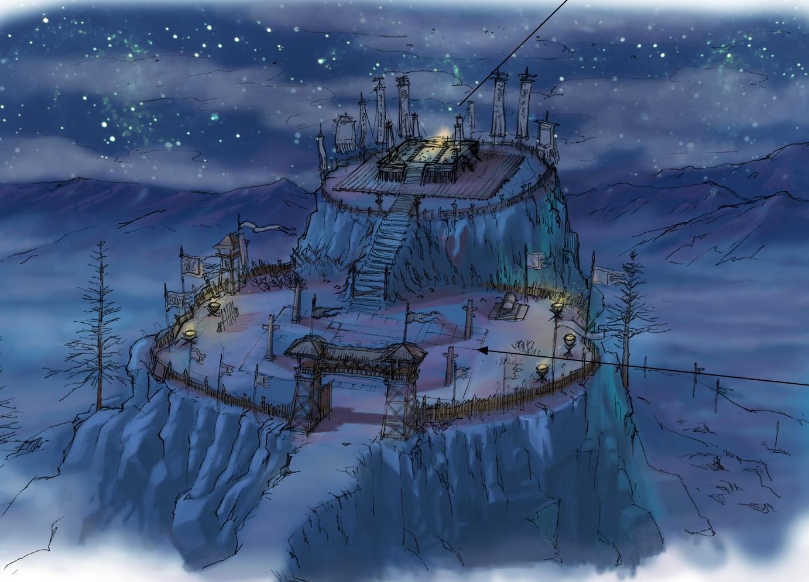

# 第一卷：黑石破曉

## 第四章 殘壇罡風、觀星與道化之影（破落道童・柳清虛）

### 一

山巔的罡風像是一柄柄淬了冰霜的鈍刀，擦著裸露的脖頸呼嘯而過，將少年身上那領洗得發灰、肘部打了兩塊青布補丁的寬大道袍吹得獵獵鼓脹。

十六歲的柳清虛盤膝坐在一塊懸凸於深淵之上的白石殘壇邊沿。

此處是黑石鋪西面最孤絕的危岩崖頂，垂直高出下方的人間聚落整整七十餘丈。晨曦未明之際，山腳下茶棚挑夫的粗重咳喘、溪灘邊婦人的搗衣聲、以及鐵匠鋪傳來的沉悶鐵錘鳴響，升騰到這七十丈高空時，都已被呼嘯狂暴的山風撕扯得細若遊絲。

唯有一株生長了不知幾百年的虯曲老松，粗黑如臥龍般的樹根死死抓裂了懸崖絕壁，如同一柄殘破的蒼青色巨傘，在萬丈深淵之上面迎罡風挺立。

老松枝頭掛著厚厚的一層白霜，偶爾被風吹落，冰屑簌簌砸在少年的眉睫與單薄的雙肩上。

柳清虛身軀紋絲不動。

他的面容極其清秀，白皙中帶著一股長期飢寒交迫、久居深山的病態透明。因為常年要在崖背陡峭的百丈石階上提運裂了縫的杉木水桶，他那一雙原本修長分明的手指上，指節處布滿了凍瘡潰爛後結下的紫紅色硬痂，掌心磨出了一層粗糲的厚繭。

他膝頭橫放著一卷邊緣被蟲蛀鼠咬得參差不齊的泛黃麻紙殘卷——《太上引氣殘篇》。

雙手在肚臍丹田前結成古拙的子午連環印，少年的呼吸維持著一種嚴苛的法度：吸氣三息，意守神闕；屏息五息，神照泥丸；再徐徐吐出一口帶著肺腑餘溫的淡白濁氣。

這是他自五歲被盲眼師傅撿回這座漏風滴雨的殘破道觀以來，每日破曉辰光必做的死功課。道觀窮得揭不開鍋，偏殿的三清泥胎早在三十年前就剝落得只剩骨架，平日師徒二人的生計，全靠在後山背風處開闢的半畝薄田收些乾癟雜豆，或是替山下黑石鋪的獵戶病家畫幾張驅邪安魂的黃表紙，換兩斗粗糲糙米。

然而，在這十六年日復一日的苦修中，柳清虛天生那近乎妖異的無垢靈台，卻察覺到了常人根本無法看見的三處天地異常。

---

### 二

第一處異常，在於這株生長在萬丈絕壁上的老松深根。

柳清虛每天清晨負責清掃殘壇積雪。整個崖頂白雪皚皚，融雪化水，唯獨老松向陰最深處的三條粗黑主根周圍，積雪落上去竟從不化水，反而被某種恐怖的無形力量生生抽乾了所有水汽，凝結成一層細小如精鹽、泛著死寂灰白的奇異冷霜！

凡人與獵戶只當是風口乾糙，唯有常年修習內視吐納、氣感清透的柳清虛能察覺到，那不是尋常凍霜，而是一種連生機骨髓都被徹底榨乾、石化凝晶的「死寂之霜」！

第二處異常，在於頭頂的周天星宿。

少年常年夜半在殘壇觀星吐納。他以靈台氣機映照蒼穹二十八星宿時，駭然發現星宿閃爍的明滅間歇，與腳下黑石山脈地氣呼應的節奏，竟然有著精確無比的三息「延遲咬合」！

那種感覺，就像是頭頂的漫天星辰根本不是自然運轉，而是隔著一層無形的巨大天羅障壁，被某種深埋於天穹深處的機括死死牽引一般！

而第三處異常，便是他的師傅——本名柳乘風的枯木老道。

老道在三十年前逃入黑石鋪時，曾親手剜去雙目，又用滾燙的火烙生生封死了眼竅；每日黃昏，老道還必須親口飲下一碗劇毒的生烏頭湯，忍受萬蟻噬骨的灼痛來壓制體內殘存的修為。每當心口劇痛發作，老道總會拄著斑竹盲杖，狠狠砸向老松深根的那處死霜角落，發出沙啞恐懼的低吼：「別上來……老道已經廢了……別上來……」

這三處常人眼裡毫不相干的古怪細節，在少年的心頭交織成了一張無形的大網，整整困惑了他十年。

「夫修真之道，以心為鏡，照臨萬類……」

柳清虛低聲默誦著經文。今日正是遺忘曆周天輪轉之際，殘壇上的山巔罡風狂暴到了極致，天地氣機紊亂。

少年深吸了一口氣，眼底掠過一抹決然的鋒芒。

他沒有聽從師傅「只引地氣、莫探松根」的嚴苛告誡，而是並指如劍，將自己苦修十餘年凝練出的一縷太虛純陽氣機，貼著白石地面，猛地探入了老松深根那處常年凝結著「死寂之霜」的黑泥死角！

---

### 三

「嗡——！」

氣機觸碰到死霜泥層的剎那，柳清虛只覺太陽穴像是被重錘狠狠轟中！

那不是泥土！

在那冰冷黑泥三尺之下，竟有一股冰冷絕望到了極致的古老道家殘餘真元，驟然被少年的氣機引動！

轟隆隆！

整座白石殘壇劇烈震顫起來！老松深處積累了幾十年的枯黃松針與黑色腐土，在氣機衝擊下四散崩開！

「孽障！住手！給老道退開！」

一聲悽厲狂亂的驚呼自後方石階炸響，枯木老道披頭散髮、拄著盲杖連滾帶爬地撲上殘壇，但已經太遲了！

泥土翻開，在老松那幾條粗大如巨蟒的黑根深處，赫然展露出了兩具令天地失色的恐怖遺骸！

那不是白骨，而是兩尊盤膝對坐的人形真身！

他們身披早已絕跡世間的古老紫綬仙鶴道袍，面容清癯，嘴角甚至還各自掛著一抹恍如得道飛升般的微笑。然而，他們的肌膚、鬚髮、乃至破損袖口下露出的每一寸骨骼經絡，早已經不再是血肉凡軀，而是徹底化作了一種非石非玉、通體半透明、泛著刺骨灰白死光的詭異冷晶！

老松那手臂粗細的黑根，如鐵槍般貫穿了他們的胸膛，將這兩尊晶石化的真人身軀當作了養分汲取的基石，生生與孤岩絕壁長在了一起！

*老松深根下的道化真人真身：非石非玉的半透明死寂冷晶被粗黑老松巨根洞穿，胸腹間隱現灰白道化結晶。*

「這……這是……」

柳清虛身軀劇烈顫抖，體內的氣機被那股刺骨的冰冷晶氣死死吸附，幾乎無法抽離！

「這就是你那位摘星拿月的師祖！和你那位天縱奇才的師叔！」

枯木老道撲倒在晶化真人身前，焦黑的盲眼流出兩行血淚，枯爪死死扣著石面：

「六十三年前！紫霄道宮三十六位紫綬上人於玉皇頂開壇大醮，接引九天星辰靈機入體，欲叩開天門……可天門開處，落下的根本不是仙露，而是這將萬物骨血化為死石的『天羅道化』！」

老道猛地扯開自己的破爛百納袍，露出乾癟胸膛正中那一圈正緩緩朝咽喉蔓延的灰白晶斑：

「修為越深，吐納的天靈之氣越多，道化便越不可逆！天下根本沒有飛升！這片天頂有一張鎖死眾生的無形天羅……誰敢越過凡胎叩問天門，誰就會被抽乾神魂、化作一尊死石！」

---

### 四

狂風嗚咽，殘壇如墓。

枯木老道血淚斑斑的嘶吼，將柳清虛十餘年來所建立的一切求道長生之念，生生擊得粉碎。

少年立在獵獵罡風中，臉色慘白如紙，看著老松根部那兩具嘴角含笑、肉身化石的師祖遺骸。

十幾年來所有的疑惑在這一瞬間徹底串聯成了一幅殘酷的圖景——為什麼老松根部會凝結不融的死霜？因為樹根扎穿了這兩尊道化真人！為什麼師傅柳乘風要親手剜去雙目、火烙封穴，甚至日日吞服劇毒烏頭湯？因為唯有自絕耳目、用劇毒與死氣封閉經絡，才能躲開天頂那張無形羅網的感應，拖延體內道化晶斑蔓延的速度！

「清虛！隨為師回觀！散去氣感，永遠做個凡人！」枯木老道厲聲哭喊，伸出枯手欲抓柳清虛。

然而，就在柳清虛仰頭望向漫天星宿與北方黑石山脈氣機交匯處的剎那，他體內剛剛被師祖遺骸引動的那一縷純陽氣機，竟本能地與高空雲層深處某種冰冷浩瀚的禁制法則產生了一瞬息的劇烈對沖！

---

### 五

在那一瞬息的氣機對沖中，柳清虛彷彿透過漫天流轉的星光，窺見了蒼穹深處那層由無數灰暗法則鎖鏈交織而成的森冷天羅！

日月星辰的靈機被那層無形天羅死死鎖定，凡是按今世道書順行吐納之人，吸入體內的每一縷靈氣裡都夾雜著微不可察的灰白死氣——就像是在牢籠裡被慢性投毒的獵物，一旦修為突破凡胎桎梏，體內的死氣便會瞬間引爆，將血肉經脈徹底結晶石化！

「呃——！」

僅僅是一瞬息的氣機窺探，一股沛莫能禦的反噬寒意便順著經脈倒灌而回！

白石殘壇之上，柳清虛猛地弓起身子，噴出一口帶著冰碴的暗紅鮮血！

在少年左鎖骨下方與右手背的肌膚表面，三處毛孔驟然泛起灰白死光，凝結成了米粒大小、刺骨冰寒的【道化冷晶】！每當他運轉氣機，那幾粒冷晶便如冰針扎入骨髓般隱隱作痛。

「痴兒啊！」枯木老道盲杖脫手，撲上前去，雙掌帶著生烏頭的苦澀毒氣拍在少年後背，拼命幫他封住左鎖骨下那幾粒道化冷晶向心脈蔓延的勢頭。

柳清虛半跪在碎石上，大口喘著粗氣，鎖骨下的道化冷晶傳來陣陣鑽心的寒意。

但他沒有閉上眼睛。

他那雙染血的手掌，死死攥住了懷中被鮮血浸透的《太上引氣殘篇》。在滾燙心頭血與道化寒氣的冷熱激盪下，古卷泛黃的麻紙夾層裂開，露出了一角由極細太古青銅絲線交織而成的隱秘殘圖——

那赫然是一角逆著今世星軌運行的【太古逆星圖殘紋】！當他的手指按在青銅殘紋上時，左鎖骨下那幾粒蠢蠢欲動的道化冷晶，竟奇異地安靜了下來。

老道癱坐在地，老淚縱橫：「看到了……你全感覺到了……順天引氣必成死石，這世道，修道人根本沒有活路……」

柳清虛緩緩擦去嘴角的血跡，將那角青銅逆星殘紋貼身收好，按住鎖骨下冰冷的晶斑，在呼嘯的山巔寒風中一步步站直了身軀：

「師傅，順著這片假天引氣，自然沒有活路。」

少年道童望向山下黑石鋪亮起的點點晨光，聲音清冷而篤定：

「但太古有人留下了逆行的星圖。只要還沒化作死石，這盤棋，就還沒到認輸的時候。」

殘壇老松之下，受傷的少年道童手握殘紋，迎風而立；而在他腳下，那兩尊晶石化的古老真人，彷彿也在這刺目的晨光中，發出了一聲跨越甲子的解脫微鳴。
