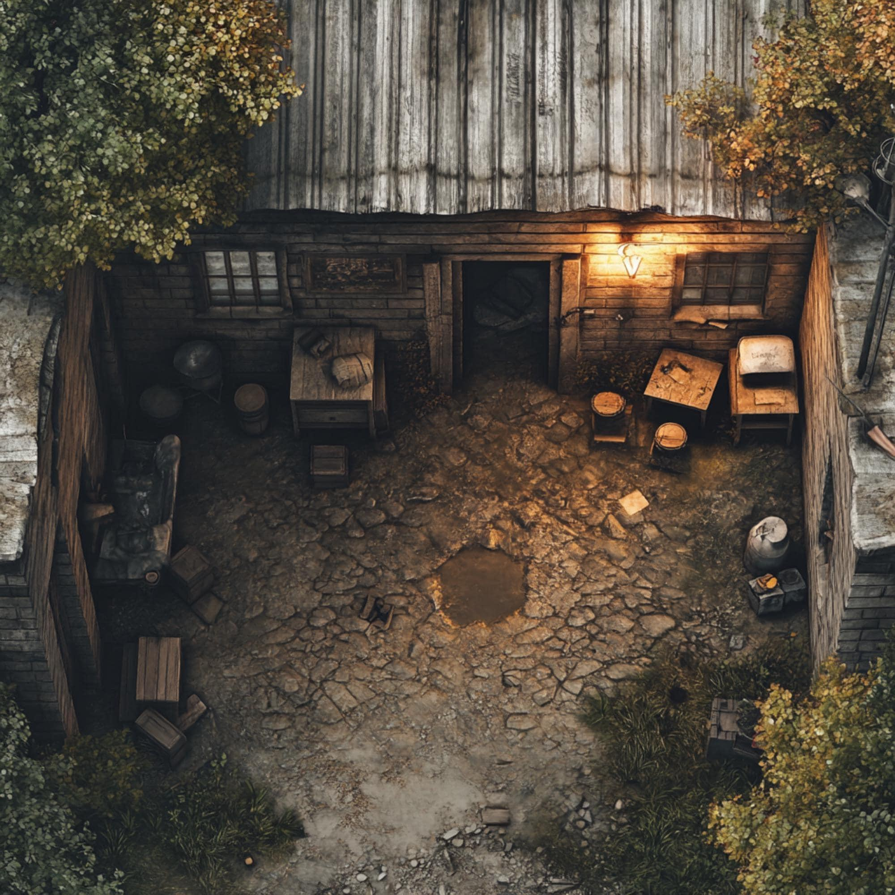

# 第一卷：黑石破曉

## 第五章 背街柴房、市井耳目與黑市古令（流浪乞兒・沈泥）

### 一

發餿腐爛的泔水酸氣，混雜著陰暗潮濕的爛木霉斑，在狹窄得僅容一人側身通過的柴房暗道裡經年不散。

然而，在這股令人作嘔的窒息氣味背後，僅隔著半寸厚、生滿黑斑的杉木板縫隙，卻正源源不斷地透出黑石客棧大廚房裡滾油翻炒的爆香，以及大鐵鍋裡燉煮了整夜的牛雜碎肉湯那濃郁滾燙的牛油肉香。

十五歲的沈泥整個人趴在冰涼潮濕的泥地上，鼻尖死死抵在一處被蟲蛀空的木板孔眼上，閉著眼睛，貪婪而深長地猛吸了一大口肉氣。

「咕嚕嚕——」

空癟如紙的肚子裡，立刻爆發出一陣飢雷般的轟鳴，胃酸翻騰，燒得食道陣陣乾疼。

沈泥身量矮小精瘦，身上裹著一件不知用多少塊破麻袋、碎氈布與爛棉絮東拼西湊縫成的百納破襖。因為常年穿梭於油膩的後廚灶台與泥濘的背街排溝，襖子外層早已結了一層硬邦邦的黑褐色油垢，內裡則用兩道粗麻布帶將剛剛發育的胸口勒得平平整整。

在弱肉強食的黑石鋪後巷，一個無父無母的孤女若是露出半分女兒態，不出三天就會被街頭的潑皮或人牙子生吞活剝。因此自打記事起，莫三便讓她剃短了頭髮、往臉上抹滿鍋底黑灰，一口一個「小爺」「老子」地混在乞兒堆裡。除了把她從死人堆裡刨出來的老丐莫三，全鎮上下誰都當這個滑不留手的小叫花是個還沒變聲的野小子。

那張抹著黑灰與泥巴的瘦削小臉上，唯有一雙深埋在蓬亂油污髮絲下的眼睛，滴溜溜轉動著。

那不是尋常乞兒面對毆打與飢餓時的懦弱哀憐，而是一雙宛如大荒深處幼狼般的眼睛——清澈、冰冷、機警，透著一股在泥濘中野蠻求生的狠勁。

在街市凡人眼裡，「他」只是一個隨處可見、為爭搶半個發霉饅頭便能被客棧夥計用擀麵杖追著打的賤命叫花子；但誰也想不到，這看似不起眼的假小子生來便有一對薄如蟬翼、敏銳過人的耳朵。

整整五年，在這個漏雨滴油的破柴房裡，沈泥聽出了黑石鋪隱藏在凡人喧囂背後的所有致命異常。

---

### 二

「吸！再使勁吸！最好把你這小王八羔子的肺泡子全給吸炸了！省得老子每天清晨還得替你操心半塊爛餅！」

柴房最深處的一捆潮濕乾草堆上，傳來一陣破鑼般的沙啞嘲弄。

一個形如骷髏的乾瘦老叫花正歪斜著身子靠在殘破的土牆根下。

老丐莫三身上套著一件爛得只剩布條的羊皮襖子，露出枯瘦發黑的胸膛，一隻骨節畸形、指甲縫塞滿黑泥的枯手，正伸在大腿內側熟練地抓著蝨子，抓出一隻便用拇指甲蓋「啪」的一聲狠狠捏爆。

老丐最引人注目的是他的雙腿與左膝——早年逃亡時被仇家伏擊打斷了腿骨，後來為了藏匿吞入腹中的信物、徹底自絕武脈避開搜捕，他又親手拿石頭砸碎了自己的左膝蓋骨。如今左膝以下以一種駭人的九十度角向內怪異扭曲著，髕骨處鼓著一個拳頭大小、泛著青黑血毒的陳年骨瘤。每逢天陰降霜，那骨瘤裡的劇痛與奇癢便如千百隻火蟻在骨髓深處啃噬。

「莫三爺，您少糟踐力氣罵人，今兒清晨後廚氣氛邪性得很。」

沈泥揉了揉凍得發麻的鼻尖，嘿嘿一笑，隨手緊了緊衣領下束胸的粗麻布，從懷裡貼肉捂著的油紙包裡，掏出半塊昨夜客棧酒客吃剩、被她趁著倒泔水時偷偷扣下的雜糧硬麵餅。

麵餅冰冷如磚，沈泥用膝蓋頂著斷鐵條，使勁將麵餅一分為二，將稍大的一半遞到了莫三面前。

莫三翻了個白眼，一把搶過面餅塞進乾癟的嘴裡，黃黑爛牙咬得咯咯作響：「邪性？王扒皮那條老閹狗，哪天不邪性？昨天老子聽他房裡的算盤珠子響了一整宿，跟奔喪似的！」

「王扒皮是在算計怎麼保住自家的皮！」

沈泥就著房簷漏下的一滴冰冷露水，將嘴裡乾硬得像石頭般的餅屑硬生生咽下喉嚨，那一對生得極薄的耳朵在蓬亂的頭髮下微微顫動了兩下，眼底掠過狡黠而冰冷的幽光：

「莫三爺，您教我的『聽風辨器』，我今日聽出了三件要命的異常。」

---

### 三

莫三咀嚼爛餅的動作猛地一頓，渾濁昏黃的眼珠子冷冷掃了少年一眼：「放屁！你這招風耳能聽出什麼天大的名堂？」

沈泥咧開嘴，露出雪白齊整的牙齒，壓低嗓音，豎起第一根漆黑的手指：

「第一處異常，在官道。告示牌上貼著『連日暴雨、山崩斷路』，純屬把全村人當睜眼瞎哄！昨夜子時三刻，客棧後門溜進一個穿黑斗篷的探子，鞋底蹭下了一層只有黑石關要塞周圍才有的『碎石白堊泥』，肋下更是被軍用神臂弩撕開了半尺長的大口子！」

沈泥冷笑著，眼中閃爍著野狼般的銳芒：

「山根本沒塌！是府城守軍大統領要吃金石商會三成油水，借著『妖獸地煞』的幌子，把唯一的關口給死死焊死了！如今黑市裡一張官軍蓋印的【保書路引】，已經被炒到了整整八十兩雪花銀！客棧大主管摔碎了三個茶盅，就是在籌這筆買路賣命錢！」

莫三握著麵餅的指節微微縮緊，眼皮狠狠跳了跳，沒有說話。

「第二處異常，在山頂破廟。」沈泥豎起第二根手指，「卯時初刻，西崖殘壇那座破觀，罡風突然倒灌，傳出一陣真氣逆亂的雷音，血腥味裡帶著冰晶碴子。小道童柳清虛今天清晨觀星，差點把自己給練炸了，而老瞎子枯木在殘壇上哭嚎得像條被抽了筋的野狗。」

「但這兩處，都不是最邪門的……」

沈泥緩緩放下手指，整個人伏在地上，目光如兩把冰錐，死死盯住了老莫三背後那一堆長滿綠白毒蕈的陳年黑泥柴禾：

「最邪門的第三處異常，就在這間破柴房的地底下！」

此言一出，老莫三渾濁的瞳孔驟然收縮成針尖大小！

沈泥身子前傾，幾乎貼著莫三的乾癟耳輪，一字一頓，字字如刀：

「整整三年了。每逢下半夜天陰下雨，您老這條斷腿骨瘤劇痛難忍、在草堆上打滾磨牙的時候——」

「這堆爛了三十年的柴禾樁子底下，深陷黑泥半尺深的地方，總會傳來一聲極其微弱、卻連綿不絕的金屬齒輪咬合聲……『哢嗒……哢嗒』！」

「那不是耗子，那是一具在爛泥裡咬合了三十年的金屬神機！它的震動節奏，跟您老腿裡骨瘤跳動的脈搏……一模一樣！」

---

### 四

死寂。

漏風的柴房裡，只剩下狂風吹過破屋頂的嗚咽聲。

老莫三乾枯的手掌僵在半空，手中的半截硬餅啪的一聲掉在泥地裡，摔得粉碎。

三十年了。

自打他拖著這條被打斷的爛腿爬進黑石鋪，裝瘋賣傻、吃屎喝尿，用最骯髒下賤的叫花子皮囊掩蓋自己，從未有任何人察覺過這間破柴房底下的秘密。

可眼前這個他一手養大、看似野狗般微不足道的小乞兒，居然憑著一對耳朵與狼崽子般的直覺，將整個黑石關的食物鏈與柴房深處的秘密，抽絲剝繭拼得一清二楚！

「你……你這小畜生……」

莫三喉嚨裡發出一陣野獸瀕死般的劇烈喘息，那張乾癟的臉龐扭曲了起來，眼中先是爆發出滔天的殺意，但緊接著，那股殺意在觸及少年冰冷清澈、毫無畏懼的眼眸時，寸寸崩解，化作了一種混合著癲狂、悲涼與極致狂喜的仰天厲笑！

「哈哈……哈哈哈哈哈哈！」

老丐猛地一拳狠狠砸在自己扭曲萎縮的斷腿骨瘤上，砸得烏血迸流：

「好！好一匹狼崽子！好一對聽風耳！」

「老子當年在死人堆裡把你刨出來，看來真他娘的是祖師爺開了眼！」

老丐霍然抬起枯瘦如鷹爪的手臂，直直指向柴房最陰暗潮濕的角落底層，厲聲狂吼：

「小畜生，把那堆爛了三十年的柴禾給老子刨開！」

「但你給老子聽好了！盒子表面塗著軍隊的『腐骨烏頭脂』，碰上一滴，你的手掌三息之內就會化成黑水！去灶台偷冷香油和酸陳醋，給老子破了毒脂再取！」

---

### 五

沈泥的心臟劇烈跳動，但他那張沾滿黑灰的臉上卻沒有一絲慌亂。

他沒有莽撞動手，而是靈巧地自後廚泔水桶後摸出半罐偷藏的陳年劣醋與半碗冷羊油，潑灑在十指與鐵條之上。

隨後，少年如幼狼般撲向角落，雙手裹著油醋，以極其精妙的寸勁瘋狂扒開那些潮濕腐朽的爛木與碎瓦！

厚達兩尺的腐爛柴堆被硬生生撕裂，在最深處黑泥半尺之下，沈泥的鐵條精準挑出了一隻沉甸甸、被層層浸透了黑褐色毒脂油布包裹的長方金屬重盒！

毒脂遇冷油酸醋滋滋冒出白煙，沈泥手起條落，「喀嚓」一聲脆響將銹死的銅鎖生生崩斷！

層層油布揭開。

鐵盒之中，赫然顯露出一枚巴掌大小、通體泛著深沉青金色澤的非鐵非木古老殘令！

令符正面，雕刻著雙龍環抱直插九天的森嚴神闕；而在令牌的背面——

數十枚細小如米粒、由極純黑鐵打造的微型太古神械齒輪，正嚴密咬合在一起！

在重見天日的剎那，微型齒輪在沒有任何外力的推動下，微不可察地自行發出了一聲清脆悠遠的「哢嗒」咬合聲！

齒輪正中，四個氣吞萬古的金篆大字流轉著暗啞神輝——

【萬物行商・天門引】！

*鐵盒中重見天日的太古商令：正面雙龍環抱直插神闕，背面微型神械齒輪咬合轉動，銘刻「萬物行商・天門引」。*

轟！

指尖隔著油布觸碰古令的瞬間，沈泥只覺靈魂猛烈一震，彷彿看見一條由億萬神機巨構搭建、貫穿了諸天星辰的宏大商路在虛無中若隱若現！

「莫三爺……這究竟是什麼？！」沈泥捧著沉重無比的古令，失聲問道。

「三十年前，老子是金石商會縱橫大荒第一快刀趟子手，人稱『飛隼莫三』！」

莫三眼眶崩裂，血淚橫流：

「三十年前，老子帶著三十個同生共死的結拜弟兄，從大荒深處史前裂谷中拿命掏出了這枚古令！可商會高層轉頭便勾結城防軍，在黑石山口設伏！漫天暴雨，全是淬毒的破罡弩！三十個兄弟全被射成了爛泥……老子把這面令吞進肚子裡，在泥漿裡爬了整整三個月，才爬到這裡！」

老丐猛地抓住沈泥的衣領，指節發白：

「八十兩銀子的官府路引，能帶你進城給老爺當奴才；但這枚天門引，能帶你踩著他們的腦袋，踏上太古九天神商大道！」

---

### 六

然而，就在那枚微型神械齒輪自行轉動發出輕響的一瞬間——

異變陡生！

一股常人無法察覺、極其微弱卻無比刺骨的史前空間信號波紋，悄然自古令深處擴散開來，穿透了柴房的破木板，掠過了客棧的前廳。

「汪！汪汪汪！」

前街客棧內，金石商會馱隊護衛圈養的三條高大黑背獵犬，猛地發出狂暴而恐懼的狂吠！

緊接著，後巷原本沉寂的青石板路上，驟然傳來了兩道極其輕微、但步伐整齊劃一的皮靴落地聲——那是軍隊精銳探子在急速逼近的節奏！

風聲驟緊！

莫三臉色大變，一把將古令死死塞進沈泥胸前的乾糧袋裡，厲聲喝道：

「神械齒輪醒了一線……金石商會的狗鼻子和黑石關的暗探已經嗅到了！這枚天門引目前齒輪卡死、仍在深度休眠，是塊招惹殺身之禍的死鐵！」

「小畜生，柴房不再安全了！」

「拿著它去找老鐵匠鋪的阿鐵！這世上除了太古工聖遺脈，沒人能修好這枚令牌的卡死齒輪！」

沈泥死死捂住胸前冰涼刺骨的金屬殘令。

這一刻，少年終於明白，這枚令牌不是天降橫財，而是一張染滿了三十條人命鮮血、引來天下豺狼追殺的催命符！

但聽著後巷逼近的皮靴聲，少年眼中的懦弱盡褪，嘴角反而勾起了一抹宛如大荒餓狼般的凶殘冷笑：

「催命符？」

「只要能活著走出去，老子就用這塊鐵，把這黑石關的天給捅個窟窿！」

晨曦破曉，街市喧囂，而在無人注視的陰暗後巷中，一場跨越三十年的血海風暴，已然拉開了序幕。
