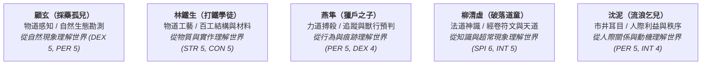

# 《遺忘的世界》核心人物檔案 (Character Profiles)

> **所屬專案**：`forgotten-space` 敘事設定集  
> **關聯文檔**：[世界觀與 Mudlib 架構設定集](file:///home/wade/src/github/mudscript/forgotten-space/world_setting.md) ｜ [第一卷大綱【黑石驚蟄】](file:///home/wade/src/github/mudscript/forgotten-space/narrative/volume1.md)  
> **更新時間**：2026-10-19  

---

## 一、五重視角核心主角 (The Five Protagonists)

黑石鋪採用**「同一天清晨・羣像五重視角」**的立體敘事架構，五位身世不同的底層少年，分別在黑石鋪五方微生態中遭遇不同的史前遺構與命運奇遇。五人分別代表五種觀察、驗證世界的不同「鏡頭」：

---

### 1. 顧玄（採藥孤兒 / herbalist）
* **詳細檔案**：[`gu_xuan.md`](file:///home/wade/src/github/mudscript/forgotten-space/narrative/characters/gu_xuan.md)
* **年齡與身世**：十六歲。十六年前大洪水中被沖刷到石板上的棄嬰，由瘋郎中葛半仙撫養長大。
* **道途定位**：物道感知 / 自然現象與生態勘測。
* **出生居所**：南谷懸崖峭壁・採藥草廬 (`/d/village/herb_hut.c`)。
* **先天六維**：STR 1, CON 3, **DEX 5**, INT 2, SPI 2, **PER 5**（總分 18）。
* **修行親和度**：身法 (DEX) 200%, 感知 (PER) 200%, 根骨 (CON) 130%, 其餘 100%。
* **怎麼理解世界**：**【從自然現象理解世界】**。觀察地形、地脈、土壤、草藥分布與環境微觀變化，從自然留下的痕跡推測事情成因。看到草藥分布異常，第一反應是思考地勢高低、向陽背風、土壤濕度與地煞滲透的生態因果。
* **太古機緣**：晨曦在碎石溪灘掬水洗臉，水流沖淨青苔，洞察被當作洗衣磨刀石的【史前逆星斷碑】，拓印下東方蒼龍七宿逆行的【殘缺星圖拓片】。
* **卷一關鍵行動**：主持草廬分診；解剖暴斃黃羊確立大荒動物逃荒假說；施展寒針截脈法救治傷患；調配低溫悶燒草煙阻滯獸潮；梳理 22 名老礦工親筆傷情錄。

---

### 2. 林鐵生（打鐵學徒 / smith）
* **詳細檔案**：[`lin_tiesheng.md`](file:///home/wade/src/github/mudscript/forgotten-space/narrative/characters/lin_tiesheng.md)
* **年齡與身世**：十七歲。八歲被老鐵匠阿鐵收留，在老鐵匠鋪當學徒整整九年，性格敦厚堅毅、惜字如金。
* **道途定位**：物道工藝 / 物質實作、材料結構與百工應力。
* **出生居所**：街市東側・老鐵匠鋪打鐵爐房 (`/d/village/forge.c`)。
* **先天六維**：**STR 5**, **CON 5**, DEX 3, INT 1, SPI 1, PER 3（總分 18）。
* **修行親和度**：臂力 (STR) 200%, 根骨 (CON) 200%, 靈巧 (DEX) 130%, 其餘 100%。
* **怎麼理解世界**：**【從物質與實作理解世界】**。理解材料、工具、力量、受力結構與工程施工限制，從器物與百工的實作角度驗證世界。看到防禦設施或落石，第一反應是評估材料脆性、頁岩承重極限、滑輪導輪應力與操作時程限制。
* **太古機緣**：地爐拉風箱千錘百鍊，震碎粗鐵礦核，顯露出萬度烈火不融的【太古不融黑鐵齒輪構件】（兩指長、約 200 克）。
* **卷一關鍵行動**：右手腕骨裂仍順應鐵紋槓桿修復門鼻；下井捨身砸穿暗渠救出 23 名礦工；落龍口踏勘判讀冰裂紋滑動面；指揮絞盤引落一號巨石；巷戰中以預埋鐵索絞盤絆倒野獸。

---

### 3. 燕隼（獵戶之子 / hunter）
* **詳細檔案**：[`yan_sun.md`](file:///home/wade/src/github/mudscript/forgotten-space/narrative/characters/yan_sun.md)
* **年齡與身世**：十六歲。父親與親大伯燕山多年前死於大荒，由老獵戶趙老獵教養長大。
* **道途定位**：力道搏殺 / 行為痕跡、荒野追蹤與獸行預判。
* **出生居所**：聚落東南・獵戶哨亭 (`/d/village/hunter_cabin.c`)。
* **先天六維**：STR 3, CON 3, **DEX 4**, INT 1, SPI 2, **PER 5**（總分 18）。
* **修行親和度**：感知 (PER) 200%, 身法 (DEX) 180%, 根骨 (CON) 140%, 臂力 (STR) 130%, 其餘 100%。
* **怎麼理解世界**：**【從行為與痕跡理解世界】**。追蹤獵物、辨認危險、預測野生動物與敵人的行動動線，以荒野搏殺經驗解讀危機。看到林中獸跡混亂，第一反應是推測動物的受驚方向、遷徙規模、捕食與逃亡本能，以及前排頭獸的盲從習性。
* **太古機緣**：大荒荊棘荒林追蹤黑熊紫黑濁血，在化骨泥沼巨榕根下觸動被巨熊撞裂石衣的【太古戰神獵獸圖騰玄柱】血脈共鳴。
* **卷一關鍵行動**：手持趙伯所傳百斤牛筋蛟骨大弓（五石力）；巡查東林發現陷阱空置與獸群遷徙跡象；地穴中連珠三箭與柴刀開腹凶悍擊殺盲眼巨蜥；落龍口居高臨下以鳴鏑火矢精準迫退前排頭獸。

---

### 4. 柳清虛（破落道童 / daoist）
* **詳細檔案**：[`liu_qingxu.md`](file:///home/wade/src/github/mudscript/forgotten-space/narrative/characters/liu_qingxu.md)
* **年齡與身世**：十六歲。五歲被枯木老道收養於殘破道觀，自幼苦修吐納，體質清癯蒼白。
* **道途定位**：法道神識 / 知識典籍、符文規律與超常天道。
* **出生居所**：西面山腰・破落道觀三清偏殿 (`/d/village/daoist_temple.c`)。
* **先天六維**：STR 1, CON 2, DEX 2, **INT 5**, **SPI 6**, PER 2（總分 18）。
* **修行親和度**：靈性 (SPI) 200%, 悟性 (INT) 200%, 根骨 (CON) 120%, 其餘 100%。
* **怎麼理解世界**：**【從知識與超自然現象理解世界】**。研究道藏典籍、星宿天象、殘缺符文與歷史謎團，從規律法則與道化徵兆解構超常現象。看到天幕晦暗與石碑裂紋，第一反應是聯想上古典籍記載、周天星軌逆反、天地牢籠封印與道化代價。
* **太古機緣**：登上迎風孤岩殘壇觀星打坐，目睹玉化道人晶骨，神識穿透星空驚見【天羅地網活體牢籠】真相。
* **卷一關鍵行動**：實測落龍口辰巳時分短暫「西南側逆風窗口」；嚴格設定風向倒灌沙土滅煙紅線；巷戰中於屋頂吹哨全局調度；梳理軍械雷管批號、精煉坩堝暗賬與山川地形圖三大證明力籌碼。

---

### 5. 沈泥（流浪乞兒 / beggar）
* **詳細檔案**：[`shen_ni.md`](file:///home/wade/src/github/mudscript/forgotten-space/narrative/characters/shen_ni.md)
* **年齡與身世**：十四至十五歲，個頭瘦小。黑石鋪後巷流浪孤兒，長年受瘸腿老丐莫三庇護。
* **道途定位**：市井耳目 / 人際關係、利益動機與社會秩序推演。
* **出生居所**：客棧後巷陰暗處・廢柴房 (`/d/village/shed.c`)。
* **先天六維**：STR 2, CON 2, **DEX 3**, **INT 4**, SPI 2, **PER 5**（總分 18）。
* **修行親和度**：悟性 (INT) 200%, 感知 (PER) 180%, 身法 (DEX) 130%, 根骨 (CON) 120%, 其餘 100%。
* **怎麼理解世界**：**【從人與人之間的關係理解世界】**。辨識言外之意、串聯消息、理解各方利益衝突、推測個人與群體的動機，以市井生存智慧解讀社會關係網。聽到眾人說詞矛盾，第一反應是盤算誰是消息來源、背後有何利益牽扯、誰有理由隱瞞真相、恐慌蔓延會推動哪方逃跑。
* **角色設計邊界 (防全能陷阱)**：
  - 能察覺矛盾，但不一定知道誰在說謊；
  - 能理解動機，但不一定同意對方的選擇；
  - 能連結不同人物，卻不能強迫別人合作；
  - 能提出協調方案，但仍可能因資訊不足或判斷失誤而失敗；
  - 成長核心在於學會理解他人，也學會**限制自己對他人的主觀判斷**（「克己復禮為仁」）。
* **太古機緣**：貼牆偷聽洞悉城防軍勒索商隊內幕，自爛泥深處扒出莫三藏匿的史前商盟【萬物行商・天門引】休眠殘令。
* **卷一關鍵行動**：銜藥冒險鑽入兩尺排沙暗渠探查穹頂傷患；動員乞兒與寡婦剁草備料；識破王周二家私逃算計；巷戰中引領乞兒於屋頂投石阻滯；協助蘇凝霜交叉核驗商會暗賬。

---

## 二、關鍵引路導師 (The Mentors)

五位留守師長身懷絕技卻各有殘缺與隱痛，是少年們成長道路上的護道者與精神錨點：

1. **瘋郎中 葛半仙**（`/clone/npc/ge_doctor.c`）
   * **角色身份**：採藥孤兒顧玄之養父。表面瘋癲嗜酒、罵罵咧咧，實則醫道精深、洞悉地脈藥性。
   * **關鍵指引**：傳授顧玄採藥、辨毒、正骨與古法分診之道，離別時贈予半本毒經與行醫禁忌。
2. **老鐵匠 阿鐵**（`/clone/npc/tie_smith.c`）
   * **角色身份**：打鐵學徒林鐵生之師父。曾是名動一時的鍛造宗師，隱居黑石鋪爐房。
   * **關鍵指引**：傳授鐵生「瘋魔打鐵法」與百工應力之道，手持四十斤鍛錘震懾宵小；離別時贈予順手的左手小鍛錘。
3. **老獵戶 趙老獵（趙伯 / 趙老拐）**（`/clone/npc/zhao_hunter.c`）
   * **角色身份**：獵戶之子燕隼之長輩，親大伯燕山的換命老友，雙眼灰白但耳目如電。
   * **關鍵指引**：傳授燕隼破甲重弩、追蹤與獵殺之道，點破轉嫁災難之道德槓桿；離別時告誡「山外人比獸險」。
4. **枯木老道（柳乘風）**（`/clone/npc/kumu_daoist.c`）
   * **角色身份**：破落道童柳清虛之師父。自剜雙目躲避道化侵蝕，殘喘苟活於破落道觀。
   * **關鍵指引**：傳授《太上引氣殘篇》與觀星避劫之法，告誡清虛「想活命，就別信這片天」。
5. **瘸腿老丐 莫三**（`/clone/npc/mo_beggar.c`）
   * **角色身份**：流浪乞兒沈泥之庇護者。三十年前金石商盟滅門血案唯一倖存者，自碎雙膝裝瘋乞食。
   * **關鍵指引**：傳授沈泥「睡夢大法」、市井聽風與泥沼求生之道，守護【天門引】青金古令三十年。

---

## 三、重要配角與各方勢力群像 (Key Supporting Cast)

### 1. 金石商隊陣營
* **蘇凝霜**：金石商會大小姐（十六至十七歲），容貌清麗冷峻。手持「紫金雙龍信印」深入黑石鋪調查父親蘇遠山暴斃真相，血書發布救援委託；在危難中果敢穩健，與五子結下生死信賴。
* **蘇遠山**：原金石商會大掌櫃，為人剛正，半月前在黑石鋪遭趙德貴與城防司內鬼聯手毒害滅口。
* **商隊死士**：忠於蘇老掌櫃的精銳衛士，手持破甲連發神臂弩護衛大小姐。

### 2. 黑石鋪底層聚落
* **魯大山**：老礦工把頭，十年前三號廢坑事故生還者。北崖塌方中咳血撐木，後帶領 22 名倖存老礦工築坎抗災、按手印作證。
* **老李頭（具名犧牲者 #1）**：老礦工。第 19 章在草廬中主動推拒最後的止痛吊命藥，留給十八歲柱子與孫大牛，安詳捨己辭世。
* **木匠老陳（具名犧牲者 #2）**：老木匠。第 29 章巷戰中為護衛地窖婦孺，手持粗榆木梁捨身刺入黑鬃野豬王胸膛，壯烈殉難。
* **柱子**：十八歲年輕礦工，在塌方中被砸斷肋骨，受老李頭捨身庇護挺過危局。
* **孫大牛**：右小腿砸斷的老礦工，經顧玄施展「寒針截脈法」保住性命。
* **狗蛋**：九歲小乞兒，母親在雪夜凍死，對沈泥忠心耿耿，在巷戰與備料中奔走傳令。
* **劉瘸子、張嫂、鄭老七**：各具生活負擔的普通鄉民，在落龍口工程與防禦中展現平凡人的韌性。

### 3. 官軍與府城勢力
* **胡百戶**：黑石關巡檢司守將。勾結趙德貴挪用軍火盜採地煞血精，炸塌北崖後企圖屠村滅口、封關斷糧。
* **趙德貴**：金石商會駐鎮二掌櫃。自私狠毒，盜採血精元兇，被胡百戶押至黑石關看管充作替罪羊。
* **陳鎮山**：金石城防司左參將（兼虎跳大營冬防演武先鋒主將）。老於官場宿將，受限於軍令與糧道斷絕，在三方證據面前審時度勢解除胡百戶職權。
* **隨軍軍械監軍 & 督糧官**：陳鎮山軍中制衡力量。監軍核查雷管批號，督糧官憂心糧道斷絕，共同形成制度性制衡。

### 4. 市井投機勢力
* **王員外 & 周掌櫃**：黑石鋪富商。私藏【金石內造・丙字柒號】耐火坩堝，僱用刀客私逃南谷，車隊翻覆促使鎮民認清逃亡死局。
* **雷五**：商隊外聘護衛首領。貪財惜命，拿遣散銀逃亡受阻後被王周二家高價截留，翻車受傷後配合防禦。
