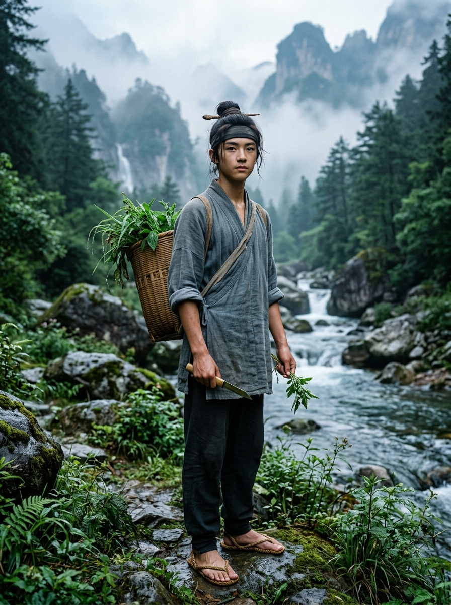

# 角色檔案：顧玄（採藥孤兒）

## 基本資訊
* **姓名**：顧玄
* **身世**：採藥孤兒 (`herbalist`)
* **年齡**：十六歲
* **外觀**：身形勻稱消瘦卻結實，面容清秀溫和，目光澄澈平靜。赤足，著粗麻短褐。
* **隨身舊物**：一只竹編藥簍 (`/clone/item/herb_basket.c`)
* **出生居所**：南谷懸崖峭壁・採藥草廬 (`/d/village/herb_hut.c`)
* **引路導師**：瘋郎中 葛半仙 (`/clone/npc/ge_doctor.c`)

## 性格特質與才能
* **沉著內斂**：十四年前大洪水中被沖刷到石板上的棄嬰，習慣了底層生活的艱難，處事波瀾不驚。
* **識百草、通地脈**：熟悉各種靈草習性與峭壁攀爬技巧，身手靈敏。
* **天命敏銳（Fate）**：能打破大清洗強加於眾生之上的認知迷障，是黑石鋪第一個洞察洗衣石板為史前逆星神碑的人。

## 先天道基與成長傾向
* **初始六維分配（總點數 18）**：
  * 臂力 (`str`)：1
  * 根骨 (`con`)：3
  * **身法 (`dex`)：5**（常年攀附懸崖，手腳輕捷如猿）
  * 悟性 (`int`)：2
  * 靈性 (`spi`)：2
  * **感知 (`per`)：5**（辨識百草微芒，明察秋毫）
* **修行親和度（行為感悟速率）**：身法 (DEX) 200%, 感知 (PER) 200%, 根骨 (CON) 130%, 其餘 100%
* **優先驗證的世界系統**：山地地貌與懸崖攀爬、荒山藥草生態與分佈、採集採摘機制、藥鋪偏方製藥、草藥物性知識

## 關鍵機緣與伏筆
* 在溪灘石板上拓印下【殘缺星圖拓片】(`stele_rubbing.c`)，發現東方蒼龍七宿星軌完全逆反的萬古真相。
* 第一章主視角人物（《晨曦微光與磨刀石》）。
