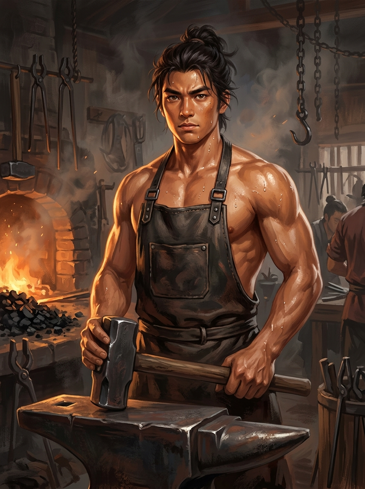

# 角色檔案：林鐵生（打鐵學徒）

## 基本資訊
* **姓名**：林鐵生
* **身世**：打鐵學徒 (`smith`)
* **年齡**：十七歲
* **外觀**：身材魁梧精壯，古銅色肌膚，身上佈滿火星灼痕，雙手骨節粗大。常年圍著牛皮圍裙。
* **隨身舊物**：一把打鐵舊鐵錘 (`/clone/weapon/smith_hammer.c`)
* **出生居所**：老鐵匠鋪・打鐵爐房 (`/d/village/forge.c`)
* **引路導師**：老鐵匠 阿鐵 (`/clone/npc/tie_smith.c`)

## 性格特質與才能
* **敦厚堅毅**：話語極少，耐得住長年累月的炭火炙烤與千錘百鍊，堅信世間唯有手造之物最為踏實。
* **神力沉凝、辨識金石**：臂力驚人，能精準辨別礦石成色、溫度火候與鍛打公差。
* **百工匠心（Wu / Matter）**：繼承了失落的工聖神髓，對機械結構與榫卯金石有著與生俱來的敏銳直覺。

## 先天道基與成長傾向
* **初始六維分配（總點數 18）**：
  * **臂力 (`str`)：5**（沉腰拉動巨型風箱，單手揮動三十斤生鐵錘）
  * **根骨 (`con`)：5**（耐炭火長年炙烤，筋骨如精鋼磐石）
  * 靈巧 (`dex`)：3（掌握鍛造微度公差與精準落點）
  * 悟性 (`int`)：1
  * 靈性 (`spi`)：1
  * 感知 (`per`)：3
* **修行親和度（行為感悟速率）**：臂力 (STR) 200%, 根骨 (CON) 200%, 靈巧 (DEX) 130%, 其餘 100%
* **優先驗證的世界系統**：原料礦石採掘、燃料配比與火候地爐、鍛造公差、造物工具、商業訂單與工匠生活

## 關鍵機緣與伏筆
* 在敲碎北崖崩落的奇異巨石時，自萬度地爐中提煉出【太古不融黑鐵齒輪構件】，接觸到了太古機關術的核心神髓。
* 第二章主視角人物（《爐火、重錘與不融黑鐵》）。
