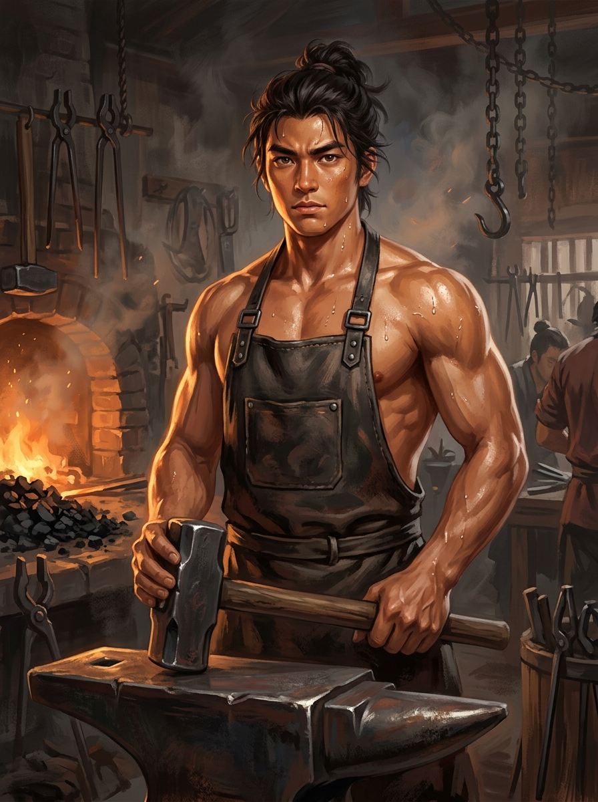

# 角色檔案：林鐵生（打鐵學徒 / 百工匠師）

## 基本資訊
* **姓名**：林鐵生
* **身世**：打鐵學徒 (`smith`) / 百工總會初階匠師
* **年齡**：十七歲
* **當前修為等級**：Lv. 20（金石府城一階成熟期）
* **職業與資質**：初階百工匠師（持【百工初階匠帖】`/clone/item/lic_artisan.c`、受贈【天工烏木尺】`/clone/tool/gong_ebony_ruler.c`）
* **外觀**：身材魁梧雄健，古銅色肌膚，肌肉如花崗岩般棱角分明，身上滿是火星灼痕與金石磨痕。常年繫厚重牛皮圍裙。
* **隨身舊物與重要器械**：打鐵舊鐵錘 (`/clone/weapon/smith_hammer.c`)、天工烏木尺、太古不融黑鐵構件 (`/clone/relic/ancient_black_iron.c`)、應力雙契木榫 (`/clone/item/stress_wedge.c`)、丙字柒號坩堝拓本
* **出生居所**：老鐵匠鋪・打鐵爐房 (`/d/village/forge.c`)
* **府城居所與人脈**：千錘地爐坊 (`/d/city/north/gong_forge.c`)；得百工總會匠首歐陽大師與地爐莫錘大師親自指點。
* **引路導師**：老鐵匠 阿鐵 (`/clone/npc/tie_smith.c`)、鍛造大師 莫錘 (`/clone/npc/gong_mochui.c`)、匠首 歐陽大師 (`/clone/npc/gong_ouyang.c`)

## 性格特質與才能
* **敦厚堅毅、惜字如金**：耐得住千鍛萬淬的寂寞，堅信世間唯有精準的公差與親手鍛打的金鐵絕不欺人。
* **神力沉凝、公差入微**：單手能控百斤鐵錘，對幾何應力分佈、剪切應力極限與熱脹冷縮公差有著直覺般的匠人神髓。
* **百工匠心（Wu / Matter）**：融合了太古天工機關術與凡人百工經驗，善於在重型機械即將崩解之際精準嵌入卸力構件。

## 六維道基與成長軌跡
* **六維屬性（Lv. 20）**：
  * **臂力 (`str`)：18**（天生神力，單手揮動六十斤烏金錘若無其事）
  * **根骨 (`con`)：17**（久耐高溫烈焰炙烤，氣血沉厚如鐵鑄）
  * 靈巧 (`dex`)：9（下錘點精準在半厘之內，掌握微米級公差）
  * 悟性 (`int`)：6
  * 靈性 (`spi`)：4
  * 感知 (`per`)：9（聽錘音辨鐵芯空洞，觀火色辨爐溫）
* **掌握專屬技能**：
  * `gong_yingli` (百工應力平衡法) 100級
  * `gong_qiaojin` (千錘巧勁鍛打術) 100級
  * `gong_cuihuo` (金石淬火溫控訣) 100級
  * `gong_analysis` (物性辨析) 100級
* **修行親和度**：臂力 (STR) 200%, 根骨 (CON) 200%, 靈巧 (DEX) 130%, 其餘 100%

## 卷二重大經歷（第 39～57 章）
1. **盤木天車應力搶險（Ch. 42）**：押解隊伍抵達盤木縣外，深谷起重天車吊索遭高壓卡死；鐵生勘測出青銅咬合處承受極限剪切應力，現場削製【應力雙契木榫】，以精準角度敲入受力核心，毫髮無傷化解萬斤崩裂慘劇。
2. **地爐五百針考核與丙字柒號拓本（Ch. 47）**：在千錘地爐坊接受莫錘大師考驗，以反手左鍛術砸下五百根平頭鋼針，無一歪斜斷裂，震驚全場並獲發【百工初階匠帖】；暗中取得商會私密【金石內造・丙字柒號】除渣坩堝的泥料配比拓片。
3. **西水門閘槽應力加固（Ch. 53）**：在水閘即將被洪峰衝垮的生死關頭，鐵生臨危不亂，在狂暴震顫的鐵閘導軌兩側敲入互鎖應力木榫，抵消了數萬斤橫向剪切應力，使千斤鑄鐵閘順暢沉入底槽。
4. **南關夜議六大缺口（Ch. 56）**：主導比對「烈礬灰陶票根」與「一號庫總勘提單」之坩堝殘渣金屬成分，鎖定商會高層將地煞精錠私調至地下暗庫的物證鏈環。
