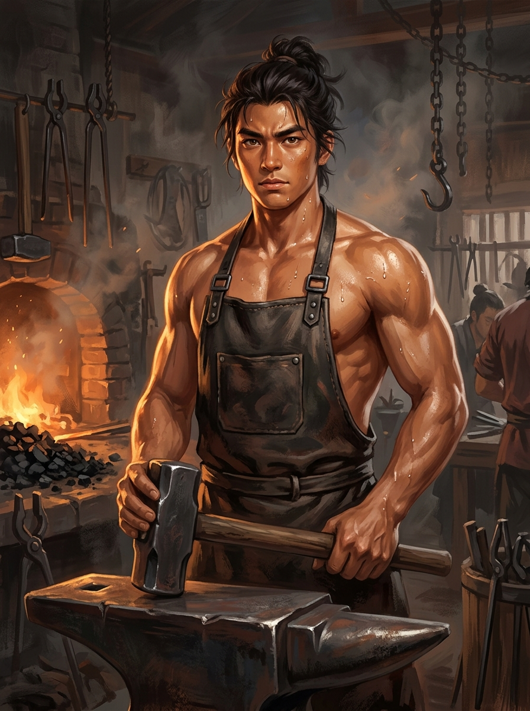

# 角色檔案：林鐵生（打鐵學徒 / 百工匠師）

## 基本資訊
* **姓名**：林鐵生
* **身世**：打鐵學徒 (`smith`) / 百工總會初階匠師
* **年齡**：十七歲
* **當前修為等級**：Lv. 50（Tier 1 圓滿・精金淬體・天工閣保薦）
* **職業與資質**：初階百工匠師（持【百工初階匠帖】`/clone/item/lic_artisan.c`、獲頒【Tier 2 名山外門考核令】`/clone/item/tier2_admission_token.c`）
* **外觀**：身材魁梧雄健，古銅色肌膚隱泛暗金精芒，肌肉如花崗岩般棱角分明，身上滿是火星灼痕與金石磨痕。常年繫厚重牛皮圍裙。
* **隨身舊物與重要器械**：打鐵舊鐵錘 (`/clone/weapon/smith_hammer.c`)、天工烏木尺、太古不融黑鐵構件 (`/clone/relic/ancient_black_iron.c`)、阿鐵精鋼卡尺、太古五器合鳴星光指針 (`/clone/item/ancient_relics_compass.c`)
* **出生居所**：老鐵匠鋪・打鐵爐房 (`/d/village/forge.c`)
* **府城居所與人脈**：千錘地爐坊 (`/d/city/north/gong_forge.c`)；得百工總會匠首歐陽大師與地爐莫錘大師親自指點與保薦。
* **引路導師**：老鐵匠 阿鐵 (`/clone/npc/tie_smith.c`)、鍛造大師 莫錘 (`/clone/npc/gong_mochui.c`)、匠首 歐陽大師 (`/clone/npc/gong_ouyang.c`)

## 性格特質與才能
* **敦厚堅毅、惜字如金**：耐得住千鍛萬淬的寂寞，堅信世間唯有精準的公差與親手鍛打的金鐵絕不欺人。
* **神力沉凝、公差入微**：單手能控百斤鐵錘，對幾何應力分佈、剪切應力極限與熱脹冷縮公差有著直覺般的匠人神髓。
* **百工匠心（Wu / Matter）**：融合了太古天工機關術與凡人百工經驗，善於在重型機械即將崩解之際精準嵌入卸力構件。

## 六維道基與成長軌跡
* **六維屬性（Lv. 50 圓滿）**：
  * **臂力 (`str`)：45**（天生神力，單手揮動六十斤烏金錘若無其事，精金淬體後力拔山兮）
  * **根骨 (`con`)：42**（久耐高溫烈焰炙烤，氣血沉厚如鐵鑄，皮膜泛金剛精金之色）
  * 靈巧 (`dex`)：24（下錘點精準在半厘之內，掌握微米級公差）
  * 悟性 (`int`)：16（格物致知，悟通百工格物心眼）
  * 靈性 (`spi`)：8
  * 感知 (`per`)：24（聽錘音辨鐵芯空洞，觀火色辨爐溫）
* **掌握專屬技能（Tier 1 圓滿）**：
  * `gong_yingli` (百工應力平衡法) Lv.100 滿值
  * `gong_qiaojin` (千錘巧勁鍛打術) Lv.100 滿值
  * `gong_cuihuo` (金石淬火溫控訣) Lv.100 滿值
  * `gong_analysis` (物性辨析) Lv.100 滿值
* **修行親和度**：臂力 (STR) 200%, 根骨 (CON) 200%, 靈巧 (DEX) 130%, 其餘 100%

## 卷二重大經歷（第 39～82 章・卷二大圓滿）
1. **盤木天車應力搶險（Ch. 42）**：押解隊伍抵達盤木縣外，深谷起重天車吊索遭高壓卡死；鐵生勘測出青銅咬合處承受極限剪切應力，現場削製【應力雙契木榫】，以精準角度敲入受力核心，毫髮無傷化解萬斤崩裂慘劇。
2. **地爐五百針考核與丙字柒號拓本（Ch. 47）**：在千錘地爐坊接受莫錘大師考驗，以反手左鍛術砸下五百根平頭鋼針，無一歪斜斷裂，震驚全場並獲發【百工初階匠帖】；暗中取得商會私密【金石內造・丙字柒號】除渣坩堝的泥料配比拓片。
3. **西水門閘槽應力加固（Ch. 56）**：在水閘即將被洪峰衝垮的生死關頭，鐵生臨危不亂，在狂暴震顫的鐵閘導軌兩側敲入互鎖應力木榫，抵消了數萬斤橫向剪切應力，使千斤鑄鐵閘順暢沉入底槽。
4. **南關夜議六大缺口（Ch. 57）**：主導比對「烈礬灰陶票根」與「一號庫總勘提單」之坩堝殘渣金屬成分，鎖定商會高層將地煞精錠私調至地下暗庫的物證鏈環。
5. **烈礬地火堡深井通風救險（Ch. 63）**：深入三號井塌方火場，憑應力與氣脈流向精算指揮鑿穿側風道救出 122 名礦工，直面北崖停產導致數百戶礦工斷炊之殘酷代價；獲老爐頭韓老調託付商會內堂專用印之【特級烈礬耐火泥出貨單】（`corroborating`）。
6. **重石穿山寨雙齒棘輪絞盤救險與密令（Ch. 66）**：以通寶信印與阿鐵短錘記號平息石匠封錘罷工，耗時兩個半時辰重造「雙齒棘輪複合防逆轉巨型絞盤」解鎖跨縣材料特惠；起獲商會內堂礦難前兩個月強令抽減北崖三成沉陰鐵木支護之血指拓本；深溝切穿太古石槨氣孔伏筆。
7. **南關匯流（Ch. 67）**：帶回耐火泥出貨單與鐵木指令拓本，與全員匯聚，共同承擔沈泥身世與迎擊信用凍結。
8. **渠首大閘螺紋頂升與衝沙排險（Ch. 71）**：查勘西水門渠首大閘卡死真相，鑑定出導軌縫隙遭商會暗中傾倒黑水埗金剛砂；鐵生與莫錘徹夜趕造四具高強度梯形螺紋頂升支架，以千斤頂頂起受卡閘葉，利用洩洪底閥形成水力反衝沙流，成功排除淤塞化解倒灌之危。
9. **三方會審鐵證對質與實幹定心（Ch. 74～76）**：堂審之上，以抽減鐵木指令拓本、烈礬耐火泥出貨單及倖存礦工指血結狀（`miner_thumbprints`），粉碎錢百川「工藝事故、不可抗力」之狡辯；會審落幕後毫不鬆懈，率領百工學徒連夜疏通分水支渠，以踏實勞動穩定工匠坊民生計。
10. **精金淬體與百工格物心眼（Ch. 79）**：右腕骨裂痊癒後直面「精密工具與火候心眼」終極瓶頸；觀摩太古不融黑鐵之極致公差，於地火反哺中開「百工格物心眼」，單錘定音完成精金淬體，突破凡胎極限晉入 Lv.50！
11. **拒天價收購・獲天工閣考核令（Ch. 81）**：斷然拒絕名山採辦經生天價收購太古黑鐵之誘惑；憑精金淬體與百工實績，獲匠首歐陽大師親授【Tier 2 名山天工閣外門考核令】。
12. **阿鐵卡尺與北關分途（Ch. 82）**：收到阿鐵大叔自黑石鋪寄來之精鋼卡尺；小棧五器合鳴直指北方名山，昂首跨出北關踏上仙途大考！

## 卷三第一幕進展（第 83～90 章・實裝於 Act 1）
13. **西街製匾與北境整裝（Ch. 84–85）**：隨商隊歷十七日抵雲津仙集，親手替「泥途商棧」（`/d/yunjin/mudway_store.c`）刨木刻匾，並於立冬前餞別沈泥赴千機百巧門。
14. **天工閣千鍛地火廊半厘偏角復原（Ch. 88、90）**：立冬於千鍛地火廊（`/d/sects/tiangong/thousand_mechanisms_hall.c`）應試修復「青銅搬山傀儡」右臂關節，棄世家強填流銀之路，以阿鐵卡尺量出半厘軸套偏角並發現內壁暗紫脆化麻點，打造高碳熟鐵雙契榫楔通過三百斤三十次負重複驗，獲章百鍊與魯長老賞識，領取【天工閣外門匠牌】（`/clone/item/cred_tiangong_artisan_tag.c`）與實測公差工單（`/clone/item/puppet_tolerance_record.c`、`v3_act1_tiangong_forge`），隨後藉耐火碳與廢鐵供貨單打通暗線。

## 卷三第二幕進展（第 91～101 章・實裝於 Act 2）
15. **連跳內門與萬機地窟同源共鳴（Ch. 95）**：於【地火鍛兵台】（`/d/sects/tiangong/forge_yard.c`）一月內修復十七具礦車絞盤並提交標準化圖紙，連跳兩級升任天工閣內門弟子。隨章百鍊、女陣匠聞九（`wenjiu`）入地下二十丈【萬機地窟】（`/d/sects/tiangong/machinery_depths.c`）檢修十丈鎮山重器【巨靈神機】（`inspect core`），腰間太古不融黑鐵齒輪與三尺黑色主軸劇烈磁吸共鳴，雙曲線螺紋出自同源母模；值守匠師季衡（`ji_heng`）更揭露次級銅管遭暗紅晶柱腐蝕之「脆化麻點」與三次異常脈衝。
16. **推進錨機延長線與停機風波（Ch. 95）**：於【陣圖工房】（`/d/sects/tiangong/array_drafting_room.c`）與聞九以炭筆繪出斜樑受力延長線（`trace blueprint`），證實神機實為超巨型船體或平台側面之「推進錨機／轉向關節」而非人形戰偶（`/clone/item/tiangong_anchor_blueprint.c`）。隨後配合章百鍊、季衡及魯長老依安全規程擋下赤煉長老（`chi_lian`）強塞六根高純度地煞血精晶柱的企圖，將晶柱暫封入【萬機四號庫房】（`/d/sects/tiangong/vault_four.c`、`v3_tiangong_ancient_mechanism`）。
17. **地窖高頻震波剝離晶絲（Ch. 99–100）**：於【泥途商棧地下石室】（`/d/yunjin/mudway_store_cellar.c`）打製雙契暗鎖護庫，在五方對帳比對出「地窟內壁脆化麻點」與府城百工坊滲碳熔渣同源；隨後在三元互濟手術中將太古不融黑鐵齒輪貼肘、以阿鐵精鋼小鍛錘節律敲出高頻微震，協助鬆動柳清虛經脈上的道化晶絲（`strip filament`）。

## 卷三第三幕進展（第 102～111 章・實裝於 Act 3）
* **北荒方舟同源實測、鎖死總閘與魯長老盟約（`Lv.70 → Lv.85`）**：
  18. **永凍血原絞盤鎖龍尾與斷崖鑿釘（Ch. 103–104）**：踩萬斤凍岩擲出雙輪鋼絲飛爪絞盤扣進雙頭霜甲地龍尾根骨縫扯偏半丈（代價是自製鋼索崩毀）；當夜於【墨黑雪壁垂降崖】（`/d/wastes/rift_watch.c`）順冰層節理砸入兩根破冰精鋼岩釘架設滑輪麻繩（`rappel cliff`），引全隊潛入【黑冰斷谷】（`/d/wastes/black_ice_valley.c`）。
  19. **黑鐵卡尺定源方舟與東北位共鳴（Ch. 106–107）**：在【方舟主引擎冷卻艙段】（`/d/wastes/ark_foundation.c`）以阿鐵精鋼卡尺比對斷裂主傳動軸，誤差不超毫釐，確證黑石鋪黑鐵齒輪、天工閣【巨靈神機】與北荒萬丈方舟完全同源；警告掏空冷卻結晶必致北境冰原陸沉後，在【八角形核心圓台】（`/d/wastes/ark_core_chamber.c`）率先於東北位放入【太古不融黑鐵齒輪構件】觸動咬合轉動（`place relics`），並完整記錄圓台機械介面尺寸。
  20. **三錘鎖死東側總閘與冰谷拆虎煞（Ch. 109–111）**：攜雪線苔冷霧攀至【方舟東側冷卻豁口】（`/d/wastes/ark_cooling_breach.c`）兩丈高處手動總閘，以卡尺檢定兩毫公差並砸入黑鐵齒輪借 Lv.80 肌力連錘三下鎖死七成母液流量（`lock valve`），液壓倒灌炸毀前排五具鑽山傀儡後親手拾獲印有天工閣內造批號的【鑽山傀儡鑽頭殘件】（`/clone/item/ev3_drill_head.c`）；【冰谷窄口】（`/d/wastes/ice_valley_exit.c`）忍住左肩兩寸鐵片割傷鑽入虎煞機關獸腹下砸斷左膝液壓閥，返閣當夜於【萬機地窟】外持殘件見【魯長老】（`lu_zhanglao`）與【章百鍊】，獲魯長老親口允諾會武百工試親坐裁判席盯緊材料批次檢驗簿。
