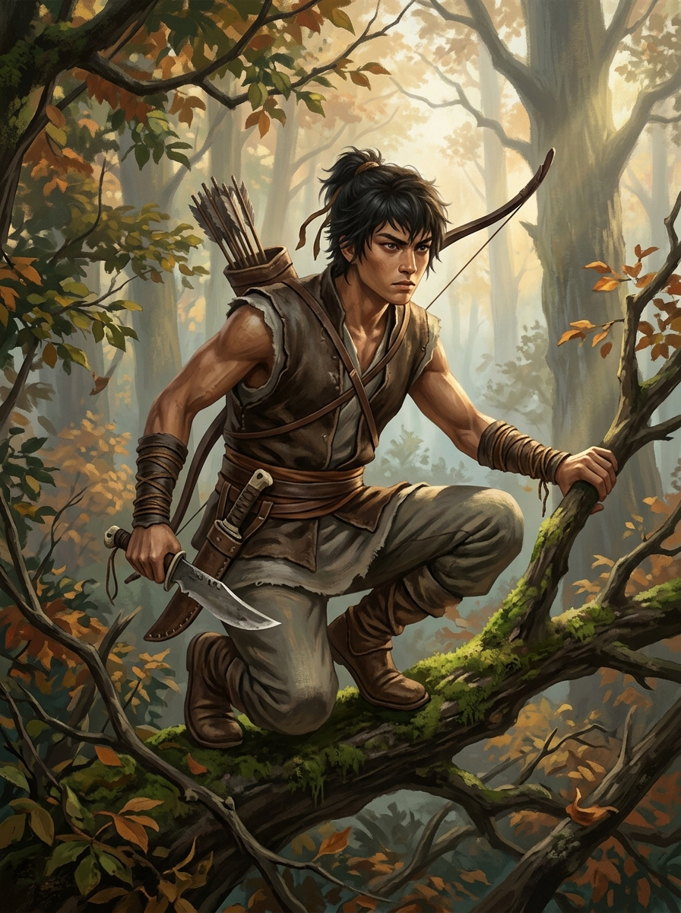

# 角色檔案：燕隼（獵戶之子 / 八方鏢師）

## 基本資訊
* **姓名**：燕隼
* **身世**：獵戶之子 (`hunter`) / 八方武館精銳鏢師
* **年齡**：十六歲
* **當前修為等級**：Lv. 50（Tier 1 圓滿・氣血脫胎・八荒武山保薦）
* **職業與資質**：初階力道武修 / 八方鏢師（持【八方鏢師總帖】`/clone/item/lic_escort_guard.c`、獲頒【Tier 2 名山外門考核令】`/clone/item/tier2_admission_token.c`）
* **外觀**：身形精瘦矯健若黑豹，深蜜色肌膚泛著精金沉凝之色，目光銳利如電，行走間步履無聲。著黑色勁裝武服，外罩護心牛皮甲。
* **隨身舊物與重要器械**：厚背精鋼柴刀、重石鐵胎柘木弓 (`/clone/weapon/heavy_bow.c`)、太古戰神獵獸圖騰骨片、趙老獵雪狼牙箭、玄鐵走山令殘牌 (`/clone/item/shan_token_half.c`)、太古五器合鳴星光指針 (`/clone/item/ancient_relics_compass.c`)
* **出生居所**：林邊茅屋・獵戶哨亭 (`/d/village/hunter_cabin.c`)
* **府城居所與人脈**：八方武館正堂 (`/d/city/east/wu_hall.c`) 與遠行車馬大院；深得武館總教頭霸山與趙猛教頭器重與保薦。
* **引路導師**：老獵戶 趙老獵 (`/clone/npc/zhao_hunter.c`)、總教頭 霸山 (`/clone/npc/wu_bashan.c`)、教頭 趙猛 (`/clone/npc/wu_zhaomeng.c`)

## 性格特質與才能
* **警覺機敏、臨危不亂**：常年在大荒與猛獸搏殺，對殺意、氣流震動與埋伏有著近乎野獸本能的直覺反應。
* **盤石步法、神箭絕技**：步如老樹盤根，身如萬仞重岩；百步穿楊，能在疾馳與狂暴水流中精準索敵與錨定。
* **蠻荒血性（Li / Vitality）**：太古戰神圖騰血脈在激戰中不斷共鳴，受創越重，氣血爆發力與抗壓韌性越強。

## 六維道基與成長軌跡
* **六維屬性（Lv. 50 圓滿）**：
  * **臂力 (`str`)：40**（開五石鐵胎重弓，單手擲起六百斤石鎖）
  * **根骨 (`con`)：38**（氣血脫胎換骨，肉身沉穩如盤石）
  * **身法 (`dex`)：42**（林間縱躍迅如夜隼，近身擒拿快逾疾雷）
  * 悟性 (`int`)：16（領悟獵道真意，動靜由心）
  * 靈性 (`spi`)：12
  * **感知 (`per`)：44**（目力如夜隼，耳聽八方，百丈內風吹草動皆在掌握）
* **掌握專屬技能（Tier 1 圓滿）**：
  * `wu_cuigu` (磐石淬骨功) Lv.100 滿值
  * `wu_qixue` (太古氣血回溯訣) Lv.100 滿值
  * `wu_fuhu` (伏虎擒拿勁) Lv.100 滿值
  * `wu_kaishan` (開山裂石劈) Lv.100 滿值
* **修行親和度**：感知 (PER) 200%, 身法 (DEX) 180%, 根骨 (CON) 140%, 臂力 (STR) 130%, 其餘 100%

## 卷二重大經歷（第 39～82 章・卷二大圓滿）
1. **押解行進中的警戒獵手（Ch. 39～42）**：沿盤木官道一線壓陣，多次提前識破商會密探與伏哨，確保要犯趙德貴在黑石鋪至府城三百里路途未被暗箭滅口。
2. **八方武館四百斤石鎖與盤石試（Ch. 49）**：在武館大校場雙臂擎起四百斤花崗岩重石鎖繞場疾走三十步，並在擂台以純粹的盤石身法硬撼趙猛教頭的三記鐵砂重拳而不退半步，獲霸山總教頭親授【八方鏢師總帖】。
3. **西水門深潭截流錨定（Ch. 56）**：千斤閘遭暴水衝擊懸空時，燕隼負重百斤【截流精鋼索】隻身縱入狂暴泥流暗潭，運起盤石千斤墜深入潭底，將鋼索死死套緊水底地牛玄武樁，穩住整個千斤閘受力平衡。
4. **追捕水關破壞主謀（Ch. 56）**：在西城水門大破後，燕隼隔著暴雨暗箭命中主謀刁建水左膝，生擒黑道水賊，繳獲商會暗號腰牌。
5. **南關夜議六大缺口（Ch. 57）**：整理出「鎮風關轉運通牒」與府城軍械流向異常，揭發城防巡丁勾結外寇走私物資之脈絡。
6. **天風谷口頂風採石（Ch. 61）**：與柳清虛馳赴北塞鎮風縣，以磐石沉錨與神箭引索配合清虛三息風眼計算，於萬仞絕壁採得極品風蝕石英核；折抵軍糧與撫恤，平息邊軍散人流血火併。
7. **雪狼夜襲死守糧站與大伯殘牌（Ch. 62）**：率戍卒死守糧站射殺狼王，獲准調閱衛所五年舊檔，查明商會五年前僱傭大伯燕山持走山令探查北崖血精礦脈；於烽燧起獲大伯箭記【玄鐵走山令殘牌】；恪守五欄鐵律，定為 `corroborative` 級別。
8. **南關匯流（Ch. 67）**：帶回殘牌與舊檔證言，力挺沈泥並準備在三方會審公堂討回公道。
9. **北關烽煙與軍需雙聯火印存根（Ch. 72）**：暗訪城防司披甲兵器庫與百工硝火作，冒死對質當面起獲軍需雷管調撥存根；兩張羊皮紙邊緣鋼齒鋸齒物理咬合嚴絲合縫，正中雙聯騎縫火印直指錢百川妻弟錢百貴，將走私軍需炸毀古礦滅口之罪坐實為 `conclusive` 鐵證！
10. **會審警戒與公堂定讞（Ch. 74～76）**：夜宿小棧擊退兩批前來刺探銷毀物證之死士，以獵戶警覺護持全隊安全；於府衙公堂之上配合蘇凝霜與沈泥呈上雙聯存根與走山令，親眼見證秦正明落印奪官下獄；歷經風暴後更加深知，戰神之力的真正歸宿不是殺戮而是守護。
11. **真氣逆沖與氣血脫胎（Ch. 80）**：大校場直面霸山百鈞重戟壓迫，收束急躁戾氣領悟獵道真意，體內戰神血脈逆沖貫通大周天，經脈骨節雷鳴，突破凡胎極限晉入 Lv.50！
12. **獲八荒武山考核令（Ch. 81）**：憑氣血脫胎與護關實績，獲總教頭霸山親授【Tier 2 名山外門考核令】，受命登天梯修成二階法身再平北荒風雪。
13. **趙老獵狼牙箭與北關出征（Ch. 82）**：接獲趙老獵自黑石鋪捎來之雪狼牙箭簇；小棧五器合鳴直指北方名山，昂首跨出北關踏上仙途大考！

## 卷三第一幕進展（第 83～90 章・實裝於 Act 1）
14. **寒原戒備與退門斷臂武卒（Ch. 83）**：過黑風口識破雪豹窺伺護隊進斷崖石棚驛站（`/d/wastes/north_road/post_station.c`），並從八荒黑山營斷臂退門武卒周鐵山處首次獲悉武山歲貢折銀與傷退外包的殘酷真相。
15. **萬鈞問心谷至黑山營領牌（Ch. 87、90）**：立冬於八荒萬鈞問心谷（`/d/sects/bahuang/gate.c`）依岳停山與唐映軍紀封存多餘箭支，僅攜百斤鐵胎柘木弓與三支三稜鐵箭穿過八十里黑石峽試煉道（`/d/sects/bahuang/black_stone_gorge.c`），精準射殺缺耳鐵背荒狼王（`ironback_wolf`）並護住鬼門彎棄考傷兵；抵達黑山煞血營（`/d/sects/bahuang/black_mountain_camp.c`）時因扣弓壓腕習慣與箭羽護指動作被獨臂老將雷烈認出（暗繫大伯燕山舊案），獲頒【八荒黑山營腰牌】（`/clone/item/cred_bahuang_camp_plate.c`、`v3_act1_bahuang_gorge`）。

## 卷三第二幕進展（第 91～101 章・實裝於 Act 2）
16. **長城殺寒犛與養息院窺見「急鎮丸」（Ch. 93）**：修《煞血霸體訣》刻意壓氣血沉丹田免於衝腦；隨軍登上【北線長城巡防牆】（`/d/sects/bahuang/great_wall_gate.c`）三號豁口兩箭穿殺二階「鐵甲寒犛」（Lv.70 `iron_yak`），嚴守軍紀未追殘敵入三倍地煞之「白霧雪溝」而回護傷兵；子夜經過【傷兵養息院】（`/d/sects/bahuang/restoration_hall.c`）撞見雷烈與老卒吐瀝青黑血、乾吞腥甜硫磺味「定心急鎮丸」，向醫官杜青禾（`du_qinghe`）核對病案並透過朔望貨單密函顧玄協查丹鼎宗線索（`v3_bahuang_bloodline_watch`）。
17. **鬼哭冰澗斷箭與天興十九年火藥秘檔（Ch. 94）**：經長城東側鐵包邊門隨唐映、斥候祁無傷（`qi_wushang`）踏察【鬼哭冰澗】（`/d/sects/bahuang/ghost_cry_gorge.c`），以測冰長鐵簽探冰垂降（`probe ice`），自三尺冰層起獲刻有大伯「燕山箭記」且遭破甲兵刃斜切之斷折骨箭與「八方」舊皮甲（`/clone/item/yanshan_broken_arrow.c`）；經炊事婦人阿滿（`a_man`）於【北線軍寨炊事後勤區】（`/d/sects/bahuang/north_garrison_kitchen.c`）查閱失蹤名冊得悉韓素線索後，於箭樓聞雷烈自首錯簽假撤防密令並取得記載「三十斤千機百巧門烈性開山火藥調往鬼哭冰澗」之【黑山軍需出庫副本】（`/clone/item/bahuang_logistics_copy.c`、`v3_act2_bahuang_ghost_gorge`）。
18. **地窖五方對帳與三分煞血護脈（Ch. 99–100）**：臘月廿三返【泥途商棧地下石室】（`/d/yunjin/mudway_store_cellar.c`）呈上三件物證；在替柳清虛剝除道化晶絲過程中，將《煞血霸體訣》熾烈氣血精準壓制為三分溫和熱力循經脈引導，護住血管免遭星煞反噬寒毒凍裂（`strip filament`、`v3_act2_yunjin_ghost_and_sanyuan`）。

## 卷三第三幕進展（第 102～111 章・實裝於 Act 3）
* **黑冰證遺骸、戰神遺塚覺《沉岳引》與一箭絕殺大執事（`Lv.70 → Lv.85`）**：
  19. **長城互助立誓與血原箭破地龍（Ch. 102–103）**：出【黑山長城北關雪道】（`/d/wastes/black_mountain_pass.c`）攜【阿滿】所託白麵傷藥赴【失蹤者家屬互助所】（`/d/wastes/missing_families_hall.c`），接下【韓素】手中所繪兄長【韓林】銅哨特徵圖立誓必帶回白紙黑字真相；【永凍血原】（`/d/wastes/frozen_blood_plain.c`）立身雪橇頂篷乘清虛報位，百斤重石柘木弓貫穿雙頭霜甲地龍右顎逆鱗死穴（所攜三支黑背雪狼頭骨破甲重箭用一存二）。
  20. **黑冰斷谷九骸磕頭與戰神遺塚「沉岳引」（Ch. 104–105）**：於【黑冰斷谷】（`/d/wastes/black_ice_valley.c`）親眼目睹天興十九年臘月人工炸毀半山之屠殺現場，見胸插制式破甲弩箭、頸佩「北線斥候・乙十七」銅哨之韓林等九具遺骸（`/clone/item/hanlin_copper_whistle.c`、`excavate remains`），又自凹槽搶救出帶「雷……非……」及「山」字落款之【燕山羊皮血書殘片】（`/clone/item/ev3_yanshan_blood_note.c`）與名冊殘頁（`/clone/item/ev3_expedition_roster.c`）後壓抑立即報仇衝動向九骸磕頭立約公開討債；深入【荒古戰神巨石遺塚】（`/d/wastes/war_god_tomb.c`）以【獵獸圖騰骨片】觸動黑色巨柱共振（`resonate totem`），自先民死戰殘影領悟鎖煞於骨髓、收力輪替之古老呼吸節律而踏入約 **Lv.80** 並悟出《八荒破天弓》第一式「沉岳引」，在裂隙邊五尺凍血跡盡頭拾獲砸凹半邊的【燕山精銅護心鏡】（`/clone/item/ev3_heart_guard_mirror.c`；大伯生死仍維持 `open` 待查）；面對堵口之 Lv.82 北荒冰熊王（`ice_bear_king`）傷其咽喉後克制棄追，擲火把拎走祁十六退入暖風裂隙（狼牙重箭剩一支）。
  21. **絕殺私盟大執事與歸還乙十七銅哨（Ch. 109–111）**：東側冷卻豁口以冷箭破燈製造混亂；隨後於【冰谷窄口】（`/d/wastes/ice_valley_exit.c`）隱身三丈高岩把握雪崩驚敵的千分之一息空門，施《沉岳引》以最後一支狼牙重箭百步穿喉斃殺 Lv.88 私盟大執事（`private_league_envoy`）；返關後親手將生鏽銅哨與公證實測名單副本交還韓素並嚴守「燕山失蹤非已亡」原欄，自己穩穩邁入 **Lv.85**，按從大局由雷烈、杜青禾與唐映備妥《急鎮丸依賴與死因統計簿》，靜候雲頂十日後會武直面私盟。

## 卷三第四幕進展（第 112～120 章・實裝於 Act 4）
  22. **點星震王鐵牛與三線呈證（Ch. 112、114、116）**：偏峰試治時以穩健陽剛血氣護元青（`yuan_qing`）心脈；力道組於【青鋼演武場】（`/d/yunjin/tournament_combat_arena.c`）以八荒磐石千斤墜卸開【王鐵牛】（`wang_tieniu`，Lv.89）雙柄血紋宣花斧，連施《八荒破天弓》兩支包鐵鈍頭震盪重箭震碎護心銅甲並震出【王鐵牛私藏暗紅丸藥瓶】（`/clone/item/wang_red_pill_vial.c`）獲勝；Ch. 116 會武高台聯同【雷烈】、【韓素】呈遞乙十七銅哨、燕山血書殘頁與天興十九年千機火藥副本。
  23. **長城西段破圍與重箭破核退骨龍（Ch. 118–120）**：毒域爆發時聽從陸觀瀾喝止不盲衝毒霧、護階疏散數千弟子；獸潮轟塌【長城西段三十丈缺口】（`/d/sects/bahuang/west_wall_breach.c`）後率【祁無傷】躍下三丈城牆殺出三丈血路，護送【韓素】、【阿滿】與三十餘家屬幼童經東側排水石道入二道內關；隨後與【雷烈】、【岳停山】、【唐映】編三百守卒三段輪替拒用全營血祭，服顧玄沸血降燥湯於【巨靈神機】右傾半息間以黑背雪狼頭骨破甲重箭施《八荒破天弓》・破核重創 Lv.95【冰獄骨龍】（`ice_bone_dragon`）左肋舊創迫退獸群；劫後見【鐵背山主】（`tiebei_shanzhu`）親授五份走山隊平反忠烈憑證並立【韓林】等名姓入長城烈士碑，猶對失蹤未明之大伯【燕山】與傷亡名單兩老哨兵銘心難忘。

## 卷三第五幕終局進展（第 121～126 章・實裝於 Act 5）
  24. **《黑山分段輪替操典》暨三百步粉石入 Lv.100（Ch. 122、125）**：在黑山長城修復工地陪【雷烈】、【岳停山】、【杜青禾】與【阿滿】逐頁核校八十七人《北荒陣亡與重傷安置名冊》（含「大伯燕山・黑冰斷谷失聯案備忘頁」），放棄燒血折壽的《煞血霸體訣》，整合戰神遺塚長呼吸、降燥草藥與實戰操演編成《黑山分段輪替操典》（`/clone/item/bahuang_rotation_manual.c`），傍晚箭樓以普通鐵箭無聲將三百步外青岩從內而外震碎成粉，破入**八荒力道二階大圓滿（Lv.100）**（右肩陰雨仍微痠）；離行前收【趙老獵】由【魯大山】代筆「別往死坑裡填」口信，並於黃昏八荒營下收【韓素】所贈幾十戶家屬手縫厚羊毛新護腕。
  25. **西北陣台護衛屏蔽兼尋燕山踪跡入洞天（Ch. 124–126）**：於【封存觀測室】攥緊凹陷【護心鏡】，決意親赴門後一探五年來失蹤之大伯【燕山】落腳何處；子夜於祖庭地底【主傳送室】西北陣台嵌入【太古戰神獵獸圖騰骨片】，運轉沉渾長呼吸放出覆蓋門框之血脈屏蔽場抵抗空間撕扯，並肩衝入青金星門抵達 **Tier 3 荒蕪碎石高原**，卸百斤鐵胎弓遙視西南赤黑裂谷【戰祖魔殿】。
