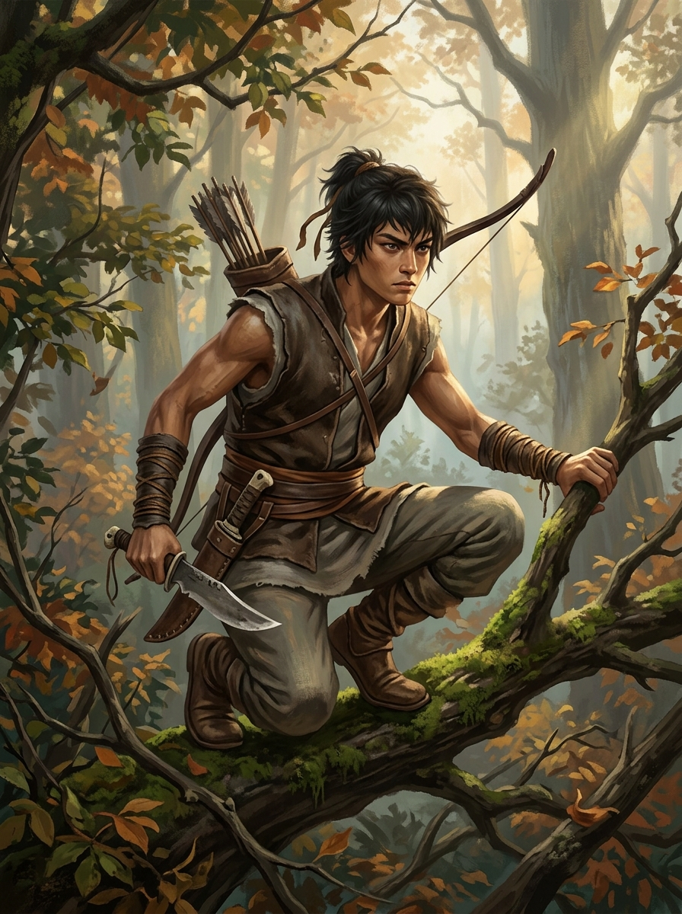

# 角色檔案：燕隼（獵戶之子 / 八方鏢師）

## 基本資訊
* **姓名**：燕隼
* **身世**：獵戶之子 (`hunter`) / 八方武館精銳鏢師
* **年齡**：十六歲
* **當前修為等級**：Lv. 22（金石府城一階大成・六縣匯流期）
* **職業與資質**：初階力道武修 / 八方鏢師（持【八方鏢師總帖】`/clone/item/lic_escort_guard.c`、配備【八方黑鐵腰牌束帶】`/clone/armour/wu_iron_belt.c`）
* **外觀**：身形精瘦矯健若黑豹，深蜜色肌膚，目光銳利如電，行走間步履無聲。著黑色勁裝武服，外罩護心牛皮甲。
* **隨身舊物與重要器械**：厚背精鋼柴刀、重石鐵胎柘木弓 (`/clone/weapon/heavy_bow.c`)、太古戰神獵獸圖騰柱印記、截流精鋼索 (`/clone/item/sluice_cable.c`)、玄鐵走山令殘牌 (`/clone/item/shan_token_half.c`)
* **出生居所**：林邊茅屋・獵戶哨亭 (`/d/village/hunter_cabin.c`)
* **府城居所與人脈**：八方武館正堂 (`/d/city/east/wu_hall.c`) 與遠行車馬大院；深得武館總教頭霸山與趙猛教頭器重。
* **引路導師**：老獵戶 趙老獵 (`/clone/npc/zhao_hunter.c`)、總教頭 霸山 (`/clone/npc/wu_bashan.c`)、教頭 趙猛 (`/clone/npc/wu_zhaomeng.c`)

## 性格特質與才能
* **警覺機敏、臨危不亂**：常年在大荒與猛獸搏殺，對殺意、氣流震動與埋伏有著近乎野獸本能的直覺反應。
* **盤石步法、神箭絕技**：步如老樹盤根，身如萬仞重岩；百步穿楊，能在疾馳與狂暴水流中精準索敵與錨定。
* **蠻荒血性（Li / Vitality）**：太古戰神圖騰血脈在激戰中不斷共鳴，受創越重，氣血爆發力與抗壓韌性越強。

## 六維道基與成長軌跡
* **六維屬性（Lv. 22）**：
  * **臂力 (`str`)：16**（開三石重弓，單手拔起四百斤石鎖）
  * **根骨 (`con`)：15**（盤石硬功初成，硬抗鐵臂教頭三拳氣血不移）
  * **身法 (`dex`)：17**（林間縱躍迅如夜隼，深潭閉氣若水獸）
  * 悟性 (`int`)：7
  * 靈性 (`spi`)：5
  * **感知 (`per`)：18**（目力如夜隼，能辨百丈外水紋異象與弓弩弦震）
* **掌握專屬技能**：
  * `wu_cuigu` (磐石淬骨功) 110級
  * `wu_qixue` (太古氣血回溯訣) 110級
  * `wu_fuhu` (伏虎擒拿勁) 110級
  * `wu_kaishan` (開山裂石劈) 110級
* **修行親和度**：感知 (PER) 200%, 身法 (DEX) 180%, 根骨 (CON) 140%, 臂力 (STR) 130%, 其餘 100%

## 卷二重大經歷（第 39～67 章）
1. **押解行進中的警戒獵手（Ch. 39～42）**：沿盤木官道一線壓陣，多次提前識破商會密探與伏哨，確保要犯趙德貴在黑石鋪至府城三百里路途未被暗箭滅口。
2. **八方武館四百斤石鎖與盤石試（Ch. 49）**：在武館大校場雙臂擎起四百斤花崗岩重石鎖繞場疾走三十步，並在擂台以純粹的盤石身法硬撼趙猛教頭的三記鐵砂重拳而不退半步，獲霸山總教頭親授【八方鏢師總帖】。
3. **西水門深潭截流錨定（Ch. 56）**：千斤閘遭暴水衝擊懸空時，燕隼負重百斤【截流精鋼索】隻身縱入狂暴泥流暗潭，運起盤石千斤墜深入潭底，將鋼索死死套緊水底地牛玄武樁，穩住整個千斤閘受力平衡。
4. **追捕水關破壞主謀（Ch. 56）**：在西城水門大破後，燕隼隔著暴雨暗箭命中主謀刁建水左膝，生擒黑道水賊，繳獲商會暗號腰牌。
5. **南關夜議六大缺口（Ch. 57）**：整理出「鎮風關轉運通牒」與府城軍械流向異常，揭發城防巡丁勾結外寇走私物資之脈絡。
6. **天風谷口頂風採石（Ch. 61）**：與柳清虛馳赴北塞鎮風縣，以磐石沉錨與神箭引索配合清虛三息風眼計算，於萬仞絕壁採得極品風蝕石英核；折抵軍糧與撫恤，平息邊軍散人流血火併。
7. **雪狼夜襲死守糧站與大伯殘牌（Ch. 62）**：率戍卒死守糧站射殺狼王，獲准調閱衛所五年舊檔，查明商會五年前僱傭大伯燕山持走山令探查北崖血精礦脈；於烽燧起獲大伯箭記【玄鐵走山令殘牌】；恪守五欄鐵律，定為 `corroborative` 級別。
8. **南關匯流（Ch. 67）**：帶回殘牌與舊檔證言，力挺沈泥並準備在三方會審公堂討回公道。
