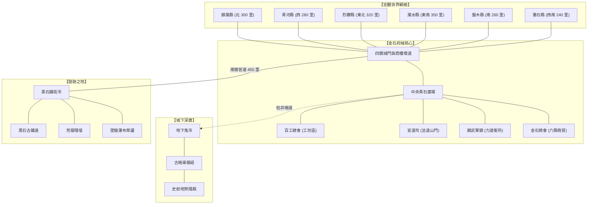

# 《遺忘的世界》全域地圖與空間拓撲總覽 (Maps & Topology)

本目錄匯整了《遺忘的世界》Tier 0（黑石鋪發跡地）與 Tier 1（金石都城及其六縣轄域）的空間拓撲結構、系統地圖輸出與 Mermaid 子圖設計。所有區域均已通過全域 BFS（廣度優先搜尋演算法）100% 可達性與雙向可逆驗證。

---

## 🗺️ 目錄結構

| 檔案 | 內容說明 | 關聯指令 |
| :--- | :--- | :--- |
| [world_map.md](world_map.md) | **宏觀世界網絡圖**：金石府城、六大外縣（91 間房）、官道山徑（22 間房）與黑石鋪地脈關係 | `map world` / `map <county>` |
| [city_map.md](city_map.md) | **金石都城九大分區詳細拓撲圖（75 間房）**：四大城門、百工總會、宣道司、鎮武軍鎮、市井核心與外城生活區 | `map city` |
| [underground_map.md](underground_map.md) | **城下太古暗渠與舊城廢墟圖**：鬼市暗街、古暗渠樞紐、天字一號密室與史前殘殿 | `map under` |
| [village_map.md](village_map.md) | **黑石鋪新手聚落微生態圖（22 間房）**：青石街市、古礦道、三清偏殿、鐵匠鋪、溪灘草廬與村莊生活圈 | `map village` |

---

## 🎮 遊戲內地圖指令指南

玩家與管理者可在遊戲內隨時呼叫由 [`/cmds/cmd_map.c`](../../../cmds/cmd_map.c) 及 [`/secure/map_d.c`](../../../secure/map_d.c) 提供之地圖服務：

```bash
# 1. 檢視當前所在區域地圖（根據當前所在房間自動切換）
map

# 2. 檢視金石都城九大分區總圖
map city

# 3. 檢視黑石鋪新手村微生態圖
map village

# 4. 檢視地下鬼市與太古暗渠廢墟圖
map under

# 5. 檢視全域六縣一府宏觀網絡圖與六大外縣專屬地圖
map world
map panmu
map zhongshi
map qinghe
map zhenfeng
map liefan
map zhuoshui

# 6. 檢視周遭動態雷達小地圖 (自訂可視半徑 1-5 格)
map 2
```

---

## 🌐 空間拓撲總覽 (Full Topology Overview)



---

## 🛡️ 系統環境規則分佈

各地區依據世界觀設定受到 [`/daemon/city_d.c`](../../../daemon/city_d.c) 的動態環境矩陣管轄：

1. **紅塵濁氣梯度 (Turbidity Gradient)**：
   - 市井商貿核心（中央廣場、六縣專材街、大客棧）：`100%`（紅塵萬丈，靈機晦澀）。
   - 修持道統轄區（宣道司太虛三清殿、百工總會天工殿）：`45%`（有陣法防護與定氣香爐）。
   - 外城農田草野（西郊農田、灌溉水渠）：`15%`（野氣初開）。
   - 城下深層廢墟（地下鬼市、古暗渠、殘殿）：`5%`（紅塵隔絕，但受地脈煞氣影響）。
2. **絕靈法網防衛 (Spirit-Sealing Grid)**：
   - 都城市井行政及核心區域受官府法網全面覆蓋，壓制未經報備的高階法術爆發。
   - 地下暗渠、城外荒郊與亂葬塚則位於法網死角之外，不受官府壓制。


---

## Tier 2 名山疆域（第三卷・已全數實裝）

第三卷地圖集於 [`tier2/`](tier2/README.md)，包含太清玄天宮（11 房）、八荒武山（10 房實裝＋2 預留營區 `draft`）、天工閣（8 房）、丹鼎宗（7 房）、雲津仙集暨問道天台（21 房）及北境官道與北荒裂谷／方舟（20 房），合計 **77 間實裝房間**（並於祖庭主傳送室單向接通 Tier 3 初臨點 `/d/realm/peach_plateau.c`）。連同 Tier 0–1 的 **210 間房**（黑石鋪 22 ＋ 金石府城 75 ＋ 六縣 91 ＋ 官道 22），全服合計 **288 間實裝房間**。

**路徑定案**：原草案曾預擬 `/d/mountain/` 總目錄；現已與 `world_setting.md`、`mudlib_lpc_mapping.md` 及實際 LPC 路由統一定案為 `/d/sects/`、`/d/yunjin/` 與 `/d/wastes/`，並已全數通過 `quest_audit.py`、`world_liveness_audit.py`、`novel_mud_sync_audit.py`、`test_v3_act1.c`～`test_v3_act5.c` 及從 `/d/village/square.c` 出發之全圖 BFS 連通驗證（僅 Tier 3 單向高原依正典設為 `enter gate` 進入）。
