# 金石都城九大分區詳細拓撲圖 (City Map)

金石府城為 Tier 1 區域網絡的政治、商貿、工匠與武衛中心。全城被護城河與高聳城牆環繞，由外城四關門戶進出，內部分為九大核心分區；經過 Phase 1–2A 擴建後，全區共有 **75 間實裝房間**（中樞 13、百工 10、宣道 5、軍鎮 6、南市商貿 10、城門 8、外城近郊 9、城牆角樓護城河 9、地下暗渠 5）。

---

## 💻 遊戲內指令輸出 (`map city`)

當玩家在遊戲內輸入 `map city` 或身處都城區輸入 `map` 時，顯示如下 ASCII 空間地圖：

```text
【金石都城九大分區空間地圖】
──────────────────────────────────────────────────────────
                        [外城大車馬店]
                              │
      [亂葬義塚] ─── 【金石北關】 ── (北城望荒箭樓)
                             │
  [官道大貨棧] ─── [北關前校場] ─── [關外車馬店]
                             │
    [匠籍登記處] ─── 【百工總會】 ─── (分業工坊街：鍛/木/石/革/藥/硝)
                             │
  【宣道司】 ────── 【中央青石廣場】 ────── 【鎮武軍鎮】 ─── 【東關城門】
   (玄機真人)          (士民商貿)          (霸山總教頭)      (烈礬/濁水)
   (摘星台/偏殿)       ┌─────┴─────┐          (大校場/生死擂)
   (聽經閣)        [府衙正堂]   [通寶錢莊]     (披甲兵器庫)
                       │           │
                   [學塾/醫館]  [通寶當鋪] ── [鬼市暗巷] (下通城下暗渠)
                       └─────┬─────┘
                             │
                        [六縣專材長街] ─── [金石商會總堂]
                             │                 │
                        [大料初堆棧] ─── [遠行車馬大院]
                             │
  【西水門】 ────── 【金石南關】 ─── [南關車馬小棧]
 (青河水路漕運)              │
                             │ (南嶺官道)
                             ▼
                     往 【黑石鋪】 聚落
──────────────────────────────────────────────────────────
```

---

## 🗺️ 九大分區結構化 Mermaid 拓撲子圖

```mermaid
flowchart TD
    %% ─────────────────────────────────────────────────────────────
    %% 1. 北門與外城貨運分區
    %% ─────────────────────────────────────────────────────────────
    subgraph NorthGateSub["【金石北關與外城樞紐】"]
        GATE_N["金石北關 (gate_north)"]
        GATE_N_PLAZA["北關前校場 (gate_plaza)"]
        GATE_N_DEPOT["外城大車馬店 (post_depot)"]
        GATE_N_WAREHOUSE["官道大貨棧 (gate_warehouse)"]
        GATE_N_INN["關外車馬店 (gate_inn)"]
        GRAVEYARD["亂葬義塚 (graveyard)"]
        TOWER_N["北城望荒箭樓 (wall_tower_n)"]

        GATE_N_DEPOT --- GATE_N
        GRAVEYARD --- GATE_N
        GATE_N --- TOWER_N
        GATE_N --- GATE_N_PLAZA
        GATE_N_WAREHOUSE --- GATE_N_PLAZA --- GATE_N_INN
    end

    %% ─────────────────────────────────────────────────────────────
    %% 2. 百工總會工坊分區 (物道)
    %% ─────────────────────────────────────────────────────────────
    subgraph GongSub["【百工總會工坊分區 (物道統)】"]
        GONG_GATE["百工總會大門 (gong_gate)"]
        GONG_REG["匠籍登記處 (gong_registry)"]
        GONG_HALL["天工殿堂 (gong_hall)"]
        GONG_FORGE["鍛鐵金石坊 (gong_forge)"]
        GONG_WOOD["機巧木作坊 (gong_wood)"]
        GONG_STONE["精研石雕坊 (gong_stone)"]
        GONG_LEATHER["百鞣皮甲坊 (gong_leather)"]
        GONG_ALCH["丹丸物性坊 (gong_alchemy)"]
        GONG_FIRE["烈性火硝坊 (gong_fireworks)"]

        GONG_GATE --- GONG_REG
        GONG_GATE --- GONG_HALL
        GONG_HALL --- GONG_FORGE
        GONG_HALL --- GONG_WOOD
        GONG_HALL --- GONG_STONE
        GONG_HALL --- GONG_LEATHER
        GONG_HALL --- GONG_ALCH
        GONG_HALL --- GONG_FIRE
        GONG_FORGE --- SCRAP_YARD["官造廢鐵回爐區 (scrap_yard)"]
    end

    %% ─────────────────────────────────────────────────────────────
    %% 3. 宣道司道統分區 (法道)
    %% ─────────────────────────────────────────────────────────────
    subgraph DaoSub["【宣道司分區 (法道統)】"]
        DAO_GATE["宣道司山門 (dao_gate)"]
        DAO_HALL["太虛三清殿 (dao_hall)"]
        DAO_OBS["摘星台 (dao_observatory)"]
        DAO_ROOF["聽經閣 (dao_roof)"]
        DAO_QUIET["清修靜室 (dao_quiet)"]

        DAO_GATE --- DAO_HALL
        DAO_HALL --- DAO_OBS
        DAO_HALL --- DAO_ROOF
        DAO_HALL --- DAO_QUIET
    end

    %% ─────────────────────────────────────────────────────────────
    %% 4. 中央市井與府衙核心
    %% ─────────────────────────────────────────────────────────────
    subgraph CenterSub["【中央市井與政務核心】"]
        SQUARE["中央青石廣場 (square)"]
        YAMEN["府衙正堂 (yamen)"]
        YAMEN_ARCH["案牘庫 (yamen_archive)"]
        YAMEN_PRIS["府衙大牢 (yamen_prison)"]
        GRANARY["官平糧倉 (granary)"]
        ACADEMY["流泉學塾 (academy)"]
        CLINIC["百草堂醫館 (clinic)"]
        BANK["通寶錢莊 (bank)"]
        PAWNSHOP["聚珍當鋪 (pawnshop)"]
        BLACK_ALLEY["鬼市暗巷 (black_alley)"]
        INN_MAIN["金石大客棧 (inn_main)"]
        TEA_ALLEY["槐蔭茶肆 (tea_alley)"]
        POST_STATION["官辦驛傳總所 (post_station)"]

        SQUARE --- YAMEN
        YAMEN --- YAMEN_ARCH
        YAMEN --- YAMEN_PRIS
        SQUARE --- ACADEMY
        ACADEMY --- CLINIC
        SQUARE --- BANK
        BANK --- PAWNSHOP
        PAWNSHOP --- BLACK_ALLEY
        SQUARE --- INN_MAIN
        INN_MAIN --- TEA_ALLEY
        INN_MAIN --- GRANARY
        SQUARE --- POST_STATION
    end

    %% ─────────────────────────────────────────────────────────────
    %% 5. 鎮武軍鎮衛所分區 (力道)
    %% ─────────────────────────────────────────────────────────────
    subgraph WuSub["【鎮武軍鎮衛所 (力道統)】"]
        WU_GATE["軍鎮大閘門 (wu_gate)"]
        WU_PLAZA["演武大校場 (wu_plaza)"]
        WU_ARENA["黑鐵生死擂 (wu_arena)"]
        WU_HALL["偏將軍帳 (wu_hall)"]
        WU_ARMORY["披甲兵器庫 (wu_armory)"]
        WU_BARRACKS["鎮武兵營 (wu_barracks)"]

        WU_GATE --- WU_PLAZA
        WU_PLAZA --- WU_ARENA
        WU_PLAZA --- WU_HALL
        WU_HALL --- WU_ARMORY
        WU_HALL --- WU_BARRACKS
    end

    %% ─────────────────────────────────────────────────────────────
    %% 6. 南部商貿與六縣大料棧
    %% ─────────────────────────────────────────────────────────────
    subgraph SouthSub["【南部商貿與大料分區】"]
        MARKET_SPEC["六縣專材長街 (market_special)"]
        SHANG_HQ["金石商會總堂 (shanghui_hq)"]
        CARAVAN_YARD["遠行車馬大院 (caravan_yard)"]
        WAREHOUSE_SHANG["商會一至三號大庫 (warehouse_shang)"]
        YARD_MAT["大料初堆棧 (yard_material)"]
        GRAIN_MKT["米糧行市 (grain_market)"]
        WINE_TAVERN["金石老酒肆 (wine_tavern)"]
        DYE_ALLEY["染坊窄巷 (dye_alley)"]
        CANAL["青河漕運水關 (canal)"]
        RIVER_WHARF["外城貨運碼頭 (river_wharf)"]
        FISH_MKT["外城河埠魚市 (fish_market)"]
        WAREHOUSE_GRN["義倉常平窖 (warehouse_grain)"]

        MARKET_SPEC --- SHANG_HQ
        SHANG_HQ --- CARAVAN_YARD --- WAREHOUSE_SHANG
        MARKET_SPEC --- YARD_MAT
        MARKET_SPEC --- GRAIN_MKT
        GRAIN_MKT --- WINE_TAVERN --- DYE_ALLEY
        GRAIN_MKT --- CANAL --- RIVER_WHARF --- FISH_MKT
        GRAIN_MKT --- WAREHOUSE_GRN
    end

    %% ─────────────────────────────────────────────────────────────
    %% 7. 外城門戶、水門與官道
    %% ─────────────────────────────────────────────────────────────
    subgraph GateOuterSub["【城門門戶與郊道生活區】"]
        GATE_E["金石東關 (gate_east)"]
        GATE_W["金石西關 (gate_west)"]
        GATE_S["金石南關 (gate_south)"]
        GATE_S_INN["南關車馬小棧 (gate_south_inn)"]
        FARMLAND["西郊官田 (farmland_w)"]
        IRRIGATION["引水渠壩 (irrigation)"]
        MOAT["護城河暗港 (moat)"]
        SOUTH_ROAD["南嶺官道 (south_road)"]
        TENEMENT["流民賃居矮巷 (tenement_alley)"]
        CHARITY_SHED["施藥義棚 (charity_clinic_shed)"]

        GATE_S --- GATE_S_INN
        GATE_S --- SOUTH_ROAD
        SOUTH_ROAD --- TENEMENT --- CHARITY_SHED
        GATE_W --- FARMLAND --- IRRIGATION
        FARMLAND --- MOAT
    end

    %% ─────────────────────────────────────────────────────────────
    %% 8. 巡城青石步道環線
    %% ─────────────────────────────────────────────────────────────
    subgraph WallLoopSub["【巡城步道與四方角樓】"]
        WALL_S["巡城南步道 (wall_path_s)"]
        WALL_E["巡城東步道 (wall_path_e)"]
        WALL_N["巡城北步道 (wall_path_n)"]
        WALL_W["巡城西步道 (wall_path_w)"]
        TOWER_S["南城哨樓 (wall_tower_s)"]
        TOWER_E["東關箭樓 (wall_tower_e)"]
        TOWER_W["西關譙樓 (wall_tower_w)"]

        WALL_S --- TOWER_E --- WALL_E
        WALL_E --- TOWER_N --- WALL_N
        WALL_N --- TOWER_W --- WALL_W
        WALL_W --- TOWER_S --- WALL_S
    end

    %% ─────────────────────────────────────────────────────────────
    %% 核心跨區連線
    %% ─────────────────────────────────────────────────────────────
    GATE_N_PLAZA --- GONG_GATE
    GONG_GATE --- SQUARE
    SQUARE --- MARKET_SPEC
    MARKET_SPEC --- GATE_S

    DAO_GATE --- SQUARE
    SQUARE --- WU_GATE

    GATE_W --- DAO_GATE
    WU_GATE --- GATE_E

    GATE_S --- WALL_S
    GATE_E --- WALL_E
    GATE_N --- WALL_N
    GATE_W --- WALL_W

    BLACK_ALLEY -.->|down 枯井暗道| UNDER_MARKET["【地下鬼市】 (城下暗渠)"]
    SOUTH_ROAD ---|southwest 450 里| HEISHIPU["往【黑石鋪】新手發跡地"]
```



---

## 🏛️ 房間清單與環境矩陣 (75 間都城實裝房間)

| 分區 | 檔案路徑 | 名稱 | 濁氣指數 | 絕靈法網 | 核心 NPC / 機制 |
| :--- | :--- | :--- | :---: | :---: | :--- |
| **中央核心** | [`center/square.c`](../../../d/city/center/square.c) | 中央青石廣場 | 100% | 覆蓋 | 四通八達樞紐 |
| | [`center/yamen.c`](../../../d/city/center/yamen.c) | 金石府衙正堂 | 90% | 覆蓋 | 府尹文承敬、通緝與入籍 |
| | [`center/yamen_archive.c`](../../../d/city/center/yamen_archive.c) | 案牘庫 | 80% | 覆蓋 | 戶籍、地契密檔 |
| | [`center/yamen_prison.c`](../../../d/city/center/yamen_prison.c) | 府衙大牢 | 95% | 覆蓋 | 刑具、禁魔牢籠 |
| | [`center/granary.c`](../../../d/city/center/granary.c) | 官平糧倉 | 90% | 覆蓋 | 府城儲糧重地 |
| | [`center/academy.c`](../../../d/city/center/academy.c) | 流泉學塾 | 70% | 覆蓋 | 陸夫子、讀書識字 |
| | [`center/clinic.c`](../../../d/city/center/clinic.c) | 百草堂醫館 | 75% | 覆蓋 | 白芷醫師、療傷解毒、濁氣淨化 |
| | [`center/bank.c`](../../../d/city/center/bank.c) | 通寶錢莊 | 95% | 覆蓋 | 存提款、銀票匯兌 |
| | [`center/pawnshop.c`](../../../d/city/center/pawnshop.c) | 聚珍當鋪 | 95% | 覆蓋 | 賈掌櫃、典當淘寶 |
| | [`center/black_alley.c`](../../../d/city/center/black_alley.c) | 鬼市暗巷 | 90% | 死角 | 暗道枯井（通往城下鬼市） |
| | [`center/inn_main.c`](../../../d/city/center/inn_main.c) | 金石大客棧 | 100% | 覆蓋 | 歇腳恢復、客棧小二 |
| | [`center/post_station.c`](../../../d/city/center/post_station.c) | 官辦驛傳總所 | 95% | 覆蓋 | 官道通關文牒、急件快遞 |
| **百工總會** | [`north/gong_gate.c`](../../../d/city/north/gong_gate.c) | 百工總會大門 | 65% | 覆蓋 | 工匠守衛、物道入門指引 |
| | [`north/gong_registry.c`](../../../d/city/north/gong_registry.c) | 匠籍登記處 | 55% | 覆蓋 | 魯長生、考核與專利授權 |
| | [`north/gong_hall.c`](../../../d/city/north/gong_hall.c) | 天工殿堂 | 45% | 覆蓋 | 歐陽玄會長、轉職考核、墨玉尺 |
| | [`north/gong_forge.c`](../../../d/city/north/gong_forge.c) | 鍛鐵金石坊 | 50% | 覆蓋 | 莫大錘、兵甲鍛造 |
| | [`north/gong_wood.c`](../../../d/city/north/gong_wood.c) | 機巧木作坊 | 50% | 覆蓋 | 機巧傀儡、機關盒 |
| | [`north/gong_stone.c`](../../../d/city/north/gong_stone.c) | 精研石雕坊 | 50% | 覆蓋 | 符印基石、靈石打磨 |
| | [`north/gong_leather.c`](../../../d/city/north/gong_leather.c) | 百鞣皮甲坊 | 50% | 覆蓋 | 異獸鞣皮、輕甲防禦 |
| | [`north/gong_alchemy.c`](../../../d/city/north/gong_alchemy.c) | 丹丸物性坊 | 50% | 覆蓋 | 藥渣萃取、清心散合成 |
| | [`north/gong_fireworks.c`](../../../d/city/north/gong_fireworks.c) | 烈性火硝坊 | 50% | 覆蓋 | 硫礬火器、霹靂信號彈 |
| **宣道司** | [`west/dao_gate.c`](../../../d/city/west/dao_gate.c) | 宣道司山門 | 60% | 覆蓋 | 道童迎客、入觀法規 |
| | [`west/dao_hall.c`](../../../d/city/west/dao_hall.c) | 太虛三清殿 | 45% | 覆蓋 | 玄機真人、法道入門、引氣訣 |
| | [`west/dao_observatory.c`](../../../d/city/west/dao_observatory.c) | 摘星台 | 35% | 覆蓋 | 行遠道人、星宿推演、渾天鏡 |
| | [`west/dao_roof.c`](../../../d/city/west/dao_roof.c) | 聽經閣頂層 | 35% | 覆蓋 | 高層冥想、神識演練 |
| | [`west/dao_quiet.c`](../../../d/city/west/dao_quiet.c) | 清修靜室 | 40% | 覆蓋 | 闢穀定境、驅除心魔 |
| **鎮武軍鎮** | [`east/wu_gate.c`](../../../d/city/east/wu_gate.c) | 軍鎮大閘門 | 70% | 覆蓋 | 鐵甲衛士、軍紀盤查 |
| | [`east/wu_plaza.c`](../../../d/city/east/wu_plaza.c) | 演武大校場 | 60% | 覆蓋 | 霸山總教頭、力道轉職、黑鐵腰牌 |
| | [`east/wu_arena.c`](../../../d/city/east/wu_arena.c) | 黑鐵生死擂 | 65% | 覆蓋 | 趙猛裁判、切磋比武 |
| | [`east/wu_hall.c`](../../../d/city/east/wu_hall.c) | 偏將軍帳 | 60% | 覆蓋 | 軍令發布、大荒煞潮軍報 |
| | [`east/wu_armory.c`](../../../d/city/east/wu_armory.c) | 披甲兵器庫 | 65% | 覆蓋 | 軍鎮鐵戟、百煉玄鐵甲 |
| | [`east/wu_barracks.c`](../../../d/city/east/wu_barracks.c) | 鎮武兵營 | 65% | 覆蓋 | 駐軍歇息所 |
| **南部商貿** | [`south/market_special.c`](../../../d/city/south/market_special.c) | 六縣專材長街 | 100% | 覆蓋 | 六縣珍異特產交流 |
| | [`south/shanghui_hq.c`](../../../d/city/south/shanghui_hq.c) | 金石商會總堂 | 95% | 覆蓋 | 會長錢百川、商盟憑證 |
| | [`south/caravan_yard.c`](../../../d/city/south/caravan_yard.c) | 遠行車馬大院 | 95% | 覆蓋 | 商隊組織、鏢局招募 |
| | [`south/yard_material.c`](../../../d/city/south/yard_material.c) | 大料初堆棧 | 90% | 覆蓋 | 粗料卸載、初階分類 |
| | [`south/grain_market.c`](../../../d/city/south/grain_market.c) | 米糧行市 | 95% | 覆蓋 | 盤木大米、粗糧交易 |
| | [`south/canal.c`](../../../d/city/south/canal.c) | 青河漕運水關 | 80% | 覆蓋 | 水運貨船、擺渡碼頭 |
| | [`south/warehouse_grain.c`](../../../d/city/south/warehouse_grain.c) | 義倉常平窖 | 85% | 覆蓋 | 平抑物價、糧款備庫 |
| **城門外城** | [`gate/gate_south.c`](../../../d/city/gate/gate_south.c) | 金石南關 | 80% | 覆蓋 | 盤查守軍、南出官道大門 |
| | [`gate/gate_north.c`](../../../d/city/gate/gate_north.c) | 金石北關 | 75% | 覆蓋 | 迎風要道、出北荒門戶 |
| | [`gate/gate_east.c`](../../../d/city/gate/gate_east.c) | 金石東關 | 80% | 覆蓋 | 東出烈礬/濁水門戶 |
| | [`gate/gate_west.c`](../../../d/city/gate/gate_west.c) | 金石西關 | 75% | 覆蓋 | 西往青河門戶 |
| | [`outer/south_road.c`](../../../d/city/outer/south_road.c) | 南嶺官道 | 20% | 無 | 直通黑石鋪新手村（450里） |
| | [`outer/farmland_w.c`](../../../d/city/outer/farmland_w.c) | 西郊官田 | 15% | 無 | 城西郊野、百工藥田 |
| | [`outer/irrigation.c`](../../../d/city/outer/irrigation.c) | 引水渠壩 | 10% | 無 | 青河引水水利設施 |
| | [`outer/graveyard.c`](../../../d/city/outer/graveyard.c) | 亂葬義塚 | 10% | 無 | 北門外亂墳崗、陰煞初現 |
| | [`outer/post_depot.c`](../../../d/city/outer/post_depot.c) | 外城大車馬店 | 60% | 無 | 北門外大宗牲畜車馬歇息地 |
| **生活擴建＆城門補充** | [`center/tea_alley.c`](../../../d/city/center/tea_alley.c) | 城中・槐蔭茶肆 | 90% | 覆蓋 | 茶博士老林 (`tea_doctor_lin`)、茶肆市井聽風 |
| | [`north/scrap_yard.c`](../../../d/city/north/scrap_yard.c) | 百工坊外・官造廢鐵回爐區 | 65% | 覆蓋 | 老匠工 (`county_worker`)、廢鐵回爐檢料 |
| | [`south/warehouse_shang.c`](../../../d/city/south/warehouse_shang.c) | 金石商會・一至三號大庫 | 95% | 覆蓋 | 丁鐵鎖 (`warehouse_shang_chief`)、商會大庫暗貨線索 |
| | [`south/wine_tavern.c`](../../../d/city/south/wine_tavern.c) | 城南水陸・金石老酒肆 | 95% | 覆蓋 | 跑商陳大牙 (`tavern_merchant`)、`PHASE_D` 樞紐劇本與《跑商聽風》 |
| | [`south/dye_alley.c`](../../../d/city/south/dye_alley.c) | 金石城南・染坊窄巷 | 85% | 覆蓋 | 老匠工 (`county_worker`)、染坊日常作業 |
| | [`outer/river_wharf.c`](../../../d/city/outer/river_wharf.c) | 青河入城・外城貨運碼頭 | 65% | 無 | 挑夫阿福 (`roaming_porter`) 與碼頭搬運工 |
| | [`outer/fish_market.c`](../../../d/city/outer/fish_market.c) | 青河入城・外城河埠魚市 | 65% | 無 | 魚販劉三娘 (`fishmonger_liu`)、鮮魚議價與市井口徑 |
| | [`outer/tenement_alley.c`](../../../d/city/outer/tenement_alley.c) | 南關外・流民賃居矮巷 | 60% | 無 | 孫老車夫 (`sun_old_carter`)、《暫住牌》、2 文通鋪／3 文菜粥、`PHASE_D` 樞紐與《家書代筆》 |
| | [`outer/charity_clinic_shed.c`](../../../d/city/outer/charity_clinic_shed.c) | 南關外・施藥義棚 | 55% | 無 | 義診老藥工周伯 (`charity_herbalist`)、流民免費義診 |
| | [`gate/gate_plaza.c`](../../../d/city/gate/gate_plaza.c) | 北關門內・前校場 | 75% | 覆蓋 | 巡防副將雷震 (`gate_plaza_deputy`) |
| | [`gate/gate_inn.c`](../../../d/city/gate/gate_inn.c) | 北關門前・關外車馬店 | 70% | 覆蓋 | 店小二老皮 (`gate_inn_laopi`) |
| | [`gate/gate_warehouse.c`](../../../d/city/gate/gate_warehouse.c) | 北關門側・官道大貨棧 | 75% | 覆蓋 | 驗貨掌櫃金算盤 (`gate_warehouse_assessor`) |
| | [`gate/gate_south_inn.c`](../../../d/city/gate/gate_south_inn.c) | 南關門下・車馬小棧 | 80% | 覆蓋 | 老劉 (`gate_south_inn_laoliu`)、流民牙子刁小七、蘇凝霜 |
| **城牆護城河 (9 房)** | `wall/wall_path_{n,e,s,w}.c`、`wall/wall_tower_{n,e,s,w}.c`、`wall/moat.c` | 巡城步道與四方箭樓／護城深河 | 30~60% | 部分 | 嚴目、百步楊、耿烽、水連環與獨釣叟（`moat` 潛入暗渠 `drain_gate`） |
| **城下暗渠 (5 房)** | `under/{black_market,canal_hub,drain_gate,shang_secret,ruins_hall}.c` | 地下鬼市、古暗渠樞紐、水閘、密室、史前殘殿 | 5% | 死角 | 鬼見愁、擺渡盲叟、翻江鼠；詳見 [`underground_map.md`](underground_map.md) |
