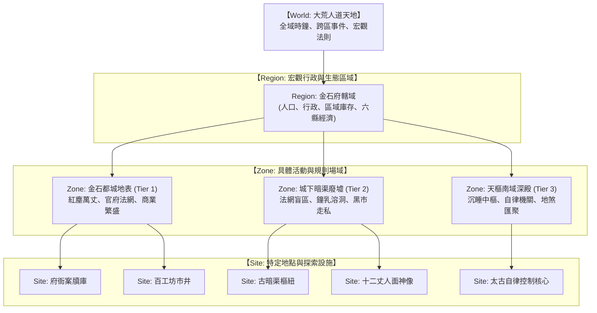
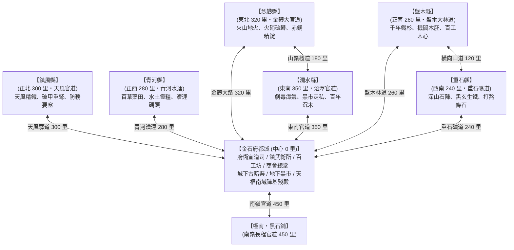
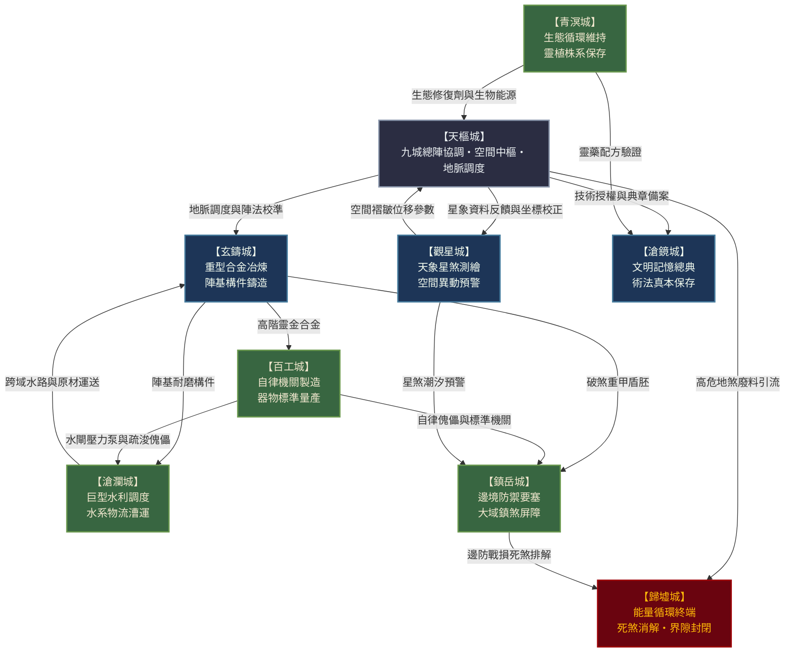
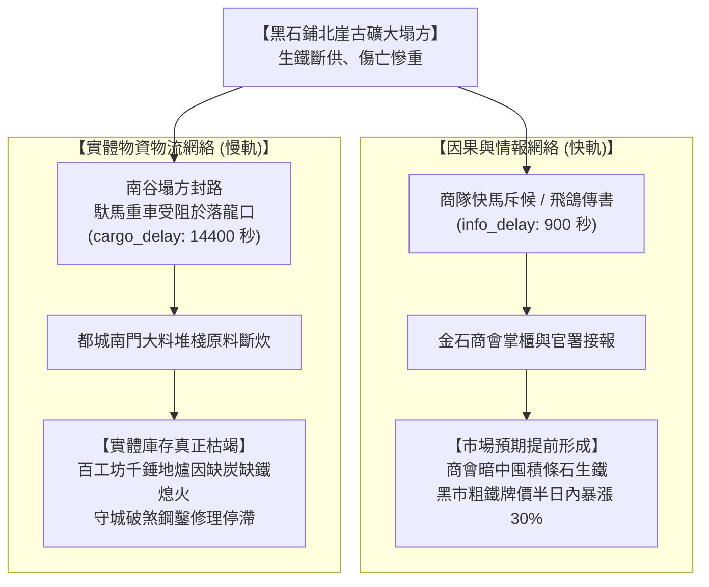

# 《遺忘的世界》太古九城宏觀輿圖暨空間拓撲圖集
## Macro Nine Cities Atlas & Spatial Topology Compendium

> **文件定位**：世界地理、空間層級、交通網絡與太古文明遺址的宏觀拓撲定義  
> **文件版本**：v1.0 (Phase 1 拓撲規範定案版)  
> **所屬架構**：Mudlib 宏觀擴建與太古九城系統 v3.1  
> **文件路徑**：`forgotten-space/narrative/docs/maps/macro_nine_cities_atlas.md`  
> **正典依據**：`forgotten-space/world/lore/nine_cities_canon.md`  
> **適用範圍**：小說地理敘事、Mudlib 世界模型、區域模擬、交通與事件傳播

---

## 一、文件目的與使用原則

### 1.1 文件目的

本文件定義《遺忘的世界》的宏觀空間結構，建立現代世界、太古九城遺跡、交通路網與文明遺產之間的對應關係。

本文件不是一張一次繪製完成的死板地圖，而是世界空間拓撲的持續性記錄與動態演算規範。

核心任務包括：

1. **建立現代世界的宏觀地理層級**：釐清大荒世界之大疆域、都城、要塞與邊陲。
2. **定義三層空間結構**：以 `Region`（宏觀區域）、`Zone`（具體場域）、`Site`（特定地點/設施）作為空間解耦標準。
3. **對齊小說與 Mudlib 既有地理**：全面收錄黑石鋪、金石都城、大荒六縣、雲津仙集、北海寒原與桃花源洞天之已實裝空間（305 房間節點、668 條雙向可逆出口）。
4. **標記太古九城與現代地理關聯**：以「太古文明機能」錨定現代殘存據點，杜絕建立靜態空城。
5. **嚴格區隔雙重網絡**：將「現代交通網絡」與「太古文明依存網絡」徹底解耦。
6. **建立雙軌傳播規則**：明確區分「實體交通物流」與「因果資訊傳播」之傳播時滯與衰減。
7. **保留未知空間迷霧**：保護尚未發現、尚未測繪及尚未開放的探索縱深。

### 1.2 核心憲章

> **敘事世界是生活世界的一個切面，而不是生活世界的全部。**

小說中的人物只會走過世界的一部分道路，接觸一部分人物與遺跡；Mudlib 所模擬的世界則必須具備小說未曾正面描寫的區域、資源、人口、交通、勢力及事件。

因此，所有世界建構與系統開發必須遵守以下憲章：

1. **未寫不代表不存在**：小說沒有描寫，不代表客觀地理世界不存在。
2. **未實裝不代表無空間**：Mudlib 尚未撰寫具體 LPC 房間，不代表宏觀地圖上該區域不存在。
3. **未發現不代表未放置**：玩家與世俗凡人尚未發現，不代表史前深層遺跡不存在。
4. **未標示不代表無路徑**：宏觀地圖沒有畫出線段，不代表荒野山川間不存在羊腸小道或水下走私暗渠。
5. **文明依存不等於現代直通**：兩座古代城池在太古時期有深層機能協調，不代表現代存在直達道路。

### 1.3 三項保留原則

本文件嚴格遵守正典文件（`nine_cities_canon.md`）確立的邊界保護原則：

* **不補精確空間座標**：不為太古九城、地下遺跡或未知區域擅自指定絕對經緯度、公里數、方位角或精確深海/地下深度。除非小說正文、現有地圖或 Mudlib 實測資料已有明確依據，否則只記錄相對拓撲關係。
* **不補完整交通走廊**：不為九城預先鋪設完整的現代官道、航道或古代傳送陣網絡。只記錄已確認的交通節點，將未竟通道留給世界事件與後續探索測繪。
* **不補所有遺跡清單**：不將九城周邊所有機關、倉庫、地下設施與文明殘跡一次列完。遺跡必須由世界事件、考古調查、情報買賣與主線推進逐步解鎖。

---

## 二、宏觀地理空間模型

### 2.1 四維正交空間模型

世界空間採用四個互相獨立的維度描述：

| 維度 | 定義 | 核心問題 | 核心原則 |
|:---|:---|:---|:---|
| **Spatial Network** | 地理與交通拓撲 | 地點之間如何連接？ | 節點與連線之圖論網絡，管理距離、路況、通行代價 |
| **Danger Tier** | 場域危險層級 | 進入後面臨什麼危險？ | Tier 0（凡俗）至 Tier 4（虛空裂隙），管理怪物強度與環境抗性 |
| **Civilization Level** | 文明與技術層次 | 該地區具備何種文明能力？ | 凡俗農耕、古代工藝、宗門修煉至史前太古自律中樞 |
| **World Influence** | 世界影響力 | 該地區對其他區域產生什麼影響？ | 經濟物資定價、軍事封鎖、地脈震盪、傳聞擴散半徑 |

四者不可互相替代：
* 一座繁華熱鬧的現代都城（金石府城），地表是 Tier 1，底層卻直接坐落於 Tier 3 的太古高危陣基廢墟之上。
* 一個文明技術極高的太古封存庫（滄鏡城石窟），其自律防禦可能已斷能沉寂，但殘留的符文依然致命。
* 一座深埋地底尚未開放的古城，其地脈異動仍會透過宏觀因果，影響數百里外礦山的礦石產量與物價。

> [!IMPORTANT]
> **Tier 嚴格屬於 Zone 或 Site，絕不屬於 Region！**  
> 一個 Region 的標記僅代表其主要行政或活動基調，允許在 low-Tier Region 內部存在 high-Tier Site。

### 2.2 空間階層架構 (Region ➔ Zone ➔ Site)

世界統一採用三層嵌套架構：



#### 空間層級特性清單

1. **Region（宏觀區域）**：
   - 代表獨立的行政單元、經濟圈或自然生態地理。
   - 負責管理：總人口統計、宏觀資源庫存（生鐵、靈穀、石料）、府衙/宗門總體勢力評級、跨區交通路由接口。
   - 範例：`region_heishipu`（黑石鋪）、`region_jinshi`（金石都城暨大荒六縣）、`region_yunjin`（雲津仙集）。

2. **Zone（具體場域）**：
   - 具有統一環境規則、危險度（Tier）與感知特性的空間集合。
   - 負責管理：光照與天候影響、紅塵濁氣濃度、法網禁制強度、環境危險代價（如低溫凍傷、地煞侵蝕）。
   - 範例：`zone_jinshi_surface`（都城地表，Tier 1）、`zone_jinshi_underground`（城下暗渠，Tier 2）、`zone_tianshu_deep`（天樞深殿，Tier 3）。

3. **Site（特定地點或設施）**：
   - 具備特定功能、建築群、機關或探索入口的具體房間節點集合。
   - 負責管理：具體 LPC 房間實體、NPC 駐留、三階段探索檢定（Discovery/Access/Survival）、任務交互觸發點。
   - 範例：`site_ruins_hall`（史前殘殿）、`site_canal_hub`（古暗渠樞紐）、`site_baigong_forge`（百工千錘地爐）。

### 2.3 區域與場域的八重開放狀態

空間的存在與玩家是否能進入，是兩個完全解耦的狀態維度：

| 狀態代碼 | 狀態名稱 | 具體意義與系統表現 |
|:---|:---|:---|
| `UNKNOWN` | 未知未覺 | 世界資料庫已定義該 Site，但無任何 NPC 或玩家知曉，不對外公開任何線索。 |
| `RUMORED` | 傳聞風聲 | 市井、茶棚或古籍中流傳模糊線索，玩家可從 NPC 口中打聽到隻字片語。 |
| `DISCOVERED` | 已確認存在 | 玩家或探險者抵達外圍或勘驗出實體入口，地圖系統標記該地點名稱。 |
| `MAPPED` | 已測繪路徑 | 取得有效輿圖或親自探明周邊通路，可於遊戲內 `map` 指令查閱相對拓撲。 |
| `ACCESSIBLE` | 具備進入權限 | 通過探索檢定（持有符節、解開機關、或抗性達標），門禁解除，允許進入。 |
| `ACTIVE` | 活躍運作中 | 房間加載，NPC 正常作息，經濟與事件正常推進。 |
| `SEALED` | 封鎖隔離 | 因世界事件、陣法暴動、塌方或季節暴雪而暫時阻斷通行。 |
| `DESTROYED` | 徹底毀損 | 設施遭遇災變被物理抹除，空間退化為荒廢瓦礫或虛空盲區。 |

> [!NOTE]
> 開放狀態**並非單向推進**。例如：一處原本處於 `ACTIVE` 的採礦 Site，可能因地煞爆發而退回 `SEALED`；修復排煞水閘後方能重新轉為 `ACTIVE`。

---

## 三、現代世界宏觀區域

### 3.1 已建立的地理區域總覽

目前小說正本與 Mudlib 核心架構已實裝五大宏觀區域（Region），總計 305 個房間節點與 668 個有效雙向出口：

| 區域 ID | 宏觀區域名稱 | 已實裝空間規格 | 核心定位與機能 | 既有對應圖資 |
|:---|:---|:---|:---|:---|
| `region_heishipu` | **黑石鋪生活圈** | 22 間房間節點 | 新手發跡、山谷採集、粗劣礦冶、底層生計 | 圖二：黑石鋪聚落地形圖 |
| `region_jinshi` | **金石府城暨大荒六縣** | 75（府城）+ 113（六縣與官道）間節點 | 行政中樞、四方商貿、百工製造、區域物流、法道門禁 | 圖三：金石府與大荒六縣水陸官道圖 |
| `region_yunjin` | **雲津仙集暨三山四脈** | 57 間房間節點 | 名山修煉、靈物拍賣、宗門論道、跨域情報樞紐 | 圖四：雲津仙集暨三山四脈輿圖 |
| `region_wastes` | **北海寒原** | 20 間房間節點 | 北境邊防、永凍雪原、冰崖裂谷、古代墜毀方舟遺塚 | 圖五：北海寒原與戰神遺塚雪圖 |
| `region_taoyuan` | **桃花源洞天** | 18 間房間節點 | 獨立時空、太虛神宮、主機城與魔殿三極對峙、晶核收割 | 圖六：桃花源洞天三極暨灰燼邊緣圖 |

---

### 3.2 黑石鋪生活圈 (`region_heishipu`)

黑石鋪位於落龍古脈極南深山，是少年主人公發跡之地，亦為玩家步入世界的起點。

* **地形與微生態構成**：
  - **南谷寒溪**：水源、野生生石膽苔與寒性草藥採集地、溪灘草廬。
  - **長街聚落**：老鐵匠鋪（百斤粗鐵鍛造）、老客棧、茶棚、市井肉攤。
  - **東側大荒密林**：荒野獵戶巡邏圈、捕獸陷阱線、深林地煞滲透前哨。
  - **西山破觀與絕壁**：迎風觀星殘壇、盲眼枯木老道駐錫地、太古斷碑遺跡。
  - **北崖礦坑活動區**：地底採掘豎井、坍方避風穹頂、史前排沙古暗渠盲井。
* **世界模擬職能**：
  - 承載底層居民（礦工、獵戶、鐵匠學徒、流民）之生計模擬。
  - 出產凡鐵礦石、墜龍水潭寒泉、初階皮毛與基礎創傷草藥。
  - 經由「南嶺長程官道（四百五十里）」向北輸送原礦與稅銀至金石府城。

---

### 3.3 金石府城暨大荒六縣 (`region_jinshi`)

以金石府都城為幾何與行政中心，外轄六大邊陲要縣，構成現代文明最成熟的世俗經濟體系。



#### 一府六縣資源與產業鏈矩陣

| 地區名稱 | 轄域方位與官方官道里程 | 運輸方式與主要工藝 | 核心資源出產 | 產業鏈下遊供給目標 |
|:---|:---|:---|:---|:---|
| **金石都城** | 核心樞紐 (0 里) | 水陸交會、四關排查、馬車轇轕 | 府平官銀、高級符籙、神機重弩、度牒考證 | 全府行政、法度維持、六縣稅銀與物資結算 |
| **重石縣** | 西南 240 里 (重石礦道) | 重載牛車道、採石索道 | 黑玄生鐵、粗胚石鎖、千斤城牆條石 | 金石都城城防、百工坊鍛造、盤木起重天車 |
| **盤木縣** | 正南 260 里 (盤木林道) | 原木軌道、林海溜槽 | 千年鐵杉木料、雲香樟木、機關木胚 | 百工坊木械骨架、金石西水門防洪閘板 |
| **烈礬縣** | 東北 320 里 (金礬大官道) | 耐火罐駝隊、防爆車隊 | 火硝赤礬、赤銅錠、耐火坩堝泥 | 百工千錘地爐、軍械破甲雷管、宗門煉丹炭火 |
| **濁水縣** | 東南 350 里 (東南直通官道) | 吃水淺舟、沼澤高腳木棧 | 百年陰沉木、暗沼腐脈毒草、走私私鹽黑貨 | 府城地下鬼市、刺客暗刃淬毒、隱密藥物合成 |
| **青河縣** | 正西 280 里 (青河官船水路) | 百噸級青河貨船、平原馬道 | 百草堂靈藥、青鱗銀魚、精白香米 | 全府民生口糧、杏林醫館解毒劑、商會大宗外貿 |
| **鎮風縣** | 正北 300 里 (天風北塞驛道) | 防風覆斗雪車、軍馬快騎 | 天風精鐵、罡風靈晶、耐寒獸皮 | 鎮武軍鎮邊防軍械、摘星台高階光學透鏡 |

---

### 3.4 雲津仙集暨三山四脈 (`region_yunjin`)

脫離世俗府衙直接管轄的名山修行大境，為修行宗門、高階物資拍賣與大宗商埠的交會處。

* **核心場域**：
  - **萬山商埠與泥途總號**：天下商道集散地，以沈泥母系家族商號為樞紐，處理百萬兩級別跨域匯兌。
  - **問道天台**：三宗（太清、八荒、天工）十年一度論道會武之所，確立名山靈脈配額與凡間採辦執照。
  - **太清玄天宮**：高踞千丈雲梯之上，掌管藏星秘閣與周天星律院，掌控凡間觀星術算真傳。
  - **丹鼎宗**：坐擁地肺丹窟與百草藥谷，壟斷宗門進階丹藥生產。
  - **八荒武宗**：鐵峽大營，崇尚肉身極致打熬與古戰陣。
  - **天工閣**：萬機地窟，掌管太古傀儡仿製與高階法器鍛造。

---

### 3.5 北海寒原 (`region_wastes`)

極北極寒之絕地，長年受極北罡風與暴雪封鎖，為軍事防線與太古浩劫遺跡沉睡之處。

* **核心場域**：
  - **北境雪道與長城巡防關隘**：阻絕極北未知兇獸與煞潮南下的軍事衛所。
  - **永凍血原與鬼哭冰澗**：極端低溫凍傷環境，常規人物需消耗耐寒物資方可涉足。
  - **戰神遺塚與遠古墜毀方舟**：深埋冰川之下的史前大型工程造物，保留方舟核心殘影。

---

### 3.6 桃花源洞天 (`region_taoyuan`)

非尋常地理空間，而是脫離凡間法則的獨立時空（Tier 3），具有嚴格的時間倍率與空間屏蔽。

* **時空法則**：
  - **時間流速**：洞天 90 日 ≈ 人間 3 年（倍率約 12:1），內部時鐘與凡世異步。
  - **三極對峙**：太虛神宮（正北秩序白玉高塔）、萬物主機城（正東自律機械群）、戰祖魔殿（西南狂暴血肉營壘）。
  - **灰燼石堡與邊緣醫站**：接納凡間被放逐之遺孤，以粗麻與苦苔抵禦幾何晶塵侵蝕。
* **跨界通道限制**：
  - 常規物理道路完全中斷。
  - 跨界通訊僅能依靠特定星門或微光共鳴信標台，窗口僅三息，載重不得超過半斤，需耗費巨額靈石。

---

## 四、太古九城與現代地理的對應

### 4.1 九城空間定位原則

太古九城是史前單一超凡人道文明建立的九大機能中樞，不是九個彼此競爭的割據國家。

萬年前大清洗爆發，九城體系解體，跨城遠距傳送中斷，現代地理經歷山川異動，因此必須落實四重分離：

1. **太古城址 $\neq$ 現代聚落**：現代城市可能建於古代基座地表，但當代居民大多不理解底層構造。
2. **太古機能 $\neq$ 現代用途**：古代的冷卻散熱暗渠，現代退化為走私暗河；古代的監察機關，現代被凡俗當作泥塑神祇膜拜。
3. **文明依存 $\neq$ 現代交通**：古代具備機能協調的兩座城，現代地表可能隔著不可逾越的絕壁深淵。
4. **遺跡存在 $\neq$ 可以通行**：深層設施即便結構完好，在權限、能源與防衛未解鎖前，依然不可進入。

---

### 4.2 九城與現代遺留矩陣

| 太古城池 | 正典文明機能 | 現代遺留型態 | 現代地理關聯與錨定 | 空間探索階段規劃 |
|:---|:---|:---|:---|:---|
| **天樞城** | 陣法中樞、空間協調、地脈總調度 | 總陣中樞本體受損、隔離或沉睡；外圍陣基於各地以殘留機能運作 | **金石都城地下天樞南域陣基**（人面神像、絕靈法網基座、太古暗渠） | Stage 1（地表）➔ Stage 2（暗渠殘殿）➔ Stage 3（深層陣基） |
| **玄鑄城** | 重型冶煉、高階靈金合金、陣基構件 | 高溫地下廢墟、靜止冷卻池、採礦豎井、半自律鍛造地爐 | 與烈礬縣活火山赤嶺、重石黑鐵礦脈及名山鍛造道統深層相通 | 宏觀經濟供需先行 ➔ 宗門後續探索實裝 |
| **青溟城** | 太古靈植培育、生態維護、物種保存 | 隱蔽古老藥谷、封閉自律生態圈、耐寒抗煞母本育種源 | 與丹鼎宗百草谷底層、青河縣上游原生水源形成傳承關聯 | 宏觀藥材價格波動 ➔ 隱世藥農秘境線索 |
| **觀星城** | 天象測繪、星煞監測、空間異動預警 | 高山萬仞殘台、失落星圖秘閣、失傳渾天儀軌、觀象基座 | 與太清玄天宮周天星律院、摘星台古法觀星傳承密切呼應 | 時間線情報中樞 ➔ 逆星圖與歲差推演實裝 |
| **滄鏡城** | 典籍彙編、文明記憶、術法真本保存 | 地底深層石窟書庫、殘破玉簡庫房、古代文字禁制石門 | 與太清藏星秘閣、府衙案牘庫封存舊案存在上下層級淵源 | 古篆殘卷收集任務 ➔ 地下石窟核心封印 |
| **滄瀾城** | 巨型水利工程、內河與跨海航運調度 | 現代繁忙漕運商港、防洪石壩殘墩、水下泥沙埋沒之太古船塢 | 與金石城西水門千斤鑄鐵水閘、雲津大河渡口及北海出海口相連 | 港口物流節點 ➔ 水下工程遺跡勘測 |
| **百工城** | 自動傀儡、自律機關、標準器物量產 | 機關廢墟城、自律傀儡巡守殘區、精密齒輪動力泵房 | 金石城北百工坊千錘地爐、天工閣神機工坊之技術源頭 | 機關殘件流入市井 ➔ 封閉機關城防禦外圍 |
| **鎮岳城** | 軍事防禦、邊界屏障、大型鎮煞要塞 | 邊關極限要塞、萬里古城牆殘垣、深山封印石柱陣列 | 與鎮風縣天風隘口、北海寒原長城巡防關隘同屬古代防禦系統 | 邊塞防禦軍備調度 ➔ 史前鎮煞封印勘探 |
| **歸墟城** | 能量迴圈終端、死煞高危消解、界隙防衛 | 空間異常深淵、虛實交錯裂隙、古代封閉石碑禁區 | 桃花源洞天界外裂隙、歸墟古淵 (Tier 4)、歸墟門縫 | 主線第四卷極限探索 ➔ 終極時空特異點 |

---

### 4.3 太古九城文明機能依存關係圖

以下拓撲展示太古人道文明的**內部職能協調網絡**，非現代地表道路：



---

## 五、現代地理交通網絡

### 5.1 雙重網絡解耦 (Modern Spatial Route vs. Ancient Dependency)

現代探險與商業運輸必須依賴地表實際道路，不能直接套用古代機能網絡：

```mermaid
flowchart LR
    subgraph AncientDep["【太古文明依存網絡 (功能供需)】"]
        direction TB
        A_XUAN["玄鑄城<br>(合金構件)"] <-->|直接陣法管道| A_QING["青溟城<br>(靈穀生物能)"]
    end

    subgraph ModernRoute["【現代地理交通網絡 (真實道路)】"]
        direction TB
        M_XUAN["玄鑄遺址 (赤嶺深處)"] -->|山嶺礦道 (200 里)| M_CANGLAN["滄瀾古碼頭 (現漕運港)"]
        M_CANGLAN -->|河運大船 (350 里)| M_RIVER["青河水網渡口"]
        M_RIVER -->|密林採藥古徑 (80 里)| M_QING["青溟深谷秘境"]
    end
```

> **核心規律**：太古的一步傳送，在現代可能演變為長達數百里、跨越山道與水運的漫長旅程。若沿途某座橋樑或渡口受阻，供應鏈即刻斷裂。

---

### 5.2 現代交通路線資料模型 (`Route`)

每一條現代交通路線必須具備獨立 `route_id`，並記錄雙軌資料結構：

```text
mapping route_definition = ([
    "route_id"         : "seg_jinshi_qinghe_water",     // 唯一路線識別碼
    "name"             : "金石—青河官船水路",            // 路線名稱
    "from_zone"        : "zone_jinshi_surface",         // 起點場域 ID
    "to_zone"          : "zone_qinghe_county",          // 終點場域 ID
    "route_type"       : "water",                       // road, mountain_path, water, underground, spatial
    "distance_li"      : 280,                           // 官方標稱里程 (里)
    "base_travel_time" : 3600,                          // 基準通行時間 (秒)
    "travel_modes"     : ({ "boat", "swim" }),          // 支援通行模式
    "transport_cost"   : 50,                            // 基準通行銅錢
    "capacity"         : 1000,                          // 路線承載吞吐量 (貨物單位/人次)
    "risk_level"       : 1,                             // 沿途常規危險等級 (0~5)
    "seasonal_state"   : "normal",                      // normal, flood, frozen, drought
    
    // 雙軌時滯參數
    "cargo_delay"      : 14400,                         // 實體貨物運輸結算週期 (秒)
    "info_delay"       : 900,                           // 情報與流言飛鴿傳播時間 (秒)
    "status"           : "OPEN"                         // OPEN, BLOCKED, RESTRICTED, UNKNOWN
]);
```

---

### 5.3 交通模式分級

| 模式識別碼 | 交通方式 | 適用載體 | 地形適用性與限制 | 典型耗時倍率 | 典型風險與消耗 |
|:---|:---|:---|:---|:---|:---|
| `MODE_FOOT` | 徒步跋涉 | 玩家、流民、斥候 | 所有陸上地形，受體力與負重嚴格限制 | 1.0 (基準) | 消耗飽食度、飲水，遇敵機率最高 |
| `MODE_MOUNT` | 單騎快馬 | 驛卒、騎兵、輕裝玩家 | 官道、硬土馬道；無法穿行沼澤與密林 | 0.35 | 需消耗草料，馬匹有疲勞上限 |
| `MODE_CART` | 馱馬大車 | 商旅、客運車隊 | 需寬闊平整官道；坡度過大或泥濘時卡死 | 0.8 | 載重大，受路況塌方影響極大 |
| `MODE_BOAT` | 漕運貨船 | 官府漕運、大宗商會 | 僅限青河水系、護城河與開闊湖泊水系 | 0.5 | 順流逆流時差大；枯水期與汛期受阻 |
| `MODE_SPECIAL` | 遁法與回城捲軸 | 高階修士、朝廷密使 | 需靈氣充足；受絕靈法網與洞天法則屏蔽 | 瞬間 | 代價昂貴，無法跨越 Tier 3 時空屏障 |

---

### 5.4 實體交通與資訊因果的雙軌傳播



* **快軌（情報與流言）**：
  - 媒介：飛鴿、驛站快騎、茶棚口耳相傳、修士神識傳書。
  - 影響：即刻改變 NPC 心理預期、物價指數與官府戒備等級，但**不直接增減實體庫存**。
* **慢軌（實體貨物與人口）**：
  - 媒介：重車、挑夫、漕運船隊。
  - 影響：遵循嚴格守恆定律。貨物出發扣除起點倉庫，抵達前處於「在途（In Transit）」狀態；遇阻則滯留途中，抵達後方入庫。

---

## 六、地理拓撲的證據等級

### 6.1 空間資料五級可信度規範

為杜絕腦補設定污染底層程式碼與地圖拓撲，全庫空間節點嚴格標註證據等級：

| 等級 | 標籤 | 判定標準與資料來源 | 系統權限與處理規則 |
|:---:|:---|:---|:---|
| **A** | `VERIFIED` (已確認) | 小說正文卷一至卷四明確描寫，或 Mudlib 房間檔案已有具體 `set_exits()` 連接 | 核心正典。可直接作為導航、任務與 NPC 移動依據。 |
| **B** | `RECORDED` (已記錄) | 出現於官方附錄（如附錄二輿圖、歷代案牘）、已註冊之文卷清單 | 正式背景。允許標註於大地圖，待場景代碼逐步落實。 |
| **C** | `INFERRED` (合理推定) | 根據地緣關係、產業互補或經濟規律推定（如六縣間之補強山道） | 待勘測。僅作為 NPC 流動與傳聞生成背景，不強制實裝房間。 |
| **D** | `UNKNOWN` (完全未知) | 正典尚無確切記錄之深山、地下深處或未開放疆界 | 空間迷霧。代碼中保留 ID 與未解鎖標籤，禁止向玩家繪製。 |
| **E** | `SEALED` (正典封存) | 第一份正典文件列明之 12 項未定事項（如大清洗終極起因、歸墟本體坐標） | 嚴禁擴寫。任何 NPC 或系統代碼不得私自將其定案。 |

---

### 6.2 地理認知六重邏輯防線

系統代碼與敘事設計時，下列六種概念嚴格獨立，嚴禁相互推導：

$$\text{相鄰 (Adjacent)} \centernot\implies \text{連通 (Connected)}$$
> 隔著千丈絕壁的兩座山峰在二維地圖上相鄰，但凡人無法通行。

$$\text{連通 (Connected)} \centernot\implies \text{可見 (Visible)}$$
> 透過地下暗渠相通的兩個房間，彼此無法直接望見，不能觸發遠程視覺。

$$\text{可見 (Visible)} \centernot\implies \text{可抵達 (Accessible)}$$
> 站在黑石鋪能望見落龍古脈的巍峨雪峰，但未持有避毒法器者寸步難行。

$$\text{可抵達 (Accessible)} \centernot\implies \text{能生存 (Survivable)}$$
> 玩家可強行跳入史前殘殿地煞靈眼，但若無抗煞修為，數息內將氣絕身亡。

$$\text{文明依存 (Interdependent)} \centernot\implies \text{直達道路 (Direct Route)}$$
> 百工坊需要烈礬縣之耐火泥，但運輸必須繞道都城外環大道。

$$\text{因果關聯 (Causally Linked)} \centernot\implies \text{同時發生 (Simultaneous)}$$
> 北海雪災會推升全府羊皮價格，但價格反應比雪災爆發延遲數日。

---

## 七、太古九城的逐步顯現策略

### 7.1 不預先鋪設九座空城

系統建構最高工程憲章：**絕不在 Mudlib 中一次性鋪設九座龐大而空洞的古代都市！**

* **步驟一：標準化現有世界（Pilot 戰役）**
  - 先以黑石鋪、金石府城、大荒六縣為試驗田，套用 Region/Zone/Site 標準資料結構。
  - 驗證重石縣生鐵運往府城百工坊之因果鏈、物價阻尼回歸與 72 小時居留時鐘。
* **步驟二：微量線索滲透（宏觀背景顯現）**
  - 九城先以「跨城流動 NPC（九城商販、游方道人）」、「拍賣行偶見之古代殘卷」、「市井流言」形式出現在都城中。
  - 玩家可在茶棚打聽到玄鑄城的鍛造異相，或在通寶當鋪目睹滄鏡城流出的殘破玉簡。
* **步驟三：漸進開放外圍 Site（探索推進）**
  - 配合小說創作與主線推進，依序列開放具體 Site（如金石城地下之天樞南域陣基深殿）。
  - 每座開放的遺址均具備獨立生態、自洽守衛與閉環任務。

---

### 7.2 空間探索三階段驗證模型 (Three-Stage Exploration Model)

任何高等級場域或太古遺跡，嚴禁僅以玩家等級作為出入判定，必須解耦為三組獨立檢定：


1. **認知與發現（Discovery）**：
   - 解決「是否知道此地存在」的問題。
   - 依賴：案牘庫舊卷查閱、說書人暗號對齊、逆星歲差心算推演（`dao_observing`）。
2. **進入與啟動（Access）**：
   - 解決「是否有權限開門」的問題。
   - 依賴：持有實體信物（如【天門引】青金古令、【太古神機密匙】）、特定時辰破曉星光斜射。
3. **生存與挑戰（Survival）**：
   - 解決「進入後能否活著完成目標」的問題。
   - 依賴：抗煞避毒散劑、物理應力支撐（`gong_yingli` 榫卯卸力）、抵禦自律機關攻擊。

---

### 7.3 金石都城天樞南域陣基示範

金石府城作為九城體系逐步顯現的第一範例，其探索架構落實為三階遞進：

| 探索進程 | 對應場域 (Zone) | 代表性地點 (Site) | 核心認知與環境特性 | 驗收與檢定要素 |
|:---|:---|:---|:---|:---|
| **Stage 1**<br>(現代生活) | `zone_jinshi_surface`<br>(都城地表街市) | 中央廣場、四關城門、百工總會、府衙公堂 | 凡俗繁華，官府絕靈法網籠罩地表，壓制修士神通。凡人安居樂業，不知腳下隱患。 | 72 小時黃木牌居留檢定、百工/鏢師/醫籍資格取得。 |
| **Stage 2**<br>(殘垣探幽) | `zone_jinshi_underground`<br>(城下暗渠與黑市) | 古暗渠樞紐、地下鬼市、史前殘殿、護城河排水閘 | 潮濕溶洞，法網盲區（Spirit-Sealing Grid = 0）。立有**十二丈人面神像**與地煞靈眼。 | 枯井攀爬技巧、商會密令、人面神像星光投射觀察。 |
| **Stage 3**<br>(深殿覺醒) | `zone_tianshu_deep`<br>(天樞南域深層陣基) | 陣基冷卻管網、外圍自律修復機關、沉睡地脈控制台 | 太古天樞城派駐南域的監察節點。機關沉睡，地煞暗湧，觸動將引發全域地脈震盪。 | 持有太古神機密匙、極限應力防護、五器共鳴。 |

---

## 八、未知空間與正典保留事項

### 8.1 永久迷霧與未知空間

以下空間與資料，在本階段及後續代碼實裝中**永久保留為未知**，嚴禁擅自補充：

1. **九城本體之絕對幾何座標**：九城並非平面地圖上的固定九個點，其本體可能深埋於萬仞地底、折疊於空間褶皺、或浮於假天雲海之上。
2. **太古跨城遠距傳送網絡修復法**：文明斷代已久，現代修士無人掌握完整的跨城星門傳送理論。
3. **各古城完整內部空間管網**：每座城池內部縱深達數十里，除已實裝的探險節點外，其餘空間保持為黑箱。
4. **歸墟城與現實空間的完整拓撲對應**：歸墟城為終極界隙，其座標隨大荒地脈漂移不定。

### 8.2 正典守護條約

本文件與 `forgotten-space/world/lore/nine_cities_canon.md` 構成不可分割的姊妹篇，兩者權責邊界如下：

* **正典文件（`nine_cities_canon.md`）**：掌管**「世界事實」**（九城是什麼、起源何時、為何存在、歷史發生何事、終極懸念）。
* **輿圖文件（`macro_nine_cities_atlas.md`）**：掌管**「空間關係」**（九城在哪裡、現代如何連接、交通與傳播延遲、探索檢定架構）。

> **黃金法則**：若地理描述與正典事實產生任何衝突，必須無條件退回修正地理描述，不得擅自竄改正典世界觀！

---

## 九、Mudlib 資料模型對應

### 9.1 靜態世界定義與動態世界狀態分離

為確保引擎高效運作與數據持久化安全，檔案系統嚴格二分：

```text
/forgotten-space/
 ├── world/                     // 【唯讀靜態定義層】(版本控制，不可動態寫入)
 │    ├── regions/              // Region 靜態模板 (heishipu.json, jinshi.json, ...)
 │    ├── zones/                // Zone 靜態規則 (surface.json, under_city.json, ...)
 │    ├── sites/                // Site 地點定義 (ruins_hall.json, ...)
 │    ├── routes/               // Route 靜態交通網絡 (modern_routes.json, ...)
 │    └── canon/                // 太古九城文明設定 JSON
 │
 └── /data/                     // 【動態持久化狀態層】(引擎運行時讀寫，gitignore)
      ├── regions/              // 區域動態存檔 ({region_id}.o，記錄物資、人口)
      ├── routes/               // 路線即時路況 (封閉、落石、劫道)
      ├── logistics/            // 在途物流運單實體
      └── world_state.o         // 全域時鐘與跨區索引存檔
```

---

### 9.2 核心守護進程分工職責

| 模組檔案 | 核心責任與界限 | 嚴禁行為 |
|:---|:---|:---|
| `/daemon/world_state_d.c` | 全域 Region 註冊、跨區宏觀時鐘推進、全域路由表快取查詢 | 嚴禁儲存單一房間的微觀變數，嚴禁執行高頻心跳 |
| `/daemon/region_d.c` | 單一 Region 內部狀態管理、資源消耗、**Lazy Evaluation 時間戳結算** | 嚴禁直接越權修改其他 Region 內部數值 |
| `/daemon/route_d.c` | 路線連通性計算、通行成本扣除、貨物在途狀態追蹤 | 嚴禁處理玩家戰鬥與個人背包邏輯 |
| `/daemon/event_manager.c` | 宏觀世界事件廣播、跨區域因果派送、任務條件變更通知 | 嚴禁直接修改底層存檔檔案，需透過各守護進程介面派送 |
| `/daemon/rumor_d.c` | 傳聞情報生成、流言跨區擴散、NPC 知識庫動態填充 | 嚴禁直接改變實體庫存，僅影響市場預期與 NPC 對話 |

---

### 9.3 惰性求值演算法 (Lazy Evaluation)

為支撐大荒數百個節點之動態運作而不耗盡 CPU 資源，所有非玩家活躍區域全面實施惰性求值：

```c
// 範例：Region 進入時之惰性結算邏輯
void eval_region_state(string region_id) {
    int now = time();
    int last_eval = query_last_eval_time(region_id);
    int elapsed = now - last_eval;

    if (elapsed < 60) return; // 小於 1 分鐘不重複結算

    // 依據 elapsed (流逝秒數) 批次結算：
    // 1. 資源生產與消耗 (礦石開採、糧食消耗)
    // 2. 指數阻尼物價回歸 (供需衝擊後向常態價格緩慢靠攏)
    // 3. 處理抵達之在途運輸單
    // 4. 更新時間戳
    set_last_eval_time(region_id, now);
}
```

---

## 十、既有輿圖與實測拓撲資料索引

本文件全面整合小說附錄二「天下輿圖暨實測拓撲圖集」與現有 LPC 實裝地圖：

### 10.1 六大分區手繪輿圖與實測拓撲對照

| 圖號 | 官方插畫輿圖名稱 (附錄二) | 對應實裝拓撲檔案 | 房間節點數 | 核心驗證標準 |
|:---:|:---|:---|:---:|:---|
| **01** | 大荒九州總輿圖 (`map_01_dahuang_world.jpg`) | `narrative/docs/maps/world_map.md` | 全域涵蓋 | 金石都城為中心，輻射六縣與極南黑石鋪 |
| **02** | 黑石鋪聚落地形圖 (`map_02_heishipu_village.jpg`) | `narrative/docs/maps/village_map.md` | 22 間 | 草廬、鐵鋪、長街、落龍寒潭與古礦道 |
| **03** | 金石府與六縣水陸官道圖 (`map_03_jinshi_six_counties.jpg`) | `narrative/docs/maps/city_map.md` + 六縣官道 | 188 間 | 府城九大分區（75間）+ 六縣與官道（113間） |
| **04** | 雲津仙集暨三山四脈輿圖 (`map_04_yunjin_three_sects.jpg`) | `narrative/docs/maps/tier2/*.md` | 57 間 | 萬山泥途總號、問道天台、三大名山山門 |
| **05** | 北海寒原與戰神遺塚雪圖 (`map_05_north_wastes.jpg`) | `narrative/docs/maps/tier2/wastes_map.md` | 20 間 | 永凍血原、長城要塞關隘、墜毀方舟遺跡 |
| **06** | 桃花源洞天三極圖 (`map_06_taoyuan_three_poles.jpg`) | `narrative/docs/maps/tier3/*.md` | 18 間 | 碎石高原、灰燼石堡、太虛神宮接天階 |

---

## 十一、文件驗收標準清單

在 Phase 1 交付審閱時，本文件已達成以下驗收指標：

* [x] **正典一致性**：九城名稱（含滄鏡城）、太古機能與現代存續形態與 `nine_cities_canon.md` 100% 咬合。
* [x] **地理自洽性**：完整對接現有 305 個房間節點與 668 條連線，未破壞任何現有城鄉拓撲。
* [x] **架構嚴謹性**：嚴格貫徹 `Region ➔ Zone ➔ Site` 三層結構，Tier 不掛載於 Region。
* [x] **雙軌傳播解耦**：實體物流與資訊流言分軌計算，明定延遲與阻尼機制。
* [x] **探索三階解耦**：確立 Discovery、Access、Survival 三階檢定，杜絕單純等級門檻。
* [x] **工程可實施性**：清晰劃分靜態 `world/` 與動態 `/data/`，明訂 `world_state_d` 輕量化與 Lazy Evaluation 規格。
* [x] **迷霧邊界守護**：不補精確座標、不補完整路網、不補全量遺跡，堅守太古大清洗起因等 12 項正典保留未定事項。

---

## 十二、後續工作路線 (Roadmap to Phase 2)

本輿圖規範文件定案後，正式宣布 **Phase 1（正典對齊與四維拓撲）圓滿完成**！

接下來將依序邁向 **Phase 2（標準資料模型與引擎架構）**：

1. **編寫 `/include/region.h`**：定義 `REGION_DATA`、`ZONE_DATA`、`SITE_DATA`、`ROUTE_DATA` 之 LPC 巨集與資料結構。
2. **規格化 JSON Schema**：於 `world/regions/` 與 `world/routes/` 建立標準靜態設定檔格式。
3. **重構 `daemon/world_state_d.c`**：落實輕量化跨區索引，剝離具體房間雜項資料。
4. **實裝惰性求值演算法**：於 `daemon/region_d.c` 完成基於 `last_eval_time` 的時間戳補償結算函式。
5. **啟動 Phase 3 Pilot 驗證**：以黑石鋪、金石府城與大荒六縣為試驗田，實裝【重石生鐵因果傳播鏈】單元測試（`test_region_iron_chain.c`）。

---

> **拓撲終極箴言**
>
> 空間是文明的骨架，地圖是旅者的眼睛。
>
> 凡人看見城池與道路，修士看見靈脈與法網，而太古先民看見的——是一整座運轉不息的天地熔爐。
