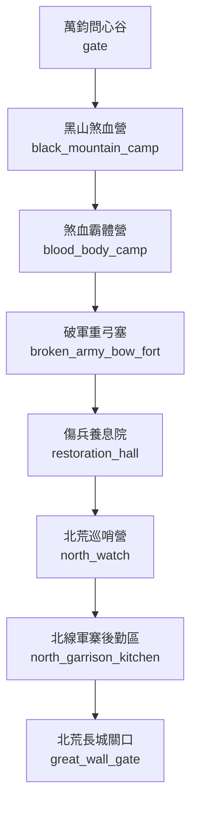

# 八荒武山地圖

> 狀態：`draft`。下列 room ID 為建議穩定 ID，尚未與現有 LPC 實作對照；拓撲需於程式實作後跑 BFS 與雙向連線驗證。

## 房間與拓撲

| Room ID | 顯示名稱 | 建議路徑 | 主要出口 | 用途／限制 |
|---|---|---|---|---|
| `gate` | 萬鈞問心谷 | `/d/sects/bahuang/gate.c` | `black_mountain_camp` | 入山考核、氣血負荷測試 |
| `black_mountain_camp` | 黑山煞血營 | `/d/sects/bahuang/black_mountain_camp.c` | `blood_body_camp` | 訓練、軍令、弟子編制 |
| `blood_body_camp` | 煞血霸體營 | `/d/sects/bahuang/blood_body_camp.c` | `broken_army_bow_fort` | 功法訓練；需控制燥火與氣血負荷 |
| `broken_army_bow_fort` | 破軍重弓塞 | `/d/sects/bahuang/broken_army_bow_fort.c` | `restoration_hall` | 弓械庫、射界、遠程防線 |
| `restoration_hall` | 傷兵養息院 | `/d/sects/bahuang/restoration_hall.c` | `north_watch` | 療傷、復健、退役安置 |
| `north_watch` | 北荒巡哨營 | `/d/sects/bahuang/north_watch.c` | `north_garrison_kitchen` | 巡哨整備、獸群情報 |
| `north_garrison_kitchen` | 北線軍寨後勤區 | `/d/sects/bahuang/north_garrison_kitchen.c` | `great_wall_gate` | 炊事、家書、補給與失蹤者登記 |
| `great_wall_gate` | 北荒長城關口 | `/d/sects/bahuang/great_wall_gate.c` | `區域出口／劇情門禁` | 軍令門禁；通往 /d/wastes/south_approach |

## 區域連線圖

## 房間設計規則

- 一般房間不得直接跳過中間節點連到禁地。
- 需要宗門令牌、軍令、商埠印信或任務狀態的門禁，必須明確記錄拒絕原因。
- 天候、獸潮、地煞污染可改變房間狀態，但不能無記錄地改變靜態出口。
- NPC 常駐房間以 `tier2_npc_roster.md` 與人物檔為準；出場時間表於第二階段補充。
- 此圖不代表遊戲已實裝。
