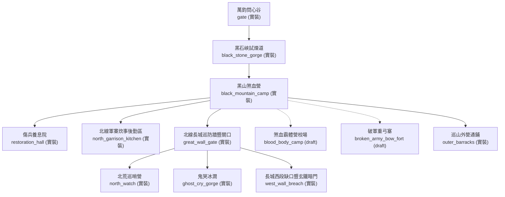

# 八荒武山地圖

> 狀態：`Act 1–4 & Living World implemented (10 房)` + `Act 3+ draft`。第三卷第一至四幕核心節點（9 房）與 Phase 1–2A 新增之 `outer_barracks`（巡山外營通鋪）已於 `/d/sects/bahuang/*.c` 實裝；`blood_body_camp`、`broken_army_bow_fort` 保留作營區擴充 `draft`。
>
> **拓撲與地名說明（依 Ch. 93–94、118 正文）**：`restoration_hall`（傷兵養息院，緊靠長城內側）與 `north_garrison_kitchen`（炊事後勤區）直接與 `black_mountain_camp` 相接；經長城 `great_wall_gate` 東側鐵包邊門三里外即 Ch. 94 新增之 `ghost_cry_gorge`（鬼哭冰澗）；`great_wall_gate` `northwest` 則通往 Ch. 118 冰獄骨龍撞垮三十丈缺口兼直連天工萬機地窟玄鐵暗門之 `west_wall_breach`（黑山長城西段缺口暨第二道內門）。

## 房間與拓撲

| Room ID | 顯示名稱 | 建議／實裝路徑 | 主要出口 | 用途／限制（共 10 房已實裝） |
|---|---|---|---|---|
| `gate` | 八荒武山・萬鈞問心谷 | `/d/sects/bahuang/gate.c` | `southeast`→`/d/yunjin/wanshan_square.c`、`north`→`black_stone_gorge` | 〔實裝，Ch. 87〕入山考核規程、領弓驗箭；駐點：`yue_tingshan`（岳停山）、`tang_ying`（唐映） |
| `black_stone_gorge` | 八荒武山・黑石峽試煉道 | `/d/sects/bahuang/black_stone_gorge.c` | `south`→`gate`、`north`→`black_mountain_camp` | 〔實裝，Ch. 87〕八十里風煞峽谷與群狼試煉；敵對 NPC：`ironback_wolf`（缺耳鐵背荒狼王） |
| `black_mountain_camp` | 八荒武山・黑山煞血營 | `/d/sects/bahuang/black_mountain_camp.c` | `south`→`black_stone_gorge`、`west`→`restoration_hall`、`east`→`north_garrison_kitchen`、`north`→`great_wall_gate`、`southwest`→`outer_barracks` | 〔實裝，Ch. 87、93–94〕外門前哨、頒發腰牌與箭樓軍需密談；駐點：`lei_lie`（雷烈） |
| `outer_barracks` | 八荒殿・巡山外營通鋪 | `/d/sects/bahuang/outer_barracks.c` | `northeast`→`black_mountain_camp` | 〔實裝，生活擴建〕巡山軍卒與趟子手 (`route_traveler`) 歇息處；連結《磨刀修弦》支線 |
| `restoration_hall` | 八荒武山・傷兵養息院 | `/d/sects/bahuang/restoration_hall.c` | `east`→`black_mountain_camp` | 〔實裝，Ch. 93〕長城內側傷兵紀錄與「定心急鎮丸」黑血病案（動作 `inspect records`）；駐點：`du_qinghe`（杜青禾） |
| `north_garrison_kitchen` | 黑山營・北線軍寨炊事後勤區 | `/d/sects/bahuang/north_garrison_kitchen.c` | `west`→`black_mountain_camp` | 〔實裝，Ch. 94〕炊事與《天興十九年失蹤者與未寄家書簿》保管處；駐點：`a_man`（阿滿） |
| `great_wall_gate` | 八荒武山・北線長城巡防牆暨關口 | `/d/sects/bahuang/great_wall_gate.c` | `south`→`black_mountain_camp`、`west`→`north_watch`、`east`→`ghost_cry_gorge`、`north`→`/d/wastes/black_mountain_pass.c`、`northwest`→`west_wall_breach` | 〔實裝，Ch. 93–94、102、118〕三號豁口守防與北出【黑山長城北關雪道】；敵對 NPC：`iron_yak`（鐵甲寒犛 Lv.70） |
| `north_watch` | 八荒武山・北荒巡哨營 | `/d/sects/bahuang/north_watch.c` | `east`→`great_wall_gate` | 〔實裝，Ch. 94〕巡哨整備、測冰長鐵簽與夜間地底震聲記錄；駐點：`qi_wushang`（祁無傷） |
| `ghost_cry_gorge` | 大黑山東側・鬼哭冰澗 | `/d/sects/bahuang/ghost_cry_gorge.c` | `west`→`great_wall_gate` | 〔實裝，Ch. 94 新增〕鷹喙岩脊外三里塌陷雪崖與暗河裂縫，起獲燕山斷箭與八方舊甲（動作 `probe ice`） |
| `west_wall_breach` | 八荒・黑山長城西段缺口暨第二道內門 | `/d/sects/bahuang/west_wall_breach.c` | `southeast`→`great_wall_gate`、`south`→`/d/sects/tiangong/machinery_depths.c` | 〔實裝，Ch. 118–119 新增〕三十丈冰煞缺口暨玄鐵暗門（`stabilize array`）；駐點：`tiebei_shanzhu`、Boss：`ice_bone_dragon`（Lv.95） |
| `blood_body_camp` | 煞血霸體營校場 | `/d/sects/bahuang/blood_body_camp.c` | `draft` | 〔draft〕煞血梅花樁訓練；需控制燥火與氣血負荷 |
| `broken_army_bow_fort` | 破軍重弓塞 | `/d/sects/bahuang/broken_army_bow_fort.c` | `draft` | 〔draft〕百步靶場、弓械庫、測距調撥 |

## 區域連線圖

## 房間設計規則

- 一般房間不得直接跳過中間節點連到禁地。
- 需要宗門令牌、軍令、商埠印信或任務狀態的門禁，必須明確記錄拒絕原因。
- 天候、獸潮、地煞污染可改變房間狀態，但不能無記錄地改變靜態出口。
- NPC 常駐房間以 `tier2_npc_roster.md` 與 [`living_world_folk_and_side_roster.md`](../../living_world_folk_and_side_roster.md) 為準。
- 以上 10 間房間已全數實裝並通過雙向連通與自動化測試（唯 `blood_body_camp`、`broken_army_bow_fort` 保留作選用擴充 `draft`）。
