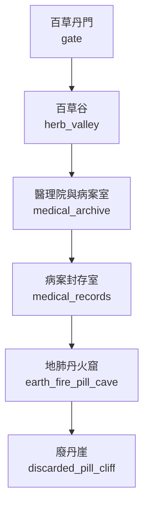

# 丹鼎宗地圖

> 狀態：`draft`。下列 room ID 為建議穩定 ID，尚未與現有 LPC 實作對照；拓撲需於程式實作後跑 BFS 與雙向連線驗證。

## 房間與拓撲

| Room ID | 顯示名稱 | 建議路徑 | 主要出口 | 用途／限制 |
|---|---|---|---|---|
| `gate` | 百草丹門 | `/d/sects/danding/gate.c` | `herb_valley` | 藥材檢查與入門辨識 |
| `herb_valley` | 百草谷 | `/d/sects/danding/herb_valley.c` | `medical_archive` | 靈植培育、灌溉與採收 |
| `medical_archive` | 醫理院與病案室 | `/d/sects/danding/medical_archive.c` | `medical_records` | 診療、病例、藥效追蹤 |
| `medical_records` | 病案封存室 | `/d/sects/danding/medical_records.c` | `earth_fire_pill_cave` | 需病患授權或院內批令 |
| `earth_fire_pill_cave` | 地肺丹火窟 | `/d/sects/danding/earth_fire_pill_cave.c` | `discarded_pill_cliff` | 煉丹、丹火、藥性反應 |
| `discarded_pill_cliff` | 廢丹崖 | `/d/sects/danding/discarded_pill_cliff.c` | `區域出口／劇情門禁` | 廢丹分類與無害化；禁止未驗毒者入內 |

## 區域連線圖

## 房間設計規則

- 一般房間不得直接跳過中間節點連到禁地。
- 需要宗門令牌、軍令、商埠印信或任務狀態的門禁，必須明確記錄拒絕原因。
- 天候、獸潮、地煞污染可改變房間狀態，但不能無記錄地改變靜態出口。
- NPC 常駐房間以 `tier2_npc_roster.md` 與人物檔為準；出場時間表於第二階段補充。
- 此圖不代表遊戲已實裝。
