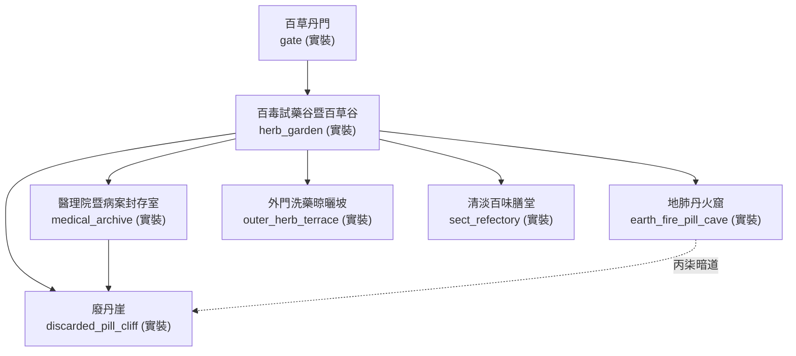

# 丹鼎宗地圖

> 狀態：`Act 1–2 & Living World implemented (7 房)`。第三卷第一至二幕核心空間（5 房）與 Phase 1–2A 外門生活區（`outer_herb_terrace`、`sect_refectory` 2 房）已於 `/d/sects/danding/*.c` 實裝並通過 `quest_audit.py`、`world_liveness_audit.py` 與 `test_v3_act2.c`。
>
> **拓撲定案（依 Ch. 96–97 正文）**：`medical_archive` 兼攝醫理院與病案封存櫃；`earth_fire_pill_cave`（地肺丹火窟）藉秘密「丙柒暗道」直連 `discarded_pill_cliff`（廢丹崖底層深溝坑）。

## 房間與拓撲

| Room ID | 顯示名稱 | 建議／實裝路徑 | 主要出口 | 用途／限制（7 房全數實裝） |
|---|---|---|---|---|
| `gate` | 丹鼎宗・百草丹門 | `/d/sects/danding/gate.c` | `southwest`→`/d/yunjin/wanshan_square.c`、`northeast`→`herb_garden` | 〔實裝，Ch. 89〕藥材檢查與入門辨識 |
| `herb_garden` | 丹鼎宗・百毒試藥谷暨百草谷 | `/d/sects/danding/herb_garden.c` | `southwest`→`gate`、`north`→`medical_archive`、`northwest`→`discarded_pill_cliff`、`down`→`earth_fire_pill_cave`、`east`→`outer_herb_terrace`、`south`→`sect_refectory` | 〔實裝，Ch. 89、96〕寒髓草與雪線苔（動作 `extract moss`）；駐點：`bai_henian`、`ye_qingzhi`、`he_shou` |
| `outer_herb_terrace` | 丹鼎門・外門洗藥晾曬坡 | `/d/sects/danding/outer_herb_terrace.c` | `west`→`herb_garden` | 〔實裝，生活擴建〕駐點：`county_worker`；連結《誤採搶救》生活支線 |
| `sect_refectory` | 丹鼎門・清淡百味膳堂 | `/d/sects/danding/sect_refectory.c` | `north`→`herb_garden` | 〔實裝，生活擴建〕火頭道姑 (`danding_cook_nun`) 執炊之外門膳堂 |
| `medical_archive` | 丹鼎宗・醫理院暨病案封存室 | `/d/sects/danding/medical_archive.c` | `south`→`herb_garden`、`west`→`discarded_pill_cliff` | 〔實裝，Ch. 96–97〕贈甘草口罩／手記與「甲一、乙三」十七份匿名病案（動作 `crosscheck cases`）；駐點：`sun_wenlu`（孫聞露） |
| `earth_fire_pill_cave` | 丹鼎宗・地肺丹火窟 | `/d/sects/danding/earth_fire_pill_cave.c` | `up`→`herb_garden`、`north`→`discarded_pill_cliff`（丙柒暗道） | 〔實裝，Ch. 96〕地下三百丈丙字區與三丈高通風暗隙窺丹（動作 `peek flue`） |
| `discarded_pill_cliff` | 丹鼎宗後山・廢丹崖 | `/d/sects/danding/discarded_pill_cliff.c` | `southeast`→`herb_garden`、`east`→`medical_archive`、`south`→`earth_fire_pill_cave` | 〔實裝，Ch. 97〕腐酸霧坑、石棚後兩只鐵罐（紫泥硬渣）與白猿剖檢（動作 `dissect ape`）；駐點：`tao_sheng`（陶生） |

## 區域連線圖

## 房間設計規則

- 一般房間不得直接跳過中間節點連到禁地。
- 需要宗門令牌、軍令、商埠印信或任務狀態的門禁，必須明確記錄拒絕原因。
- 天候、獸潮、地煞污染可改變房間狀態，但不能無記錄地改變靜態出口。
- NPC 常駐房間以 `tier2_npc_roster.md` 與 [`living_world_folk_and_side_roster.md`](../../living_world_folk_and_side_roster.md) 為準。
- 以上 7 間房間已全數實裝並通過雙向連通與自動化測試。
