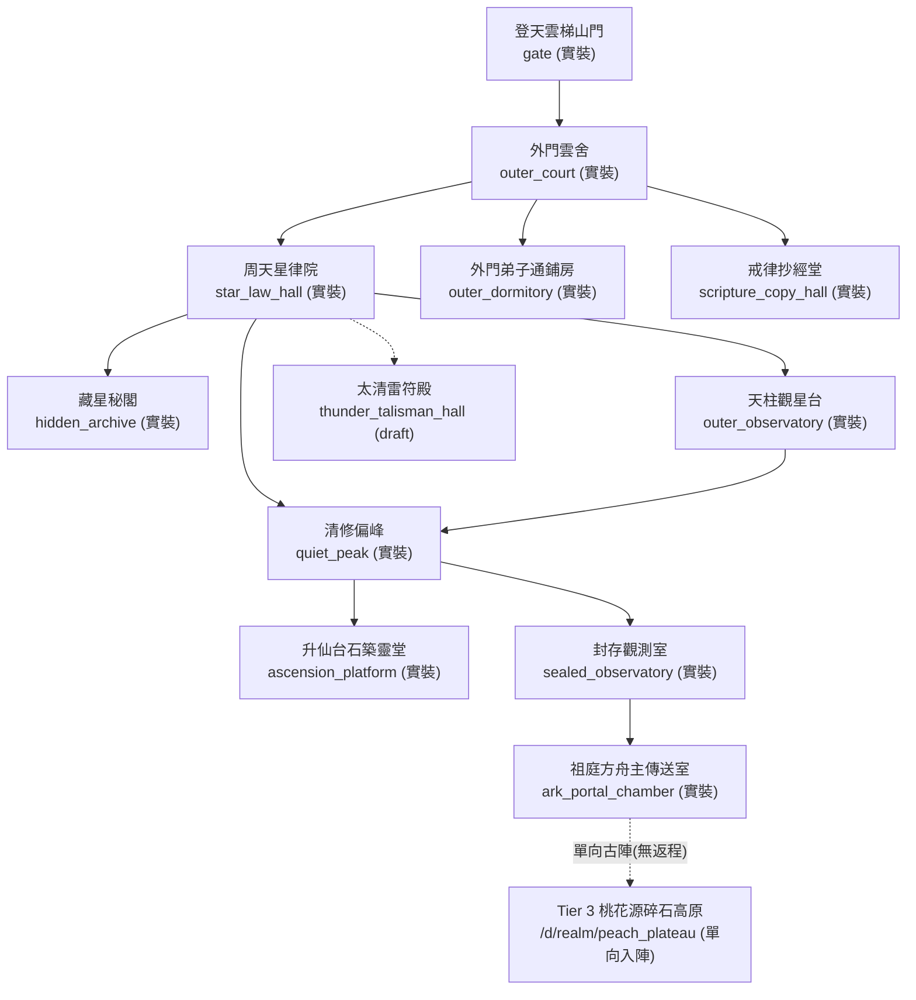

# 太清玄天宮地圖

> 狀態：`Act 1–5 & Living World implemented (11 房)` + `Act 4+ draft`。第三卷第一至五幕核心節點（9 房）與 Phase 1–2A 外門生活圈（`outer_dormitory`、`scripture_copy_hall` 2 房）已全數於 `/d/sects/taiqing/*.c` 實裝並通過雙向連線與 `quest_audit.py`、`world_liveness_audit.py`、`test_v3_act5.c` 驗證；另留 `thunder_talisman_hall` 作為太清雷符殿內殿 `draft`。
>
> **拓撲定案（依 Ch. 91–92、124–126 正文）**：`hidden_archive`（藏星秘閣）開鑿於天柱峰背陰山腹，由 `star_law_hall` 向北直通；`quiet_peak`（清修偏峰）通往後山 `ascension_platform`（升仙台石築靈堂）暨東北禁區 `sealed_observatory`（封存觀測室），再沿千餘丈深黑螺旋階梯下行至三大祖庭交會地底的 `ark_portal_chamber`（太古破界方舟・主傳送室）。

## 房間與拓撲

| Room ID | 顯示名稱 | 建議／實裝路徑 | 主要出口 | 用途／限制（共 11 房已實裝） |
|---|---|---|---|---|
| `gate` | 太清玄天宮・登天雲梯山門 | `/d/sects/taiqing/gate.c` | `south`→`/d/yunjin/wanshan_square.c`、`north`→`outer_court` | 〔實裝，Ch. 86〕三百六十五階問心陣（動作 `measure ladder`）；駐點：`lu_guanlan`（陸觀瀾） |
| `outer_court` | 太清玄天宮・外門雲舍 | `/d/sects/taiqing/outer_court.c` | `south`→`gate`、`north`→`star_law_hall`、`west`→`outer_dormitory`、`east`→`scripture_copy_hall` | 〔實裝，Ch. 86〕外門居所、功課與同門競技；駐點：`shen_zhaochen`（沈照塵） |
| `outer_dormitory` | 太清門・外門弟子通鋪房 | `/d/sects/taiqing/outer_dormitory.c` | `east`→`outer_court` | 〔實裝，生活擴建〕外門弟子歇宿與雜務交流處 |
| `scripture_copy_hall` | 太清門・戒律抄經堂 | `/d/sects/taiqing/scripture_copy_hall.c` | `west`→`outer_court` | 〔實裝，生活擴建〕駐點：`taiqing_copy_senior`（戒律抄經師兄）；連結《抄經換餐》支線 |
| `star_law_hall` | 太清玄天宮・周天星律院 | `/d/sects/taiqing/star_law_hall.c` | `south`→`outer_court`、`north`→`hidden_archive`、`east`→`outer_observatory`、`northeast`→`quiet_peak` | 〔實裝，Ch. 86、91〕星曆校讀、測算與實證封存；駐點：`song_zhiwei`（宋知微） |
| `hidden_archive` | 太清玄天宮・藏星秘閣 | `/d/sects/taiqing/hidden_archive.c` | `south`→`star_law_hall` | 〔實裝，Ch. 91〕天柱背陰花崗岩山腹；《紫微星官錄》三版本與蟲蛀舊箱廢頁（動作 `collate archive`）；駐點：`yu_shouzhuo`（余守拙） |
| `outer_observatory` | 太清玄天宮・天柱觀星台 | `/d/sects/taiqing/outer_observatory.c` | `west`→`star_law_hall`、`north`→`quiet_peak` | 〔實裝，Ch. 91〕黃銅渾儀朔望雙向盲測與暴雪氣壓誤差校驗（動作 `observe sphere`） |
| `quiet_peak` | 太清後山・清修偏峰 | `/d/sects/taiqing/quiet_peak.c` | `southwest`→`star_law_hall`、`south`→`outer_observatory`、`north`→`ascension_platform`、`northeast`→`sealed_observatory` | 〔實裝，Ch. 92、111–112、124〕老松亭與簡素真人石屋（`cure yuanqing`）；駐點：`jian_su`、`yuan_qing` |
| `ascension_platform` | 太清偏峰・升仙台石築靈堂 | `/d/sects/taiqing/ascension_platform.c` | `south`→`quiet_peak` | 〔實裝，Ch. 92 新增〕鶴鳴真人玉化晶像與主聚星抽取陣紋（動作 `collect crystal`）；駐點：`xuan_ming`（玄冥真人） |
| `sealed_observatory` | 太清偏峰・封存觀測室 | `/d/sects/taiqing/sealed_observatory.c` | `southwest`→`quiet_peak`、`down`→`ark_portal_chamber` | 〔實裝，Ch. 124–125 新增〕五器共振引動假天排斥劫雲暨《祖師密錄》十七先輩告白處（動作 `resonate relics`） |
| `ark_portal_chamber` | 祖庭地底・太古破界方舟主傳送室 | `/d/sects/taiqing/ark_portal_chamber.c` | `up`→`sealed_observatory`（另 `enter gate` 單向入 `/d/realm/peach_plateau.c`） | 〔實裝，Ch. 126 新增〕五座石台同步校驗啟動三丈青金星門入 Tier 3（動作 `activate gate`／`enter gate`） |
| `thunder_talisman_hall` | 太清雷符殿 | `/d/sects/taiqing/thunder_talisman_hall.c` | `draft` | 〔draft〕雷符訓練、護山陣維護與執法調度 |

## 區域連線圖

## 房間設計規則

- 一般房間不得直接跳過中間節點連到禁地。
- 需要宗門令牌、軍令、商埠印信或任務狀態的門禁，必須明確記錄拒絕原因。
- 天候、獸潮、地煞污染可改變房間狀態，但不能無記錄地改變靜態出口。
- NPC 常駐房間以 `tier2_npc_roster.md` 與 [`living_world_folk_and_side_roster.md`](../../living_world_folk_and_side_roster.md) 為準。
- 以上 11 間房間已全數實裝並通過雙向連通與自動化測試（唯 `thunder_talisman_hall` 仍保留作選用擴充 `draft`）。
