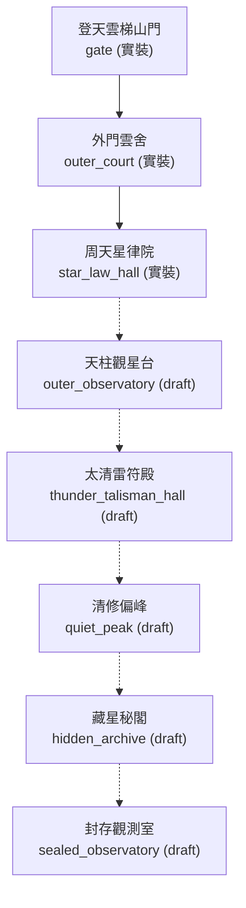

# 太清玄天宮地圖

> 狀態：`draft`。下列 room ID 為建議穩定 ID，尚未與現有 LPC 實作對照；拓撲需於程式實作後跑 BFS 與雙向連線驗證。

## 房間與拓撲

| Room ID | 顯示名稱 | 建議／實裝路徑 | 主要出口 | 用途／限制（Act 1 前 3 房已實裝） |
|---|---|---|---|---|
| `gate` | 太清玄天宮・登天雲梯山門 | `/d/sects/taiqing/gate.c` | `south`→`/d/yunjin/wanshan_square.c`、`north`→`outer_court` | 〔實裝〕三百六十五階問心陣（動作 `measure ladder`）；駐點：`lu_guanlan`（陸觀瀾） |
| `outer_court` | 太清玄天宮・外門雲舍 | `/d/sects/taiqing/outer_court.c` | `south`→`gate`、`north`→`star_law_hall` | 〔實裝〕外門居所、功課與同門競技；駐點：`shen_zhaochen`（沈照塵） |
| `star_law_hall` | 太清玄天宮・周天星律院 | `/d/sects/taiqing/star_law_hall.c` | `south`→`outer_court`（`draft`: `outer_observatory`） | 〔實裝〕星曆校讀、測算與實證封存；駐點：`song_zhiwei`（宋知微） |
| `outer_observatory` | 天柱觀星台 | `/d/sects/taiqing/outer_observatory.c` | `thunder_talisman_hall` | 〔draft〕天候與星軌觀測；夜間需輪值牌 |
| `thunder_talisman_hall` | 太清雷符殿 | `/d/sects/taiqing/thunder_talisman_hall.c` | `quiet_peak` | 雷符訓練、護山陣維護 |
| `quiet_peak` | 清修偏峰 | `/d/sects/taiqing/quiet_peak.c` | `hidden_archive` | 閉關、養息與苦修派居所 |
| `hidden_archive` | 藏星秘閣 | `/d/sects/taiqing/hidden_archive.c` | `sealed_observatory` | 需長老批令；保存原始星圖與禁卷 |
| `sealed_observatory` | 封存觀測室 | `/d/sects/taiqing/sealed_observatory.c` | `區域出口／劇情門禁` | 劇情門禁；保管被封存的異常觀測檔案 |

## 區域連線圖

## 房間設計規則

- 一般房間不得直接跳過中間節點連到禁地。
- 需要宗門令牌、軍令、商埠印信或任務狀態的門禁，必須明確記錄拒絕原因。
- 天候、獸潮、地煞污染可改變房間狀態，但不能無記錄地改變靜態出口。
- NPC 常駐房間以 `tier2_npc_roster.md` 與人物檔為準；出場時間表於第二階段補充。
- 此圖不代表遊戲已實裝。
