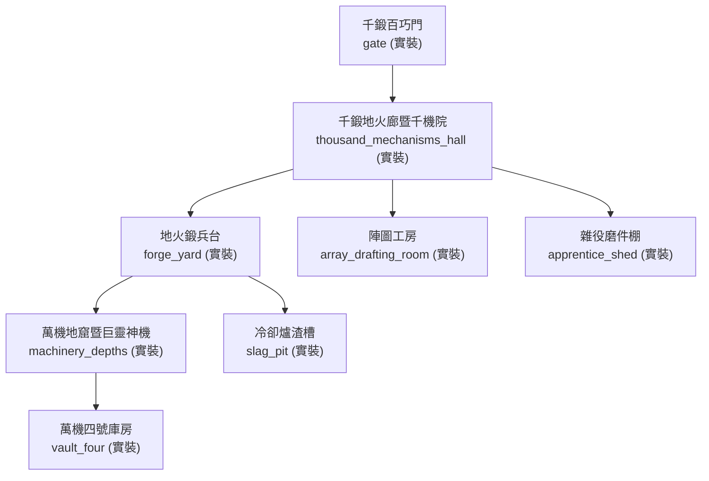

# 天工閣地圖

> 狀態：`Act 1–4 & Living World implemented (8 房)`。第三卷第一至四幕核心空間（6 房）與 Phase 1–2A 新增之外門雜役區（`apprentice_shed`、`slag_pit` 2 房）已於 `/d/sects/tiangong/*.c` 全數實裝，並通過 `quest_audit.py`、`world_liveness_audit.py` 與 `test_v3_act4.c`。
>
> **拓撲定案（依 Ch. 95 正文）**：十丈「巨靈神機」與地下二十丈岩窟合併實裝為單一巨型空間 `machinery_depths`（萬機地窟），並依正文於東側新增 `vault_four`（萬機四號庫房，暫封赤煉長老所調六根高純度血精晶柱）。

## 房間與拓撲

| Room ID | 顯示名稱 | 建議／實裝路徑 | 主要出口 | 用途／限制（8 房全數實裝） |
|---|---|---|---|---|
| `gate` | 天工閣・千鍛百巧門 | `/d/sects/tiangong/gate.c` | `west`→`/d/yunjin/wanshan_square.c`、`east`→`thousand_mechanisms_hall` | 〔實裝，Ch. 88〕驗匠牌、材料與安全檢查 |
| `thousand_mechanisms_hall` | 天工閣・千鍛地火廊暨千機院 | `/d/sects/tiangong/thousand_mechanisms_hall.c` | `west`→`gate`、`east`→`forge_yard`、`south`→`array_drafting_room`、`north`→`apprentice_shed` | 〔實裝，Ch. 88、95〕千機院與入門鍛台實測（動作 `repair puppet`）；駐點：`lu_zhanglao`（魯長老）、`zhang_bailian`（章百鍊） |
| `apprentice_shed` | 天工門・雜役磨件棚 | `/d/sects/tiangong/apprentice_shed.c` | `south`→`thousand_mechanisms_hall` | 〔實裝，生活擴建〕外門雜役打磨粗件處；駐點：`county_worker` |
| `forge_yard` | 天工閣・地火鍛兵台 | `/d/sects/tiangong/forge_yard.c` | `west`→`thousand_mechanisms_hall`、`down`→`machinery_depths`、`east`→`slag_pit` | 〔實裝，Ch. 95〕礦車絞盤標準化維修、材料疲勞曲線與通往地底二十丈石道 |
| `slag_pit` | 天工門・冷卻爐渣槽 | `/d/sects/tiangong/slag_pit.c` | `west`→`forge_yard` | 〔實裝，生活擴建〕冷卻爐渣淘撿現場；連結《淘撿玄鐵》支線 |
| `array_drafting_room` | 天工閣・陣圖工房 | `/d/sects/tiangong/array_drafting_room.c` | `north`→`thousand_mechanisms_hall` | 〔實裝，Ch. 95〕分段圖紙與推進錨機受力延長線測繪（動作 `trace blueprint`）；駐點：`wenjiu`（聞九） |
| `machinery_depths` | 天工閣・萬機地窟 | `/d/sects/tiangong/machinery_depths.c` | `up`→`forge_yard`、`east`→`vault_four`、`north`→`/d/sects/bahuang/west_wall_breach.c`、`northup`→`/d/yunjin/crystal_poison_edge.c` | 〔實裝，Ch. 95、117–118〕地下二十丈岩窟、十丈【巨靈神機】主軸同源共鳴、玄鐵暗門推機赴援長城暨維修井暗渠通道；駐點：`ji_heng`、`chi_lian`（Ch.117 逃逸） |
| `vault_four` | 天工閣・萬機四號庫房 | `/d/sects/tiangong/vault_four.c` | `west`→`machinery_depths` | 〔實裝，Ch. 95 新增〕魯長老與監察文吏會同查封之鉛封鐵箱（六根血精晶柱與《特殊工單》） |

## 區域連線圖

## 房間設計規則

- 一般房間不得直接跳過中間節點連到禁地。
- 需要宗門令牌、軍令、商埠印信或任務狀態的門禁，必須明確記錄拒絕原因。
- 天候、獸潮、地煞污染可改變房間狀態，但不能無記錄地改變靜態出口。
- NPC 常駐房間以 `tier2_npc_roster.md` 與 [`living_world_folk_and_side_roster.md`](../../living_world_folk_and_side_roster.md) 為準。
- 以上 8 間房間已全數實裝並通過雙向連通與自動化測試。
