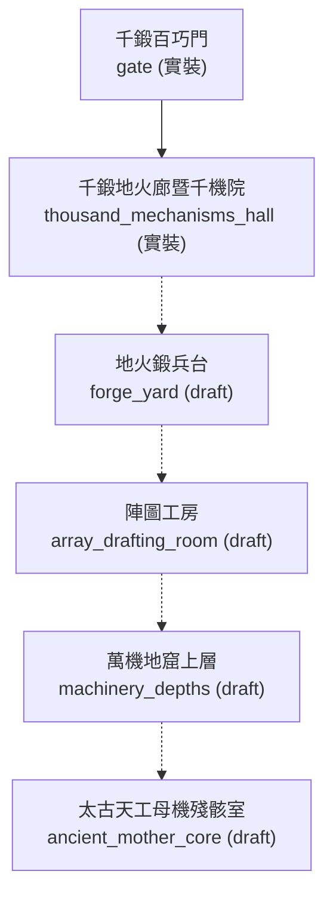

# 天工閣地圖

> 狀態：`draft`。下列 room ID 為建議穩定 ID，尚未與現有 LPC 實作對照；拓撲需於程式實作後跑 BFS 與雙向連線驗證。

## 房間與拓撲

| Room ID | 顯示名稱 | 建議／實裝路徑 | 主要出口 | 用途／限制（Act 1 前 2 房已實裝） |
|---|---|---|---|---|
| `gate` | 天工閣・千鍛百巧門 | `/d/sects/tiangong/gate.c` | `west`→`/d/yunjin/wanshan_square.c`、`east`→`thousand_mechanisms_hall` | 〔實裝〕驗匠牌、材料與安全檢查 |
| `thousand_mechanisms_hall` | 天工閣・千鍛地火廊暨千機院 | `/d/sects/tiangong/thousand_mechanisms_hall.c` | `west`→`gate`（`draft`: `forge_yard`） | 〔實裝，Ch. 88〕兼攝千機院與入門鍛台實測（動作 `repair puppet`）；駐點：`lu_zhanglao`（魯長老）、`zhang_bailian`（章百鍊） |
| `forge_yard` | 地火鍛兵台 | `/d/sects/tiangong/forge_yard.c` | `array_drafting_room` | 鍛造、合金、熱處理 |
| `array_drafting_room` | 陣圖工房 | `/d/sects/tiangong/array_drafting_room.c` | `machinery_depths` | 陣圖設計與施工檔案 |
| `machinery_depths` | 萬機地窟上層 | `/d/sects/tiangong/machinery_depths.c` | `ancient_mother_core` | 古傀存放、拆解區；需雙人值守 |
| `ancient_mother_core` | 太古天工母機殘骸室 | `/d/sects/tiangong/ancient_mother_core.c` | `區域出口／劇情門禁` | 劇情鎖定；母機殘骸並非可任意啟動的普通機關 |

## 區域連線圖

## 房間設計規則

- 一般房間不得直接跳過中間節點連到禁地。
- 需要宗門令牌、軍令、商埠印信或任務狀態的門禁，必須明確記錄拒絕原因。
- 天候、獸潮、地煞污染可改變房間狀態，但不能無記錄地改變靜態出口。
- NPC 常駐房間以 `tier2_npc_roster.md` 與人物檔為準；出場時間表於第二階段補充。
- 此圖不代表遊戲已實裝。
