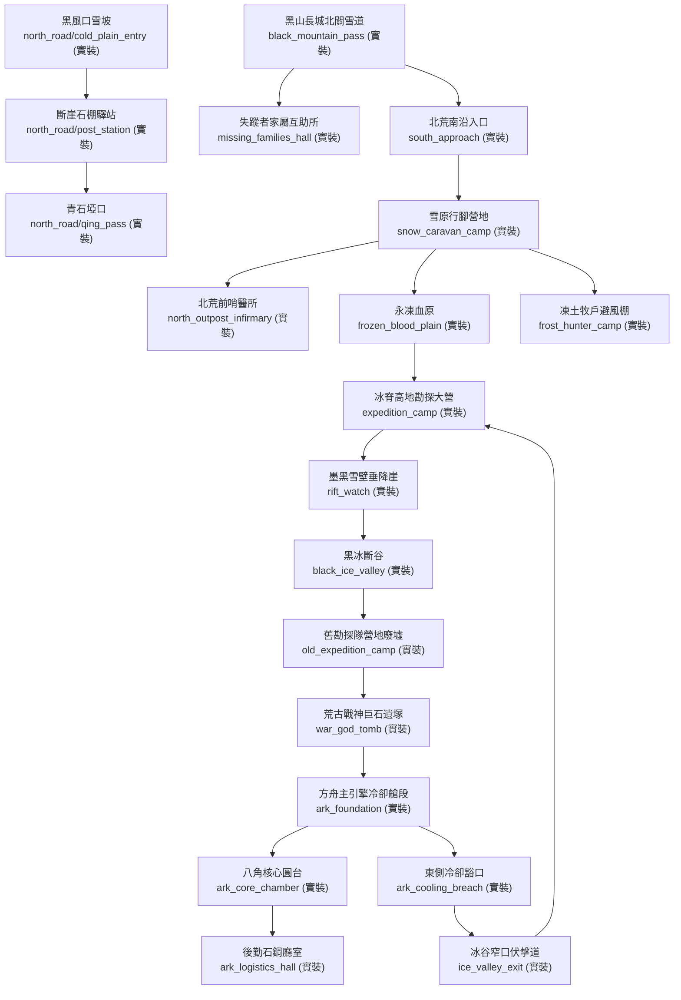

# 北荒裂谷地圖

> 狀態：`Act 1 & Act 3 & Living World implemented (共 20 房：`north_road` 3 房 + `wastes` 主區 17 房)`。第三卷第一幕北境雪原官道（Ch. 83–84）、第三幕北荒聯合勘探／黑冰斷谷／荒古戰神遺塚／方舟北方陣基（Ch. 102–111）及 Phase 1–2A 凍土牧戶避風棚已全數於 `/d/wastes/*.c` 實裝並通過雙向連線、`quest_audit.py`、`world_liveness_audit.py` 與 `test_v3_act3.c` 驗證。

## 房間與拓撲

| Room ID | 顯示名稱 | 實裝路徑 | 主要出口 | 用途／限制（全數已實裝） |
|---|---|---|---|---|
| `cold_plain_entry` | 北境寒原・黑風口雪坡 | `/d/wastes/north_road/cold_plain_entry.c` | `south`→`/d/counties/zhenfeng/north_beacon.c`、`north`→`post_station` | 〔實裝，Ch. 83〕離開鎮風關北塞後的第一段高寒官道 |
| `post_station` | 北境官道・斷崖石棚驛站 | `/d/wastes/north_road/post_station.c` | `south`→`cold_plain_entry`、`north`→`qing_pass` | 〔實裝，Ch. 83〕避雪與熬藥（動作 `brew decoction`）；駐點：`mu_xue`（穆雪）、`zhou_tieshan`、`chen_qing` |
| `qing_pass` | 北境官道・青石埡口 | `/d/wastes/north_road/qing_pass.c` | `south`→`post_station`、`north`→`/d/yunjin/north_road_gate.c` | 〔實裝，Ch. 83–84〕翻越分水嶺俯瞰雲津峽谷的最後關隘 |
| `black_mountain_pass` | 北荒裂谷・黑山長城北關雪道 | `/d/wastes/black_mountain_pass.c` | `south`→`/d/sects/bahuang/great_wall_gate.c`、`west`→`missing_families_hall`、`north`→`south_approach` | 〔實裝，Ch. 102、EV323〕長城出關咽喉雪道；關外三百步即失蹤者家屬互助所 |
| `missing_families_hall` | 北荒關外・失蹤者家屬互助所 | `/d/wastes/missing_families_hall.c` | `east`→`black_mountain_pass` | 〔實裝，Ch. 102、111〕草頂木棚暨《失蹤者登記簿》登錄（動作 `log missing`）；駐點：`han_su`（韓素） |
| `south_approach` | 北荒裂谷・南沿入口 | `/d/wastes/south_approach.c` | `south`→`black_mountain_pass`、`north`→`snow_caravan_camp` | 〔實裝，Ch. 102〕百名勘探精銳與二十四輛「泥」字貨橇集結整隊；駐點：`qi_shiliu`（祁十六） |
| `snow_caravan_camp` | 北荒裂谷・雪原行腳營地 | `/d/wastes/snow_caravan_camp.c` | `south`→`south_approach`、`east`→`north_outpost_infirmary`、`west`→`frost_hunter_camp`、`north`→`frozen_blood_plain` | 〔實裝，Ch. 102〕最後人煙整備營；星盤測赤煉黑布重車磁偏角（動作 `inspect sleighs`） |
| `frost_hunter_camp` | 北荒南沿・凍土牧戶避風棚 | `/d/wastes/frost_hunter_camp.c` | `east`→`snow_caravan_camp` | 〔實裝，生活擴建〕老牧戶烏蘭 (`wastes_herder`) 避風棚，連結《凍土尋羊》生活支線 |
| `north_outpost_infirmary` | 北荒前哨醫所 | `/d/wastes/north_outpost_infirmary.c` | `west`→`snow_caravan_camp` | 〔實裝，Ch. 102–103〕雪線續脈膏半寸對照實驗（動作 `test poultice`）與染煞病例簿；駐點：`bai_yan`（白岩） |
| `frozen_blood_plain` | 北荒裂谷・永凍血原 | `/d/wastes/frozen_blood_plain.c` | `south`→`snow_caravan_camp`、`north`→`expedition_camp` | 〔實裝，Ch. 103〕裂谷二層血原伏擊陣（動作 `throw smoke`）；敵對凶獸：`shuangtou_dilong`（Lv.82 雙頭霜甲地龍） |
| `expedition_camp` | 北荒裂谷・冰脊高地勘探大營 | `/d/wastes/expedition_camp.c` | `south`→`frozen_blood_plain`、`northwest`→`rift_watch`、`west`→`ice_valley_exit` | 〔實裝，Ch. 104、110–111〕裂谷深處三百里主營地 |
| `rift_watch` | 北荒裂谷・墨黑雪壁垂降崖 | `/d/wastes/rift_watch.c` | `southeast`→`expedition_camp`、`down`→`black_ice_valley` | 〔實裝，Ch. 104〕大營西北五里炸毀半山遺址上方崖頂；鑿釘滑輪垂降（動作 `rappel cliff`） |
| `black_ice_valley` | 北荒裂谷・黑冰斷谷 | `/d/wastes/black_ice_valley.c` | `up`→`rift_watch`、`west`→`old_expedition_camp` | 〔實裝，Ch. 104〕天興十九年走山隊主遺址；九具遺骸暨韓林「北線斥候・乙十七」銅哨（動作 `excavate remains`） |
| `old_expedition_camp` | 黑冰斷谷・舊勘探隊營地廢墟 | `/d/wastes/old_expedition_camp.c` | `east`→`black_ice_valley`、`north`→`war_god_tomb` | 〔實裝，Ch. 104〕塌陷帆布帳與岩石凹槽；油燈竹夾剝離羊皮血書與名冊殘頁（動作 `search alcove`） |
| `war_god_tomb` | 黑冰深處・荒古戰神巨石遺塚 | `/d/wastes/war_god_tomb.c` | `south`→`old_expedition_camp`、`east`→`ark_foundation` | 〔實裝，Ch. 105〕十二玄柱骨片共鳴悟《沉岳引》暨拾「燕」字護心鏡（動作 `resonate totem`）；敵對凶獸：`ice_bear_king`（Lv.82 北荒冰熊王） |
| `ark_foundation` | 地底數百丈・方舟主引擎冷卻艙段 | `/d/wastes/ark_foundation.c` | `west`→`war_god_tomb`、`north`→`ark_core_chamber`、`east`→`ark_cooling_breach` | 〔實裝，Ch. 106〕永凍冰下巨鯨艙段暨三丈主導管台；三息檢測冷卻生物質廢液（動作 `test coolant`） |
| `ark_core_chamber` | 太古方舟・八角形主陣基核心圓台 | `/d/wastes/ark_core_chamber.c` | `south`→`ark_foundation`、`north`→`ark_logistics_hall` | 〔實裝，Ch. 106–107〕十丈五龕圓台嵌放五器共鳴呈現三大先民職能光影殘篇（動作 `place relics`） |
| `ark_logistics_hall` | 太古方舟・後勤石鋼廳室 | `/d/wastes/ark_logistics_hall.c` | `south`→`ark_core_chamber` | 〔實裝，Ch. 108〕玄鐵主控台合璧【九城總契銅版】與【天門引】（動作 `join treaty`）兼得乙巳雲記抄頁 |
| `ark_cooling_breach` | 太古方舟・東側冷卻外殼豁口 | `/d/wastes/ark_cooling_breach.c` | `west`→`ark_foundation`、`northeast`→`ice_valley_exit` | 〔實裝，Ch. 109〕三十具鑽山傀儡盜掘點；雪線苔霧配黑鐵齒輪砸鎖七成總閘（動作 `lock valve`） |
| `ice_valley_exit` | 北荒裂谷・冰谷窄口伏擊道 | `/d/wastes/ice_valley_exit.c` | `southwest`→`ark_cooling_breach`、`east`→`expedition_camp` | 〔實裝，Ch. 110〕百丈冰脊窄道引爆雪簷（動作 `trigger avalanche`）；敵對頭目：`private_league_envoy`（Lv.88）、`tiger_mech_beast`（Lv.84） |

## 區域連線圖

## 房間設計規則

- 北荒裂谷所有主節點、黑冰斷谷與方舟地底艙段均經雙向連線驗證，不跳躍一般節點直連禁地。
- `black_ice_valley`（Ch. 104 五年前九骸血書主遺址）嚴格區分於二幕 `bahuang/ghost_cry_gorge.c`（Ch. 94 大黑山東側斷箭軍需副聯現場）。
- 天候、獸潮與地煞濃度受 `EVENT_TIER2_CRISIS` 控制，但不任意毀棄靜態空間連通性。
