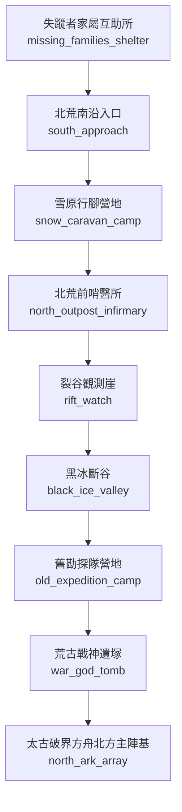

# 北荒裂谷地圖

> 狀態：`draft`。下列 room ID 為建議穩定 ID，尚未與現有 LPC 實作對照；拓撲需於程式實作後跑 BFS 與雙向連線驗證。

## 房間與拓撲

| Room ID | 顯示名稱 | 建議路徑 | 主要出口 | 用途／限制 |
|---|---|---|---|---|
| `south_approach` | 北荒南沿入口 | `/d/wastes/south_approach.c` | `snow_caravan_camp` | 由八荒長城關口進入；軍令與嚮導核驗 |
| `snow_caravan_camp` | 雪原行腳營地 | `/d/wastes/snow_caravan_camp.c` | `north_outpost_infirmary` | 補給、獸材交易、隊伍整備 |
| `north_outpost_infirmary` | 北荒前哨醫所 | `/d/wastes/north_outpost_infirmary.c` | `rift_watch` | 傷病救治、地煞暴露觀察 |
| `rift_watch` | 裂谷觀測崖 | `/d/wastes/rift_watch.c` | `black_ice_valley` | 監測冰層、獸潮與地脈震動 |
| `black_ice_valley` | 黑冰斷谷 | `/d/wastes/black_ice_valley.c` | `old_expedition_camp` | 五年前走山隊遺址；需證據採集與安全繩索 |
| `old_expedition_camp` | 舊勘探隊營地 | `/d/wastes/old_expedition_camp.c` | `war_god_tomb` | 保存營具、名冊與血書線索 |
| `war_god_tomb` | 荒古戰神遺塚 | `/d/wastes/war_god_tomb.c` | `north_ark_array` | 遺物共鳴區；不是普通寶庫 |
| `north_ark_array` | 太古破界方舟北方主陣基 | `/d/wastes/north_ark_array.c` | `區域出口／劇情門禁` | 核心劇情區；需多件遺物、結構穩定與撤退方案 |
| `missing_families_shelter` | 失蹤者家屬互助所 | `/d/wastes/missing_families_shelter.c` | `south_approach` | 記錄失蹤者、家屬證詞與遺物清單 |

## 區域連線圖

## 房間設計規則

- 一般房間不得直接跳過中間節點連到禁地。
- 需要宗門令牌、軍令、商埠印信或任務狀態的門禁，必須明確記錄拒絕原因。
- 天候、獸潮、地煞污染可改變房間狀態，但不能無記錄地改變靜態出口。
- NPC 常駐房間以 `tier2_npc_roster.md` 與人物檔為準；出場時間表於第二階段補充。
- 此圖不代表遊戲已實裝。
