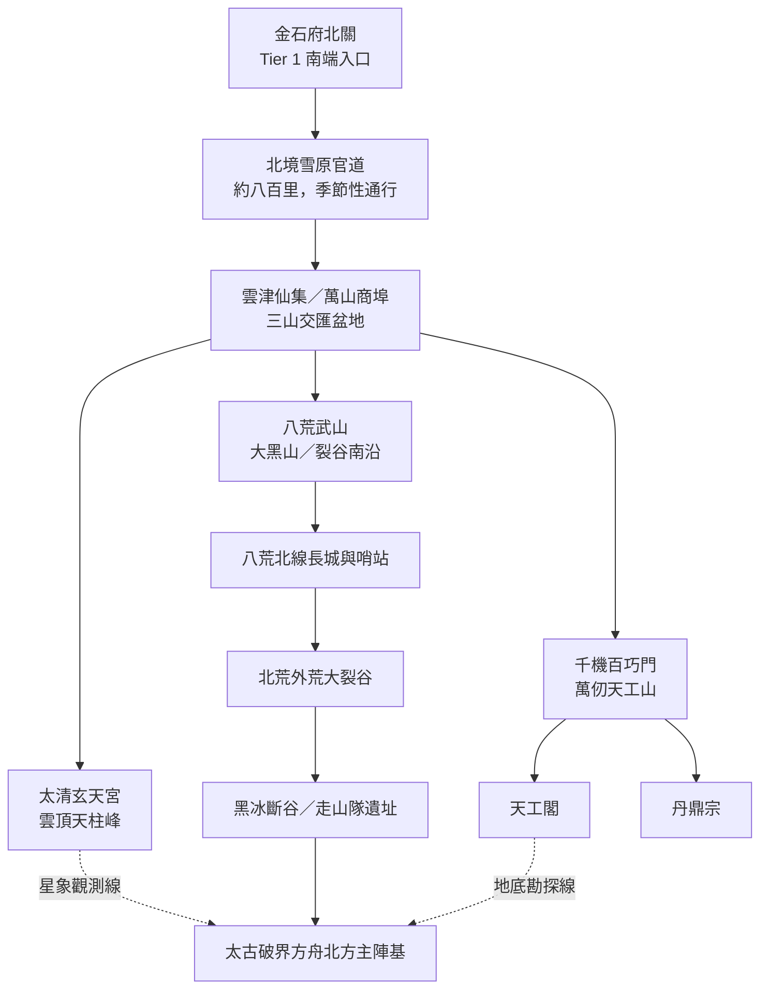

# Tier 2 宏觀世界地圖

> 地理基礎沿用 `volume3.md`「三山一埠一裂谷」與 `world_setting.md` §5.2。方位與里程若原文未定，標記為相對位置，不虛構精確座標。

## 區域關係

| 區域 ID | 名稱 | 與其他區域關係 | 通行特性 |
|---|---|---|---|
| `tier2_north_road` | 北境雪原官道 | 金石北關至雲津 | 約八百里；風雪、補給與驛站決定行程 |
| `yunjin` | 雲津仙集 | 三山交匯 | 中立商埠；宗門山道由各宗門管理 |
| `taiqing` | 太清玄天宮 | 雲津北側高峰（方位為草案） | 登天雲梯、符陣門禁 |
| `bahuang` | 八荒武山 | 大黑山、北荒裂谷南沿 | 軍營與長城有軍令管制 |
| `qianji` | 千機百巧門 | 萬仞天工山 | 外門、工坊與地窟分層管理 |
| `wastes` | 北荒裂谷 | 八荒防線以北 | 高危區；受天候、獸潮、地煞影響 |
| `ark_north_array` | 方舟北方主陣基 | 裂谷深層 | 劇情鎖定區；未解鎖前不得視為可自由往返 |

## 空間設計注意

- 北境官道是長距離旅程，不應用一個房間代表八百里；可用驛站、雪原營地與風口節點表現時間及補給成本。
- 三大宗門與雲津之間必須有不依賴傳送的實際山道，以維持商業物流可信度。
- 太清宮星象觀測線與天工閣地底勘探線只是不同觀測／探索入口，不代表兩處可以直接互通。
- 北荒裂谷深層、黑冰斷谷與方舟陣基需有明確危險等級、撤退路線及劇情門禁。
