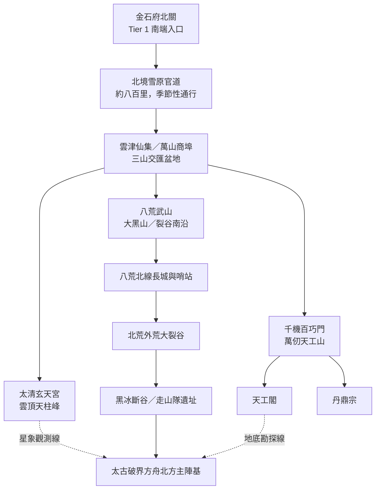

# Tier 2 宏觀世界地圖

> 地理基礎沿用 `volume3.md`「三山一埠一裂谷」與 `world_setting.md` §5.2。方位與里程若原文未定，標記為相對位置，不虛構精確座標。

## 區域關係（第三卷第一幕已打通北上幹道與雲津三宗入口）

| 區域 ID | 名稱 | 與其他區域關係 | 通行特性 | 實裝狀態 |
|---|---|---|---|---|
| `tier2_north_road` | 北境雪原官道 | 金石府鎮風關北塞（`/d/counties/zhenfeng/north_beacon.c` `north`）→ 雲津南口 | 約八百里；依序經 `cold_plain_entry`（黑風口雪坡）→ `post_station`（斷崖石棚驛站）→ `qing_pass`（青石埡口） | Act 1 實裝（3 房） |
| `yunjin` | 雲津仙集 | 南接 `qing_pass`，北連太清、西北連八荒、東連天工、東北連丹鼎 | 中立商埠；廣場、交割票號、西街、泥途地下石室、三宗交易街、車馬行與雲海鬼市後門暗巷已全線連通 | Act 1–2 實裝（12 房） |
| `taiqing` | 太清玄天宮 | `wanshan_square` 正北入口（`north`） | 雲梯山門 → 外門雲舍 → 星律院 → 藏星秘閣／觀星台 → 清修偏峰 → 升仙台石築靈堂 | Act 1–2 實裝（7 房）／深處 `draft` |
| `bahuang` | 八荒武山 | `wanshan_square` 西北入口（`northwest`） | 問心谷 → 黑石峽 → 黑山營 → 養息院／炊事區／長城關口 → 巡哨營／鬼哭冰澗 | Act 1–2 實裝（8 房）／裂谷 `draft` |
| `qianji`（`tiangong`／`danding`） | 千機百巧門（天工閣／丹鼎宗） | `wanshan_square` 正東往天工閣（`east`）、東北往丹鼎宗（`northeast`） | 天工閣（6 房全實裝至萬機地窟／四號庫房）；丹鼎宗（5 房全實裝至地肺丹火窟／醫理院／廢丹崖） | Act 1–2 實裝（共 11 房） |
| `wastes` | 北荒裂谷 | 八荒長城以北（`black_ice_valley` 為三幕深處主遺址；外圍 `ghost_cry_gorge` 已於二幕實裝） | 高危區；受天候、獸潮、地煞影響 | Act 3+ `draft` |
| `ark_north_array` | 方舟北方主陣基 | 裂谷深層 | 劇情鎖定區；未解鎖前不得視為可自由往返 |

## 空間設計注意

- 北境官道是長距離旅程，不應用一個房間代表八百里；可用驛站、雪原營地與風口節點表現時間及補給成本。
- 三大宗門與雲津之間必須有不依賴傳送的實際山道，以維持商業物流可信度。
- 太清宮星象觀測線與天工閣地底勘探線只是不同觀測／探索入口，不代表兩處可以直接互通。
- 北荒裂谷深層、黑冰斷谷與方舟陣基需有明確危險等級、撤退路線及劇情門禁。
