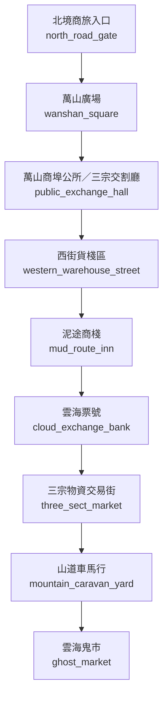

# 雲津仙集地圖

> 狀態：`draft`。下列 room ID 為建議穩定 ID，尚未與現有 LPC 實作對照；拓撲需於程式實作後跑 BFS 與雙向連線驗證。

## 房間與拓撲

| Room ID | 顯示名稱 | 建議路徑 | 主要出口 | 用途／限制 |
|---|---|---|---|---|
| `north_road_gate` | 北境商旅入口 | `/d/yunjin/north_road_gate.c` | `wanshan_square` | 商隊驗貨、路引與天候公告 |
| `wanshan_square` | 萬山廣場 | `/d/yunjin/wanshan_square.c` | `public_exchange_hall` | 市集、公告、行商集散 |
| `public_exchange_hall` | 萬山商埠公所／三宗交割廳 | `/d/yunjin/public_exchange_hall.c` | `western_warehouse_street` | 仲裁、驗收、跨宗門對帳 |
| `western_warehouse_street` | 西街貨棧區 | `/d/yunjin/western_warehouse_street.c` | `mud_route_inn` | 倉庫、商號、貨運行 |
| `mud_route_inn` | 泥途商棧 | `/d/yunjin/mud_route_inn.c` | `cloud_exchange_bank` | 沈泥主場；小型倉棧與代辦 |
| `cloud_exchange_bank` | 雲海票號 | `/d/yunjin/cloud_exchange_bank.c` | `three_sect_market` | 票據、匯兌、信用核驗 |
| `three_sect_market` | 三宗物資交易街 | `/d/yunjin/three_sect_market.c` | `mountain_caravan_yard` | 符材、藥材、礦料、軍需 |
| `mountain_caravan_yard` | 山道車馬行 | `/d/yunjin/mountain_caravan_yard.c` | `ghost_market` | 雪橇、馱獸、嚮導與護運 |
| `ghost_market` | 雲海鬼市 | `/d/yunjin/ghost_market.c` | `區域出口／劇情門禁` | 非公開交易；入口受暗號與信物限制 |

## 區域連線圖

## 房間設計規則

- 一般房間不得直接跳過中間節點連到禁地。
- 需要宗門令牌、軍令、商埠印信或任務狀態的門禁，必須明確記錄拒絕原因。
- 天候、獸潮、地煞污染可改變房間狀態，但不能無記錄地改變靜態出口。
- NPC 常駐房間以 `tier2_npc_roster.md` 與人物檔為準；出場時間表於第二階段補充。
- 此圖不代表遊戲已實裝。
