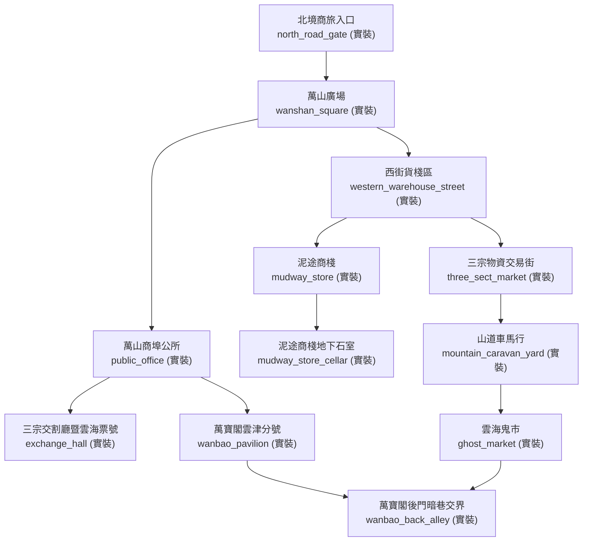

# 雲津仙集地圖

> 狀態：`Act 1–2 implemented (12 房)`。第三卷第一至二幕（Ch. 84–85、90、98–101）雲津全部節點已於 `/d/yunjin/*.c` 實裝並通過雙向連線與 `quest_audit.py`、`test_v3_act2.c` 驗證；另保留第四幕公開質證廳（`hearing_hall` 草案）待後續擴充。
>
> **路徑對齊說明**：原草案 `public_exchange_hall`、`mud_route_inn`、`cloud_exchange_bank` 依任務定義整併定名為 `public_office.c`、`exchange_hall.c`（含交割廳與雲海票號櫃檯）、`wanbao_pavilion.c` 與 `mudway_store.c`；二幕依正文新增 `mudway_store_cellar.c`（泥途地下石室）與 `wanbao_back_alley.c`（鬼市暗巷與萬寶閣後門交界）。

## 房間與拓撲

| Room ID | 顯示名稱 | Mudlib 路徑 | 雙向出口 | 用途／駐點與狀態 |
|---|---|---|---|---|
| `north_road_gate` | 雲津仙集・北境商旅入口 | `/d/yunjin/north_road_gate.c` | `south`→`/d/wastes/north_road/qing_pass.c`、`north`→`wanshan_square` | 〔實裝，Ch. 84〕「萬山交匯」牌樓、入市盤查與路引核對 |
| `wanshan_square` | 雲津仙集・萬山廣場 | `/d/yunjin/wanshan_square.c` | `south`→`north_road_gate`、`southeast`→`public_office`、`west`→`western_warehouse_street`、`north`→`/d/sects/taiqing/gate.c`、`northwest`→`/d/sects/bahuang/gate.c`、`east`→`/d/sects/tiangong/gate.c`、`northeast`→`/d/sects/danding/gate.c` | 〔實裝，Ch. 84–85〕中心樞紐、四脈山門分流起點 |
| `public_office` | 雲津仙集・萬山商埠公所 | `/d/yunjin/public_office.c` | `northwest`→`wanshan_square`、`east`→`exchange_hall`、`south`→`wanbao_pavilion` | 〔實裝，Ch. 84、90、101〕仲裁、倉契登記與輜重招標；駐點：`luo_jiucheng`（羅九秤） |
| `exchange_hall` | 雲津仙集・三宗交割廳暨雲海票號 | `/d/yunjin/exchange_hall.c` | `west`→`public_office` | 〔實裝，Ch. 84、90、98–99〕準備金核驗與匯兌清算；駐點：`gu_lanzhou`（顧蘭舟） |
| `wanbao_pavilion` | 雲津仙集・萬寶閣雲津分號 | `/d/yunjin/wanbao_pavilion.c` | `north`→`public_office`、`south`→`wanbao_back_alley` | 〔實裝，Ch. 84、90、98、101〕跨州商會據點；駐點：`he_wanjin`（何萬金） |
| `western_warehouse_street` | 雲津仙集・西街貨棧區 | `/d/yunjin/western_warehouse_street.c` | `east`→`wanshan_square`、`west`→`mudway_store`、`south`→`three_sect_market` | 〔實裝，Ch. 84、90、101〕貨棧長街 |
| `mudway_store` | 雲津仙集・泥途商棧 | `/d/yunjin/mudway_store.c` | `east`→`western_warehouse_street`、`down`→`mudway_store_cellar` | 〔實裝，Ch. 84、90、98–101〕沈泥主場與貨單總帳；駐點：`qiu_he`（邱禾）、`a_si`（阿四） |
| `mudway_store_cellar` | 雲津仙集・泥途商棧地下石室 | `/d/yunjin/mudway_store_cellar.c` | `up`→`mudway_store` | 〔實裝，Ch. 98–101 新增〕雙契暗鎖地窖、五方對帳與三元剝離晶絲（動作 `strip filament`）；駐點：`mo_san`（莫三 `/clone/npc/mo_beggar.c`） |
| `three_sect_market` | 雲津仙集・三宗物資交易街 | `/d/yunjin/three_sect_market.c` | `north`→`western_warehouse_street`、`south`→`mountain_caravan_yard` | 〔實裝，Ch. 98、101〕符材、藥材、耐火炭交易長街 |
| `mountain_caravan_yard` | 雲津仙集・山道車馬行 | `/d/yunjin/mountain_caravan_yard.c` | `north`→`three_sect_market`、`down`→`ghost_market` | 〔實裝，Ch. 98、101〕雙馬雪橇車棚、勘探輜重招標榜欄與死巷暗門 |
| `ghost_market` | 雲津仙集・雲海鬼市 | `/d/yunjin/ghost_market.c` | `up`→`mountain_caravan_yard`、`northeast`→`wanbao_back_alley` | 〔實裝，Ch. 98〕磷火裂縫暗市；駐點：`gui_jianchou`（鬼見愁 `/clone/npc/under_black_market_broker.c`） |
| `wanbao_back_alley` | 雲津・萬寶閣後門暗巷交界 | `/d/yunjin/wanbao_back_alley.c` | `southwest`→`ghost_market`、`north`→`wanbao_pavilion` | 〔實裝，Ch. 98 新增〕三口黑鐵箱車轍與放風截帳處（動作 `rumor audit`）；駐點：`gray_robed_scribe`（灰袍經生） |

## 區域連線圖

## 房間設計規則

- 一般房間不得直接跳過中間節點連到禁地。
- 需要宗門令牌、軍令、商埠印信或任務狀態的門禁，必須明確記錄拒絕原因。
- 天候、獸潮、地煞污染可改變房間狀態，但不能無記錄地改變靜態出口。
- NPC 常駐房間以 `tier2_npc_roster.md` 與人物檔為準；出場時間表於第二階段補充。
- 此圖不代表遊戲已實裝。
