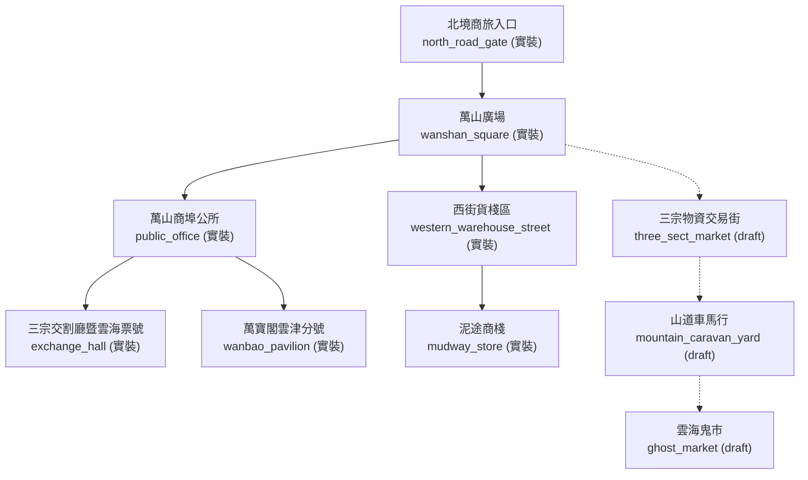

# 雲津仙集地圖

> 狀態：`Act 1 implemented (7 房)` + `Act 2+ draft`。第三卷第一幕（Ch. 84–85、90）對應之 7 個核心節點已於 `/d/yunjin/*.c` 實裝並通過雙向連線與 `quest_audit.py` 驗證；其餘街區仍為 `draft`。
>
> **路徑對齊說明**：原草案 `public_exchange_hall`、`mud_route_inn`、`cloud_exchange_bank` 於實作時依既有任務定義整併定名為 `public_office.c`、`exchange_hall.c`（含交割廳與雲海票號櫃檯）、`wanbao_pavilion.c` 與 `mudway_store.c`。

## 房間與拓撲

| Room ID | 顯示名稱 | Mudlib 路徑 | 雙向出口 | 用途／駐點與狀態 |
|---|---|---|---|---|
| `north_road_gate` | 雲津仙集・北境商旅入口 | `/d/yunjin/north_road_gate.c` | `south`→`/d/wastes/north_road/qing_pass.c`、`north`→`wanshan_square` | 〔實裝〕「萬山交匯」牌樓、入市盤查與路引核對 |
| `wanshan_square` | 雲津仙集・萬山廣場 | `/d/yunjin/wanshan_square.c` | `south`→`north_road_gate`、`southeast`→`public_office`、`west`→`western_warehouse_street`、`north`→`/d/sects/taiqing/gate.c`、`northwest`→`/d/sects/bahuang/gate.c`、`east`→`/d/sects/tiangong/gate.c`、`northeast`→`/d/sects/danding/gate.c` | 〔實裝〕中心樞紐、四脈山門分流起點 |
| `public_office` | 雲津仙集・萬山商埠公所 | `/d/yunjin/public_office.c` | `northwest`→`wanshan_square`、`east`→`exchange_hall`、`south`→`wanbao_pavilion` | 〔實裝〕仲裁、倉契登記；駐點 NPC：`luo_jiucheng`（羅九秤） |
| `exchange_hall` | 雲津仙集・三宗交割廳暨雲海票號 | `/d/yunjin/exchange_hall.c` | `west`→`public_office` | 〔實裝〕歲貢折算、票據清算與保證金核驗；駐點 NPC：`gu_lanzhou`（顧蘭舟） |
| `wanbao_pavilion` | 雲津仙集・萬寶閣雲津分號 | `/d/yunjin/wanbao_pavilion.c` | `north`→`public_office` | 〔實裝〕跨州大商會據點；駐點 NPC：`he_wanjin`（何萬金） |
| `western_warehouse_street` | 雲津仙集・西街貨棧區 | `/d/yunjin/western_warehouse_street.c` | `east`→`wanshan_square`、`west`→`mudway_store` | 〔實裝〕民營貨棧、客棧與車馬落腳地 |
| `mudway_store` | 雲津仙集・泥途商棧 | `/d/yunjin/mudway_store.c` | `east`→`western_warehouse_street` | 〔實裝〕沈泥主場、貨單總帳；駐點 NPC：`qiu_he`（邱禾） |
| `three_sect_market` | 三宗物資交易街 | `/d/yunjin/three_sect_market.c`（建議） | `draft`（待接續） | 〔draft〕符材、藥材、礦料、軍需集中交易 |
| `mountain_caravan_yard` | 山道車馬行 | `/d/yunjin/mountain_caravan_yard.c`（建議） | `draft`（待接續） | 〔draft〕雪橇、馱獸、嚮導與護運 |
| `ghost_market` | 雲海鬼市 | `/d/yunjin/ghost_market.c`（建議） | `draft`（區域出口／劇情門禁） | 〔draft〕非公開交易；入口受暗號與信物限制 |

## 區域連線圖

## 房間設計規則

- 一般房間不得直接跳過中間節點連到禁地。
- 需要宗門令牌、軍令、商埠印信或任務狀態的門禁，必須明確記錄拒絕原因。
- 天候、獸潮、地煞污染可改變房間狀態，但不能無記錄地改變靜態出口。
- NPC 常駐房間以 `tier2_npc_roster.md` 與人物檔為準；出場時間表於第二階段補充。
- 此圖不代表遊戲已實裝。
