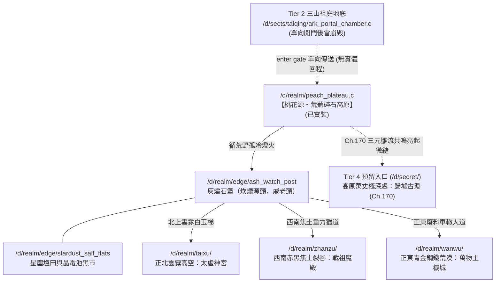

# Tier 3 宏觀世界地圖（桃花源異界洞天）

> 基於 `ch0126.md` 實見地貌（暗鐵青靜止天穹、碎石高原、遠處炊煙與正北／西南／正東三座對峙太古巨構）及 `world_setting.md` §4.1、§5.3 規劃設計。

## 區域關係規劃

| 區域 ID | 名稱 | 與鄰區接續 | 環境特徵與成本（`§3.12`） |
|---|---|---|---|
| `peach_plateau` | 荒蕪碎石高原（已實裝） | 北行入 `edge/ash_watch_post` | 空間幾何張力強，Tier 2 舊功法功耗三倍；遠窺三極輪廓 (`gaze horizon`) |
| `realm/edge` | 灰燼邊緣聚落帶（規劃） | 西南連戰祖邊道、北連太虛白玉梯、東連萬物外環 | 依賴換芯暖爐與報廢塩晶電池維生；塩田作業具微弱晶塵感染風險 |
| `realm/taixu` | 太虛神宮（規劃） | 由高原北緣白玉浮梯登山 | 高維神識威壓極強，擅入須持有《淨鹽運送牌》或《外院觀測雜役符》 |
| `realm/zhanzu` | 戰祖魔殿（規劃） | 經西南赤黑裂谷哨卡進入 | 週期性重力脈衝干擾身法；外圍遊蕩二、三階變異裂谷混沌獸 |
| `realm/wanwu` | 萬物主機城（規劃） | 穿過東側金屬砂礫荒漠至回收環 | 高溫電弧暨自動強徵掃描；外環未持工牌者隨時遭機隼標記拆檢 |
