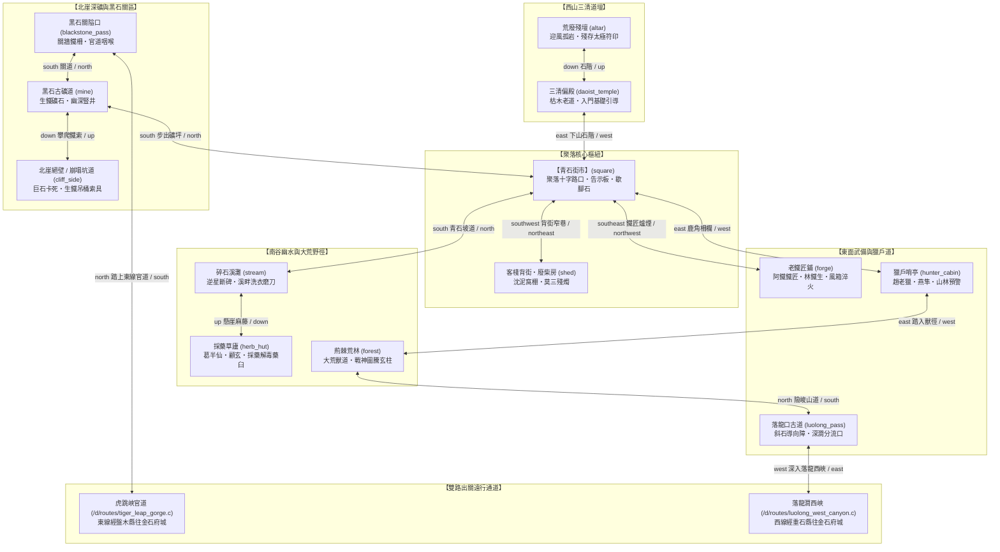

# 黑石鋪聚落五方微生態圖 (Village Map)

黑石鋪為《遺忘的世界》Tier 0 新手發跡之地。坐落於極南莽古山脈深谷，依傍黑石古礦與墜龍寒潭而建，五方分佈著礦道、三清偏殿、鐵匠鋪、荒林與草廬。

---

## 💻 遊戲內指令輸出 (`map village`)

當玩家在黑石鋪聚落輸入 `map` 或執行 `map village` 時，顯示如下 ASCII 微生態地圖：

```text
【黑石鋪・聚落五方微生態地圖 (Tier 0)】
──────────────────────────────────────────────────────────
                             【黑石古礦道】(北崖古礦坑)
                                   │ (up/down)
                             【地下崩塌坑道】(深井生鐵索具)
                                   │
   【荒廢殘壇】                    │                    往 【金石府城】
    (迎風孤岩)                     │                          ▲
        │                         │                          │ (northeast)
   【三清偏殿】 ───────── 【青石街市】 ───────── 【老鐵匠鋪】
    (枯木老道)                 (核心樞紐)                 (阿鐵爐火)
        │                         │                          │
   【客棧後街】 ───────── 【廢柴房】                   【獵戶哨亭】
    (青石暗巷)                 (沈泥窩棚)                 (趙老獵)
                                   │                          │
                             【碎石溪灘】 ───────── 【大荒荒林】
                              (幽霧水谷)                  (東林獸道)
                                   │
                             【墜龍瀑布】
                              (寒潭瀑布淬體)
                                   │
                             【採藥草廬】(葛半仙草堂)
──────────────────────────────────────────────────────────
```

---

## 🗺️ 黑石鋪詳細 Mermaid 拓撲子圖



---

## 🏡 黑石鋪房間與生態功能矩陣 (13 間核心實裝房間)

| 檔案路徑 | 名稱 | 出口方向 | 核心生態功能 / NPC / 遺物 |
| :--- | :--- | :--- | :--- |
| [`square.c`](file:///home/wade/src/github/mudscript/forgotten-space/d/village/square.c) | 青石街市 | `north` $\to$ 黑石古礦道<br>`south` $\to$ 碎石溪灘<br>`west` $\to$ 三清偏殿<br>`east` $\to$ 獵戶哨亭<br>`southeast` $\to$ 老鐵匠鋪<br>`southwest` $\to$ 廢柴房 | 聚落政治與市集樞紐、商隊駐地、張屠戶肉攤、告示板。 |
| [`mine.c`](file:///home/wade/src/github/mudscript/forgotten-space/d/village/mine.c) | 黑石古礦道 | `south` $\to$ 青石街市<br>`north` $\to$ 黑石關隘口<br>`down` $\to$ 北崖崩塌坑道 | 魯大山與老礦工、生鐵礦石採集點、北崖地煞爆發點。 |
| [`cliff_side.c`](file:///home/wade/src/github/mudscript/forgotten-space/d/village/cliff_side.c) | 北崖崩塌坑道 | `up` $\to$ 黑石古礦道 | 地下三百米避風穹頂、受困礦工救援現場、盲眼巨蜥與太古機關城裂隙。 |
| [`blackstone_pass.c`](file:///home/wade/src/github/mudscript/forgotten-space/d/village/blackstone_pass.c) | 黑石關隘口 | `south` $\to$ 黑石古礦道<br>`north` $\to$ 虎跳峽官道 | 鎮武軍扣關與關前會審現場，北接 `/d/routes/tiger_leap_gorge.c` 東線官道。 |
| [`daoist_temple.c`](file:///home/wade/src/github/mudscript/forgotten-space/d/village/daoist_temple.c) | 三清偏殿 | `east` $\to$ 青石街市<br>`up` $\to$ 荒廢殘壇 | 枯木老道與柳清虛居所、《太上引氣殘篇》傳授點。 |
| [`altar.c`](file:///home/wade/src/github/mudscript/forgotten-space/d/village/altar.c) | 迎風孤岩・荒廢殘壇 | `down` $\to$ 三清偏殿 | 孤松玉化道人晶骨、觀星窺破【天羅地網活體牢籠】奇遇點。 |
| [`shed.c`](file:///home/wade/src/github/mudscript/forgotten-space/d/village/shed.c) | 客棧背街・廢柴房 | `northeast` $\to$ 青石街市 | 瘸腿老丐莫三與沈泥居所、五子火塘立約處、【萬物行商・天門引】發掘點。 |
| [`forge.c`](file:///home/wade/src/github/mudscript/forgotten-space/d/village/forge.c) | 老鐵匠鋪・打鐵爐房 | `northwest` $\to$ 青石街市 | 老鐵匠阿鐵與林鐵生居所、風箱地爐、【太古不融黑鐵構件】奇遇點。 |
| [`hunter_cabin.c`](file:///home/wade/src/github/mudscript/forgotten-space/d/village/hunter_cabin.c) | 獵戶哨亭 | `west` $\to$ 青石街市<br>`east` $\to$ 荊棘荒林 | 趙老獵與燕隼居所、鹿角柵欄、弓箭陷阱製作與東林預警哨。 |
| [`stream.c`](file:///home/wade/src/github/mudscript/forgotten-space/d/village/stream.c) | 碎石溪灘 | `north` $\to$ 青石街市<br>`up` $\to$ 採藥草廬 | 村婦捶衣與屠戶磨刀處、水底【史前逆星斷碑】拓印奇遇點。 |
| [`herb_hut.c`](file:///home/wade/src/github/mudscript/forgotten-space/d/village/herb_hut.c) | 採藥草廬 | `down` $\to$ 碎石溪灘 | 瘋郎中葛半仙與顧玄居所、草廬分診與解毒配藥重地。 |
| [`forest.c`](file:///home/wade/src/github/mudscript/forgotten-space/d/village/forest.c) | 荊棘荒林 | `west` $\to$ 獵戶哨亭<br>`north` $\to$ 落龍口古道 | 大荒獸跡勘測點、化骨泥沼巨榕下【太古戰神獵獸圖騰玄柱】奇遇點。 |
| [`luolong_pass.c`](file:///home/wade/src/github/mudscript/forgotten-space/d/village/luolong_pass.c) | 落龍口古道 | `south` $\to$ 荊棘荒林<br>`west` $\to$ 落龍澗西峽 | 大荒獸潮斜石導向障與草煙改道工程現場，西接 `/d/routes/luolong_west_canyon.c` 西線山徑。 |
