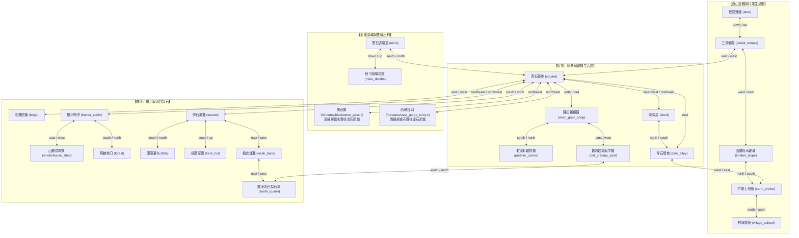

# 黑石鋪聚落五方微生態圖 (Village Map)

黑石鋪為《遺忘的世界》Tier 0 新手發跡之地。坐落於極南莽古山脈深谷，依傍黑石古礦與墜龍寒潭而建。經過 Phase 1–2A 聚落生活圈擴建後，全村共有 **22 間實裝房間**（含五大核心傳承場域與雜糧鋪、貨郎棚、晾穀場、村尾蒙館、土地廟、搗衣淺灘、烘肉寮、採石場、伐木雜坡等庶民生活節點）。

---

## 💻 遊戲內指令輸出 (`map village`)

當玩家在黑石鋪聚落輸入 `map` 或執行 `map village` 時，顯示如下 ASCII 微生態地圖（含外圍出村雙線與聚落生活圈）：

```text
【黑石鋪・聚落空間拓撲總覽 (Tier 0・共 22 房)】
──────────────────────────────────────────────────────────
             往西線官道 (/d/routes/west_gorge_entry)       往東線官道 (/d/routes/blackstone_pass)
                                ▲                                 ▲
                                │ (northwest)        【黑石古礦道】 │ (northeast)
                                │                          │ (down: 地下崩塌坑道)
  【村尾蒙館】                   │                          │
       │ (s)                    │                          │
  【村尾土地廟】 ── (e) ── 【青石暗巷】 ── (e) ── 【青石街市】 ── (e) ── 【老鐵匠鋪】
       │ (s)                 │ (s)             (enter/sw/se/s)
  【西嶺伐木坡】 ── (e) ─▶ 【廢柴房】        ├─▶【陳記雜糧鋪】─(s)─【老貨郎雜貨棚】
                         (兼通三清偏殿)       │        └─(e)─【舊晾穀場】─(s)─【露天青石採石場】
                                             │                                   │ (w)
  【荒廢殘壇】 ◀── (up) ── 【三清偏殿】       ├─▶【獵戶哨亭】─(e)─【山麓烘肉寮】   │
                                             │        └─(s)─【荊棘林口】          │
                                             └─▶【碎石溪灘】 ──── (e) ──── 【搗衣淺灘】
                                                      ├─(s)─【墜龍瀑布】
                                                      └─(down)─【採藥草廬】
──────────────────────────────────────────────────────────
```

---

## 🗺️ 黑石鋪詳細 Mermaid 拓撲子圖



---

## 🏡 黑石鋪房間與生態功能矩陣 (22 間實裝房間)

| 檔案路徑 | 名稱 | 主要出口 | 核心生態功能 / NPC / 遺物 |
| :--- | :--- | :--- | :--- |
| [`square.c`](../../../d/village/square.c) | 青石街市 | `north`→`mine`、`south`→`stream`、`east`→`forge`、`west`→`daoist_temple`、`southeast`→`hunter_cabin`、`southwest`→`shed`、`enter`→`chen_grain_shop`、`northeast`→`/d/routes/blackstone_pass`、`northwest`→`/d/routes/west_gorge_entry` | 聚落核心樞紐、`PHASE_D` 街市多節拍互動點；常駐 `caravan_merchant`。 |
| [`mine.c`](../../../d/village/mine.c) | 黑石古礦道 | `south`→`square`、`down`→`mine_depths` | 魯大山 (`lao_miner`) 與礦鼠、採礦循環任務。 |
| [`mine_depths.c`](../../../d/village/mine_depths.c) | 地下崩塌坑道 | `up`→`mine` | 礦難救援現場與地下深層礦脈。 |
| [`daoist_temple.c`](../../../d/village/daoist_temple.c) | 三清偏殿 | `east`→`square`、`up`→`altar`、`west`→`lumber_slope` | 枯木老道 (`kumu_daoist`) 與拓印道具點。 |
| [`altar.c`](../../../d/village/altar.c) | 迎風孤岩・荒廢道壇 | `down`→`daoist_temple`、`east`→`daoist_temple` | 柳清虛觀星窺破【天羅活體牢籠】與道化晶石奇遇點。 |
| [`forge.c`](../../../d/village/forge.c) | 老鐵匠鋪・打鐵爐房 | `west`→`square` | 老鐵匠阿鐵 (`tie_smith`)、林鐵生【太古不融黑鐵】奇遇點。 |
| [`hunter_cabin.c`](../../../d/village/hunter_cabin.c) | 獵戶哨亭 | `west`→`square`、`northwest`→`square`、`south`→`forest`、`east`→`smokehouse_shed` | 趙老獵 (`zhao_hunter`)、弓箭與東林預警。 |
| [`forest.c`](../../../d/village/forest.c) | 荊棘林口 | `north`→`hunter_cabin`、`west`→`hunter_cabin`、`northwest`→`square` | 荒原野熊 (`wild_bear`)、濁血皮毛與【太古戰神圖騰玄柱】奇遇點。 |
| [`stream.c`](../../../d/village/stream.c) | 碎石溪灘 | `north`→`square`、`south`→`falls`、`down`→`herb_hut`、`east`→`wash_bank` | 張屠戶 (`zhang_butcher`)、水底【史前逆星斷碑】拓印奇遇點。 |
| [`falls.c`](../../../d/village/falls.c) | 南谷寒澗・墜龍瀑布 | `north`→`stream` | 趙四 (`zhao_si`)、石苔與寒潭淬體點。 |
| [`herb_hut.c`](../../../d/village/herb_hut.c) | 懸崖峭壁・採藥草廬 | `up`→`stream` | 葛半仙 (`ge_doctor`) 與顧玄草藥配劑重地。 |
| [`shed.c`](../../../d/village/shed.c) | 客棧背街・廢柴房 | `northeast`→`square`、`north`→`dark_alley` | 莫三 (`mo_beggar`)、蘇凝霜 (`su_ningshuang`)、【天門引】發掘點。 |
| [`dark_alley.c`](../../../d/village/dark_alley.c) | 客棧後街・青石暗巷 | `south`→`shed`、`east`→`square`、`west`→`earth_shrine` | 黑衣暗哨 (`black_guard`)、後巷接頭與西村通道。 |
| [`chen_grain_shop.c`](../../../d/village/chen_grain_shop.c) | 黑石鋪・陳記雜糧鋪 | `out`→`square`、`east`→`old_granary_yard`、`south`→`peddler_corner` | 陳老漢 (`chen_grain_owner`)、《鄰里勻米》支線。 |
| [`peddler_corner.c`](../../../d/village/peddler_corner.c) | 黑石鋪・老貨郎雜貨棚 | `north`→`chen_grain_shop` | 貨郎胡二 (`peddler_hu`)、黑石木炭貨盤交易口。 |
| [`old_granary_yard.c`](../../../d/village/old_granary_yard.c) | 黑石鋪・舊晾穀場與牛棚 | `west`→`chen_grain_shop`、`south`→`south_quarry` | 晾穀牛棚與通往南山石場農徑。 |
| [`south_quarry.c`](../../../d/village/south_quarry.c) | 南山坡腳・露天青石採石場 | `north`→`old_granary_yard`、`west`→`wash_bank` | 石匠老周 (`zhou_quarryman`)、《冬日備炭》支線。 |
| [`wash_bank.c`](../../../d/village/wash_bank.c) | 碎石溪下游・搗衣淺灘 | `west`→`stream`、`east`→`south_quarry` | 王大嬸 (`wang_washerwoman`)、洗衣生計與村婦流言。 |
| [`smokehouse_shed.c`](../../../d/village/smokehouse_shed.c) | 黑石鋪・山麓烘肉寮 | `west`→`hunter_cabin` | 老套手錢七 (`qian_trapper`)、臘肉燻製與山套保養。 |
| [`earth_shrine.c`](../../../d/village/earth_shrine.c) | 黑石鋪・村尾土地廟 | `north`→`village_school`、`east`→`dark_alley`、`south`→`lumber_slope` | 民俗社祭與敲社鼓 (`Phase 3D` 地方文化選擇)。 |
| [`village_school.c`](../../../d/village/village_school.c) | 黑石鋪・村尾蒙館 | `south`→`earth_shrine` | 宋秀才 (`song_xiucai`)、《一錠松煙墨》支線。 |
| [`lumber_slope.c`](../../../d/village/lumber_slope.c) | 黑石鋪・西嶺伐木雜坡 | `north`→`earth_shrine`、`east`→`daoist_temple` | 西嶺砍柴雜坡與連接後山環道。 |
